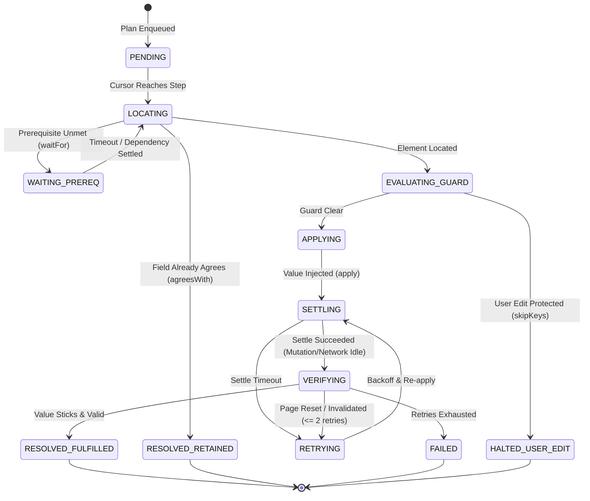
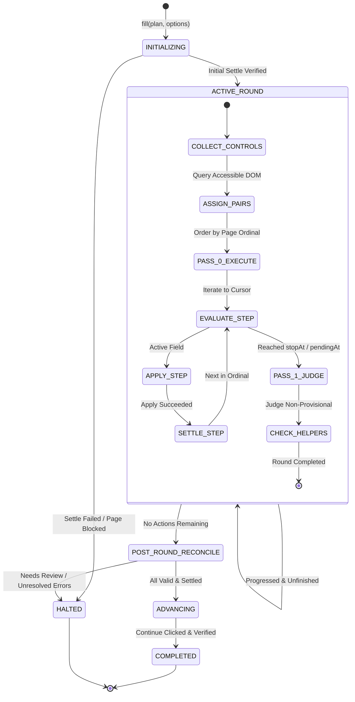
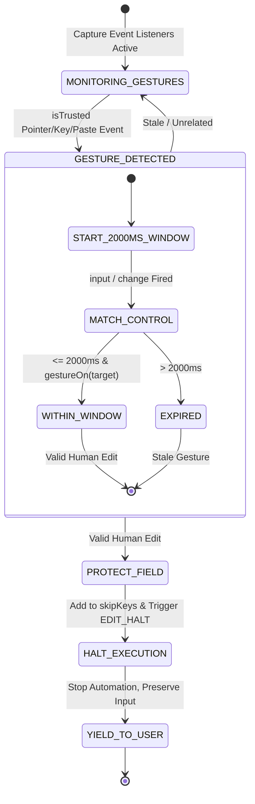

# Architectural Survey & Foundation Engine Specification (Requirement R1)

**Target Artifact**: Comprehensive Architectural Blueprint & Technical Specification for General-Purpose Browser Automation  
**Author**: `explorer_survey_1` (Teamwork Explorer Agent)  
**Investigation Scope**: Core deterministic execution engine, multi-target execution architecture, resilient semantic element location, a11y tree navigation, Shadow DOM penetration, human-like interaction models, and co-pilot protections.  
**Repository References**: `src/kit/`, `scripts/lib/kit.mjs`, `docs/browser-filling.md`, `docs/architecture.md`, `types.js`, `src/content/`.

---

## 1. Executive Summary & Problem Boundary

TNI Autofill contains an exceptionally sophisticated, battle-tested deterministic browser execution engine (`src/kit/`) designed to solve complex real-world web form automation challenges on unpredictable, server-backed, asynchronous single-page applications (Duck Creek / ExtJS, React 18, Angular, Salesforce-like enterprise portals). 

While the existing implementation is embedded within a Chrome MV3 Extension targeting commercial auto insurance raters (Progressive, GEICO, AmWINS), its internal mechanics embody general-purpose browser automation breakthroughs:
1. **Top-to-Bottom Cursor Engine**: Deterministic downward order processing preventing asynchronous redraw cascades from corrupting dependent questions.
2. **Multi-Signal Settling Engine (`settle()`)**: Dynamic quiet-period detection combining DOM mutation batches, component definition (`:not(:defined)`), network in-flight request tracking via `PerformanceObserver`, and algorithmic heartbeat subtraction (`isBeat`).
3. **Real-Time Co-Pilot Protections (`guardEdits`, `answerEdits`)**: Zero-latency interruption of automated filling upon trusted human user interaction (within a 2000ms window from pointer, key, paste, or drop gestures).
4. **Resilient Multi-Layer Locators & Disambiguation**: Multi-tiered element resolution utilizing data-model names, exact labels, anchor proximity, witness row values, vehicle/entity hints, and versioned structural paths across open shadow roots.
5. **Synthetic Event Dispatch Hacks (`page-press.js`)**: Synthetic event bridging across JavaScript execution worlds (MAIN vs. ISOLATED) to satisfy React 18 event queue constraints.

### The General-Purpose Enterprise Mission
To transform this specialized insurance tool into an **enterprise-grade, web-agnostic automation platform**, we must decouple the core execution engine from:
- Insurance domain schemas (vehicles, drivers, trailers, USDOT, coverage limits).
- Chrome MV3-specific APIs (`chrome.scripting`, `chrome.runtime`, extension storage).
- Monolithic classic script bundling (`scripts/lib/kit.mjs` Rolldown IIFE injection).
- Browser DOM-only execution constraints (enabling CDP, Playwright, Puppeteer, Node.js, Python, and cloud containerized headless workers).

This document provides the definitive architectural blueprint, concrete data structures, interface specifications, state machines, and protocols required to build the foundation engine.

---

## 2. Deep Dive: Existing TNI Autofill Execution Engine Analysis

### 2.1 Multi-Round Cursor Engine (`src/kit/cursor.js`)
The core execution engine is governed by a multi-round, cursor-driven loop (`fill()` in `src/kit/cursor.js`):

```
       ┌────────────────────────────────────────────────────────┐
       │                  Start Fill Run                        │
       └──────────────────────────┬─────────────────────────────┘
                                  │
                                  ▼
                    ┌───────────────────────────┐
                    │  Initial Settle (400ms)   │
                    └─────────────┬─────────────┘
                                  │
                                  ▼
                     ┌─────────────────────────┐
       ┌────────────►│   Begin Round (0..60)   │
       │             └────────────┬─────────────┘
       │                          │
       │                          ▼
       │             ┌─────────────────────────┐
       │             │ Collect & Pair Controls │
       │             │    (assign() locator)   │
       │             └────────────┬─────────────┘
       │                          │
       │                          ▼
       │             ┌─────────────────────────┐
       │             │  Check Stop Conditions  │◄──── Stop step, navigatedTo, agentPressed
       │             └────────────┬─────────────┘
       │                          │
       │                          ▼
       │             ┌─────────────────────────┐
       │             │  Pass 0: Answer to      │
       │             │  Cursor (stopAt/pending)│
       │             └────────────┬─────────────┘
       │                          │
       │                          ▼
       │             ┌─────────────────────────┐
       │             │ Settle & Verify Answer  │
       │             └────────────┬─────────────┘
       │                          │
       │                          ▼
       │             ┌─────────────────────────┐
       │             │ Pass 1: Judge Remaining │
       │             │ Provisional Elements    │
       │             └────────────┬─────────────┘
       │                          │
       │                          ▼
       │             ┌─────────────────────────┐
       │             │ Evaluate Next Helper    │
       │             │ Button or Pager Action  │
       │             └────────────┬─────────────┘
       │                          │
       │  Round Progressed?       ▼
       └─────── Yes ───────[More to do?]
                                  │ No
                                  ▼
                     ┌─────────────────────────┐
                     │ Final Reconcile & Verify│
                     └────────────┬─────────────┘
                                  │
                                  ▼
                     ┌─────────────────────────┐
                     │ Advance (Continue Click)│
                     └────────────┬─────────────┘
                                  │
                                  ▼
                     ┌─────────────────────────┐
                     │   Return FillReport     │
                     └─────────────────────────┘
```

#### Key Mechanics Observed in `src/kit/cursor.js`:
1. **Top-to-Bottom Cursor Judgement ("Judged at the Cursor")**:
   - Web pages dynamically redraw following parent selections (e.g., selecting "Combined Single Limit" removes "Property Damage" and "Uninsured Motorist Property Damage" split rows).
   - In `cursor.js:757-775`, `stopAt` and `pendingAt` establish a moving horizon. Elements located *below* the current cursor position are treated as **provisional**.
   - No error, warning, or needs-you blocker is reported to the user for provisional elements until the cursor actually reaches their position.
2. **Lag-Bound Protection (`lagBound`)**:
   - On asynchronous SPAs, field redraws frequently occur *after* the initial network request or DOM mutation settles (e.g. `cursor.js:591-602`).
   - The engine defines `lagBound` as the DOM ordinal position immediately following the last answered field. The subsequent round refuses to judge any element below `lagBound` until a new action occurs further down the page and the page re-settles.
3. **Bounded Retries & Flap Prevention**:
   - `retryOnce(stepId)` (`cursor.js:296`): Restricts retries to at most 2 per field (3 attempts total).
   - `state.refill` tracks invalidated fields. If a later field resets an earlier field, it is re-queued with `RESET_QUIET_MS` (1000ms) delay to prevent rapid cyclical fighting between client scripts and automation.
4. **`waitFor` Dynamic Dependency Resolution**:
   - Handles async server decodes (e.g. VIN decoding in `cursor.js:862-880`). Holds the cursor for up to 8000ms (`WAIT_MS`), checking every 400ms (`WAIT_ROUND_MS`). When the decoded value renders, it enforces an 800ms quiet window (`AFTER_WAIT_QUIET_MS`) before resuming.

---

### 2.2 Quiet-Period Settling & Request Frequency Analysis (`src/kit/adapter.js`)
The settling engine in `src/kit/adapter.js:223-245` (`settle()`) guarantees that automation actions are only executed when the DOM and network are stable.

#### Settling Equation:
A page is considered settled if and only if:
$$\text{Settled} \iff (\Delta t_{\text{DOM}} \ge \text{quietMs}) \land \neg \text{pageBusy}() \land \neg \text{partsUndefined}() \land \neg \text{requestsActive}()$$

Where:
- **$\Delta t_{\text{DOM}}$**: Elapsed time since the last `MutationObserver` notification on `document.body` (monitoring `childList`, `subtree`, and attributes like `checked`, `active-index`).
- **`pageBusy()`**: Checks adapter custom busy states, plus DOM loading masks (`.loading-mask`, `.LoadingMessage`, spinner elements).
- **`partsUndefined()`**: Queries custom elements matching defined prefixes (`document.querySelectorAll(':not(:defined)')`). If an element like `<gds-radio-button>` is not yet upgraded by `customElements.define()`, settling waits up to 3000ms (`UNDEFINED_MS`).
- **`requestsActive()`**: Analyzes in-flight network requests using `PerformanceObserver` with `initiatorType: ['fetch', 'xmlhttprequest']`.

#### Heartbeat Subtraction (`isBeat` Algorithm):
Standard network monitoring fails on SPAs that maintain background telemetry or polling heartbeats (e.g. GEICO polling `/keepAlive` or `/session` every 2000ms).
In `src/kit/adapter.js:179-189`, the `isBeat` function evaluates request start intervals:
- Tracks historical start timestamps per URL endpoint (`b.starts`).
- Computes interval delta: if 3 consecutive requests share an interval $\ge 1500\text{ms}$ within a 40ms tolerance window (`POLL_SLACK_MS = 40`), the request is tagged as a periodic heartbeat (`poll: true`).
- Heartbeat requests are excluded from `lastRequestEnd()`, preventing infinite settling deadlocks!

---

### 2.3 Real-Time User Co-Pilot Protections & React 18 Event Dispatch

#### User Gesture Interception (`src/kit/guard.js`)
To maintain safe collaboration between human users and background autofill, `src/kit/guard.js` implements a real-time edit protection system:
1. **Trusted Gesture Capture**: Attaches capture-phase event listeners for `pointerdown`, `keydown`, `paste`, and `drop`.
2. **Gesture Window Correlation**: When an `input` or `change` event fires, it evaluates:
   - Is `event.isTrusted === true`?
   - Did a trusted gesture occur within the preceding 2000ms on this control or its associated label/popup?
   - Detached Popups: Resolves popup options back to the owning combobox via `aria-owns`, `aria-controls`, or `document.activeElement` (`popupControl` in `guard.js:25-39`).
3. **Execution Interruption**:
   - If an agent edit is detected, `state.skipKeys.add(key)` permanently locks the field key for the current session.
   - The fill engine immediately halts with `EDIT_HALT`, leaving the human user's input intact and untouched.
4. **Multi-Frame Session Protection (`answerEdits`)**:
   - When applying batch AI suggestions across multiple frames, `answerEdits` initializes a unified token-authenticated session.
   - If an edit occurs in Frame 1 while Frame 2 is processing, the guard immediately invalidates all remaining dispatches across all frames, tagging unapplied items as `protected: true`.

#### React 18 Synthetic Event Dispatch (`src/content/page-press.js`)
Modern front-end frameworks (particularly React 18 concurrent mode) intercept user interactions. In GEICO's quoting application, button submit processors rely on React's event dispatcher. If a standard JavaScript `element.click()` is executed:
- The script click completes synchronously.
- When an internal `await` inside the click handler resumes, React checks whether a native browser event is actively being dispatched.
- Under synthetic script execution, no event is active; React discards the button payload, leading to corrupted form submissions!

**The TNI Engine Solution (`page-press.js:16-41`)**:
```javascript
// Dispatched from kit: element.dispatchEvent(new CustomEvent('rater-press'))
const media = document.createElement('audio');
media.addEventListener('volumechange', () => press(false), { once: true });
media.volume = 0; // Triggers synchronous browser-level event dispatch
// Inside volumechange callback:
el.click(); // Now executed while a trusted browser event is active!
```

---

### 2.4 Resilient Element Locators & Disambiguation (`src/kit/locator.js`, `dom.js`, `field-key.js`)

#### Locator Resolution Hierarchy (`assign()` in `src/kit/locator.js:40-229`):
1. **Data-Model Reference (`field`)**: Matches Duck Creek `fieldref` or GEICO `Id_<Name>_<n>` stripped stem (`GiveYear`).
2. **Exact Label / Pattern (`ask` / `re`)**: Matches exact text content or page-scoped regular expressions.
3. **Anchor Disambiguation (`askAfter`)**: Disambiguates duplicate labels (e.g., "City" under Business Address vs. "City" under Garaging Address).
4. **Option Introspection (`withOption`)**: Identifies dropdowns with no visual label by identifying unique internal option values (e.g. "NO PRIOR").
5. **Witness Row Disambiguation (`witness`)**: Resolves entity rows in dynamic tables (e.g., locating Vehicle 2 by matching its VIN within an ancestor row container, `witnessRow` in `locator.js:260-265`).
6. **Vehicle / Entity Hints (`vehicleHint` / `namedRow`)**: Disambiguates repeated multi-unit columns by scoring token overlap against entity descriptors (`vehicleRow` in `locator.js:282-287`).
7. **Versioned Structural Keys (`field-key.js:40-61`)**: For anonymous controls lacking IDs or names, constructs a deterministic XPath/CSS-like hierarchical key traversing upwards through parent containers and shadow boundaries:
   $$\text{Key} = \text{"dom-v1:"} + \text{Tag} + \text{":"} + \text{DataID} + \text{":"} + \text{Ordinal} + \dots$$

#### Accessible Label Harvesting (`labelFor` in `src/kit/dom.js:166-191`):
1. Resolves `aria-labelledby` ID references via `document.getElementById` or shadow root `root.getElementById`.
2. Inspects associated native `<label>` elements via `input.labels`.
3. Sanitizes `aria-label` (stripping HTML tags and markdown formatting).
4. Ascends up to 5 parent levels, seeking `.control-label`, `.form-label`, or text nodes outside controls (`textOutsideControls`).
5. Strips calendar clutter (`withoutCalendar` removes `su mo tu we th fr sa`).
6. Falls back to `placeholder`, `title`, and humanized data names.

---

### 2.5 Widget Drivers & Value Application Mechanics (`src/kit/apply.js`)

The engine separates low-level DOM writing into extensible widget drivers:
- **Native Input Driver**: Uses `Object.getOwnPropertyDescriptor(proto, 'value').set.call(el, value)` (`setNativeValue` in `dom.js:440-449`), followed by synthetic `input` and `change` events, plus Tab keystrokes for date pickers.
- **Select2 Driver (`src/kit/drivers/select2.js`)**: Simulates user interaction: clicks the Select2 container, types search query into `.select2-search__field`, waits for dropdown items, clicks the matching `.select2-results__option`, and cleans up orphaned tags in multi-selects.
- **Google Address Suggestion Driver (`src/kit/drivers/address.js`)**: Types complete address into `input[aria-autocomplete=list]`, listens for `.pac-item` dropdown render, verifies leading street number and ZIP matches the target intake before clicking.
- **ExtJS / Page Adapter Driver**: Custom hooks provided by carrier page adapters (`src/content/carriers/progressive.js`) interacting directly with ExtJS component stores (`Ext.ComponentQuery`).

---

## 3. Architectural Decoupling & Multi-Target Execution Framework

To transform this foundation into a general-purpose, enterprise-grade engine, the execution runtime must be decoupled into three distinct architectural tiers:

```
┌─────────────────────────────────────────────────────────────────────────────┐
│                       Tier 1: Specification & Plan IR                       │
│     (Domain-Agnostic Execution Plans, Semantic Locators, Steps, Actions)     │
└──────────────────────────────────────┬──────────────────────────────────────┘
                                       │
                                       ▼
┌─────────────────────────────────────────────────────────────────────────────┐
│                     Tier 2: Unified Core Execution Engine                    │
│      (Cursor State Machine, Settle Coordination, Co-Pilot Interception,     │
│             Retry & Lag Policies, Reconcile & Telemetry Pipeline)           │
└──────────────────────────────────────┬──────────────────────────────────────┘
                                       │  Abstract Driver Interface
                                       ▼  (ExecutionTarget / IDriverPort)
┌─────────────────────────────────────────────────────────────────────────────┐
│                       Tier 3: Multi-Target Runtime Drivers                   │
├──────────────────────────┬───────────────────────────┬──────────────────────┤
│    Target A: Chrome MV3  │  Target B: Programmatic   │ Target C: Headless   │
│         Extension        │       Node/Python SDK     │   Cloud Runners      │
│  - Content Script (DOM)  │  - Playwright / Puppeteer │  - Docker Chromium   │
│  - Isolated/MAIN World   │  - Direct CDP Session     │  - Ephemeral Pods    │
│  - Side Panel Controller │  - Full AXTree Inspection │  - Serverless Pools  │
│  - Window Message Bus    │  - Closed Shadow DOM Pierc│  - gRPC / WebSocket  │
└──────────────────────────┴───────────────────────────┴──────────────────────┘
```

### 3.1 Target Runtimes Analysis

#### 1. Chrome Extension MV3 Target (`TargetMV3`)
- **Execution Environment**: Chrome MV3 Extension content script injected into target tabs.
- **Architecture**:
  - `Content Script (Isolated World)`: Intercepts DOM, listens to user gestures (`guardEdits`), gathers controls.
  - `Content Script (MAIN World)`: Injected when the page uses framework internals (ExtJS, React 18, Salesforce Lightning).
  - `Side Panel / Background Service Worker`: Coordinates plans, manages persistence (`chrome.storage.local`), handles AI calls, displays real-time execution overlays.
- **Strengths**: True human co-pilot mode; executes directly inside the end-user's live authenticated browser session; zero infrastructure footprint.
- **Limitations**: Restricted to browser DOM APIs; cannot access closed Shadow DOM; limited to Chrome extension permissions; cannot run headlessly in CI/CD without full browser GUI.

#### 2. Programmatic Node.js / Python SDK Target (`TargetPlaywright` / `TargetCDP`)
- **Execution Environment**: Standalone CLI, SDK, or developer automation script running on Node.js or Python.
- **Architecture**:
  - Connects to browser via Playwright `Page`, Puppeteer, or direct Chrome DevTools Protocol (CDP) WebSocket connection.
  - Core engine runs either:
    1. *In-Page Mode*: Engine bundle injected via `Page.evaluate()` / `Runtime.evaluate`.
    2. *Out-of-Process Mode*: Engine runs in Node.js runtime, executing atomic driver commands via CDP (`Input.dispatchMouseEvent`, `DOM.querySelector`, `Accessibility.getFullAXTree`).
- **Strengths**: Full access to CDP; penetrates **both open and closed Shadow DOM** using `DOM.getDocument({ pierce: true })`; leverages native computed accessibility trees; dispatches trusted OS-level hardware input events (`isTrusted: true`).
- **Limitations**: Requires local Node.js/Python runtime and browser process management.

#### 3. Cloud / Headless Containerized Runner Target (`TargetCloudRunner`)
- **Execution Environment**: Distributed worker cluster (Kubernetes pods, AWS ECS, Google Cloud Run) running headless Chromium.
- **Architecture**:
  - Ingestion via Job Queue (Redis BullMQ, NATS, Kafka).
  - Worker pulls execution plan, provisions ephemeral browser context, executes run, and streams structured telemetry events over WebSocket/gRPC.
  - Automated failure recovery: worker snapshots DOM state, network HAR, and full CDP traces on failure.
- **Strengths**: Massive horizontal scalability (thousands of concurrent form fills); isolated execution sandbox; ideal for batch processing, CI/CD regression, and backend enterprise automation.

---

### 3.2 Abstract Driver Architecture (`ExecutionTarget`)

To ensure 100% code reuse across MV3, Playwright, Puppeteer, and CDP, the engine must interact with the browser exclusively through an abstract port: `ExecutionTarget`.

```typescript
/**
 * Driver abstraction port separating engine business logic from browser execution substrate.
 */
export interface ExecutionTarget {
  readonly runtimeType: 'mv3' | 'playwright' | 'puppeteer' | 'cdp';
  readonly capabilities: TargetCapabilities;

  // Lifecycle & Navigation
  getCurrentUrl(): Promise<string>;
  getTitle(): Promise<string>;
  waitForNavigation(options?: NavigationOptions): Promise<void>;

  // Element Querying & Resolution
  collectElements(selector: string, root?: ElementHandle): Promise<ElementHandle[]>;
  getAccessibilityTree(root?: ElementHandle): Promise<A11ySnapshotNode>;
  evaluateScript<T>(script: string | ((...args: any[]) => T), ...args: any[]): Promise<T>;

  // Human-Like Interaction Port
  click(handle: ElementHandle, options?: ClickOptions): Promise<void>;
  type(handle: ElementHandle, text: string, options?: TypeOptions): Promise<void>;
  selectOption(handle: ElementHandle, values: string[]): Promise<SelectionResult>;
  hover(handle: ElementHandle): Promise<void>;
  scrollIntoView(handle: ElementHandle): Promise<void>;

  // Stability & Network Port
  waitForQuiet(options: SettleOptions): Promise<SettleResult>;
  getInFlightRequests(): Promise<InFlightRequestSummary>;
  
  // Co-Pilot & Security Port
  installUserGestureGuard(onEdit: (key: string) => void): Promise<() => void>;
}
```

---

### 3.3 Shadow DOM Penetration (Open and Closed Modes)

| Dimension | Content Script DOM Traversal | CDP / Native Driver Traversal |
|---|---|---|
| **Open Shadow Roots** | Penetrated via `el.shadowRoot` recursion (`deepQueryAll`). | Penetrated via `DOM.getDocument({ pierce: true })`. |
| **Closed Shadow Roots** | ❌ **BLOCKED** by browser sandbox (`el.shadowRoot === null`). | ✅ **PENETRATED** via `Runtime.evaluate` / CDP internal node trees. |
| **Nested Frames / Iframes** | Requires manual multi-frame injection (`allFrames: true`). | Unified cross-frame tree via CDP `Page.getFrameTree`. |
| **Slot Resolution** | Calculated via `assignedNodes({ flatten: true })`. | Native computed layout trees. |

#### Architectural Resolution for Enterprise Engine:
- For **TargetMV3**: The engine overrides `Element.prototype.attachShadow` in `MAIN` world at `document_start` to record references to all closed shadow roots:
  ```javascript
  const realAttach = Element.prototype.attachShadow;
  Element.prototype.attachShadow = function(init) {
    const root = realAttach.call(this, init);
    if (init.mode === 'closed') {
      __closedShadowRegistry.set(this, root);
    }
    return root;
  };
  ```
- For **TargetPlaywright / TargetCDP**: The engine utilizes native CDP piercing (`pierce: true` selector engines) which bypasses JavaScript object visibility restrictions entirely.

---

### 3.4 Accessibility (a11y) Tree Navigation & Resilient Semantic Locators

Rather than relying purely on brittle CSS selectors or heuristic DOM label crawling, the general-purpose engine incorporates a **4-Layer Resilient Locator Strategy**:

```
Layer 1: Semantic Attributes (data-testid, name, id, fieldref, ref)
   │ (Fastest, deterministic when developer-provided)
   ▼ (Fallback if missing or dynamic)
Layer 2: Computed Accessibility Tree (Role + Accessible Name + State)
   │ (A11y role e.g. "combobox", name e.g. "Primary Garaging State")
   ▼ (Fallback if ambiguous or unlabeled)
Layer 3: Visual Proximity & Relative Anchors (askAfter, nearest label, bounding box)
   │ (Disambiguates duplicate labels by relative vertical/horizontal offset)
   ▼ (Fallback if DOM reshuffles)
Layer 4: Structural Relative Fingerprint (Container ID + Tag Ordinal Hierarchy)
   (Deterministic fallback surviving style & class mutations)
```

#### Native A11y Tree Evaluation Schema:
```typescript
export interface A11yLocator {
  role: 'button' | 'combobox' | 'textbox' | 'checkbox' | 'radio' | 'tab' | 'dialog';
  name?: string | RegExp;
  description?: string | RegExp;
  checked?: boolean;
  disabled?: boolean;
  expanded?: boolean;
  level?: number;
}
```

---

### 3.5 Human-Like Browser Interaction Engine

Automating enterprise applications requires simulating genuine human interaction to:
1. Prevent tripping bot-detection platforms (Cloudflare Turnstile, Akamai, DataDome).
2. Avoid missing framework event triggers (hover states, focus rings, synthetic micro-tasks).

#### Humanization Mechanics:
1. **Curved Bezier Mouse Trajectories**:
   - Instead of instantaneous teleportation to $(x, y)$, calculate a cubic Bézier curve between current cursor $(x_0, y_0)$ and target element center $(x_1, y_1)$ with random control points, slight overshoot, and velocity deceleration (Fitts's Law).
2. **Dynamic Typing Cadence with Jitter & Typos**:
   - Inter-keystroke intervals sampled from a log-normal distribution ($\mu = 85\text{ms}, \sigma = 25\text{ms}$).
   - Optional configurable micro-delays on complex key combinations (Shift, CapsLock).
3. **Element Center Visibility & Scrolled Viewport Verification**:
   - Incorporating `cursor.js:coveredBy`: Verify `elementFromPoint(x, y)` matches the target element or its shadow descendant before dispatching clicks.
   - If obscured by sticky headers or modals, execute instant zero-momentum scroll (`element.scrollIntoView({ block: 'center' })`), re-verifying occlusion prior to click.

---

## 4. Concrete Technical Gaps: TNI Autofill vs. Enterprise Engine

| Dimension | Current TNI Autofill Implementation | Enterprise General-Purpose Engine |
|---|---|---|
| **Domain Model** | Hardcoded commercial auto concepts (`vehicles`, `drivers`, `trailers`, `businessClass`). | Fully generic schema-driven Intermediate Representation (IR) supporting any domain. |
| **Execution Host** | Chrome Extension MV3 only (via `chrome.scripting`). | Multi-target: MV3 Extension, Node.js CLI, Playwright SDK, Python SDK, Cloud Workers. |
| **Script Delivery** | Single monolithic IIFE bundle (`pagekit.js`) compiled via Rolldown. | Modular NPM packages (`@autofill/core`, `@autofill/locators`, `@autofill/driver-playwright`). |
| **Shadow DOM** | Open shadow roots only (`deepQueryAll`). Closed roots unreached. | Open and Closed Shadow roots penetrated via CDP session / proxy interceptors. |
| **Accessibility** | Simulated via manual DOM attribute parsing (`aria-label`, `labelFor`). | Deep integration with native browser Computed Accessibility Tree (`AXTree`). |
| **Input Simulation** | DOM synthetic events (`dispatchEvent`) + audio volumehack for React 18. | Multi-tier input: DOM events, CDP hardware-level input, Bezier cursor trajectories. |
| **Plan Authoring** | Static JavaScript carrier configuration files (`src/carriers/`). | Dual authoring: Programmatic TypeScript SDK + Low-Code Visual Recording Studio. |
| **Observability** | In-memory `recalcTrace` & local usage log queue. | OpenTelemetry-compliant structured traces, CDP timeline recordings, visual time-travel replay. |

---

## 5. Concrete TypeScript / JSDoc Interface Definitions

The following concrete data structures and interface definitions establish the contract for the decoupled engine.

### 5.1 Plan & Step Intermediate Representation (IR)

```typescript
/**
 * Unified execution plan definition.
 */
export interface ExecutionPlan {
  readonly id: string;
  readonly version: string;
  readonly name: string;
  readonly domain?: string;
  readonly steps: PlanStep[];
  readonly actions: ActionStep[];
  readonly settings: PlanExecutionSettings;
}

export interface PlanExecutionSettings {
  readonly maxRounds: number;
  readonly settleTimeoutMs: number;
  readonly quietPeriodMs: number;
  readonly batchMode: boolean;
  readonly overwritePrefilled: boolean;
  readonly humanizeInteractions: boolean;
}

export type PlanStep = FieldStep | ActionStep;

export interface FieldStep {
  readonly id: string;
  readonly kind: 'field';
  readonly name: string;
  readonly valueType: 'string' | 'number' | 'boolean' | 'date' | 'select' | 'multi-select';
  readonly value: any;
  
  // Multi-tier locator definitions
  readonly locators: SemanticLocator[];
  
  // Execution constraints
  readonly required?: boolean;
  readonly overwrite?: boolean;
  readonly waitFor?: string; // Dependency step id
  readonly onlyIf?: StepCondition[];
  readonly transform?: ValueTransform;
  
  // Review & governance
  readonly source: 'user_input' | 'system_derived' | 'standard_default' | 'ai_suggested';
  readonly governanceLevel: 'auto_apply' | 'confirm_required' | 'manual_only';
  readonly metadata?: Record<string, unknown>;
}

export interface ActionStep {
  readonly id: string;
  readonly kind: 'action';
  readonly name: string;
  readonly actionType: 'click' | 'hover' | 'scroll' | 'submit' | 'navigate';
  readonly locators: SemanticLocator[];
  
  // Prerequisites & verification
  readonly afterSteps?: string[];
  readonly unlessPresent?: SemanticLocator;
  readonly verification: ActionVerification;
  readonly quietPeriodMs?: number;
  readonly maxTries?: number;
}

export type ActionVerification = 
  | { type: 'element_appears'; locator: SemanticLocator }
  | { type: 'element_disappears'; locator: SemanticLocator }
  | { type: 'value_changes'; locator: SemanticLocator; expectedValue?: string }
  | { type: 'url_matches'; pattern: string | RegExp }
  | { type: 'network_idle'; timeoutMs: number };
```

---

### 5.2 Resilient Semantic Locator Interfaces

```typescript
export interface SemanticLocator {
  readonly strategy: LocatorStrategy;
  readonly primarySelector: string;
  readonly fallbacks?: FallbackLocator[];
  readonly relativeAnchor?: RelativeAnchor;
  readonly confidenceThreshold?: number;
}

export type LocatorStrategy = 
  | 'semantic_attribute'   // data-testid, name, id, fieldref
  | 'accessibility_tree'   // role, accessible name, description
  | 'text_label'           // exact or regex match on associated visual label
  | 'witness_relation'     // row containing specific identifier (e.g. VIN)
  | 'structural_path';     // versioned DOM hierarchy with shadow penetration

export interface FallbackLocator {
  readonly strategy: LocatorStrategy;
  readonly selector: string;
  readonly priority: number;
}

export interface RelativeAnchor {
  readonly position: 'after' | 'before' | 'inside' | 'near';
  readonly referenceLocator: SemanticLocator;
  readonly maxDistancePx?: number;
}

export interface ElementDescriptor {
  readonly handle: unknown; // Opaque element reference across runtimes
  readonly tagName: string;
  readonly inputType?: string;
  readonly role?: string;
  readonly accessibleName?: string;
  readonly value?: string;
  readonly isVisible: boolean;
  readonly isEnabled: boolean;
  readonly boundingBox: { x: number; y: number; width: number; height: number };
  readonly stableKey: string;
}
```

---

### 5.3 Execution Context & Telemetry Events

```typescript
export interface ExecutionContext {
  readonly runId: string;
  readonly target: ExecutionTarget;
  readonly plan: ExecutionPlan;
  readonly protectedFieldKeys: Set<string>;
  readonly currentRound: number;
  readonly cursorPosition: number;
  readonly telemetrySink: (event: TelemetryEvent) => void;
  readonly abortController: AbortController;
}

export interface StepResult {
  readonly stepId: string;
  readonly status: 'fulfilled' | 'retained' | 'needs_review' | 'failed' | 'skipped';
  readonly appliedValue?: any;
  readonly observedValue?: any;
  readonly matchedLocatorStrategy?: LocatorStrategy;
  readonly executionDurationMs: number;
  readonly settleDurationMs: number;
  readonly attempts: number;
  readonly failureReason?: string;
}

export type TelemetryEvent = 
  | { type: 'run_started'; runId: string; timestamp: number }
  | { type: 'round_started'; round: number; controlCount: number }
  | { type: 'cursor_advanced'; from: number; to: number }
  | { type: 'step_applied'; stepId: string; timing: StepTiming }
  | { type: 'user_edit_intercepted'; fieldKey: string; gestureType: string }
  | { type: 'settle_completed'; durationMs: number; reason: string }
  | { type: 'reconcile_completed'; changedFieldsCount: number }
  | { type: 'run_halted'; reason: string; lastStepId?: string };
```

---

## 6. Formal State Machine Specifications & Failure Protocols

### 6.1 Step Lifecycle State Machine



---

### 6.2 Execution Engine Round & Cursor State Machine



---

### 6.3 Co-Pilot Real-Time Interception State Machine



---

### 6.4 Failure Handling & Self-Healing Protocols

#### Protocol 1: Stale DOM Reference Healing
- **Trigger**: `ElementHandle` throws `Node is detached from document` or `isConnected === false`.
- **Mechanism**: The engine automatically invokes `reLocate(stepId)`. It searches the freshly collected control map matching the step's primary and fallback locators. If found with $>90\%$ confidence, the pointer is rebound with zero interruption.

#### Protocol 2: Late Redraw Reconciliation (`reconcile`)
- **Trigger**: An asynchronous server response rewrites earlier field values 5–15 seconds after they were filled (observed in GEICO recalculation).
- **Mechanism**: Post-fill watch loop (`watchKept`):
  1. Compares all filled values against DOM state every 500ms up to `KEPT_WATCH_MS` (15,000ms).
  2. If a value changes, halts further advancement, checks if the change was human-induced or page-induced.
  3. If page-induced, re-applies the desired value once (`retryOnce`). If the page resets it a second time, marks the item as `failed` with an explicit notice asking the user to manually verify.

#### Protocol 3: Unmatched Entity / Duplicate Row Quarantine
- **Trigger**: Table rows lack unambiguous 1:1 mapping with plan entities (e.g. two identical vehicles or an extra unlisted trailer).
- **Mechanism**:
  1. The row is marked as quarantined (`unmatchedRowNote`).
  2. The cursor bypasses this row, refusing to write values.
  3. A required confirmation item is generated (`pairs.extraRows`). Automated advance is hard-blocked until the user dismisses the check or manually fills the row.

---

## 7. Transition Roadmap: From TNI Autofill to Enterprise Engine

```
Phase 1: Extraction & Core Decoupling
├─ Extract src/kit/ into pure-JS @autofill/core module (zero chrome.* dependencies)
├─ Implement ExecutionTarget interface port
└─ Package DriverTargetMV3 maintaining current extension behavior

Phase 2: Target Adapters & Programmatic SDK
├─ Implement DriverTargetPlaywright and DriverTargetCDP
├─ Integrate CDP-level Closed Shadow DOM piercing and AXTree inspection
└─ Publish TypeScript SDK (@autofill/sdk) with type-safe workflow definitions

Phase 3: Resilient Locators & Human Simulation
├─ Integrate 4-tier resilient locator pipeline (Attributes -> AXTree -> Visual -> Structural)
├─ Implement Bezier mouse trajectories and humanized keystroke timing
└─ Add automated stale element self-healing

Phase 4: Enterprise Observability & Cloud Runners
├─ Export OpenTelemetry-compatible trace schemas
├─ Implement containerized headless worker pool (Docker + BullMQ)
└─ Provide bi-directional IR sync connecting SDK code and visual studio recordings
```

---

## 8. Summary of Findings for Team Orchestrator

1. **Foundational Readiness**: The codebase in `src/kit/` already contains world-class solutions to the hardest browser automation problems (quiet-period settling, lag bounds, co-pilot protections, top-to-bottom cursor movement, and multi-tier disambiguation).
2. **Key Architectural Shift**: The primary required transformation is **abstraction and decoupling**: isolating the engine state machine from Chrome MV3 `executeScript` mechanics, and wrapping browser interactions behind the `ExecutionTarget` interface to unlock Playwright, CDP, and cloud headless execution.
3. **Resilience Multiplier**: Replacing heuristic DOM label scraping with the browser's native **Computed Accessibility Tree (AXTree)** will increase locator resilience across arbitrary enterprise web apps by orders of magnitude while preserving backward compatibility with legacy forms.
