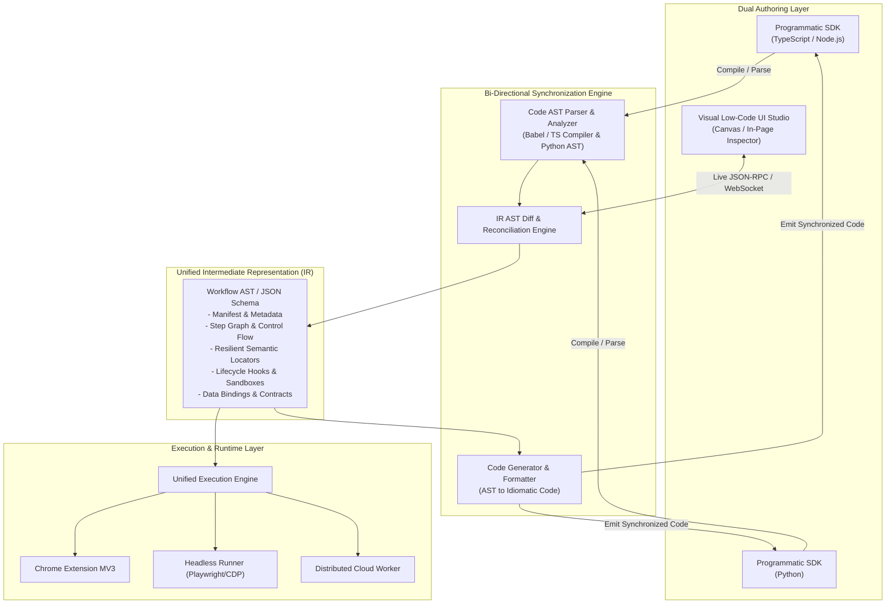
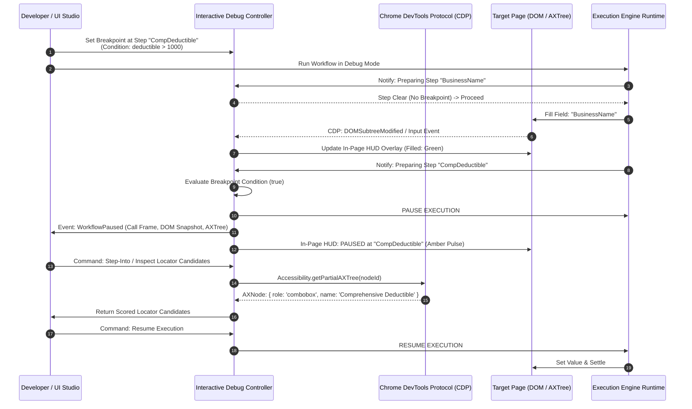
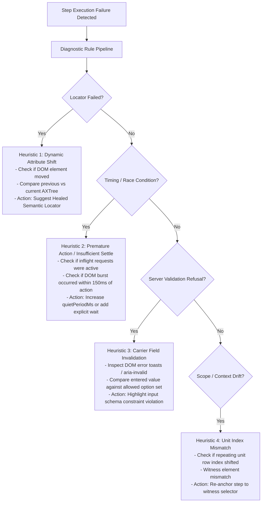

# Technical Survey & Architectural Specification: Dual Authoring & Interactive Debugging (R2 & R3)

**Document ID:** SURVEY-R2-R3-2026-11-04  
**Author:** Explorer Survey Agent 2 (`explorer_survey_2`)  
**Context:** Enterprise Architecture Blueprint for General-Purpose Browser Automation & Autofill Platform  
**Target Requirements:** R2 (Dual Authoring Interfaces: Programmatic SDK & Low-Code UI Studio, Unified IR) & R3 (Interactive Debugging & Observability System, CDP Integration, In-Page HUD, Structured Telemetry, Automated Diagnostics)  
**Baseline Codebase:** TNI Rater Autofill (`src/panel/`, `docs/developer-recording.md`, `server/`, `types.js`, `src/kit/`, `scripts/`)  

---

## 1. Executive Summary & Problem Framing

The existing TNI Rater Autofill engine represents a state-of-the-art deterministic automation foundation tailored specifically to commercial-auto insurance raters. Its core strengths include human-like interaction timing (`settle`, `quietMs`), multi-frame isolated/main world execution, shadow DOM piercing, attribution tracking (`yours` vs `page` vs `extension`), and offline recording via `trace.js`.

However, transforming this foundation into an **enterprise-grade, general-purpose browser automation and autofill platform** capable of running on arbitrary complex web applications requires addressing three foundational architectural gaps:

1. **Authoring Gap (Hardcoded vs. Dual Authoring):** Automation logic today is hand-coded in monolithic JavaScript carrier modules (`src/carriers/*.js`) and parsed into internal plans (`plan.js`). There is no clean, standalone programmatic SDK for Node.js or Python developers, nor is there a visual Low-Code UI Studio for non-developers to inspect, record, configure, and customize automation flows directly against live web pages.
2. **Synchronization Gap (Missing Unified IR):** Without a formal, declarative Workflow Intermediate Representation (IR) / Abstract Syntax Tree (AST), visual user actions cannot be compiled into clean code, nor can developer-authored code be visually rendered and edited without losing comments, macros, or custom hooks.
3. **Debugging & Observability Gap (Passive Observer vs. Active CDP Interceptor):** Today's recording infrastructure (`trace.js`, `sidepanel/recording.js`, `scripts/recording.mjs`) is an *offline, passive observer*. It cannot pause execution mid-flow, evaluate conditional breakpoints, step over/into asynchronous actions, inspect accessibility trees in real-time, or pinpoint the root cause of dynamic selector breakage or network race conditions.

This specification designs the complete architectural blueprint for **Requirements R2 and R3**, providing concrete TypeScript/JSDoc schemas, architectural models, component interaction flows, and developer interfaces.

---

## 2. Baseline Architecture Audit & Current State Analysis

### 2.1 Audit of Relevant Subsystems

| Subsystem / File | Current Responsibilities & Implementation | Strengths & Reusable Elements | Gaps & Structural Limitations |
| :--- | :--- | :--- | :--- |
| **`docs/developer-recording.md`** | Comprehensive specification of millisecond-level timeline recording, attribution rules, DOM snapshots, and timing slack analysis. | Clean mental model of wall-clock (`t`) vs relative (`pt`) time, quiet-wait slack calculation, and credential redaction. | Strictly designed for offline developer post-mortems; explicitly avoids active execution control (`debugger` domain avoided to prevent warnings). |
| **`src/content/trace.js`** | Passive listener in isolated/all frames tracking clicks, keys, inputs, DOM `burst` events (via `MutationObserver`), network calls (via `PerformanceObserver`), and `rater-trace` custom events. | Robust batching (250ms), buffer-overflow protection (2000 events), gesture attribution (`gestureMs`), light DOM control extraction. | Cannot inspect closed Shadow DOMs without script injection; `PerformanceObserver` cannot detect *in-flight* pending HTTP requests; no execution pausing. |
| **`sidepanel/recording.js` & `dev-recording.js`** | OPFS (Origin Private File System) chunk streamer (`events-*.jsonl`), zip archiver (`fflate`), uncorrupted recovery on browser crash. | Crash resilience, chunked persistence, local download without extra permissions. | Tightly coupled to Chrome Extension MV3 Origin Private File System; cannot run in Node/Python headless CLI environments. |
| **`src/kit/cursor.js` & `pagekit.js`** | Multi-round cursor execution loop, settle waits, edit guards, plan execution, progress emission. | Sophisticated settle logic (quiet period settling, busy masks, component readiness, request watching). | Monolithic execution loop; lack of a step-debugger interceptor hook; cannot pause at specific DOM operations. |
| **`src/kit/marks.js`** | In-page DOM overlays (`outline`, pulsing ring, AI floating banner) using `data-rater-autofill`. | Lightweight DOM markers, non-destructive outline restoration (`data-ra-prev-outline`). | Basic CSS outline modification that can be clipped by `overflow: hidden` containers; lacks rich interactive HUD, tooltips, or confidence scores. |
| **`src/kit/locator.js` & `dom.js`** | Multi-attribute matching (field ref, data-model name, exact label, selector, regex, witness verification). | Deep query across open shadow roots, multi-pass assignment priority. | Rules are statically defined; no dynamic selector healing, no ranking engine for alternative locators, no A11y tree synthesis. |
| **`server/index.mjs` & `dashboard.mjs`** | Telemetry ingestion endpoint (`POST /v1/events`), allowlist-based schema filtering, rate limiting, and review scripts. | Efficient NDJSON append-only logging, deduplication by event ID, token authentication. | Ingestion only; no bidirectional WebSocket protocol for remote live debugging or step-by-step remote execution control. |
| **`types.js`** | Repository-wide JSDoc definitions (`TraceEvent`, `RecordingManifest`, `PlanStep`, `FieldStep`, `ActionStep`, `FillReport`). | Comprehensive typing for quote automation domain. | Insurance-quote specific (`Financing`, `UnitList`, `ClientRecord`); lacks a generalized workflow execution and debugging type system. |

---

## 3. R2: Dual Authoring Interfaces Architecture

The platform provides two synchronized authoring interfaces sharing a single source of truth:
1. **Programmatic SDK (TypeScript/Node.js & Python):** A typed, modular API for software engineers.
2. **Visual Low-Code UI Studio:** An interactive canvas and live in-page inspector for domain specialists and automation designers.
3. **Unified Intermediate Representation (IR):** An AST-based declarative schema enabling lossless bi-directional translation.



---

### 3.1 Unified Intermediate Representation (IR) Specification

The Workflow IR is a declarative, language-agnostic Abstract Syntax Tree (AST) stored as JSON or YAML. It encapsulates target domains, flow control, resilient multi-layered locators, data bindings, execution timeouts, and lifecycle hooks.

#### 3.1.1 Complete TypeScript Schema (`types/workflow-ir.ts`)

```typescript
/**
 * Unified Intermediate Representation (IR) Schema - Version 2.0
 */

export type UUID = string;
export type JSONPrimitive = string | number | boolean | null;
export type JSONValue = JSONPrimitive | JSONObject | JSONArray;
export interface JSONObject { [key: string]: JSONValue; }
export interface JSONArray extends Array<JSONValue> {}

/** Top-level Workflow Document */
export interface WorkflowDefinitionIR {
  irVersion: "2.0.0";
  id: UUID;
  name: string;
  description?: string;
  version: string;
  author?: string;
  tags?: string[];
  
  /** Target scope where this workflow is authorized and intended to execute */
  scope: {
    matchUrls: string[];         // Glob or RegExp pattern (e.g. "https://*.carrier.com/quote/*")
    excludedUrls?: string[];
    allowedOrigins: string[];
    requiredPermissions?: string[];
  };

  /** Input and Output Data Contracts */
  schema: {
    inputs: JSONSchemaDraft7;    // Expected payload for data injection
    outputs?: JSONSchemaDraft7;  // Schema of scraped / collected fields
  };

  /** Default timing and resilience configuration */
  defaults: {
    timeoutMs: number;           // Default step timeout (e.g. 15000)
    quietPeriodMs: number;       // Settle window after DOM actions (e.g. 400)
    maxRetries: number;          // Default retry rounds (e.g. 3)
    retryIntervalMs: number;     // Backoff interval (e.g. 500)
    screenshotOnFailure: boolean;
  };

  /** Visual layout metadata for Studio canvas (preserved across SDK roundtrips) */
  studioMetadata?: {
    canvasNodes: Record<UUID, { x: number; y: number; group?: string }>;
    comments: Record<UUID, string>;
  };

  /** Global lifecycle hooks */
  hooks?: WorkflowHooksIR;

  /** Step execution sequence or directed acyclic graph (DAG) */
  steps: WorkflowStepIR[];
}

/** Standard JSON Schema Draft 7 Type Definition */
export interface JSONSchemaDraft7 {
  type: "object" | "array" | "string" | "number" | "boolean";
  properties?: Record<string, any>;
  required?: string[];
  items?: any;
  [key: string]: any;
}

/** Semantic Multi-Strategy Locator */
export interface SemanticLocatorIR {
  id: string;
  description: string;
  
  /** Tier 1: Semantic & Accessibility Locators (Preferred, resilient to styling changes) */
  accessibility?: {
    role: string;               // e.g. "textbox", "combobox", "button", "checkbox"
    name?: string;              // Accessible name (computed via a11y tree)
    description?: string;
  };
  
  /** Tier 2: Domain & Data Model Attributes */
  attributes?: {
    dataTestId?: string;        // data-testid, data-cy, data-qa
    fieldRef?: string;          // Carrier data-model path (e.g. "Policy.Coverages.Comp")
    name?: string;              // HTML name attribute
    idPattern?: string;         // Regex for dynamic IDs (e.g. "^ext-gen[0-9]+-input$")
    placeholder?: string;
  };

  /** Tier 3: Contextual / Geometric Anchoring */
  anchor?: {
    nearText?: string;          // Label or heading visually adjacent
    direction?: "right-of" | "below" | "inside" | "near";
    withinContainerSelector?: string;
    sectionTitle?: string;
  };

  /** Tier 4: Fallback CSS / XPath Selectors */
  selectors: string[];          // Prioritized array of CSS / XPath locators
  
  /** Shadow DOM Penetration Path */
  shadowPath?: string[];        // Array of host selectors to traverse open/closed shadow roots
  
  /** Frame path if element lives in an iframe */
  frameSelector?: string;
}

/** Workflow Step Definitions */
export type WorkflowStepIR = 
  | NavigateStepIR
  | FillFieldStepIR
  | ClickActionStepIR
  | WaitStepIR
  | ExtractDataStepIR
  | ConditionalBranchStepIR
  | LoopStepIR
  | SubWorkflowStepIR
  | CustomCodeStepIR;

export interface BaseStepIR {
  id: UUID;
  name: string;
  comment?: string;
  enabled: boolean;
  continueOnError?: boolean;
  timeoutMs?: number;
  hooks?: StepHooksIR;
}

/** Navigate Step */
export interface NavigateStepIR extends BaseStepIR {
  kind: "navigate";
  url: string;                  // Supports template variables: "{{env.BASE_URL}}/app"
  waitUntil: "load" | "domcontentloaded" | "networkidle0" | "quiet-period";
  quietPeriodMs?: number;
}

/** Form Field Filling Step */
export interface FillFieldStepIR extends BaseStepIR {
  kind: "fillField";
  locator: SemanticLocatorIR;
  valueBinding: {
    source: "input" | "constant" | "derived" | "standard" | "env";
    path?: string;              // JSONPath expression into input: "$.applicant.ein"
    constant?: JSONPrimitive;
    formatTransform?: "trim" | "currency" | "date:YYYY-MM-DD" | "phone:digits" | "uppercase";
  };
  fieldKind: "text" | "radio" | "checkbox" | "select" | "combobox" | "typeahead";
  strategy: {
    clearBeforeTyping: boolean;
    keystrokeDelayMs?: number;  // Human-like typing simulation
    pressEnterAfter?: boolean;
    dispatchEvents: Array<"input" | "change" | "blur">;
    verification: "value-equals" | "visual-mark" | "no-error-message";
    replaceExisting: boolean;   // Override prefilled values
  };
}

/** Button / Action Step */
export interface ClickActionStepIR extends BaseStepIR {
  kind: "clickAction";
  locator: SemanticLocatorIR;
  interaction: "click" | "doubleClick" | "hover" | "focus";
  postWait: {
    type: "settle" | "navigation" | "element-visible" | "none";
    targetLocator?: SemanticLocatorIR;
    quietPeriodMs?: number;
  };
  guardrails: {
    blockDestructiveSubmissions: boolean; // Prevent Submit, Bind, Purchase unless confirmed
  };
}

/** Deterministic Wait Step */
export interface WaitStepIR extends BaseStepIR {
  kind: "wait";
  condition: 
    | { type: "quiet-period"; durationMs: number }
    | { type: "element-state"; locator: SemanticLocatorIR; state: "visible" | "hidden" | "enabled" }
    | { type: "network-idle"; maxInflightRequests: number; durationMs: number }
    | { type: "custom-predicate"; script: string }; // Sandboxed JavaScript expression
  maxWaitMs: number;
}

/** Data Extraction Step */
export interface ExtractDataStepIR extends BaseStepIR {
  kind: "extractData";
  locator: SemanticLocatorIR;
  extract: "text" | "value" | "attribute" | "table-rows";
  attributeName?: string;
  targetVariable: string;       // Saved to workflow execution context
}

/** Conditional Branching */
export interface ConditionalBranchStepIR extends BaseStepIR {
  kind: "condition";
  predicate: {
    type: "expression" | "element-exists";
    expression?: string;        // e.g. "context.inputs.hasPriorClaims === true"
    locator?: SemanticLocatorIR;
  };
  thenSteps: WorkflowStepIR[];
  elseSteps?: WorkflowStepIR[];
}

/** Iteration / Loop Step */
export interface LoopStepIR extends BaseStepIR {
  kind: "loop";
  loopOver: {
    type: "collection" | "pagination" | "range";
    collectionPath?: string;    // e.g. "$.vehicles"
    paginationNextButton?: SemanticLocatorIR;
    range?: { start: number; end: number };
  };
  itemVariableName: string;     // e.g. "vehicle"
  indexVariableName?: string;   // e.g. "vehicleIdx"
  steps: WorkflowStepIR[];
}

/** Sub-Workflow Reusable Module Call */
export interface SubWorkflowStepIR extends BaseStepIR {
  kind: "callSubWorkflow";
  workflowId: UUID | string;    // Reference to packaged module or external workflow file
  inputBindings: Record<string, string>; // Mapping parent context to child inputs
}

/** Custom Code Step (Sandboxed Hook) */
export interface CustomCodeStepIR extends BaseStepIR {
  kind: "customCode";
  runtime: "javascript" | "python";
  sourceCode: string;           // Function signature: (context, api) => Promise<void>
}

/** Lifecycle Hooks IR */
export interface WorkflowHooksIR {
  beforeWorkflow?: string;      // Executed before step 1
  afterWorkflow?: string;       // Executed after completion
  onError?: string;             // Global error interceptor
  onStepFailure?: "retry" | "halt" | "skip" | "trigger-self-healing";
}

export interface StepHooksIR {
  beforeStep?: string;
  afterStep?: string;
  onError?: string;
}
```

---

### 3.2 Programmatic SDK Architecture

The programmatic SDK targets **Node.js (TypeScript/ESM)** and **Python 3.10+**. It is designed around three principles:
1. **Type Safety & Intellisense:** Full compile-time validation of step configurations, locators, and data contracts.
2. **Pluggable Driver Abstraction:** Identical workflow definitions run on Chrome Extension MV3, Playwright, Puppeteer, or Headless CDP runners.
3. **Fluent DSL + Declarative Options:** Code can be authored imperatively or declaratively.

#### 3.2.1 Node.js / TypeScript SDK Architecture & API Example

```typescript
import { 
  defineWorkflow, 
  locator, 
  quietSettle, 
  ExecutionContext, 
  WorkflowRunner 
} from "@automata/sdk";

// Define Typed Input Contract
interface IntakePayload {
  applicant: {
    businessName: string;
    fein: string;
    yearsInBusiness: number;
  };
  vehicles: Array<{
    vin: string;
    year: number;
    make: string;
    comprehensiveDeductible: number;
  }>;
}

export const CommercialAutoWorkflow = defineWorkflow<IntakePayload>({
  id: "commercial-auto-v2",
  name: "Commercial Auto Carrier Autofill",
  version: "1.0.0",
  scope: {
    matchUrls: ["https://*.ratingcarrier.com/quote/*"],
    allowedOrigins: ["https://auth.ratingcarrier.com", "https://ratingcarrier.com"]
  },
  defaults: {
    timeoutMs: 15000,
    quietPeriodMs: 400,
    maxRetries: 2
  }
})
  // Navigation
  .navigate("StartQuote", {
    url: "https://ratingcarrier.com/quote/commercial-auto/new",
    waitUntil: "networkidle0"
  })

  // Business Information Step
  .fill("BusinessName", {
    locator: locator()
      .byRole("textbox", { name: /Legal Business Name/i })
      .byDataTestId("business-name-input")
      .byAttributes({ fieldRef: "Applicant.LegalName" })
      .bySelector("input[name='busName']"),
    value: (ctx) => ctx.input.applicant.businessName,
    strategy: {
      clearBeforeTyping: true,
      verification: "value-equals"
    }
  })

  .fill("FEIN", {
    locator: locator()
      .byRole("textbox", { name: /FEIN|Tax ID/i })
      .byDataTestId("fein-input")
      .bySelector("#applicant-fein"),
    value: (ctx) => ctx.input.applicant.fein,
    formatTransform: "digits-only"
  })

  // Conditional Branch: New Venture Questions
  .when(
    (ctx) => ctx.input.applicant.yearsInBusiness < 2,
    (sub) => sub.fill("PriorExperienceDetails", {
      locator: locator().byRole("textbox", { name: /Owner Commercial Driving Experience/i }),
      value: "Owner has over 10 years commercial driving experience prior to LLC formation."
    })
  )

  // Iterating repeating units (Vehicles)
  .forEach("vehicles", {
    collection: (ctx) => ctx.input.vehicles,
    itemAlias: "vehicle",
    indexAlias: "idx",
    body: (loop) => {
      loop
        .click("ClickAddVehicle", {
          locator: locator().byRole("button", { name: /Add Vehicle/i }),
          postWait: quietSettle(500)
        })
        .fill("VehicleVIN", {
          locator: locator().byRole("textbox", { name: /VIN/i }).bySelector("input[name='vin']"),
          value: (ctx) => ctx.current.vehicle.vin
        })
        .fill("CompDeductible", {
          locator: locator().byRole("combobox", { name: /Comprehensive Deductible/i }),
          value: (ctx) => `$${ctx.current.vehicle.comprehensiveDeductible}`,
          fieldKind: "combobox"
        });
    }
  })

  // Safe submission boundary
  .click("CalculateRate", {
    locator: locator().byRole("button", { name: /Calculate Rate|Recalculate/i }),
    postWait: {
      type: "settle",
      quietPeriodMs: 1200
    },
    guardrails: {
      blockDestructiveSubmissions: true // Enforces agent approval before bind
    }
  });
```

#### 3.2.2 Python SDK Architecture & API Example

```python
"""
Automata Python SDK (Python 3.10+)
Fully typed automation engine integrating with Playwright or CDP.
"""

from pydantic import BaseModel, Field
from automata_sdk import (
    Workflow,
    Locator,
    StepContext,
    quiet_settle,
    Runner
)

class ApplicantData(BaseModel):
    business_name: str
    fein: str
    years_in_business: int

class VehicleData(BaseModel):
    vin: str
    year: int
    make: str
    comp_deductible: int

class CommercialAutoPayload(BaseModel):
    applicant: ApplicantData
    vehicles: list[VehicleData]

workflow = Workflow[CommercialAutoPayload](
    id="commercial-auto-py-v2",
    name="Python Commercial Auto Autofill",
    scope_urls=["https://*.ratingcarrier.com/quote/*"],
    default_timeout_ms=15000,
    quiet_period_ms=400
)

@workflow.step(name="FillBusinessName")
async def fill_business_name(ctx: StepContext[CommercialAutoPayload]):
    target = (
        Locator()
        .by_role("textbox", name="Legal Business Name")
        .by_data_testid("business-name-input")
        .by_attribute("fieldRef", "Applicant.LegalName")
        .by_css("input[name='busName']")
    )
    await ctx.actions.fill(
        locator=target,
        value=ctx.input.applicant.business_name,
        clear_before=True
    )

@workflow.step(name="FillFEIN")
async def fill_fein(ctx: StepContext[CommercialAutoPayload]):
    target = Locator().by_role("textbox", name="FEIN").by_css("#applicant-fein")
    await ctx.actions.fill(
        locator=target,
        value=ctx.input.applicant.fein
    )

@workflow.loop(name="ProcessVehicles", collection_path="vehicles")
async def process_vehicles(ctx: StepContext[CommercialAutoPayload], vehicle: VehicleData, idx: int):
    # Click Add Vehicle
    await ctx.actions.click(
        Locator().by_role("button", name="Add Vehicle"),
        post_wait=quiet_settle(500)
    )
    # Fill VIN
    await ctx.actions.fill(
        Locator().by_role("textbox", name="VIN"),
        value=vehicle.vin
    )
    # Choose Deductible
    await ctx.actions.select_option(
        Locator().by_role("combobox", name="Comprehensive Deductible"),
        value=f"${vehicle.comp_deductible}"
    )

# Execution Hook
@workflow.on_step_failure
async def handle_step_failure(ctx: StepContext[CommercialAutoPayload], error: Exception):
    ctx.logger.error(f"Step {ctx.current_step.name} failed: {error}. Capturing state...")
    await ctx.diagnostics.capture_full_trace()
```

---

### 3.3 Visual / Low-Code UI Studio Architecture

The Low-Code UI Studio runs in two delivery modalities:
1. **Docked/Popped-out Browser Extension Mode:** Directly integrated into the browser side panel or docked dev window.
2. **Standalone Desktop / Cloud Web Studio:** Connects via a secure WebSocket CDP bridge to remote or local browser sessions.

```
+---------------------------------------------------------------------------------------------------------+
|                                    AUTOMATA LOW-CODE UI STUDIO                                          |
+-----------------------------------+-----------------------------------+---------------------------------+
|   WORKFLOW CANVAS (LEFT / TOP)    |    LIVE INSPECTOR & DOM OVERLAY   |     CODE VIEW & IR (RIGHT)      |
+-----------------------------------+-----------------------------------+---------------------------------+
| [Step 1: Navigate to Quote]       | [Target Web Page: rating.com]     | // Generated TypeScript SDK     |
|   |                               | +-------------------------------+ | export const QuoteFlow =        |
|   v                               | | Legal Business Name: [______] | |   defineWorkflow(...)         |
| [Step 2: Fill Business Info]      | |  * Status: Matched (98% A11y) | |   .fill("BusinessName", {     |
|   |- Field: BusinessName (A11y)   | |  * Value: "Acme Logistics"    | |     locator: locator()        |
|   |- Field: FEIN                  | |  [Overlay: Green Solid #16a34a]| |       .byRole("textbox", ...  |
|   |                               | +-------------------------------+ |   })                            |
|   v                               |                                   |                                 |
| [Step 3: Branch (New Venture?)]   | Active Quiet Settle: [========]   | [Bidirectional Sync: ACTIVE]    |
|   |- If years < 2: Explain        | Pending Network Inflight: 0 reqs  | Mode: AST Round-trip Reconcile  |
|   v                               |                                   |                                 |
| [Step 4: Repeat (Vehicles)]       | [Record Action] [Pause] [Step]    | [Export IR JSON] [Push to Git]  |
+-----------------------------------+-----------------------------------+---------------------------------+
```

#### 3.3.1 In-Page Interactive Recorder & Hover Inspector
- **Accessibility-First Candidate Generation:** When hovering over an input element on the page, the recorder traverses the element and its ancestors to build a prioritized `SemanticLocatorIR`:
  1. Accessibility Role & Computed Name (`role=textbox`, `aria-label`, `<label for="...">`).
  2. Test IDs (`data-testid`, `data-cy`).
  3. Stable Data Attributes (`name`, `fieldref`, `ng-model`).
  4. Contextual Anchor (text to the left or above).
  5. Structural Shadow Path & CSS selector.
- **Real-Time Locator Scoring:** Displays a confidence badge (e.g., `Score: 99% - Highly Resilient A11y Match` vs. `Score: 40% - Fragile Dynamic ID`).
- **One-Click Step Creation:** Clicking an element with the inspector active automatically appends a pre-configured step (`FillFieldStep` or `ClickActionStep`) into the visual canvas.

#### 3.3.2 Bidirectional Synchronization Engine (AST Round-Trip)
To allow developers to code in their IDE while business analysts configure steps in the Studio:
1. **Source of Truth:** The Workflow IR AST acts as the canonical representation.
2. **Code-to-IR Parser:**
   - Uses TypeScript Compiler API / Babel parser for JS/TS, and Python's built-in `ast` module for Python.
   - Parses `defineWorkflow()` calls, chained method invocations, and locator builders into IR Step nodes.
   - Extracts comments, visual layout tags, and custom code blocks into `studioMetadata`.
3. **IR-to-Code Generator:**
   - Emits clean, idiomatic code using Prettier (TS) / Black (Python) formatting rules.
   - **AST Comment & Formatting Preservation:** Nodes carry source location and trivia (leading/trailing comments). When visual changes are made in the Studio, only affected AST nodes are modified, leaving manual comments and helper functions untouched.
4. **Three-Way Conflict Resolution:**
   - If both the code file and the visual studio modify the workflow simultaneously, the reconciliation engine performs a 3-way structural merge using the previous base commit IR. Conflicts are highlighted visually in the Studio before committing.

---

## 4. R3: Interactive Debugging & Observability System

The debugging and observability architecture provides step-by-step execution control, in-page state HUD overlays, high-fidelity CDP telemetry capture, and automated failure root-cause analysis.



---

### 4.1 Chrome DevTools Protocol (CDP) Event Integration

To provide deep execution control without the limitations of isolated content scripts, the debugger attaches directly to the browser instance using CDP (`chrome.debugger` API in MV3 or WebSocket in headless/Node/Python environments).

#### 4.1.1 CDP Domains and Methods Utilized

| CDP Domain | APIs & Events Used | Specific Role in Platform Architecture |
| :--- | :--- | :--- |
| **`Debugger`** | `Debugger.enable`<br/>`Debugger.pause`<br/>`Debugger.resume`<br/>`Debugger.stepOver`<br/>`Debugger.stepInto`<br/>`Debugger.setBreakpointByUrl`<br/>`Debugger.paused` | Low-level script pause/resume control, stepping into custom code hooks, and call-frame evaluation. |
| **`DOM`** | `DOM.enable`<br/>`DOM.getDocument`<br/>`DOM.querySelector`<br/>`DOM.describeNode`<br/>`DOM.getBoxModel`<br/>`DOM.setInspectModeEnabled` | Inspecting live node hierarchies, computing exact bounding client rects, and driving in-page element inspection. |
| **`DOMDebugger`** | `DOMDebugger.setDOMBreakpoint`<br/>`DOMDebugger.setEventListenerBreakpoint` | Halting when target form elements are modified, removed by JavaScript frameworks (e.g. React/ExtJS redraws), or attributes change. |
| **`Accessibility`**| `Accessibility.enable`<br/>`Accessibility.getFullAXTree`<br/>`Accessibility.getPartialAXTree` | Live query of accessibility tree nodes to compute accessible names, roles, and states without relying on brittle DOM classes. |
| **`Network`** | `Network.enable`<br/>`Network.requestWillBeSent`<br/>`Network.loadingFinished`<br/>`Network.loadingFailed` | **True In-Flight Request Tracking:** Maintains an accurate counter of pending requests, eliminating premature timeouts in quiet-period settling. |
| **`Page`** | `Page.enable`<br/>`Page.captureScreenshot`<br/>`Page.startScreencast`<br/>`Page.screencastFrame` | Live visual mirroring in Studio canvas; captures high-res screenshots at breakpoints and failures. |
| **`Runtime`** | `Runtime.enable`<br/>`Runtime.evaluate`<br/>`Runtime.callFunctionOn`<br/>`Runtime.exceptionThrown` | Safe evaluation of custom expressions in target world; intercepting unhandled page errors. |

#### 4.1.2 Debug Session Interface & Execution Controller (`types/debugger.ts`)

```typescript
/**
 * Interactive Debugger & CDP Bridge Types
 */

export type DebuggerState = "IDLE" | "RUNNING" | "PAUSED" | "STEPPING" | "HALTED" | "ERROR";

export interface BreakpointDefinition {
  id: string;
  stepId?: string;               // Break at specific workflow step
  type: "step" | "dom-mutation" | "network-request" | "error" | "conditional";
  condition?: string;            // JavaScript expression: "context.input.value > 500"
  locator?: SemanticLocatorIR;   // Break when this element is targeted
  hitCount: number;
  enabled: boolean;
}

export interface ExecutionFrame {
  stepId: string;
  stepName: string;
  timestamp: number;
  callStack: Array<{ functionName: string; location: string }>;
  contextScope: {
    inputs: Record<string, any>;
    variables: Record<string, any>;
    activeUnitIndex?: number;
  };
  domSnapshot: {
    selectedNodeId?: number;
    axNode?: AccessibleNodeSummary;
    inFlightRequests: string[];
    settled: boolean;
  };
  screenshotDataUrl?: string;
}

export interface AccessibleNodeSummary {
  role: string;
  name: string;
  value?: string;
  description?: string;
  disabled?: boolean;
  focused?: boolean;
}

export interface IDebugController {
  // Session Lifecycle
  attach(target: { tabId?: number; wsEndpoint?: string }): Promise<void>;
  detach(): Promise<void>;
  getState(): DebuggerState;

  // Execution Control
  pause(): Promise<void>;
  resume(): Promise<void>;
  stepOver(): Promise<void>;
  stepInto(): Promise<void>;
  stepOut(): Promise<void>;
  stepTo(stepId: string): Promise<void>;

  // Breakpoints
  setBreakpoint(bp: Omit<BreakpointDefinition, "id" | "hitCount">): Promise<string>;
  removeBreakpoint(breakpointId: string): Promise<void>;
  toggleBreakpoint(breakpointId: string, enabled: boolean): Promise<void>;

  // Evaluation & Inspection
  evaluateExpression(expression: string): Promise<any>;
  inspectElementAt(x: number, y: number): Promise<AccessibleNodeSummary | null>;
  getPartialAXTree(nodeId: number): Promise<AccessibleNodeSummary>;

  // Time-Travel Inspection
  captureFrame(stepId: string): Promise<ExecutionFrame>;
  getTimeline(): ExecutionFrame[];
  timeTravelToFrame(frameIndex: number): Promise<void>;
}
```

---

### 4.2 Visual State Inspection on Target Pages (In-Page HUD)

Building on and replacing the basic outline system in `marks.js`, the platform provides a rich, non-destructive **In-Page Head-Up Display (HUD)**.

#### 4.2.1 Component Structure of In-Page HUD
1. **Field State Badge Overlays:** Positioned at the top-right corner of every active form control:
   - **Status Badges:**
     - `Filled` (Solid Green `#16a34a`): Value successfully injected and verified.
     - `Standard / Rule` (Solid Blue `#2563eb`): Filled from standard policy rulebook.
     - `AI Suggested` (Solid Purple `#7c3aed`): Proposed by bounded AI model; pending confirmation.
     - `User Corrected` (Slate `#475569`): Field edited by human; protected from overwrite.
     - `Needs Attention` (Dashed Amber `#d97706`): Missing input fact; agent must answer.
     - `Failed / Refused` (Solid Red `#dc2626`): Locator failed or carrier validation refused answer.
   - **Locator Resilience Score Indicator:** Hovering on badge displays confidence score (e.g., `Confidence: 96% | A11y: combobox 'Comprehensive Deductible'`).
   - **Diff Inspector Tooltip:** Displays before/after state:
     - `Original Carrier Value: "$500"`
     - `Injected Intake Value: "$1,000"`
     - `Accepted Value: "$1,000"`

2. **Quiet Wait & Activity Indicator (Live Floating HUD):**
   - Positioned unobtrusively at the bottom right of the viewport.
   - **Live Progress Ring:** Visually displays remaining quiet settle time (`350ms / 800ms`).
   - **Network In-Flight Badge:** Live count of open network requests (e.g. `2 requests active: /recalc, /vin-lookup`).
   - **DOM Mutation Indicator:** Pulses during framework redraw storms.
   - **Pause / Break Button:** Allows the agent or engineer to immediately pause execution right from the target page.

3. **Carrier Agreement / Rejection Tracking:**
   - Detects when a carrier's script wipes out an injected value after calculation.
   - Flags discrepancies in red outline: `"Carrier reverted Comp Deductible back to $500"`.

---

### 4.3 Structured Telemetry, Logging & Trace Archive

The telemetry subsystem builds upon the foundation in `types.js` (`TraceEvent`, `RecordingManifest`) and `server/index.mjs` to produce OpenTelemetry-compliant structured traces.

#### 4.3.1 Telemetry Event Schema (`types/telemetry.ts`)

```typescript
/**
 * OpenTelemetry-Compliant Structured Trace Schema
 */

export interface TelemetrySpan {
  traceId: string;              // Unique execution run ID (UUIDv4)
  spanId: string;               // Unique step span ID
  parentSpanId?: string;        // Parent step / workflow span
  name: string;                 // e.g. "FillField:CompDeductible"
  kind: "workflow" | "step" | "locator" | "settle" | "network" | "ai";
  startTime: number;            // High-precision epoch ms
  endTime: number;              // High-precision epoch ms
  durationMs: number;
  status: {
    code: "OK" | "ERROR" | "TIMEOUT" | "SKIPPED";
    message?: string;
  };
  attributes: {
    "engine.version": string;
    "engine.mode": "extension" | "sdk-node" | "sdk-python" | "headless";
    "target.url": string;
    "target.origin": string;
    "workflow.id": string;
    "workflow.stepId"?: string;
    
    // Step specific attributes
    "step.kind"?: string;
    "step.locator.strategy"?: string;
    "step.locator.durationMs"?: number;
    "step.locator.matchedSelector"?: string;
    "step.value.length"?: number;
    "step.value.source"?: string;
    
    // Settle & Timing attributes
    "settle.quietPeriodMs"?: number;
    "settle.actualWaitMs"?: number;
    "settle.slackMs"?: number;    // Waste time after page finished changing
    "settle.inflightRequests"?: number;
    "settle.domMutations"?: number;
    
    // Attribution
    "action.by": "agent" | "extension" | "page";
    "action.trusted": boolean;
  };
  events: Array<{
    name: string;               // e.g. "dom_burst", "request_finished", "value_applied"
    timestamp: number;
    attributes?: Record<string, any>;
  }>;
}

/** Structured Trace Bundle Manifest */
export interface TraceArchiveManifest {
  manifestVersion: "2.0.0";
  traceId: string;
  workflowId: string;
  workflowVersion: string;
  environment: {
    browser: string;
    os: string;
    viewport: { width: number; height: number; dpr: number };
    nodeVersion?: string;
  };
  startedAt: string;            // ISO String
  endedAt: string;              // ISO String
  durationMs: number;
  stats: {
    totalSteps: number;
    completedSteps: number;
    failedSteps: number;
    totalWaitsMs: number;
    totalSlackMs: number;
    eventsCount: number;
  };
  files: {
    timeline: "timeline.jsonl";
    spans: "spans.jsonl";
    screenshotsDirectory: "screenshots/";
    domSnapshotsDirectory: "dom/";
  };
}
```

---

### 4.4 Automated Failure Root-Cause Diagnostics Engine

When an execution step fails or halts, the engine runs an automated **Diagnostic Rule Pipeline** against the telemetry stream, CDP snapshots, and accessibility tree to identify the root cause and propose actionable fixes.

#### 4.4.1 Root Cause Classification & Heuristic Rules



#### 4.4.2 Diagnostic Output Schema & Example Report (`types/diagnostics.ts`)

```typescript
export interface DiagnosticReport {
  traceId: string;
  failedStepId: string;
  failedStepName: string;
  timestamp: number;
  rootCauseCategory: 
    | "LOCATOR_BROKEN"
    | "TIMING_RACE_CONDITION"
    | "SERVER_VALIDATION_ERROR"
    | "FRAMEWORK_REWRITE"
    | "PERMISSION_OR_POPUP_BLOCK";
  
  confidence: number;           // 0.0 to 1.0 (e.g. 0.94)
  summary: string;
  detailedExplanation: string;
  
  evidence: {
    lastMatchingAXNode?: AccessibleNodeSummary;
    currentAXTreeSnippet?: string;
    activeRequestsDuringFailure: string[];
    recentDOMMutationsCount: number;
    carrierErrorMessage?: string;
  };
  
  remediation: {
    actionType: "UPDATE_LOCATOR" | "ADJUST_TIMING" | "ADD_WAIT_CONDITION" | "MODIFY_INPUT";
    suggestedPatch?: Record<string, any>;
    humanInstructions: string;
  };
}
```

#### Real-World Diagnostic Report Example:

```json
{
  "traceId": "trace-88cf-992a-4a21",
  "failedStepId": "step-veh-deductible-2",
  "failedStepName": "CompDeductible",
  "timestamp": 1730745600120,
  "rootCauseCategory": "LOCATOR_BROKEN",
  "confidence": 0.96,
  "summary": "Carrier updated form control from native select to custom ExtJS combobox.",
  "detailedExplanation": "The element matched selector 'select[name=compDed]' in previous runs, but the page now renders an accessibility node with role 'combobox' and ID 'combobox-1042-input'. The original select element is hidden with display:none.",
  "evidence": {
    "lastMatchingAXNode": { "role": "select", "name": "Comprehensive Deductible" },
    "currentAXTreeSnippet": "<div role='combobox' aria-label='Comprehensive Deductible' id='combobox-1042-input'>",
    "activeRequestsDuringFailure": [],
    "recentDOMMutationsCount": 14
  },
  "remediation": {
    "actionType": "UPDATE_LOCATOR",
    "suggestedPatch": {
      "locator": {
        "accessibility": { "role": "combobox", "name": "Comprehensive Deductible" },
        "selectors": ["#combobox-1042-input", "input[aria-label*='Comprehensive Deductible']"]
      }
    },
    "humanInstructions": "Update step locator to use byRole('combobox', { name: /Comprehensive Deductible/i }) to pierce the ExtJS custom widget."
  }
}
```

---

## 5. Architectural Component Boundaries & Responsibility Matrix

The system architecture partitions responsibilities cleanly across modules to ensure cross-platform execution:

```
+---------------------------------------------------------------------------------------+
|                                    PLATFORM LAYERS                                    |
+---------------------+-----------------------------------------------------------------+
| Layer               | Components & Responsibilities                                  |
+---------------------+-----------------------------------------------------------------+
| 1. Authoring        | - Programmatic SDK: TypeScript/Python DSL & Type definitions     |
|                     | - Visual UI Studio: Web/Extension Canvas, Interactive Recorder |
|                     | - AST Sync Engine: Babel/TS & Python AST parser and codegen     |
+---------------------+-----------------------------------------------------------------+
| 2. Specification    | - Workflow IR AST (JSON/YAML Schema v2.0)                       |
|                     | - Semantic Locators (Accessibility, Anchors, Attributes)        |
|                     | - Data Binding & Sandboxed Transformation Expressions           |
+---------------------+-----------------------------------------------------------------+
| 3. Execution        | - Core Execution Engine: Step dispatching, lifecycle loops      |
|                     | - Human-like Interaction: Cursor physics, keystroke delays      |
|                     | - Settle Engine: Multi-factor quiet wait, request tracking      |
|                     | - Guardrails: Destructive action prevention, edit guards        |
+---------------------+-----------------------------------------------------------------+
| 4. Debug & Observ.  | - CDP Controller: Breakpoint manager, step-over/into            |
|                     | - In-Page HUD: Badges, overlays, diff tooltips, quiet ring      |
|                     | - Telemetry Collector: OTel spans, timeline.jsonl, OPFS         |
|                     | - Root-Cause Diagnostic Analyzer: Automated failure triage      |
+---------------------+-----------------------------------------------------------------+
| 5. Drivers          | - Extension MV3 Driver (Isolated/Main world scripting)          |
|                     | - Playwright / Puppeteer Headless Driver                        |
|                     | - Pure CDP WebSocket Remote Driver                              |
+---------------------+-----------------------------------------------------------------+
```

---

## 6. Migration & Integration Strategy from Existing Codebase

To preserve existing investments in `src/kit/`, `sidepanel/`, and carrier configurations while building this generalized platform:

1. **Carrier Rulebook to IR Compiler (`scripts/compile-carrier-to-ir.mjs`):**
   - Write a migration utility that reads existing `CarrierConfig` objects (`src/carriers/*.js`) and automatically outputs valid `WorkflowDefinitionIR` JSON files.
   - Map existing `CarrierRule` fields (`path`, `q`, `ask`, `whenShown`, `witness`, `onlyIf`) directly into `SemanticLocatorIR` and `FillFieldStepIR` nodes.
2. **Upgrading `trace.js` into CDP Telemetry Agent:**
   - In Chrome Extension environments without `chrome.debugger` permission, `trace.js` continues running as the lightweight in-page passive observer.
   - In developer, test, and headless environments, the CDP Debug Controller attaches to provide full step-pause, accessibility tree query, and true in-flight network request tracking.
3. **Refactoring `marks.js` into the In-Page HUD:**
   - Extend `marks.js` into an interactive Web Component `<automata-debug-hud>` injected into the top frame, providing non-invasive badges, tooltips, and the quiet-settle progress indicator.
4. **Exporting Programmatic SDK Packages (`@automata/sdk` and `automata-python`):**
   - Package the core locator, plan builder, and execution engine into standalone npm and pip packages decoupled from Chrome-specific storage or UI tabs.

---

## 7. Conclusion & Next Steps

This blueprint fully specifies Requirements **R2 (Dual Authoring Interfaces)** and **R3 (Interactive Debugging & Observability System)**:
- Provides concrete, type-safe schemas for the Unified Intermediate Representation (IR), TypeScript SDK, Python SDK, Debugger Controller, and Telemetry Spans.
- Bridges visual low-code workflow authoring with clean developer code via bi-directional AST synchronization.
- Elevates the deterministic automation runtime from an offline passive logger to an active, CDP-driven interactive debugger with automated failure root-cause analysis.
- Supplies complete component diagrams and integration mappings grounded in the current codebase foundation.
