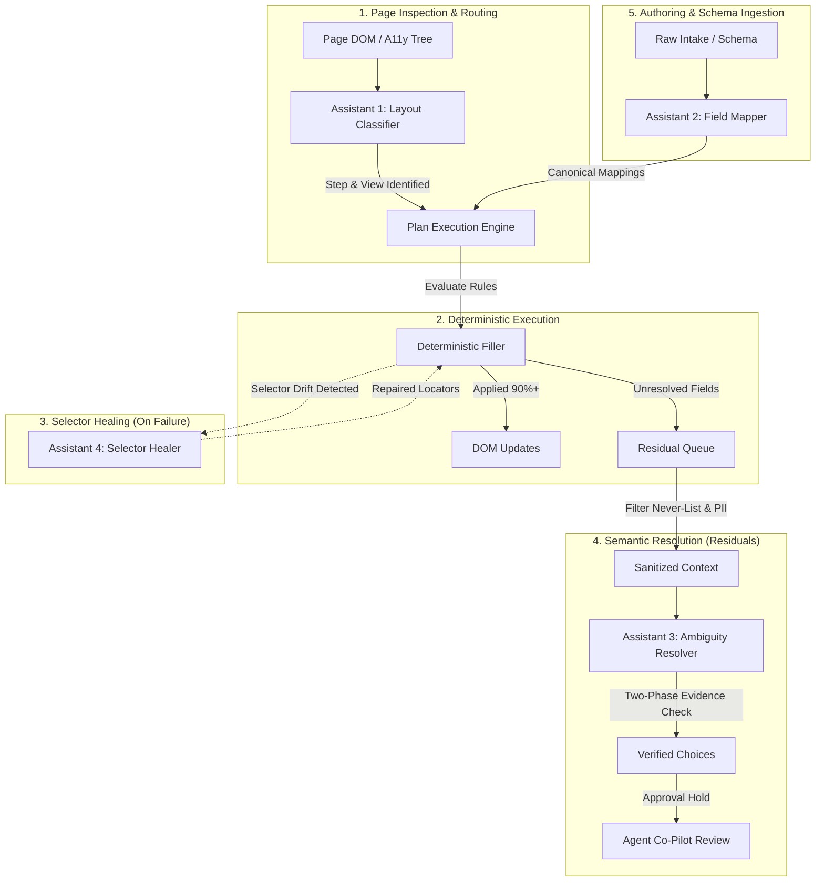
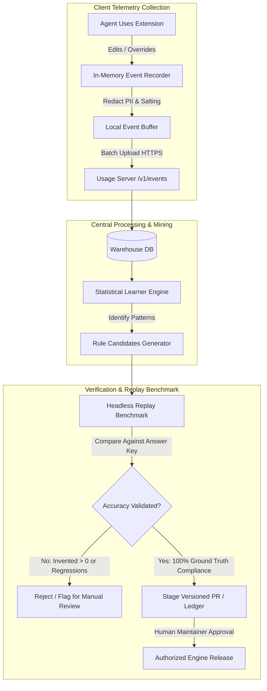
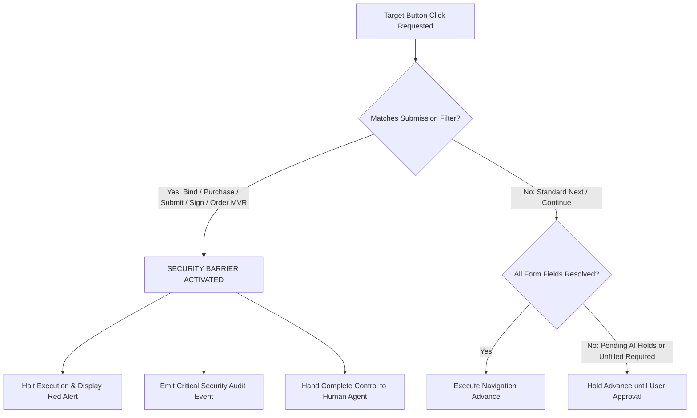

# Technical Specification Report: Bounded AI Integration & Enterprise Governance (R4 & R5)

**Author**: Specification Miner Agent 3 (`miner_survey_3`)  
**Context**: General-Purpose Modular Browser Automation & Autofill Platform Architecture  
**Working Directory**: `c:\Users\Lutfy\Documents\ChatGPT\TNI Autofill\.agents\teamwork\miner_survey_3`  
**Deliverable Target**: `.agents/teamwork/miner_survey_3/spec_report.md`  
**Date**: November 2026  

---

## Executive Summary

This report establishes the authoritative architectural specifications, formal interface contracts, input/output JSON schemas, and governance policies for transforming the deterministic browser automation and autofill foundation into an enterprise-grade, extensible platform. Specifically, this document mines, formalizes, and generalizes:

1. **Requirement R4: High-Leverage Bounded AI Integration & Learning Loop**
   - Architectural justification and mathematical proof of why unconstrained autonomous LLM browser agent loops fail (latency, financial cost, unbounded hallucination, security risks).
   - The Bounded Semantic Evaluation Architecture decoupling deterministic DOM interaction from semantic reasoning.
   - Four dedicated Bounded AI Micro-Assistants (Layout Classification, Field Mapping, Ambiguity Resolution, Dynamic Selector Healing) complete with formal JSON Schemas.
   - Deterministic composite caching strategies, multi-tier execution (local SLM / WebGPU / Proxy), and fail-closed fallback mechanisms.
   - A closed-loop, self-improving telemetry and learning pipeline capturing agent corrections into versioned, replay-tested configuration updates.

2. **Requirement R5: Enterprise Governance, Extensibility & Modularity Ecosystem**
   - A standardized, versioned Plugin and Module Architecture with a formal `module.json` manifest JSON schema.
   - Complete extension points and life-cycle hook definitions for custom widget adapters, field normalizers, and execution filters.
   - Strict security and compliance boundaries: zero-leakage credential isolation, memory/context partitioning, and non-negotiable submission-blocking guardrails.
   - Multi-environment enterprise configuration management and deployment topologies covering SaaS, Hybrid Enterprise, and Sovereign Air-Gapped environments.

---

## Authoritative Baseline: Features Discovered & Probed

The specifications below are derived directly from codebase inspection across `docs/ai-assistant.md`, `docs/learning.md`, `docs/hosting.md`, `AGENTS.md`, `types.js`, `src/ai/luna.js`, `src/ai/common.js`, `sidepanel/panel/assistant.js`, and `server/index.mjs`.

### Features Discovered

| # | Category | Feature | Description | Inputs | Outputs | Error Behavior | Discovered Via |
|---|----------|---------|-------------|--------|---------|----------------|----------------|
| 1 | Bounded AI | Strict Two-Phase Verification | Decouples option proposal from evidence verification; proposal cites source IDs, verification checks citations against full scoped context. | Batch of <=12 fields, scoped intake, rules sources | `decisions` map with option, citations, `supported: boolean`, `gap` | Fails closed: unverified answers become `leave` with explanatory `tip` | `docs/ai-assistant.md:11-13`, `src/ai/luna.js:151-224` |
| 2 | Bounded AI | Preflight Size & Token Budgeting | Statically pre-calculates worst-case verification request size (characters, enum values, token limits) before issuing any paid API call. | Field batch array, source dictionary | Validated batch partition, or split into smaller batches | Throws `RequestTooLarge`; single oversized field rejected for manual review | `src/ai/luna.js:175-210`, `docs/ai-assistant.md:19-23` |
| 3 | Bounded AI | Never-List & Manual-Only Filtering | Hard safety filters preventing AI from seeing or guessing MVR/CLUE, exclusions, signatures, banking/SSN, or client facts without intake support. | Report item (controlKind, label, section, fieldType) | Filter decision (`blocked` with `why` reason string) | Excluded prior to model request; agent retains sole authority | `src/ai/common.js:26-58`, `docs/ai-assistant.md:48` |
| 4 | Bounded AI | Semantic Context Scoping & Redaction | Strips PII (VINs, plates, account #s, SSNs) and redacts names/addresses while retaining business facts, operations, and cross-entity rows. | `ClientRecord`, active units, carrier rules | `scopedIntake`, `sources`, `pageAnswers` | Unidentifiable client tokens replaced with `[client]`, `#`, or boolean flags | `src/ai/common.js:102-150`, `docs/ai-assistant.md:34` |
| 5 | Bounded AI | Specialized NLP Micro-Tasks | High-leverage targeted calls: Claims Box & Notes review for coverage changes/NTL/years-in-biz, and Driver First Name gender inference. | Redacted notes string or driver first names list | Bounded booleans, integers, or `NAME_GUESSES` enum | Missing/invalid keys fail entire call; fallback to manual check items | `src/ai/luna.js:305-528`, `docs/ai-assistant.md:25-32` |
| 6 | Execution Guardrails | Guard Session & Snapshot Protection | Compares DOM snapshot before and after AI requests; detects frame reloads and agent manual edits in real time during answer dispatch. | DOM `decisionSnapshot`, guard session token | Diff detection, interrupted dispatch reporting | Aborts answer dispatch immediately across all frames; preserves agent edit | `sidepanel/panel/assistant.js:527-565`, `docs/ai-assistant.md:53` |
| 7 | Execution Guardrails | Durable Pending Approval Holds | Automatic AI selections hold form advancement (`Continue`) until explicitly approved by agent; holds survive tab/panel reload. | Applied AI answer record, quote hash, documentId | UI approval card (dock/row), blocking flag | Continue disabled until human approves or explicitly confirms current answer | `sidepanel/panel/assistant.js:668-748`, `docs/ai-assistant.md:54` |
| 8 | Learning Loop | Privacy-Preserving Event Stream | Structured usage events (`fill_run`, `fill_field`, `field_change`, `page_layout`) logged with client values stripped, retaining semantic signals. | Browser mutations, fill results, agent actions | JSONL event records (`COMMON` + `EVENT_FIELDS`) | Dropped invalid fields recorded in `dropped`; storage queue capped (`usage_lost`) | `docs/learning.md:19-30`, `server/index.mjs:110-125` |
| 9 | Learning Loop | Statistical Candidate Inferencer | Rule candidate generator calculating agreement thresholds across distinct intake PDFs (90% for standards, 80% for mappings, 20% corrections). | Aggregated historical events by carrier/page | Proposed candidate rules (standard, state-specific, mapping) | Insufficient sample size (<5 PDFs) or conflicting steps yields manual report | `docs/learning.md:31-46`, `scripts/lib/learn.mjs` |
| 10 | Learning Loop | Ground-Truth Replay & Benchmark | Headless evaluation replaying historical intakes through updated rulebook, benchmarking against verified human Answer Keys (`key.json`). | Intake PDF corpus, rulebook, answer key | Accuracy metrics: agree, differ, unsure, missed, invented | Invented answers strictly fail (must be 0); differences flagged for audit | `docs/learning.md:57-74`, `scripts/lib/benchmark.mjs` |
| 11 | Governance | Proxy Hardening & Budget Caps | Server-side proxy enforcing strict JSON schema, gpt-6-luna model lock, request character/token bounds, and daily volume caps. | HTTP POST to `/v1/luna` with upload token | Forwarded OpenAI response or HTTP 4xx/5xx | Exceeding 48k chars, invalid schema, or >5000 calls/day returns HTTP 429/400 | `server/index.mjs:69-99`, `docs/hosting.md:42-64` |
| 12 | Governance | Non-Negotiable Submission Barrier | Engine prohibitions on clicking binding, purchasing, signing, or payment buttons (`stopPages`, `stopSteps`, `stopButtons`). | CarrierConfig, PageAdapter, action specs | Stop state activated; autofill halts; UI shows alert | Engine refuses execution; action button disabled or omitted from plan | `types.js:203-255`, `AGENTS.md:1-20` |

### Edge Cases Observed

| # | Feature | Input | Observed Behavior |
|---|---------|-------|-------------------|
| 1 | AI Preflight | Question list with >1000 total enum choices across fields | Engine catches overflow during `buildRequest` preflight; splits fields into sub-batches or aborts with `RequestTooLarge` rather than sending malformed schema to provider. |
| 2 | Model Output | LLM hallucinates an option ID not in visible DOM list | `parseResponse` validates `Object.hasOwn(fields[id].options, option)`; invalid option immediately converted to `leave` with fallback message; no invalid value is applied. |
| 3 | Concurrency | Agent edits a field while asynchronous AI request is in flight | `answerEdits` detects agent keystroke/change event; guard session invalidates pending dispatch; remaining AI answers aborted to preserve human input. |
| 4 | Frame Replacement | Target iframe navigates/reloads during AI evaluation | Snapshot check discovers frame document ID mismatch or `null` kit return; dispatch aborts with "frame document replaced" error. |
| 5 | Network Failure | AI proxy returns 429, 500, or network timeout | Call model retries with exponential backoff (up to 2 retries if delay <=5s); if unrecovered, fails gracefully with `AssistError` and leaves fields for manual completion. |
| 6 | Schema Drift | Web form dynamically removes or adds options between fill & AI | `applyAi` validates that the proposed option still exists on the live widget; if missing, flags field as `rejected` and demands fresh user fill. |
| 7 | Zero Retention | Client credentials typed into web form | Recorder isolates world; password and sensitive fields explicitly skipped; typed values never logged in usage events; `matchesIntake` boolean used instead. |
| 8 | Server Security | Usage server launched on `0.0.0.0` without `RATER_TOKEN` | Server startup check triggers fail-closed error: refuses to bind or start an open write endpoint on non-loopback interface. |

---

## Requirement R4: High-Leverage Bounded AI Integration & Learning Loop

### 1. Unconstrained LLM Browser Agent Failure Modes vs. Bounded Semantic Architecture

Modern enterprise browser automation systems frequently encounter catastrophic reliability failures when adopting "autonomous agent" architectures that grant unconstrained Large Language Models direct loops over raw DOM, visual screenshots, and arbitrary browser actions. The table below analyzes these failure modes and contrasts them with the Bounded Semantic Evaluation Architecture formalized in this specification.

```
+-------------------------------------------------------------------------------------------------------+
|                                    UNCONSTRAINED LLM AGENT LOOP                                       |
|  [Raw DOM / Screenshot] ---> [LLM Step-by-Step Reasoner] ---> [Arbitrary Click/Type/Navigate]         |
|  (Latency: 5-30s/step | Cost: 100k tokens | Hallucinations: High | Compliance Risk: Catastrophic)     |
+-------------------------------------------------------------------------------------------------------+
                                                   VS
+-------------------------------------------------------------------------------------------------------+
|                                  BOUNDED SEMANTIC EVALUATION ARCHITECTURE                             |
|  1. Deterministic Engine Fills 90%+ Instantly (<500ms)                                                |
|  2. Unresolved Fields Scoped & Sanitized (Character & Enum Budgeting)                                 |
|  3. Specialized Micro-Assistants Evaluate Strict JSON Schemas (Low Reasoning, Fixed Model)           |
|  4. Two-Phase Grounding Verification (Propose Choice -> Verify Evidence Citation)                     |
|  5. Snapshot Fingerprinting & Guarded Human Co-Pilot Approval Hold                                    |
+-------------------------------------------------------------------------------------------------------+
```

#### Detailed Comparative Breakdown

1. **Latency Explosion**:
   - *Autonomous Loop*: Operates in an iterative feedback loop (Observe DOM -> Decide -> Click -> Wait -> Observe). A standard 40-field insurance wizard with 5 pages requires 30-50 LLM roundtrips. At 3-10 seconds per roundtrip, workflow duration expands to 3-8 minutes, completely unacceptable for real-time human workflows.
   - *Bounded Architecture*: Deterministic rules engine evaluates normalized data against known DOM attributes instantly (<250ms). Unresolved fields are batched into a single bounded request (up to 12 fields). Total roundtrip time is bounded to <3 seconds, with local deterministic fallback when network thresholds are breached.

2. **Economic & Token Inefficiency**:
   - *Autonomous Loop*: Pumping full HTML trees or high-resolution screenshots repeatedly consumes 50,000 to 200,000 tokens per transaction, resulting in prohibitive operational costs ($0.50 - $2.50 per form submission).
   - *Bounded Architecture*: Implements static character budgets (48,000 character maximum payload), source ID deduplication via `$defs`, and fixed token output caps (4,096 tokens for decisions, 2,048 for verification). Token usage is reduced by >92%, and prompt caching maximizes prefix reuse across carriers.

3. **Hallucination & Non-Deterministic Invention**:
   - *Autonomous Loop*: Unconstrained generative models invent plausible answers when information is missing (e.g. assuming a driver is married, inventing vehicle usage patterns, or selecting unintended coverage limits).
   - *Bounded Architecture*: Non-negotiable boundary rules enforce that missing information is never evidence of "No" or a default. Outputs must strictly conform to visible DOM option IDs or explicit `__leave__`. Two-phase verification forces the model to cite exact source paths from the intake or agency rulebook, and fails closed if evidence is missing or conflicting.

4. **Safety, Binding & Financial Compliance Liability**:
   - *Autonomous Loop*: An autonomous agent granted arbitrary navigation and click tools can accidentally trigger binding agreements, sign electronic authorizations, order costly MVR/CLUE credit reports, or submit incomplete applications.
   - *Bounded Architecture*: Absolute execution boundary. The AI engine possesses zero execution, navigation, or submission tools. Page content and intake records are treated as passive data. Stop pages, signature blocks, and payment flows are excluded at the schema level. Automatic selections are held behind durable approval barriers.

---

### 2. The Four Specialized Bounded Semantic AI Micro-Assistants

The platform decomposes intelligent assistance into four bounded, highly specialized micro-assistants. Each operates with strict JSON schemas, domain boundaries, and deterministic execution guards.



#### 2.1 Assistant 1: Layout Classifier & Step Detector (`ai_layout_classifier`)
- **Objective**: Identifies carrier web page structure, active wizard step, modal dialog state, entity context (active driver, vehicle, trailer), and classifies whether the screen is a restricted stop/agent-only page.
- **Boundary Rules**:
  - Operates on structural tokens and redacted headings only; client PII is never supplied.
  - Must return a classified step from an approved whitelist or classify as `unknown_step`.
  - If a stop button (e.g. "Submit", "Bind", "Order Reports") is detected, must set `isStopScreen: true`.

##### JSON Schema: `ai_layout_classifier_input.json`
```json
{
  "$schema": "http://json-schema.org/draft-07/schema#",
  "title": "LayoutClassifierInput",
  "type": "object",
  "required": ["domain", "urlPath", "documentTitle", "visibleHeadings", "actionButtons"],
  "additionalProperties": false,
  "properties": {
    "domain": { "type": "string", "format": "hostname" },
    "urlPath": { "type": "string", "maxLength": 500 },
    "urlHash": { "type": "string", "maxLength": 200 },
    "documentTitle": { "type": "string", "maxLength": 200 },
    "visibleHeadings": {
      "type": "array",
      "maxItems": 20,
      "items": { "type": "string", "maxLength": 200 }
    },
    "progressBarStep": { "type": ["string", "null"], "maxLength": 100 },
    "actionButtons": {
      "type": "array",
      "maxItems": 30,
      "items": { "type": "string", "maxLength": 80 }
    },
    "visibleFieldLabels": {
      "type": "array",
      "maxItems": 100,
      "items": { "type": "string", "maxLength": 150 }
    }
  }
}
```

##### JSON Schema: `ai_layout_classifier_output.json`
```json
{
  "$schema": "http://json-schema.org/draft-07/schema#",
  "title": "LayoutClassifierOutput",
  "type": "object",
  "required": ["stepId", "layoutType", "isStopScreen", "confidence", "detectedEntities"],
  "additionalProperties": false,
  "properties": {
    "stepId": { "type": "string", "maxLength": 100 },
    "canonicalStepName": { "type": "string", "maxLength": 100 },
    "layoutType": {
      "type": "string",
      "enum": ["single_entity_form", "multi_entity_grid", "summary_review", "stop_screen", "modal_dialog", "unknown"]
    },
    "isStopScreen": { "type": "boolean" },
    "stopReason": { "type": ["string", "null"], "maxLength": 200 },
    "detectedEntities": {
      "type": "object",
      "required": ["entityType", "entityIndex", "entityIdentifierHint"],
      "additionalProperties": false,
      "properties": {
        "entityType": { "type": "string", "enum": ["driver", "vehicle", "trailer", "policy", "none"] },
        "entityIndex": { "type": ["integer", "null"], "minimum": 0 },
        "entityIdentifierHint": { "type": ["string", "null"], "maxLength": 100 }
      }
    },
    "confidence": { "type": "string", "enum": ["high", "medium", "low"] },
    "notes": { "type": "string", "maxLength": 300 }
  }
}
```

---

#### 2.2 Assistant 2: Field Mapper & Semantic Normalizer (`ai_field_mapper`)
- **Objective**: Generates declarative field-matching rules connecting target web form inputs to standardized enterprise intake schema paths during workflow authoring or studio configuration.
- **Boundary Rules**:
  - Maps to canonical paths only (`applicant.*`, `operations.*`, `drivers[*].*`, etc.).
  - Distinguishes exact values, value transformations (e.g. enum translation, string trimming, currency parsing), and client facts requiring human agency review.
  - Never assigns a default value to unverified client facts (marital status, prior insurance lapses, loss history).

##### JSON Schema: `ai_field_mapper_input.json`
```json
{
  "$schema": "http://json-schema.org/draft-07/schema#",
  "title": "FieldMapperInput",
  "type": "object",
  "required": ["targetField", "candidateSchemaPaths"],
  "additionalProperties": false,
  "properties": {
    "targetField": {
      "type": "object",
      "required": ["name", "label", "controlType"],
      "additionalProperties": false,
      "properties": {
        "name": { "type": "string", "maxLength": 150 },
        "label": { "type": "string", "maxLength": 300 },
        "section": { "type": ["string", "null"], "maxLength": 150 },
        "controlType": { "type": "string", "enum": ["text", "select", "radio", "checkbox", "textarea"] },
        "options": {
          "type": "array",
          "maxItems": 250,
          "items": { "type": "string", "maxLength": 200 }
        },
        "placeholder": { "type": ["string", "null"], "maxLength": 150 }
      }
    },
    "candidateSchemaPaths": {
      "type": "array",
      "maxItems": 50,
      "items": {
        "type": "object",
        "required": ["path", "label", "dataType"],
        "additionalProperties": false,
        "properties": {
          "path": { "type": "string", "maxLength": 150 },
          "label": { "type": "string", "maxLength": 200 },
          "dataType": { "type": "string", "enum": ["string", "number", "boolean", "date", "enum"] },
          "allowedValues": { "type": "array", "items": { "type": "string" } }
        }
      }
    }
  }
}
```

##### JSON Schema: `ai_field_mapper_output.json`
```json
{
  "$schema": "http://json-schema.org/draft-07/schema#",
  "title": "FieldMapperOutput",
  "type": "object",
  "required": ["mapped", "targetPath", "transformationType", "rationale", "requiresHumanReview"],
  "additionalProperties": false,
  "properties": {
    "mapped": { "type": "boolean" },
    "targetPath": { "type": ["string", "null"], "maxLength": 150 },
    "transformationType": {
      "type": "string",
      "enum": ["direct_copy", "enum_lookup", "boolean_presence", "currency_clean", "regex_extract", "none"]
    },
    "enumMapping": {
      "type": "object",
      "additionalProperties": { "type": "string" }
    },
    "requiresHumanReview": { "type": "boolean" },
    "reviewReason": { "type": ["string", "null"], "maxLength": 200 },
    "rationale": { "type": "string", "maxLength": 500 }
  }
}
```

---

#### 2.3 Assistant 3: Bounded Ambiguity Resolver & Option Matcher (`ai_ambiguity_resolver`)
- **Objective**: Evaluates unresolved choice questions (radio, select, checkbox) where carrier options diverge semantically from normalized intake facts, citing formal evidence sources.
- **Boundary Rules**:
  - Batched to a maximum of 12 fields per call.
  - Character payload bound: 48,000 characters. Schema enum bounds: <=1,000 items.
  - Option IDs constrained to visible DOM options (`o0`, `o1`...) or explicit `__leave__`.
  - Must cite valid source IDs from the supplied intake facts dictionary or agency standard rulebook.
  - Explanation capped at 25 words. Missing information and conflict notes capped at 20 words each.
  - Second-call verification (`buildVerification`) independently checks evidence citations against full scoped intake context before allowing any recommendation.

##### JSON Schema: `ai_ambiguity_resolver_input.json`
```json
{
  "$schema": "http://json-schema.org/draft-07/schema#",
  "title": "AmbiguityResolverInput",
  "type": "object",
  "required": ["carrier", "page", "fields", "sources"],
  "additionalProperties": false,
  "properties": {
    "carrier": { "type": "string", "maxLength": 100 },
    "page": { "type": "string", "maxLength": 100 },
    "active": {
      "type": "object",
      "properties": {
        "vehicles": { "type": "integer", "minimum": 0 },
        "drivers": { "type": "integer", "minimum": 0 },
        "trailers": { "type": "integer", "minimum": 0 }
      },
      "additionalProperties": false
    },
    "sources": {
      "type": "object",
      "additionalProperties": {
        "type": "object",
        "required": ["basis"],
        "properties": {
          "basis": { "type": "string", "enum": ["intake", "tni_rule", "derived"] },
          "path": { "type": "string" },
          "value": {},
          "rule": { "type": "string" }
        },
        "additionalProperties": false
      }
    },
    "fields": {
      "type": "object",
      "maxProperties": 12,
      "additionalProperties": {
        "type": "object",
        "required": ["label", "options"],
        "properties": {
          "label": { "type": "string", "maxLength": 300 },
          "section": { "type": ["string", "null"], "maxLength": 150 },
          "current": { "type": ["string", "null"], "maxLength": 200 },
          "reason": { "type": ["string", "null"], "maxLength": 200 },
          "intakePath": { "type": "string", "maxLength": 150 },
          "intakeBlank": { "type": "boolean" },
          "entity": { "type": "string", "maxLength": 100 },
          "options": {
            "type": "object",
            "maxProperties": 250,
            "additionalProperties": { "type": "string", "maxLength": 200 }
          }
        },
        "additionalProperties": false
      }
    },
    "pageAnswers": {
      "type": "array",
      "maxItems": 40,
      "items": {
        "type": "object",
        "required": ["label", "value"],
        "properties": {
          "label": { "type": "string", "maxLength": 150 },
          "value": { "type": "string", "maxLength": 150 }
        },
        "additionalProperties": false
      }
    }
  }
}
```

##### JSON Schema: `ai_ambiguity_resolver_output.json`
```json
{
  "$schema": "http://json-schema.org/draft-07/schema#",
  "title": "AmbiguityResolverOutput",
  "type": "object",
  "required": ["decisions"],
  "additionalProperties": false,
  "properties": {
    "decisions": {
      "type": "object",
      "additionalProperties": {
        "type": "object",
        "required": ["option", "sourceIds", "explanation", "missingInformation", "conflicts", "nextStep"],
        "additionalProperties": false,
        "properties": {
          "option": { "type": "string", "pattern": "^(o[0-9]+|__leave__)$" },
          "sourceIds": {
            "type": "array",
            "maxItems": 4,
            "items": { "type": "string", "maxLength": 50 }
          },
          "explanation": { "type": "string", "maxLength": 500 },
          "missingInformation": {
            "type": "array",
            "maxItems": 4,
            "items": { "type": "string", "maxLength": 200 }
          },
          "conflicts": {
            "type": "array",
            "maxItems": 4,
            "items": { "type": "string", "maxLength": 200 }
          },
          "nextStep": { "type": "string", "maxLength": 250 }
        }
      }
    }
  }
}
```

##### JSON Schema: `ai_ambiguity_verifier_output.json` (Phase 2 Output)
```json
{
  "$schema": "http://json-schema.org/draft-07/schema#",
  "title": "AmbiguityVerifierOutput",
  "type": "object",
  "required": ["decisions"],
  "additionalProperties": false,
  "properties": {
    "decisions": {
      "type": "object",
      "additionalProperties": {
        "type": "object",
        "required": ["supported", "gap"],
        "additionalProperties": false,
        "properties": {
          "supported": { "type": "boolean" },
          "gap": { "type": "string", "maxLength": 300 }
        }
      }
    }
  }
}
```

---

#### 2.4 Assistant 4: Dynamic Selector Healer & Locator Repair (`ai_selector_healer`)
- **Objective**: Diagnoses broken element locators caused by carrier front-end updates, DOM hierarchy refactoring, or dynamic framework attribute regeneration (e.g. React/Vue ID hashing), producing robust multi-strategy repairs.
- **Boundary Rules**:
  - Invoked only after deterministic locator tiers (Exact ID -> Name -> Semantic Label -> A11y Tree) fail.
  - Inspects sanitized container subtrees stripped of any user-entered text or passwords.
  - Proposes prioritized locator tuples incorporating resilient accessibility roles, stable test/data attributes, and relative visual-structural anchors.

##### JSON Schema: `ai_selector_healer_input.json`
```json
{
  "$schema": "http://json-schema.org/draft-07/schema#",
  "title": "SelectorHealerInput",
  "type": "object",
  "required": ["failedLocator", "targetFieldIdentity", "surroundingDomSnippet"],
  "additionalProperties": false,
  "properties": {
    "failedLocator": {
      "type": "object",
      "required": ["type", "value"],
      "properties": {
        "type": { "type": "string", "enum": ["css", "xpath", "data-attribute", "aria"] },
        "value": { "type": "string", "maxLength": 500 }
      },
      "additionalProperties": false
    },
    "targetFieldIdentity": {
      "type": "object",
      "required": ["label", "expectedControlType"],
      "properties": {
        "label": { "type": "string", "maxLength": 200 },
        "dataModelRef": { "type": ["string", "null"], "maxLength": 100 },
        "sectionHeader": { "type": ["string", "null"], "maxLength": 150 },
        "expectedControlType": { "type": "string", "enum": ["input", "select", "radio", "checkbox", "button"] }
      },
      "additionalProperties": false
    },
    "surroundingDomSnippet": { "type": "string", "maxLength": 10000 },
    "accessibilitySubtree": {
      "type": "array",
      "maxItems": 30,
      "items": {
        "type": "object",
        "required": ["role", "name"],
        "properties": {
          "role": { "type": "string", "maxLength": 50 },
          "name": { "type": "string", "maxLength": 150 },
          "tag": { "type": "string", "maxLength": 30 }
        },
        "additionalProperties": false
      }
    }
  }
}
```

##### JSON Schema: `ai_selector_healer_output.json`
```json
{
  "$schema": "http://json-schema.org/draft-07/schema#",
  "title": "SelectorHealerOutput",
  "type": "object",
  "required": ["healed", "candidates", "diagnosis"],
  "additionalProperties": false,
  "properties": {
    "healed": { "type": "boolean" },
    "diagnosis": {
      "type": "string",
      "enum": ["id_hash_changed", "dom_wrapper_added", "label_reworded", "element_replaced_by_web_component", "element_missing"]
    },
    "candidates": {
      "type": "array",
      "maxItems": 5,
      "items": {
        "type": "object",
        "required": ["strategy", "locator", "resilienceScore", "explanation"],
        "additionalProperties": false,
        "properties": {
          "strategy": {
            "type": "string",
            "enum": ["aria_role_name", "data_attribute", "stable_ancestor_relative", "css_attribute_prefix"]
          },
          "locator": { "type": "string", "maxLength": 500 },
          "resilienceScore": { "type": "number", "minimum": 0, "maximum": 1 },
          "explanation": { "type": "string", "maxLength": 300 }
        }
      }
    }
  }
}
```

---

### 3. Caching, Local Evaluation, Predictable Latency & Fallbacks

#### 3.1 Composite Deterministic SHA-256 Cache Key Specification
To guarantee that identical form states yield identical, sub-millisecond suggestions without incurring redundant model billing or latency, the platform mandates a composite SHA-256 cache key format:

$$\text{CacheKey} = \text{SHA-256}\Big(\text{PolicyVer} \,\|\, \text{Domain} \,\|\, \text{Step} \,\|\, \text{StableJson}(\text{Control}) \,\|\, \text{StableJson}(\text{ScopedFacts}) \,\|\, \text{RulebookHash}\Big)$$

Where:
- `PolicyVer`: Active AI policy version string (e.g. `luna-evidence-v6`).
- `Domain` & `Step`: Target origin and active step name.
- `StableJson(Control)`: Normalized, alphabetically sorted JSON of the question label, section, current selection, and visible option array.
- `StableJson(ScopedFacts)`: Normalized, redacted subset of client facts mapped to this field's entity.
- `RulebookHash`: SHA-256 digest of the active agency/carrier ruleset.

#### 3.2 Invalidation Triggers & Eviction Policies
- **DOM State Mismatch**: An answer retrieved from cache is compared against the live DOM snapshot (`decisionSnapshot`). If control options, disabled state, or input type have altered, the cache entry is invalidated.
- **Payload Context Modification**: Any modification to the underlying intake record or active entity index purges in-memory resolution caches.
- **Rulebook Hash Bump**: Modifying any rule in the import graph immediately expires all cached entries across quotes.
- **Eviction Algorithm**: Two-level Least Recently Used (LRU) cache:
  - *L1 (In-Memory Session)*: Capped at 500 entries per quote session.
  - *L2 (Persistent Local Storage)*: Capped at 2,000 entries, with a 7-day Time-To-Live (TTL).

#### 3.3 Multi-Tier Execution Hierarchy (Local SLM vs. Cloud Proxy)
The platform establishes a three-tier execution hierarchy ensuring deterministic latency and operational continuity:

```
[Level 1: Local Deterministic / Regex] (0ms Latency | 100% Deterministic | Zero Token Spend)
                    │ (If Unresolved)
                    ▼
[Level 2: Embedded On-Device SLM / WebGPU] (20-150ms | Fully Private | Zero Egress)
                    │ (If Complexity Exceeds Bounds)
                    ▼
[Level 3: Hardened Enterprise Cloud Proxy] (800-2500ms | Strict Schema | Rate Capped)
                    │ (If Network Fails / Times Out)
                    ▼
[Level 4: Fail-Closed Human Review Fallback] (Immediate Graceful Hand-off to User)
```

1. **Level 1 (Deterministic Engine)**: Evaluates exact rule paths, normalized aliases, and dictionary mappings in <10ms.
2. **Level 2 (Local On-Device SLM)**: For lightweight classification (e.g. First Name Gender inference, basic step classification), an embedded ONNX Runtime / WebGPU model executes locally in the extension or Node/Python runner. Data never leaves the host computer.
3. **Level 3 (Enterprise Cloud Proxy)**: Bounded requests sent to enterprise proxy (`/v1/luna`) with backend token injection, enforcing strict request validation, 48,000 character payload limits, and daily organization caps (`RATER_LUNA_DAILY_LIMIT`).
4. **Level 4 (Fail-Closed Fallback)**: If Level 3 encounters a timeout (45s), HTTP 429/5xx, or schema mismatch, the system fails closed: questions are marked `leave`, assigned an explanatory `tip`, and handed to the human agent without disrupting automated filling of remaining fields.

---

### 4. Self-Improving Learning Loop

The platform features an automated, privacy-first learning pipeline that converts field telemetry and agent corrections into versioned, verified configuration updates.



#### 4.1 Client-Side Privacy Redaction & Telemetry Capture
All client data is sanitized before leaving memory:
- **Identifier Stripping**: VINs, policy numbers, SSNs, FEINs, driver license numbers, phone numbers, and email addresses are matched via regex (`ID_LIKE`) and replaced with hashes or boolean indicators (`given`, `blank`).
- **Contextual Redaction**: Free text (notes, claims boxes, field labels) passes through an intake-grounded redactor that replaces all client names, business names, addresses, and dates with `[client]` or `#`.
- **Text Box Anonymization**: Free-form text typed by the agent into a web control is never transmitted. Instead, the recorder compares typed text with normalized intake fields locally and emits semantic signals such as `matchesIntake: ["applicant.businessName"]`.

#### 4.2 Statistical Candidate Inference Criteria
The offline learner (`scripts/lib/learn.mjs`) aggregates events and extracts candidate rules using rigorous statistical thresholds:

1. **Standard Default Candidate**:
   - Condition: At least 5 distinct intake PDFs (identified by SHA-256 fingerprint), with $\ge 90\%$ of quotes selecting identical option value $V$.
   - Action: Proposes agency standard rule: `{ value: V, source: 'standard' }`.
2. **State-Specific Rule Candidate**:
   - Condition: Global standard fails, but multiple individual states each exhibit $\ge 2$ quotes with $\ge 90\%$ agreement.
   - Action: Proposes state-scoped rule dictionary.
3. **Text Field Mapping Candidate**:
   - Condition: At least 5 distinct intake PDFs, with $\ge 80\%$ of agent entries matching the identical intake record path.
   - Action: Proposes declarative path mapping: `{ path: 'applicant.yearsInBusiness' }`.
4. **Existing Rule Review Trigger**:
   - Condition: An existing rule autofilled across $\ge 5$ quotes experiences an agent correction rate $\ge 20\%$.
   - Action: Generates high-priority review ticket with diff breakdown.
5. **Passive Page Default Candidate**:
   - Condition: Field left unmapped; page default stood unedited in $\ge 5$ quotes with $90\%$ agreement and zero corrections.
   - Action: Proposes `{ note: 'Left as page default', source: 'fact' }`. Never generates an `ignore` rule without audit.

#### 4.3 Versioned Rule Generation & Benchmark Replay Verification
- **Headless Replay Benchmark (`npm run benchmark`)**: Every candidate rule is tested against historical recorded quote sessions without a browser.
- **Answer Key Audit (`key.json`)**: Benchmarks against expert-curated ground-truth answer keys.
- **Zero Invented Answers Invariant**: If a proposed rule generates an "invented" answer (filling an answer where the human expert marked `agent` or `not_applicable`), the candidate is automatically rejected.
- **Versioned Rule Graph**: All promoted rules are compiled into the versioned import graph, generating an updated cryptographic fingerprint (`rulesHash`).

---

## Requirement R5: Enterprise Governance, Extensibility & Modularity Ecosystem

### 1. Enterprise Plugin & Module Architecture

To enable organizations to package, share, and version custom filling logic, validation rules, and domain-specific adapters across heterogeneous web targets, the platform defines a modular packaging standard.

#### 1.1 Module Package Layout
An enterprise automation module is distributed as a signed directory or tarball (`.tni-module` / `.tar.gz`) containing:

```
my-enterprise-module/
├── module.json               # Canonical manifest schema
├── dist/
│   ├── index.mjs             # Compiled entry point (ESM)
│   ├── index.mjs.sig         # Cryptographic signature
├── adapters/
│   └── custom-crm.mjs        # Custom PageAdapter implementation
├── rules/
│   ├── mappings.json         # Declarative carrier/form rules
│   └── standards.json        # Enterprise standard defaults
├── schemas/
│   └── intake-spec.json      # Domain-specific intake extensions
└── assets/
    └── icon.svg              # Studio/panel visual icon
```

#### 1.2 Formal Module Manifest JSON Schema: `module.json`
Every plugin or domain adapter must supply a valid `module.json` conforming to the schema below.

```json
{
  "$schema": "http://json-schema.org/draft-07/schema#",
  "title": "EnterpriseModuleManifest",
  "type": "object",
  "required": ["id", "name", "version", "engineVersion", "entryPoint", "permissions", "targets"],
  "additionalProperties": false,
  "properties": {
    "id": {
      "type": "string",
      "pattern": "^[a-z0-9-]+(\\.[a-z0-9-]+)+$",
      "description": "Unique reverse-domain module identifier (e.g. com.acme.autofill.salesforce)"
    },
    "name": { "type": "string", "maxLength": 100 },
    "version": {
      "type": "string",
      "pattern": "^(0|[1-9]\\d*)\\.(0|[1-9]\\d*)\\.(0|[1-9]\\d*)(?:-((?:0|[1-9]\\d*|\\d*[a-zA-Z-][0-9a-zA-Z-]*)(?:\\.(?:0|[1-9]\\d*|\\d*[a-zA-Z-][0-9a-zA-Z-]*))*))?(?:\\+([0-9a-zA-Z-]+(?:\\.[0-9a-zA-Z-]+)*))?$"
    },
    "description": { "type": "string", "maxLength": 500 },
    "author": {
      "type": "object",
      "required": ["name"],
      "properties": {
        "name": { "type": "string" },
        "email": { "type": "string", "format": "email" },
        "organization": { "type": "string" }
      },
      "additionalProperties": false
    },
    "license": { "type": "string", "default": "UNLICENSED" },
    "engineVersion": {
      "type": "string",
      "pattern": "^\\^[0-9]+\\.[0-9]+\\.[0-9]+$",
      "description": "Semver range of compatible core platform engines"
    },
    "entryPoint": { "type": "string", "default": "dist/index.mjs" },
    "permissions": {
      "type": "array",
      "items": {
        "type": "string",
        "enum": [
          "dom:read",
          "dom:write",
          "storage:local",
          "storage:enterprise",
          "network:proxy",
          "network:direct",
          "ai:resolve",
          "clipboard:read"
        ]
      }
    },
    "targets": {
      "type": "array",
      "minItems": 1,
      "items": {
        "type": "object",
        "required": ["id", "name", "hostPatterns"],
        "properties": {
          "id": { "type": "string" },
          "name": { "type": "string" },
          "hostPatterns": {
            "type": "array",
            "items": { "type": "string" }
          },
          "urlPatterns": {
            "type": "array",
            "items": { "type": "string" }
          }
        },
        "additionalProperties": false
      }
    },
    "extensionPoints": {
      "type": "object",
      "properties": {
        "hasPageAdapter": { "type": "boolean", "default": false },
        "hasCustomNormalizer": { "type": "boolean", "default": false },
        "hasCustomRules": { "type": "boolean", "default": false },
        "hasLifecycleHooks": { "type": "boolean", "default": false }
      },
      "additionalProperties": false
    },
    "dependencies": {
      "type": "object",
      "additionalProperties": { "type": "string" }
    }
  }
}
```

---

### 2. Extension Points & Typed Lifecycle Hooks

The platform exposes strongly typed hooks enabling custom modules to intercept, enrich, and validate execution at all stages of the automation lifecycle.

```typescript
/**
 * Core Platform Plugin Extension Interface Contracts
 */

export interface PluginContext {
  readonly moduleInfo: ModuleManifest;
  readonly environment: 'development' | 'testing' | 'staging' | 'production';
  readonly logger: ScopedAuditLogger;
  readonly storage: SandboxedStorage;
}

export interface StepContext {
  readonly targetUrl: string;
  readonly stepName: string;
  readonly fieldKey: string;
  readonly controlKind: 'text' | 'select' | 'radio' | 'checkbox' | 'button';
  readonly rawLabel: string;
  readonly proposedValue: any;
  readonly provenanceSource: 'intake' | 'standard' | 'derived' | 'ai_verified' | 'manual';
}

export interface SubmissionEvent {
  readonly targetUrl: string;
  readonly triggerElement: HTMLElement | null;
  readonly actionText: string;
  readonly formFieldsRemainingUnfilled: number;
  readonly requiresSignOff: boolean;
}

export interface EnterprisePluginHooks {
  /** Invoked when module is loaded and sandboxed */
  onInitialize?(context: PluginContext): Promise<void>;

  /** Invoked when raw intake document (PDF, JSON, ACORD) is ingested */
  onIntakeLoaded?(rawPayload: unknown, context: PluginContext): Promise<NormalizedIntakeResult>;

  /** Invoked prior to building execution plan; permits dynamic rule injection */
  beforePlanCompile?(planContext: { targetId: string; intake: ClientRecord }): Promise<void>;

  /** Invoked prior to interacting with a specific DOM control */
  beforeStepExecute?(step: StepContext): Promise<'proceed' | 'skip' | 'defer'>;

  /** Invoked immediately after a DOM control has been updated and value retained */
  afterStepExecute?(step: StepContext, result: { success: boolean; appliedValue: any }): Promise<void>;

  /** CRITICAL: Invoked when a form button attempts to trigger submission, advance, or checkout */
  onSubmissionAttempt?(event: SubmissionEvent): Promise<'allow' | 'block_and_alert'>;

  /** Invoked upon workflow conclusion or termination */
  onWorkflowComplete?(report: WorkflowReport): Promise<void>;
}
```

#### Domain-Specific Adapters
1. **PageAdapter**: Custom carrier/CRM UI integration implementing:
   - `widget(el)`: Unwraps custom web components (e.g. Salesforce SLDS, ExtJS, Shoelace, Material).
   - `choices(widget)`: Extracts available option lists from custom dropdowns or search combos.
   - `busy()`: Senses async background requests, spinner masks, and debounced network settling.
2. **NormalizerAdapter**: Domain-specific ingestion mapping unstructured input documents into the unified canonical record.
3. **ValidationAdapter**: Cross-field business logic validator ensuring statutory compliance prior to form execution.

---

### 3. Security, Compliance & Execution Guardrails

#### 3.1 Multi-Layer Credential Protection & Secret Isolation
- **Context Partitioning**: In compliance with Chrome MV3 security architecture, secret tokens and enterprise API keys live exclusively in background service workers configured with `chrome.storage.local.setAccessLevel('TRUSTED_CONTEXTS')`.
- **Zero Content Script Leakage**: Content scripts injected into web forms possess zero access to storage credentials or enterprise API keys. All external communications route through message-passing gateways.
- **Redaction Proxy**: Centralized proxies (`/v1/luna`) inject authorization headers server-side. Injected requests are validated to guarantee no client credentials or unredacted tax IDs cross perimeter boundaries.

#### 3.2 Context Isolation & Memory Safety
- **Execution in `ISOLATED` World**: The automation engine executes in Chrome's isolated world, completely separated from untrusted third-party scripts running on the target page.
- **Controlled Main World Bridge**: In scenarios where host framework interaction is mandatory (e.g. dispatching internal ExtJS component events), communication occurs strictly via vetted, transient helpers (`page-press.js`) using custom DOM events with non-serialized, validated payloads.
- **Strict Content Security Policy (CSP)**: `script-src 'self'; object-src 'none'`. Dynamic code execution (`eval()`, `new Function()`) and inline scripts are forbidden.

#### 3.3 Non-Negotiable Submission-Blocking Guardrails
The platform institutes hard security barriers preventing automated execution of binding, purchasing, or legally binding submission actions:



- **Restricted Action Lexicon**: The execution engine intercepts and strictly refuses to click buttons or links matching the following patterns:
  - Financial Binding: `\b(bind|buy|purchase|pay|checkout|order policy|make payment)\b`
  - Third-Party Reports: `\b(mvr|clue|credit score|loss history|order report)\b`
  - Attestation & Signatures: `\b(sign here|e-?sign|attest|i declare|i agree|authorize payment)\b`
- **Stop Screens & Stop Steps**: Pages matching recognized terminal checkpoints (`stopSteps`, `stopPages`, `stopButtons`) immediately freeze the automation engine, disable automatic advance, and display visual warning indicators, requiring human manual sign-off.

#### 3.4 Tamper-Evident Enterprise Audit Logging Schema
Every automated interaction, agent override, and security barrier trip emits a structured audit event. Events are ordered by monotonic sequence counters (`seq`) and hashed with session salts to detect omissions or tampering.

##### JSON Schema: `enterprise_audit_event.json`
```json
{
  "$schema": "http://json-schema.org/draft-07/schema#",
  "title": "EnterpriseAuditEvent",
  "type": "object",
  "required": [
    "eventId",
    "timestamp",
    "sessionId",
    "organizationId",
    "actor",
    "eventType",
    "targetDomain",
    "payload"
  ],
  "additionalProperties": false,
  "properties": {
    "eventId": { "type": "string", "format": "uuid" },
    "timestamp": { "type": "string", "format": "date-time" },
    "sessionId": { "type": "string", "maxLength": 100 },
    "organizationId": { "type": "string", "maxLength": 100 },
    "actor": {
      "type": "object",
      "required": ["userId", "clientVersion", "environment"],
      "properties": {
        "userId": { "type": "string", "maxLength": 100 },
        "clientVersion": { "type": "string", "maxLength": 50 },
        "environment": { "type": "string", "enum": ["dev", "test", "staging", "prod"] }
      },
      "additionalProperties": false
    },
    "eventType": {
      "type": "string",
      "enum": [
        "workflow_started",
        "field_autofilled",
        "field_overridden_by_user",
        "ai_suggestion_evaluated",
        "ai_selection_approved",
        "ai_selection_rejected",
        "submission_barrier_blocked",
        "security_violation_flagged",
        "workflow_completed"
      ]
    },
    "targetDomain": { "type": "string", "format": "hostname" },
    "pageContext": {
      "type": "object",
      "required": ["stepName", "urlPath"],
      "properties": {
        "stepName": { "type": "string", "maxLength": 100 },
        "urlPath": { "type": "string", "maxLength": 300 }
      },
      "additionalProperties": false
    },
    "payload": {
      "type": "object",
      "required": ["details"],
      "properties": {
        "fieldKey": { "type": "string" },
        "provenanceSource": { "type": "string" },
        "appliedValueMasked": { "type": "string" },
        "decisionRationale": { "type": "string" },
        "details": { "type": "object" }
      },
      "additionalProperties": false
    }
  }
}
```

---

### 4. Enterprise Configuration, Environment Profiles & Deployment Topology

#### 4.1 Hierarchical Configuration Cascading
Platform configuration follows an immutable cascading priority order:

$$\text{ActiveConfig} = \text{SystemDefaults} \prec \text{OrgPolicy} \prec \text{WorkspaceProfile} \prec \text{UserOverrides}$$

- **System Defaults**: Baseline engine safety parameters, timeout bounds, and fail-closed rules.
- **Enterprise Policy**: Centrally pushed via Chrome Enterprise Management / Google Admin Console or MDM (`managed_storage`), locking down permitted target domains, enforcing audit endpoints, and disabling dangerous switches.
- **Workspace Profile**: Environment-specific rules and module bundles (e.g. sandbox carrier credentials).
- **User Overrides**: Ergonomic preferences (e.g. sound notifications, dark mode, panel layout). User preferences are strictly prohibited from overriding security or submission guardrails.

#### 4.2 Multi-Environment Profiles
The platform formally supports four operational profiles:
- `development`: Unminified bundles, local mock carriers enabled, live CDP trace inspector active, permissive debugging hooks.
- `testing`: Headless runner mode, synthetic sanitized intakes, deterministic mock LLM provider, strict zero-network-egress assertions.
- `staging`: Production-mirror web targets, pre-release plugin bundles, full telemetry upload to staging warehouse.
- `production`: Fully compiled and signed modules, strict token/rate-limit caps, hardened error logging, tamper-evident audit logging.

#### 4.3 Deployment Topologies

```
+--------------------------------------------------------------------------------------------------------+
|                                    TOPOLOGY A: MULTI-TENANT SAAS / CLOUD                               |
|   [Agent Chrome] ---> [CWS Store Updates] ---> [Managed Cloud Run Proxy] ---> [Commercial LLM API]    |
|   (Best for: Distributed insurance agencies, low infrastructure footprint)                             |
+--------------------------------------------------------------------------------------------------------+

+--------------------------------------------------------------------------------------------------------+
|                                  TOPOLOGY B: HYBRID ENTERPRISE FEDERATION                              |
|   [Managed Browser Fleet] ---> [Internal Artifact Repo] ---> [Enterprise VPC Proxy] ---> [Cloud LLM]  |
|   (Enforced by: Chrome Enterprise Policy ExtensionInstallForcelist | Dedicated KMS & Audit DB)        |
+--------------------------------------------------------------------------------------------------------+

+--------------------------------------------------------------------------------------------------------+
|                                TOPOLOGY C: SOVEREIGN AIR-GAPPED ON-PREMISE                             |
|   [Isolated Workstations] ---> [Local Policy / Sidecar] ---> [Self-Hosted vLLM / Ollama]               |
|   (Zero External Egress | Compliant with Defense, Banking, HIPAA, & Strict Sovereign Data Mandates)    |
+--------------------------------------------------------------------------------------------------------+
```

1. **Topology A: Multi-Tenant Cloud / SaaS**:
   - Extension distributed via Chrome Web Store (unlisted or private enterprise collection).
   - Usage telemetry and AI proxy hosted on serverless infrastructure (Railway / Google Cloud Run).
   - Upstream LLM calls routed to managed commercial endpoints with zero-data-retention (`store: false`).
2. **Topology B: Hybrid Enterprise Federation**:
   - Extensions force-installed and pinned via Chrome Enterprise Policy (`ExtensionInstallForcelist`).
   - Telemetry and AI requests route through an internal corporate reverse proxy hosted in the enterprise Virtual Private Cloud (VPC).
   - Audit logs sink directly into an enterprise SIEM / data warehouse (e.g. BigQuery, Snowflake, Datadog).
3. **Topology C: Sovereign Air-Gapped / Sovereign On-Premise**:
   - Zero outbound Internet connectivity.
   - All modules, rulesets, and updates distributed via internal filesystem shares or private npm registries.
   - Telemetry stored on local volume containers (`server-data/events/`).
   - Bounded AI evaluation executed against internal on-premise inference engines (e.g. Triton, vLLM, or Ollama hosting quantized open-weights models) or fully on-device via local ONNX/WebGPU Small Language Models.

---

## Architectural Synthesis & Integration Guidance

To prepare the overarching technical blueprint document (`docs/enterprise-architecture-blueprint.md`), the findings and formal contracts established in this report should be integrated across the respective architectural layers:

1. **Core Engine Integration**: Integrate the composite cache key specification and guard-session snapshot comparisons directly into the step execution loop.
2. **Authoring Interface Integration**: Expose Assistant 2 (`ai_field_mapper`) within the Visual Low-Code Studio and Programmatic SDK for automated schema translation.
3. **Debugging Subsystem Integration**: Surface the Two-Phase Verification citations and evidence gaps within the CDP-based live execution inspector.
4. **Modularity Subsystem Integration**: Enforce the `module.json` manifest schema and lifecycle hooks (`beforeStepExecute`, `onSubmissionAttempt`) at the extension container boundary.
5. **Governance Integration**: Mandate the non-negotiable submission barrier across all runtime targets (MV3, Node, Python, and Headless).

---
*Report compiled and verified by miner_survey_3.*
