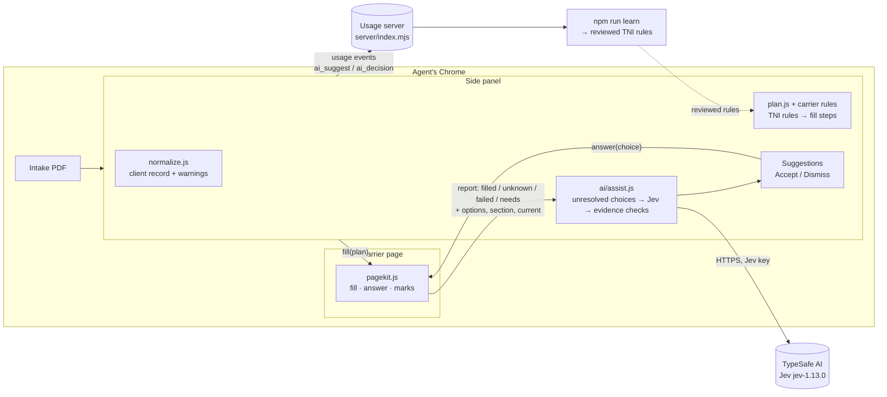
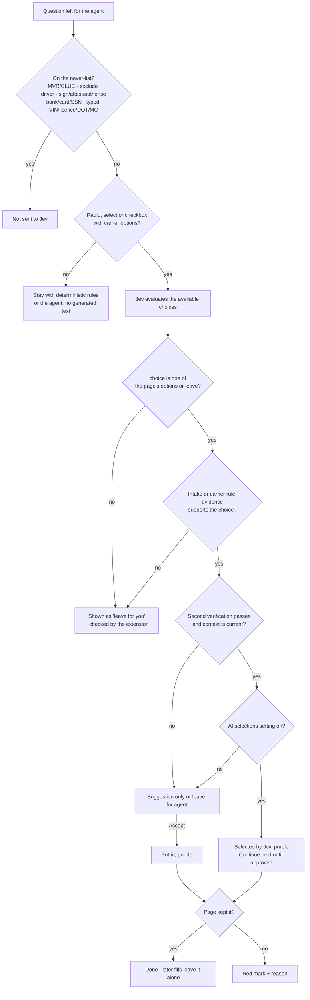
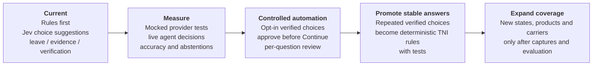
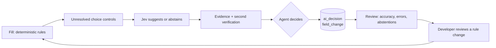

# AI assistant: rule-first Jev architecture

The rules engine remains the source of decisions that can be made exactly. It reads the intake,
applies carrier mappings and TNI's written rules, and fills the page. The AI assistant handles the
small remainder: an unresolved radio, select or checkbox where the carrier's available options do
not have an exact deterministic mapping.

The provider is TypeSafe AI **Jev** (`jev-1.13.0` by default) through
`https://api.typesafe.ai/v1/systemone`. The agent's Jev key and model are stored per device in the
extension settings. The legacy OpenAI key and model settings are not sent to any provider.

Jev is a choice and recommendation layer, not a replacement for the rule engine. It can return one
of the options the page actually offers or `leave` for the agent. It does not create text for form
fields, infer typed identifiers, click controls, navigate pages, perform lookups or submit a quote.

## Where it sits



## One page, step by step

```mermaid
sequenceDiagram
  autonumber
  actor Agent
  participant Panel as Side panel
  participant Kit as pagekit (rater page)
  participant AI as TypeSafe AI Jev

  Agent->>Panel: Fill this page
  Panel->>Kit: fill(plan)
  Kit-->>Panel: report (filled, unknown, failed, noData, leftRequired)
  Panel->>Panel: collectItems(): keep unresolved choice controls; drop never-list questions
  Panel->>AI: current options + active intake facts + carrier-scoped TNI rules
  AI-->>Panel: exact choice or leave + evidence + confidence
  Panel->>Panel: check option, evidence, active context and stale request
  Panel->>AI: proposed choice + selected evidence + active intake
  AI-->>Panel: support probability (Noul)
  Panel->>Panel: validate verification and automatic-selection thresholds
  alt auto-select enabled and conservative checks pass
    Panel->>Kit: answer(choice)
    Kit-->>Panel: kept by the page? (settle + re-read) → purple mark
  end
  Panel-->>Agent: suggestions with reasons and evidence
  Agent->>Panel: Accept
  Panel->>Kit: answer(choice)
  Kit-->>Panel: ok → purple mark / not kept → red mark + reason
```

## What Jev may do



Rules the code enforces, whatever Jev says:

- Rules and exact carrier mappings run before Jev. Jev never overrides a deterministic answer.
- The request contains only unresolved choice controls. Typed text, dates, amounts and identifiers
  stay with deterministic rules or the agent.
- A choice must be one of the page's current options. `leave` is always available, including when
  the model is uncertain or the evidence is incomplete.
- Evidence is selected from the active intake facts and the carrier-scoped TNI rules. The source must
  be one of the supplied intake facts or carrier rules; Jev then checks its relevance in a second call. The
  active driver, vehicle and trailer indexes are checked before the answer is used.
- A second verification stage checks the proposed option against the selected evidence. Model
  probabilities and confidence labels are signals for this process, not accuracy guarantees.
- Only a high-confidence answer with valid evidence and a passing verification can become an
  automatic candidate. The agent must opt into automatic selections, and the existing
  approve-before-Continue boundary remains in force.
- Answers the page already shows are not re-selected. After applying a choice, the page is read
  again; if it did not keep the answer, the result is marked failed for the agent.
- A manual edit wins over a pending or previously returned Jev answer. Context and edit checks
  prevent a late response from overwriting what the agent changed.
- Requests and responses are tied to the intake and active context. Late responses or responses
  after an intake, driver or vehicle edit are discarded.

## Data and settings

The request is sent directly from the extension to TypeSafe AI only when **Jev assistant** is on.
It contains the unresolved carrier questions and options, the active intake context needed to
interpret them, and the applicable TNI rules. The Jev key is stored locally per device and is
never written to usage events or logs. The extension does not send the key to the collection
server. MVR/CLUE orders, exclusions, signatures and attestations, payment or bank details, and
typed identifiers are excluded before a request is built.

The settings are separate from the old OpenAI settings:

| Setting | Purpose |
| --- | --- |
| `aiOn` | Enables Jev requests and suggestions. |
| `aiAuto` | Opts into applying eligible choice suggestions before the agent approves Continue. |
| `jevKey` | The agent's TypeSafe AI key, stored on that device and never logged. |
| `jevModel` | Jev model name; the default is the pinned `jev-1.13.0`. |

If no Jev key is configured, the rules engine still works and unresolved questions remain for the
agent. A live key is not part of the repository or test fixtures.

Automatic selection uses pinned `jev-1.13.0`, choice probability at least 0.98, derived
confidence at least 0.97, a top-to-runner-up margin of at least 0.95, evidence probability
at least 0.98, and verified support at least 0.99. Numerical/date/identity questions remain
manual recommendations. These are conservative starting thresholds, not calibrated accuracy.
A different configured model can suggest answers but cannot automatically select them until
its policy is explicitly validated in code. Requests batch four fields at a time, with two
stages per batch and bounded retries for 429/529 responses.

## Files

| File | Role |
| --- | --- |
| `src/ai/assist.js` | Unresolved choices → Jev request, response/evidence checks, auto-select eligibility |
| `src/ai/tni-rules.js` | TNI's carrier-scoped quoting rules as Jev reads them; keep in step with carrier rules |
| `src/content/pagekit.js` | `answer()` puts in a chosen option and verifies it; flagged fields carry options/section/current; purple `ai` mark |
| `sidepanel/sidepanel.js` | `runAssist`, `applyAi`, `renderAi`, Jev settings and approval boundary |
| `server/index.mjs` | Accepts `ai_suggest` and `ai_decision` usage events without receiving the Jev key |
| `test/assist.test.mjs` | Choice schema, never-list, evidence/response checks, stale-result and error handling |

## Usage events and evaluation

| Event | Contents |
| --- | --- |
| `ai_suggest` | model, time, choice questions sent, suggested / leave / auto-eligible counts, held-back count, provider usage, error |
| `ai_decision` | question id and redacted label, `accepted` / `dismissed` / `auto` / `failed`, chosen option (never typed text), confidence, evidence basis and intake path |

The key and client values are never logged. Agent changes after a Jev answer show up as ordinary
`field_change` events. Acceptance rate per question is `accepted` ÷ (`accepted` + `dismissed`),
but acceptance alone is not accuracy. The pilot also measures independently checked answer
accuracy, confidently-wrong answers, appropriate abstentions, evidence-verification failures,
latency and cost. A Jev confidence or probability value is not used as a measured accuracy rate.

The automated tests use deterministic mocked provider responses. They verify request boundaries,
choice validation, evidence checks, stale-response protection, manual edits and approval before
Continue; they do not establish Jev's live-model accuracy or latency.

## Rollout and learning loop





Each choice that repeatedly passes evidence verification and agent review can become a plain rule,
which is fast, deterministic and tested. Jev then handles only the next set of unresolved
questions while the system keeps a conservative abstention path.
