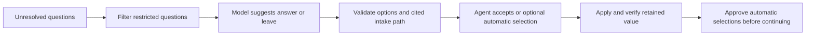

# AI assistance

Read this when changing AI suggestions, prompts, response validation, context reuse, or agent approval.

## Current role

The rules engine fills first. AI receives eligible unresolved fields (`unknown`, `failed`, `noData`, `leftRequired`) with the structured intake, active driver/vehicle, page context, and written TNI rules. It does not provide a complete audit of already-filled answers or automatically extract every request buried in notes.

The configured default is `gpt-6-luna` through the OpenAI Responses API, using the agent's key. Model and key are per-agent settings. The record and eligible page context leave the computer when assistance is enabled.

## Enforced behavior and its limits

- The never-list filters question text for MVR/CLUE, exclusions, signatures/attestations/authorizations, bank/card/SSN/password details, and typed identifiers. This is not a blanket redaction of the entire intake sent to the model.
- Choice answers must match available options; invalid choices become leave-for-agent results. Text suggestions are possible, but typed text is not automatically applied.
- A cited intake path must contain a value. A missing value downgrades the basis/confidence; path existence does not prove that the proposed answer follows from that value.
- Current `autoOk` permits applicable dropdown/radio/checkbox changes at high or medium confidence. It is not restricted to high confidence or intake/rule basis. Low-confidence answers stay suggestions.
- With automatic selections enabled, selected answers are marked purple and held for agent approval before Continue. Applying an answer uses the browser's retained-value check and respects manual edits.
- Cache/context identity includes the record and active entity. Discard late responses after context changes; never reuse one vehicle's answer merely because another vehicle has the same question.
- The model returns data; it has no direct navigation or submission tool. Page content and intake text must remain data, not instructions.

The AI exclusion filter does not override deterministic carrier rules: Progressive currently defaults its driver-exclusion question to No. See [intake and rules](intake-and-rules.md) when changing that behavior.

## Making changes

Keep the written [TNI rulebook](../src/ai/tni-rules.js) aligned with implemented carrier standards. A new client fact or agency decision needs evidence; model confidence and agent acceptance rates do not establish correctness.

Test invalid options, absent or misleading source paths, restricted questions, stale responses, manual edits, and approval-before-continue when those paths change. Preserve a leave-for-agent result when evidence is missing. Use [testing](testing.md) for harness setup.

Usage includes `ai_suggest` and `ai_decision`; reports summarize acceptance and failures. This does not fine-tune the model or promote rules automatically. Read [learning](learning.md) only if changing that feedback mechanism.

## Proposed work, not current capabilities

Potential extensions include confirmed extraction of free-text requests, a final requested-versus-entered check, AI-drafted rule proposals for human review, and centrally managed provider access. These are not committed milestones or permission to expand a task. Validate each against actual quote correctness, not acceptance rate alone.

## Related code and tests

- [assist.js](../src/ai/assist.js): `collectItems`, `buildRequest`, `parseResponse`, `assistContextKey`.
- [sidepanel.js](../sidepanel/sidepanel.js): `runAssist`, `applyAi`, caching, approval, and manual-edit protection.
- [pagekit.js](../src/content/pagekit.js): `answer`, retained-value checks, and marks.
- [assist tests](../test/assist.test.mjs), [panel safety tests](../test/sidepanel-safety.test.mjs), [ai-mock.mjs](../scripts/ai-mock.mjs): validation and controlled-provider interaction tests.
