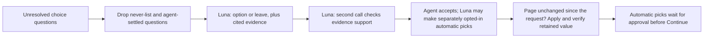

# AI assistance

Read this when changing AI suggestions, prompts, response validation, context reuse, or agent approval.

## Current role

**Its name in the panel** (maintainer, 2026-11-07): what the agent reads calls it the **AI assistant** ("The AI assistant suggests …", "Picked by the AI assistant", Settings → **AI assistant**, its errors and Intake check items), and never Luna; short tags and marks say **AI** ("AI · approved", "AI pick"), and the answer key names each mark with its tag's word (**AI**, **You**). Luna stays the name in code, internal identifiers, provider ids, the usage events and these documents. `test/assistant-name.test.mjs` fails on a string literal naming Luna in the panel, the assistant's messages (`src/ai/luna.js`, `common.js`) or a carrier's notes.

The rules engine fills first. AI only handles the small remainder: unresolved radio, select and checkbox questions (`unknown`, `failed`, `noData`, `leftRequired`) where no exact carrier mapping applies. It does not audit already-filled answers, produce typed text, click, navigate, look anything up, or submit.

The assistant uses OpenAI **GPT-6 Luna** at `https://api.openai.com/v1/responses`. **Suggest answers** is on unless the agent turns it off (`aiOn !== false`). With no key of the agent's own, requests go to the usage server's `/v1/luna` with the upload token, and the server adds TNI's `OPENAI_API_KEY` ([hosting](hosting.md)); `settingsFrom` in [providers.js](../src/ai/providers.js) builds that route (`proxy`) from the server in use, and `ready` says Luna can be asked. Settings (the gear, with a dot when Luna is on without a key) has it under **AI assistant**, folded until opened (it opens itself when Luna is on without a key) and named without the model: **Use my own key** (**Add key** when there is no server either) takes an OpenAI API key with **Save** (or Enter; nothing is saved while it is typed); that key goes straight to OpenAI. The model is fixed and not shown for editing. Settings are per-device: `aiOn`, `lunaKey`, `lunaAuto` and `lunaNames` (below); the fixed model is `gpt-6-luna`. They live in `chrome.storage.local`, which `background.js` restricts to the extension's own pages (`setAccessLevel('TRUSTED_CONTEXTS')`); Chrome honours that for local storage from version 140, the manifest's `minimum_chrome_version`, so content scripts cannot read the key. Legacy provider settings are ignored and never used as an OpenAI key. Automatic selection is off unless the agent enables it. Saved automatic decisions from a retired assistant remain holds for manual review and cannot release Continue by themselves. Decisions saved under an earlier policy version (v3, before the 2026-10-09 answer-provenance rulebook; v4, before the 2026-10-27 context below; v5, before the 2026-10-27 rulebook of a general part and one part per carrier; v6, before short client text kept a pick a suggestion, 2026-11-07) are retired the same way.

Luna policy v7 (`luna-evidence-v7`, `POLICY_VERSION` in `src/ai/luna.js`; v7 since 2026-11-07, when the rulebook became a pick resting only on short text the client typed stopped being automatic) is the safety contract's version, set by hand: the schema's shape, what may be picked automatically and what counts as evidence; changing it retires pending approval holds. Which prompt a review got is `promptHash` instead, worked out by code from both calls' instructions, the carrier's TNI rules as sent (an agent's own defaults included), the model and the policy version (12 hex characters). It is on each suggestion, on `ai_suggest` (a failed or dropped review's too: `suggest` puts it on the error) and `ai_decision`, and on a pending hold's record, so a rule edit shows in the log without a version bump and retires nothing. Luna uses the fixed `gpt-6-luna` model, low reasoning, low text verbosity, strict Structured Outputs, `store: false`, and no tools, `temperature`, or `top_p`. The deployment checklist requires omitting those sampling controls when reasoning is enabled. It reviews up to 12 eligible fields per adaptive request, and asks two such groups at a time (`GROUPS_AT_ONCE`; each group still needs both its calls, and the answers go in the questions' order; the first failure in that order is the review's, once both groups have ended), each call waiting up to 55 s (`TIMEOUT_MS`; through the usage server, which gives OpenAI 45 s, its 504 is said as too long), with a combined state and schema bound of 120,000 characters (`MAX_REQUEST_CHARS`); the usage server's own check allows 160,000, so everything the panel sends passes it. Choice output is capped at 4,096 tokens and verification output at 2,048 tokens; these are request budgets and do not represent actual billed token counts. The first call carries the complete bounded fact/rule source set once without duplicating the intake representation. The verification call carries the whole scoped intake and the evidence cited by the proposed choices. Both calls are required for a non-`leave` result. The same local answer cache is used, keyed on the policy version, so answers cached under an earlier version are asked again; no extended paid API cache configuration is enabled. The first call's input starts with the carrier and its TNI rules (the first sources, keyed by their rulebook ids), then the intake, page and fields, so every page review on a carrier starts with the same text, through its last rule, which the provider's automatic prompt cache can reuse. The Structured Outputs schema changes with each request's fields and sources, and OpenAI doesn't say where it sits in the cached prefix, so whether the start is reused shows only in the `cachedTokens` counter of live runs: not measured. The rules make each carrier's every request longer, so a page with long option lists splits into more groups sooner. With the committed intakes, one yes/no question and a page's other answers at their bound (about 6,000 characters) take about 47,300 characters on Progressive, 33,200 on GEICO and 32,600 on AmWINS; the longest one-question request the committed pages make (a state or commodity list) about 49,000 on Progressive, 40,000 on GEICO and 34,200 on AmWINS. `test/luna-budget.test.mjs` fails when that longest request passes 80% of the bound, so a growing rulebook shows in CI before a question can't be asked. A usage server from before the 120,000 bound refuses more than 48,000 characters (its 400 `request too large`, or 413 over twice that, when it may cut the connection first): the panel then plans the questions not yet reviewed again at 48,000 (`OLD_SERVER_CHARS`) and asks them, so it keeps working against that server. Nothing reached OpenAI or the day's count with the refused request.

Luna suggests current visible options with source IDs and a short explanation. Missing information, conflicts, absent/unknown evidence, invalid options, refusals, incomplete output, and unexpected models fail closed: an answer must come from `gpt-6-luna` or its dated snapshot (`gpt-6-luna-YYYY-MM-DD`, which the provider may report the alias as; `isLunaModel`), and any other model name, `gpt-6-luna-mini` say, is refused. The verification call checks each proposed option against its sources and intake. This is another judgment from the same model, not independent proof. Luna automatic selection is separately opt-in through `lunaAuto`; it can pick only a visible, applicable radio/select/checkbox choice when the verification succeeds, the choice differs from the current value, the field is outside the manual-only safety list, and the pick does not rest only on what the client wrote: when every intake source it cites is text the client typed (`restsOnClientText`): a free-text box (the claims box, its other notes, the additional notes) or a short text field (what they haul, which filings, the ELD brand, the radius as written, a name or an address), a TNI rule cited beside them or not, it stays a suggestion the agent approves on its row, never an automatic pick the dock's Approve for all could clear. Only such a text-only pick is held back: one that also cites a choice, yes/no, number, date or state the intake records, or a value code worked out, can still be automatic. It never displays a generated confidence percentage. Two judgments from the same model are not calibrated accuracy evidence. This request-budget change is intended to reduce prompt and output work; live latency, cost, and accuracy have not been measured. See the [model documentation](https://developers.openai.com/api/docs/models/gpt-6-luna), [Structured Outputs](https://developers.openai.com/api/docs/guides/structured-outputs), [latency optimization](https://developers.openai.com/api/docs/guides/latency-optimization), [deployment checklist](https://developers.openai.com/api/docs/guides/deployment-checklist), and [prompt caching](https://developers.openai.com/api/docs/guides/prompt-caching) for the provider contract and general optimization guidance.

Since 2026-10-27 (policy v5) a page review also carries, read-only, what the agent sees around the questions left to them. Each question says what code knows about it: `intakePath`, the intake field TNI's rules map it to (the fill report's `path`, only when that is an intake field, not a carrier's own key), with `intakeBlank` when the intake leaves it empty, and `entity`, the driver, vehicle or trailer row it is about (its intake path's, or a vehicle whose year and make the question's text names, when exactly one does: GEICO's quote page asks per-vehicle and per-driver questions on one page). The scoped intake adds those rows beside the active ones, at most two more per list (`rowsFor`), with the same identifier removal and redaction. `pageAnswers` lists the page's other choice questions and their current answers, from the decision snapshot the panel already takes (`pageAnswers` in [common.js](../src/ai/common.js)): never a typed value, nor a question on the never-list or about names, addresses or identifiers; labels and answers redacted with the intake's terms; at most 40 entries and about 6,000 characters. Page answers are context for consistency, not evidence: they are not sources and can't be cited, so they can't make an answer verifiable. The evidence check gets the same rows, the entity of each proposed answer and the page answers. An added row's facts are sources for the whole group, so code refuses a citation from a driver, vehicle or trailer row other than the field's own (its `entity`, else the active row): that field is left, as with no usable citation. Each decision now returns `nextStep`, one recommendation for the agent on a field left (the fact to confirm with the client or the intake detail to check, never an answer); for a blank mapped field the panel shows code's own sentence instead (“The intake leaves "Needs SR-22" blank: confirm it with the client, then add it under All client details.”). The evidence check returns `gap`, what is missing or conflicting when it refuses an answer, shown in place of the generic "could not verify". The panel shows the recommendation under "The AI assistant leaves this one to you." as **The AI assistant recommends: …**, text only: there is no button for it, and nothing about suggestions, approval or automatic selection changed. A missing, non-text or over-long `nextStep` or `gap` fails the whole response, as before.

Why: from 2026-10-09 to 2026-10-26 (policy v4, test intakes left out, one agent id), 58 page reviews in 21 quotes sent 121 questions; Luna suggested 10, left 76, and 13 requests failed (12 dropped because the page or intake changed meanwhile, 1 timeout). Joined with the fills' `fill_field` events, of the 113 questions it saw, 70 had no rule and no intake path (16 of them GEICO per-vehicle coverage questions about a vehicle that wasn't the active one), 24 mapped to an intake field that was blank (Luna wasn't told which), and 17 were failed fills. The log had no reason per question, so `ai_suggest` now also counts why questions were left: `leaveMissing`, `leaveConflict`, `leaveChose`, `leaveNoSource`, `leaveUnverified` (counts only; the usage server keeps them once it runs this version). Whether the added context lowers live leaves is not measured yet: the controlled mock and the offline eval cases prove the context reaches the requests, not live accuracy.

Before any paid model request, the planner conservatively sizes the possible verification request: the whole scoped intake, at most four cited sources per field, and the longest visible answer. It splits a group when that bound is exceeded. A single field that is still too large on its own (a long option list, say) is left to the agent without a model call (`leaveWhy` `tooLarge`, with the note "Too long for Luna to review … Answer it on the page."), and the page's other questions are still reviewed; only when no question fits does the review stop with "This page has too much context for Luna". A field Luna may not review at all (invalid, or on the never-list) still stops the whole review before any paid call. This keeps the evidence boundary explicit while avoiding a request that only fails after it reaches the provider.

The proposal schema shares the exact source-ID constraint through `$defs`/`$ref` instead of repeating it for every field. Groups also split before exceeding the Structured Outputs limit of 1,000 total enum values; no visible option or source is removed to fit a group.

The historical request shapes explain the scope of the optimization. The earliest Luna path used low reasoning and one request for up to 40 fields with an 8,000-token cap. The prior evidence-checked path used medium reasoning, up to four fields per batch, and two calls per batch with an 8,192-token cap. The optimized path uses low reasoning, up to 12 fields per batch, and two calls with 4,096/2,048-token caps. Twelve eligible fields therefore move from up to six calls to two when there are no size splits, retries, abstentions, or cache hits.

Luna also reads the intake's claims box once per intake (on the 2026-10 form, the claims box and the Additional Notes box as one text, `intakeNotes`), when assistance is on and Luna is ready (a key of the agent's own, or the usage server's `/v1/luna`). Code splits the box into lines (at most 20) and replaces client names, numbers and the street (`redactionTerms`) before one structured call answers per line: does it name non-trucking liability (NTL / bobtail), does it ask for coverage other than the form's ticked coverages, and how many years the business has operated or the year it started, as the line states them (integers or null; Luna copies, never calculates). Flagged lines become Intake check items (`ai.ntl`, `ai.coverage-change`) quoting the line (no `ai.ntl` once Non-trucking liability is Yes, from the form's Non-Trucking or the agent: `ntlSet`); code turns a start year into years and adds `ai.years-in-business` for the first line stating them when they differ from the intake's years in business (or years under own authority), including a blank one, which AmWINS otherwise quotes as a new venture ("in Biz for 3+ years" with no year established); a line the intake's own NTL check already quotes isn't repeated. Nothing is filled or ticked from them: the agent changes Requested coverage. There is no second verification call because nothing is applied. A malformed answer fails the whole review, and a failed review adds an Intake check item to read the box by hand; it is tried again when the assistant settings change (also when they change while a review is still out). An answer for a claims box or form coverages that changed meanwhile is dropped and the box read again; an edit to either after a finished review is read again too (a years-in-business entry made after the review leaves its item for the agent to tick), with Luna's earlier items replaced in place by info notes. NTL and GL (`coverage.ntl`, `coverage.gl`, `coverage.hasGl`) are Luna's own questions, not form coverage: setting them is no edit. The panel compares what Luna read with key order ignored (`stableJson`): chrome.storage gives the intake back with its keys sorted, and reopening the panel isn't an edit either. The same holds for the key a Luna answer is tied to (`assistContextKey`). NTL has its own flag; "coverage change" means any other change. The usage log records counts only (`ai_suggest`, page `ClaimsBox`, with the same token and cache counters as page reviews).
Since W44-09 (2026-10-26) the intake reader itself takes a plain statement such as "in Biz for 3+ years" (and, since the maintainer's answers that day, "over 3 years" or "about 3 years") when the form gives no year established, also over years under own authority ([Intake and rules](intake-and-rules.md)), so Luna's years item is for a line the reader doesn't take ("less than 3 years", "almost 3 years"; the maintainer's later answers that day made "less than 1 year" 0 and "18 months" 1, then "less than 6 months" 0, "two years" 2 and "1 year 6 months" 1, and on 2026-10-27 "under 6 months" and "under a year" 0, then "a year" 1, "half a year" 0 and "first year in business" 0, and later "a month" 0, "1.5 years" 1, "second year in business" 1 and "3-year-old business" 3, which the reader takes) or one that disagrees with the intake's years. A range in the notes whose ends differ ("2-3 years in business") is the agent's (V7, 2026-10-27): the reader's check names it, and Luna's years item then says the years are left to the agent (`yearsRange`), not that the quote gets New Venture or the authority years. So is another statement of years in business the reader doesn't take ("a few years", "almost 3 years", two figures that disagree, and such a statement beside a figure; round-6 answer 4 and round-7 answer 2, 2026-10-27): its check names the line, and Luna's years item says the same (`yearsUnread`).

Since 2026-10-10 the same call also answers, per line, whether it says the client has, wants or asks about general liability (`generalLiability`: GL, CGL; a line saying they don't is false). GL is its own question like NTL: neither is sent in `formCoverage`, a line asking for GL is not a coverage change, and setting either in the panel doesn't make Luna read the box again. Progressive's other business coverages are filled None of the above unless the notes say the client has GL (`coverage.hasGl`; GL asked for on the form, `coverage.gl`, doesn't change them: TNI, 2026-10-19), so when a line is flagged, code adds one Intake check item (`ai.gl`) for the first such line, whether or not the form's GL box is ticked. Its evidence is the line itself: code split it from the box and checks the flagged line is one it sent, so Luna can't supply a quote of its own. The card quotes the line (shortened past 120 characters) and offers **Client has GL**, which sets `coverage.hasGl = true` as the agent's edit (the client has GL; `coverage.gl` stays a request to quote GL, which puts the General Liability item on Rates; `coverage.hasGl` changes nothing there) (the same path as an edit in All client details: saved with the intake, listed in `agentEdited`, logged as `intake_edit` without the value; those questions are then left to the agent), and **Not GL**, which only checks the item. Without Luna (assistance off, or no key and no usage server), or when the review fails, nothing changes: other business coverages stay None of the above unless the agent sets `coverage.hasGl` in All client details.

Driver gender is filled MALE (TNI standard) unless `drivers[i].gender` is set. TNI approved the name-based check (the maintainer, 2026-11-07; rulebook entry `general.gender-name-check`), and it has its own switch in Settings, **Check driver names** (`lunaNames`, on unless the agent turns it off; `names` from `settingsFrom`), apart from Suggest answers: either can be off without the other, and the AI card's row says "On. Checks driver names." when it alone is on. Once per intake, with that switch on and Luna ready, a sibling call (`reviewDriverNames`, response format `driver_first_names`) asks whether each driver's first name is more often given to women. It sends **only first names**: the first word of each first-name field (letters, apostrophe or hyphen, two to thirty characters; initials are skipped), keyed `d<index>`, for drivers whose gender isn't set, at most 20. No last names, dates of birth, license data, business name or any other intake field go with them, and the claims-box and page reviews still replace names with `[client]`. Luna answers each with a bounded enum, `likely_female`, `likely_male` or `unclear`, never free text; a missing, extra or out-of-list answer fails the whole check. For `likely_female` on a driver whose gender is still unset and whose name is still the one sent, code adds an Intake check item (`ai.driver-gender`) that says gender is filled Male, names the first name, and says it's a guess from the name only. **Use Female** sets `drivers[i].gender = 'FEMALE'` and **Keep Male** sets `'MALE'`, both as the agent's edit. `likely_male` and `unclear` add nothing. A failure adds an info note (the TNI standard stands) and is tried again when the AI settings change; an answer for names edited meanwhile is dropped and the names read again, and a first-name edit after a finished check retires its items in place and asks again. The usage log records counts only (`ai_suggest`, page `DriverNames`). With the switch off or without Luna nothing is sent and gender stays Male unless the agent sets it.

The buttons on these cards come from code (`GL_CHOICES`, `genderChoices`), and the panel only applies a choice that is on its stored item, for that item's own field, and one of the allowed values (`coverage.hasGl` true; `drivers[i].gender` FEMALE or MALE).

With assistance on, this leaves the computer: the unresolved questions with their labels, sections, current values and option texts as the page shows them (unredacted, since the answer must be one of them, except a choice that names the client's people or place: a driver's or owner's name, or the garaging street, unit, city or ZIP, as the redactor would replace them. Such a choice goes as a placeholder saying whose it is, "Driver 1 (intake drivers[0])", "Owner (intake applicant.owner1)", "Owner 2 (intake applicant.owner2)", "Garaging city" and the like (a driver who is also the owner says both), its current answer too, and code maps Luna's pick back to the page's own choice by its place in the list (`pseudonymizeChoices` in [common.js](../src/ai/common.js); the maintainer, 2026-11-07). A choice is a driver's when it holds each word of their first and last name, an owner's when it holds each word of the name. Where code can't tell whose a choice is (part of a name only, two drivers or two owners in one choice, a person and the address, two choices for one placeholder, or a current answer naming the client that is none of the choices), the question is never sent and stays with the agent, counted in `blocked`. A pick between people is an identity match, so one made so is always a suggestion the agent approves, never an automatic pick. The business's own name doesn't count: its words are often a business class or cargo), the carrier-scoped TNI rules, the page's other choice answers (`pageAnswers`, above: redacted, no typed values), and the scoped intake (`scopedIntake`): the applicant, operations, garaging, coverage, claims, additional notes, trailer and prior-insurance sections and the active driver, vehicle and trailer, plus up to two more rows per list that the questions name. Identifier keys (VIN, license and plate numbers, FEIN, phone, email, account numbers) are removed and USDOT/MC become presence booleans; every remaining string is redacted with the claims-box review's term list (`redactionTerms`, `[client]` for the client's and owners' names, drivers' names and dates of birth, the garaging street, unit, city and ZIP, and contact and ID numbers), in the first call's evidence sources and in the verification call's intake alike. What still goes, in clear: the applicant's year established, years in business and of experience, whether the owner drives, the 60-day USDOT/MC answer and the application date; the garaging state; business class and every operations answer (what they haul, radius, ELD and its brand, SR-22, filings and which, hazmat and placards, moving state, team driving / slip seating, loads to Canada, personal use, vehicle ownership, equipment value); every coverage choice and limit; the whole trailer section (ownership, hitch, interchange and its limit, trailer equipment value); vehicle and trailer type, year, make, model and value; the license state, CDL, CDL year, marital status and gender when set of each driver row sent; prior insurance (type, carrier, limit, expiration) and the computed `priorPolicyExpired` and `noPriorInsurance` (the carrier says "NO POP", "No", "None" or "N/A" with no expiration date); and the claims box and notes with the terms replaced, with `hasClaims` and the NTL flag. The redaction is the same as the usage log's and has its limits: a value is replaced only where it appears as written in the intake's field, so the same date, phone or name written another way in the claims box or notes (1/2/1980 for 01/02/1980, (555) 123-4567 for 555-123-4567) is still sent; a term shorter than three characters is kept; and a single name word is replaced only as a whole word ("Ann" leaves "Annual", "Car" leaves "Cargo"), but a whole word shared by a name and a fact (a business called "Expediter Services") redacts the fact too. The prior carrier's name is not a term and is sent. Drivers' first names are the one exception to name redaction: the driver-name check above sends them, alone, in their own request (first word only, nothing else from the intake). Without Luna (assistance off, or no key and no usage server), deterministic rules still work and unresolved questions stay with the agent. OpenAI `store: false` does not imply zero retention under the provider's other policies.

## Enforced behavior and its limits

- The never-list filters question text for MVR/CLUE, exclusions, signatures/attestations/authorizations, bank/card/SSN/password details, and typed identifiers. A DOT-lookup identity mismatch is review-only. A question the rules leave to the agent as a client fact or attestation (`source: 'fact'`/`'attestation'`, or a `clientFact` rule the intake doesn't answer, such as marital status or vehicle ownership) carries `manualOnly` on its fill-report item, and so the status `agent` in its `resolution` ([intake and rules](intake-and-rules.md#resolution)), which `collectItems` reads to keep it from Luna entirely: no suggestion and no automatic pick. If the same control appears in multiple report groups (for example, an invalid prefilled answer also missing an intake fact), manual-only and review-only restrictions survive deduplication regardless of report priority. It filters questions; what the intake context contains is set by `scopedIntake` (above), whose redaction leaves business and coverage facts in clear.
- Questions the agent changed, or that an applied AI answer already settled on this page, are not sent again.
- The answer must be one of the page's current options or `leave`. Luna uses strict structured output and validates its option and source IDs; missing evidence, invalid output, or an unsupported choice becomes `leave`. The cited source must be one of the supplied intake facts or carrier rules.
- A second Luna call verifies that the cited evidence supports the proposed option. Both calls are required for any non-`leave` result, use the fixed `gpt-6-luna` model, and stay within the adaptive request and output budgets above.
- Luna automatic selection is opt-in through `lunaAuto`. It has no probability or confidence threshold: only a successfully verified, source-supported choice from the fixed `gpt-6-luna` model can be selected, and the field must be a visible/applicable radio, select or checkbox with a changed value outside the manual-only safety list. The second call is another judgment from the same model, not calibrated accuracy evidence.
- Before anything is applied, the panel compares the page with the snapshot taken when the request started (every control's current value). Any change, including an agent edit made while the request was pending, cancels the apply and asks for a fresh fill. The snapshot is read in every frame right after the kit is injected there; a frame whose document was replaced in between (a hidden chat frame still loading) has no kit and reads as `null`, which differs from any snapshot taken before, so that too is a change (before 2026-10-26 the read threw there: Chrome gave the panel `null` all the same and reported the error on that frame's page, checked in Chromium 153). `answer()` then checks the field's kind, section, options and current value, and that the page kept the answer. An agent edit while the answers go in keeps the agent's value on that question, protects its key from later fills, and stops the answers still to come, across all frames, including an edit in a frame that is waiting its turn or already finished (remaining answers are reported as not applied, with the reason); the recorder reports that edit as the agent's when the apply ends. Every dispatch checks the original guard session and current intake context, so a replaced frame document or changed intake stops remaining answers. Guarded edits remain protected in their original intake, tab, and vehicle/driver/page scope after a switch, including transport failures; only keys are retained. Intake replacement keeps those separately scoped records, while explicit Clear erases the current intake's records and prevents its late writes from restoring them without cancelling another intake's guarded edits ([browser filling](browser-filling.md)).
- Automatic picks are marked purple and hold Continue until the agent approves them: Approve or Reject in a pick's row, or the dock's Approve for all of them, which reads "Approve and continue" only when they are all that is left on the page. A suggestion (not put in) shows in its question's row with Use this answer and No thanks. Its card shows Luna's explanation and what the pick rests on (`cited`, from `citedSaid` in [luna.js](../src/ai/luna.js)): "Based on" each cited intake field's label, with its driver, vehicle or trailer number, and the value Luna was given (Yes/No, or the text shortened past 80 characters), or "TNI rule:" and the rule's text shortened past 120, which the card then also holds whole under **Read the whole rule**, closed until the agent opens it to check the rule's exceptions (`citedRules`, from `citedRuleFull`). A fact the intake has no box for reads by what it is ("Has a USDOT #", "Prior policy expired (worked out from the intake)"), and any other path the schema doesn't name by its last part in words, never as the path. The extension's own checks (`checks`: the choice is one of the field's options, every cited source exists) stay on the suggestion but are no longer printed on every card. A durable hold is recorded before answer dispatch, so intake/cache replacement or a transport failure after dispatch cannot erase it. A guard-read failure before the first answer is sent removes the preparation holds; a failure after any answer is sent retains the conservative holds for review. A trusted manual correction before Reject releases that hold; otherwise Reject keeps it until the agent changes that field or explicitly confirms the current page answer. Identity-bound pending holds survive panel reload and follow the physical quote across intake changes. They retire when the exact quote URL changes or the originating document is proven replaced or gone; a changed value in the same document remains a review hold. Picks made before intake edits or a driver/vehicle change stay listed (labelled); approval re-checks that the page is unchanged since the pick was applied, otherwise the pick stays unresolved for review. Durable pending records contain redacted display text and fingerprints, not intake copies or API keys. Approval and current-answer confirmation check the originating frame, document, question and expected value fingerprint, so a matching answer in another frame cannot release a hold and redacted names do not prevent review. Duplicate questions across frames are left for the agent before applying. Replacing or clearing the intake, changing the quote URL or evicting a cached pick invalidates in-flight approval callbacks. Ordinary agent-edited field keys also survive panel reload, scoped to the intake, tab and page, without saving typed values.
- Cached answers are keyed on the question as the page shows it (key, label, section, options, current value, status), what Luna's answers rest on (`assistContextKey`: the intake as Luna can see it, every row with identifiers removed and client terms redacted, the active driver/vehicle, and the carrier's TNI rules as sent, an agent's own defaults included), the model and the policy version. An intake edit Luna never sees (a phone number, a VIN) keeps the cached answers; a change to the agent's defaults or the rules asks again. Luna's optimized path keeps the same local answer cache and does not enable an extended paid API cache. Late responses after a tab, page, quote URL, intake, driver/vehicle, the agent's defaults or assistant settings change are discarded (logged with `error: "Answer discarded: …"`), and Luna stops between its model calls for them. A newer request for the same page, or a report redrawn by a fill of that page, does not discard an answer: it is cached, and a newer request whose questions an earlier one is still asking waits for that answer instead of asking again, then shows it in the redrawn report. From 2026-10-09 to 10-26, 12 of 58 page reviews ended "The page or intake changed", most of them on GEICO's quote page while a fill of the same page ran (`runAssist`, `state.aiAsking`). A kept answer is applied and approved like any other: `applyAi` checks the page snapshot of the request that shows it, and approval checks it again.
- Luna returns data and has no navigation or submission tool. Page content and intake text are data, not instructions.
- On a carrier's stop page, on a step that is the agent's (`stopSteps`: GEICO's Final Quote Details, MVR & CLUE and Payment Information), and on a stop screen (`stopButtons`: GEICO's Add USDOT Number, the agent's, and its referral page, GEICO's stop), Luna isn't asked and nothing is applied: `aiActionCurrent` refuses through `stopNoteFor`, and `answer()` puts nothing in while the page shows one of the stop steps the fills in that document were given.
- Successful Luna reviews report `tokensIn`, `tokensOut`, `modelCalls`, `reasoningTokens`, `cachedTokens`, and `cacheWriteTokens`. Reasoning tokens are included in the output count. `modelCalls` counts logical provider calls and excludes HTTP retries. These counters do not account for all possible spend from failed or timed-out requests.

The AI never-list does not override deterministic carrier rules: Progressive answers its driver-exclusion question No for a driver listed on the intake and Yes for one the intake marks excluded. See [intake and rules](intake-and-rules.md) when changing that behavior.

## Making changes

The [TNI rulebook](../src/ai/tni-rules.js) has a general part, TNI's decisions for every carrier ([general.js](../src/ai/rulebook/general.js): the intake is the source of truth, client facts and MVR/CLUE, signing, payment and navigation are the agent's, gender, year licensed, a blank CDL, a blank hazmat placard, NTL with its permanent lease, no prior insurance, a blank cargo deductible as the agent's), and one part per carrier for its pages, options, state exceptions and carrier-only standards ([progressive.js](../src/ai/rulebook/progressive.js), [amwins.js](../src/ai/rulebook/amwins.js), [geico.js](../src/ai/rulebook/geico.js)). `evidenceFor` in [common.js](../src/ai/common.js) gives Luna the general part and its own carrier's (`rulebookFor`, with the `rewrite` of [agents' own defaults](agent-defaults-spec.md) (`rulebookRewriteFor`), which gives nothing while that feature is switched off; on, it adds the agent's default to the entries stating the standard it replaces); a carrier without a part gets no TNI rules. Each entry has an id (`general.cdl-blank`, `geico.um`), which Luna cites, and a kind: `standard` (a TNI answer), `intake` (how an intake answer is read), `agent` or `workflow`. Every carrier rule that can be `standard` names the entry stating its answer (`tni`, in the general part or its carrier's), and every `standard` entry is named by a rule (or a click, GEICO's permanent lease) of a carrier that gets it: [test/rulebook.test.mjs](../test/rulebook.test.mjs) checks both ways, so a new or changed standard changes the code and the rulebook in the same change. The test matches ids, not wording: an entry still has to say what its rules do. GEICO's part states only standards GEICO's rules fill and [intake and rules](intake-and-rules.md) records as TNI's. Concepts the carriers still answer differently (medical payments or PIP, the current carrier's tenure) stay in the carrier parts. The rulebook states coverage and workflow standards, never a default for a client fact. A fact the intake doesn't give (marital status, year established, current-carrier tenure, loss runs, the vehicle registrant) is the agent's, and Luna must not cite a standard for it. The exceptions are TNI's 2026-10-10 standards: gender MALE unless set in client details, year licensed = birth year + 17 (the agent's without a readable date of birth), continuous coverage Yes when the intake shows current insurance, and other business coverages None unless the notes say the client has general liability ([intake and rules](intake-and-rules.md)). For-hire answers follow the business class, not the MC number. A new client fact or agency decision needs evidence; model output and agent acceptance rates do not establish correctness. Luna suggestions are on unless the agent turns them off, automatic selection remains opt-in, and both are subject to the approval hold. Keep exact mappings, calculations, and execution in code; use the model only for the bounded semantic choice that remains.

Test invalid options, missing or misleading sources, restricted questions, stale responses, manual edits, model identity and approval-before-Continue when those paths change. Preserve a `leave` result when evidence is missing. `npm run mock:luna` drives the packaged extension against controlled OpenAI responses and checks key isolation, automatic-selection setting, the driver-name check's own switch (it runs with Suggest answers off, and nothing is sent with both off), approval hold, rejection/manual correction, conflicts, stale responses, retired-assistant pending holds, that facts left to the agent (`manualOnly`) never reach Luna, that page reviews carry the fixture page's other answers (bounded, with no typed value and no name, address or identifier question), and that a field Luna left shows its recommendation; the agent dismisses those facts on the fixture page so only the Luna approval holds Continue. Mocked responses prove integration behavior, not live accuracy or latency. Use [testing](testing.md) for harness setup.

The evaluation runner (`npm run ai:eval`) supports offline `--score <saved-result.json>`, explicit Luna-only live mode with `--live`, and offline `--replay <responses.json>`, which runs today's code on the model answers a live run saved with `--responses` (only the response envelope, by request; a request built differently since has none and counts as a service error). It evaluates page reviews, the claims-box review (each line's NTL, coverage-change and general-liability flags and stated years, false positives and misses per flag) and the driver-name check (each guess, with a female name guessed male or the other way counted apart); results keep flags and guesses only, never line text or explanations. Live mode uses `OPENAI_API_KEY`, separately from extension settings, and is never run as part of unit or browser tests. The evaluation agent decides whether a live run is warranted. Committed cases are sanitized synthetic scenarios with `expertReviewed: false`; their proposed expected answers are not an expert answer key. Reports distinguish suggestions, abstentions, evidence paths, errors, timing and token usage; no output establishes calibrated automatic thresholds or live accuracy. Saved result case IDs must be unique; duplicate IDs are rejected before scoring.

Usage includes `ai_suggest` (model, `promptHash`, timing, counts, why questions were left (`leaveMissing`, `leaveConflict`, `leaveChose`, `leaveNoSource`, `leaveUnverified`, `leaveTooLarge`), provider usage, errors; a page review's error text passes the intake redactor first. Each call's tokens are counted as soon as it returns, so a review that fails or is dropped afterward, a page review, the claims-box review or the driver-name check, still logs what it spent with its error. Each is logged as the quote it began in, also when the intake was replaced while Luna answered: that intake gets nothing, and its quote's log keeps the usage, the answer logged as discarded) and `ai_decision` (redacted label, decision, chosen option, evidence basis, `promptHash`). The key and client values are never logged. Reports summarize acceptance and failures; this does not train the model or promote rules automatically. Read [learning](learning.md) only if changing that feedback mechanism.

## Proposed work, not current capabilities

Potential extensions include confirmed extraction of free-text requests, a final requested-versus-entered check, AI-drafted rule proposals for human review, and promoting repeatedly verified choices to deterministic rules. These are not committed milestones or permission to expand a task. Validate each against actual quote correctness, not acceptance rate alone.

## Related code and tests

- [luna.js](../src/ai/luna.js): Luna request/response contract, evidence checks, bounded request planning, and automatic-selection policy.
- [common.js](../src/ai/common.js): `collectItems`, `scopedIntake` and its redaction, and the read-only context (`rowsFor`, `entityOf`, `pageAnswers`).
- [providers.js](../src/ai/providers.js): the Luna-only settings adapter.
- [panel/assistant.js](../sidepanel/panel/assistant.js): `runAssist`, `pendingAi`, `applyAi`, `renderAi`, caching, approval and manual-edit protection. `renderAi` and `runAssist` say the cards as data, which [panel/ai-view.jsx](../sidepanel/panel/ai-view.jsx) draws with React: a row's card from its record (`aiCard`), the rest in the report's holder above the list ([its tests](../test/panel/ai-view.test.jsx)).
- [pagekit.js](../src/kit/pagekit.js): `answer`, `decisionSnapshot`, retained-value checks and marks.
- [Luna tests](../test/luna.test.mjs), [panel safety tests](../test/sidepanel-safety.test.mjs), and [luna-mock.mjs](../scripts/luna-mock.mjs): validation and controlled-provider interaction tests.
- [evaluation cases](../test/ai-eval/cases.json), [claims-box cases](../test/ai-eval/notes-cases.json), [driver-name cases](../test/ai-eval/names-cases.json) and [evaluation runner](../scripts/ai-eval.mjs): Luna-only evaluation scaffolding.
