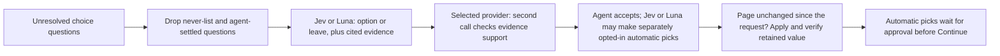

# AI assistance

Read this when changing AI suggestions, prompts, response validation, context reuse, or agent approval.

## Current role

The rules engine fills first. AI only handles the small remainder: unresolved radio, select and checkbox questions (`unknown`, `failed`, `noData`, `leftRequired`) where no exact carrier mapping applies. It does not audit already-filled answers, produce typed text, click, navigate, look anything up, or submit.

Agent options supports TypeSafe AI **Jev** at `https://api.typesafe.ai/v1/systemone` (`jev-1.13.0` by default), and OpenAI **GPT-6 Luna** at `https://api.openai.com/v1/responses`. Select a provider with the brain button, expand **Connection & model**, and enter its key. Settings are per-device: `aiProvider`, `jevKey`, `jevModel`, `lunaKey`, `aiAuto` for Jev automatic selection, and `lunaAuto` for Luna automatic selection. Keys never cross providers; the legacy `aiKey` is never reused. Existing configured Jev installations keep Jev; new installations start with Luna. Neither provider or automatic selection is enabled by default.

Luna policy v3 uses the fixed `gpt-6-luna` model, low reasoning, low text verbosity, strict Structured Outputs, `store: false`, and no tools, `temperature`, or `top_p`. The deployment checklist requires omitting those sampling controls when reasoning is enabled. It reviews up to 12 eligible fields per adaptive request, with a combined state and schema bound of 48,000 characters. Choice output is capped at 4,096 tokens and verification output at 2,048 tokens; these are request budgets and do not represent actual billed token counts. The first call carries the complete bounded fact/rule source set once without duplicating the intake representation. The verification call carries the whole scoped intake and the evidence cited by the proposed choices. Both calls are required for a non-`leave` result. The same local answer cache is used; no extended paid API cache configuration is enabled.

Luna suggests current visible options with source IDs and a short explanation. Missing information, conflicts, absent/unknown evidence, invalid options, refusals, incomplete output, and unexpected models fail closed. The verification call checks each proposed option against its sources and intake. This is another judgment from the same model, not independent proof. Luna automatic selection is separately opt-in through `lunaAuto`; it can pick only a visible, applicable radio/select/checkbox choice when the verification succeeds, the choice differs from the current value, and the field is outside the manual-only safety list. It never displays a generated confidence percentage. Two judgments from the same model are not calibrated accuracy evidence. This request-budget change is intended to reduce prompt and output work; live latency, cost, and accuracy have not been measured. See the [model documentation](https://developers.openai.com/api/docs/models/gpt-6-luna), [Structured Outputs](https://developers.openai.com/api/docs/guides/structured-outputs), [latency optimization](https://developers.openai.com/api/docs/guides/latency-optimization), [deployment checklist](https://developers.openai.com/api/docs/guides/deployment-checklist), and [prompt caching](https://developers.openai.com/api/docs/guides/prompt-caching) for the provider contract and general optimization guidance.

Before any paid model request, the planner conservatively sizes the possible verification request: the whole scoped intake, at most four cited sources per field, and the longest visible answer. It splits a group when that bound is exceeded; a single field that is still too large is rejected for manual review. This keeps the evidence boundary explicit while avoiding a request that only fails after it reaches the provider.

The proposal schema shares the exact source-ID constraint through `$defs`/`$ref` instead of repeating it for every field. Groups also split before exceeding the Structured Outputs limit of 1,000 total enum values; no visible option or source is removed to fit a group.

The historical request shapes explain the scope of the optimization. The earliest Luna path used low reasoning and one request for up to 40 fields with an 8,000-token cap. The prior evidence-checked path used medium reasoning, up to four fields per batch, and two calls per batch with an 8,192-token cap. The optimized path uses low reasoning, up to 12 fields per batch, and two calls with 4,096/2,048-token caps. Twelve eligible fields therefore move from up to six calls to two when there are no size splits, retries, abstentions, or cache hits.

With assistance on, unresolved questions/options, active intake context, and carrier-scoped TNI rules leave the computer. Exact identifier keys are filtered, but names, addresses, dates of birth and free-text notes may remain; this is not complete intake redaction. Without the selected provider's key, deterministic rules still work and unresolved questions stay with the agent. OpenAI `store: false` does not imply zero retention under the provider's other policies.

## Enforced behavior and its limits

- The never-list filters question text for MVR/CLUE, exclusions, signatures/attestations/authorizations, bank/card/SSN/password details, and typed identifiers. A DOT-lookup identity mismatch is review-only. This is not a redaction of the whole intake.
- Questions the agent changed, or that an applied AI answer already settled on this page, are not sent again.
- The answer must be one of the page's current options or `leave`. Jev's probability distribution is checked for completeness and consistency; low probability, a missing source, or an unknown source becomes `leave`. Luna uses strict structured output and validates its option and source IDs instead of emitting probabilities. The cited source must be one of the supplied intake facts or carrier rules.
- A second call verifies that the cited evidence supports the proposed option. For Luna, both calls are required for any non-`leave` result, use the fixed `gpt-6-luna` model, and stay within the adaptive request and output budgets above. Jev's calls must use the same resolved model revision.
- Jev automatic selection is opt-in through `aiAuto` and needs the pinned default model to have served the answer, choice probability ≥ 0.98, confidence ≥ 0.97, margin ≥ 0.95, evidence probability ≥ 0.98 and verified support ≥ 0.99 (`AUTO_POLICY`). Numeric, date, limit and identity-style questions stay manual through field metadata and fallback label checks, as does a choice the page already shows. These are conservative starting thresholds, not calibrated accuracy.
- Luna automatic selection is independently opt-in through `lunaAuto`. It has no probability or confidence threshold: only a successfully verified, source-supported choice from the fixed `gpt-6-luna` model can be selected, and the field must be a visible/applicable radio, select or checkbox with a changed value outside the manual-only safety list. The second call is another judgment from the same model, not calibrated accuracy evidence.
- Before anything is applied, the panel compares the page with the snapshot taken when the request started (every control's current value). Any change, including an agent edit made while the request was pending, cancels the apply and asks for a fresh fill. `answer()` then checks the field's kind, section, options and current value, and that the page kept the answer.
- Automatic picks are marked purple and hold Continue until the agent approves them. Rejecting a pick keeps the hold until the agent changes that field or explicitly confirms the current page answer. Pending holds survive panel reload. Picks made before an intake or driver/vehicle change stay listed (labelled); approval re-checks that the page is unchanged since the pick was applied, otherwise the pick stays unresolved for review. Durable pending records contain redacted display text and fingerprints, not intake copies or API keys. Current-answer confirmation checks the exact field/value fingerprint, so redacted names do not prevent review. Ordinary agent-edited field keys also survive panel reload, scoped to the intake, tab and page, without saving typed values.
- Cached answers are keyed on the question as the page shows it (key, label, section, options, current value, status), the intake and active driver/vehicle, the model and the policy version. Luna's optimized path keeps the same local answer cache and does not enable an extended paid API cache. Late responses after a page or context change are discarded.
- Both providers return data and have no navigation or submission tool. Page content and intake text are data, not instructions.
- Successful Luna reviews report `tokensIn`, `tokensOut`, `modelCalls`, `reasoningTokens`, `cachedTokens`, and `cacheWriteTokens`. Reasoning tokens are included in the output count. `modelCalls` counts logical provider calls and excludes HTTP retries. These counters do not account for all possible spend from failed or timed-out requests.

The AI never-list does not override deterministic carrier rules: Progressive currently defaults its driver-exclusion question to No. See [intake and rules](intake-and-rules.md) when changing that behavior.

## Making changes

Keep the written [TNI rulebook](../src/ai/tni-rules.js) aligned with implemented carrier standards. A new client fact or agency decision needs evidence; model probabilities and agent acceptance rates do not establish correctness. Both providers can suggest answers, and each provider's automatic-selection setting is independently opt-in and remains subject to the approval hold. For TypeSafe/Jev prompts or decision-policy work, follow the `typesafe-ai` skill named in the project guidance.

Test invalid options, missing or misleading sources, restricted questions, stale responses, manual edits, model identity and approval-before-Continue when those paths change. Preserve a `leave` result when evidence is missing. `npm run mock:ai` drives the packaged extension against a mocked Jev endpoint; `npm run mock:luna` checks the Luna endpoint, key isolation, independent automatic-selection setting, approval hold, rejection/manual correction, conflicts and stale provider responses. Mocked responses prove integration behavior, not live accuracy or latency. Use [testing](testing.md) for harness setup.

The comparison runner (`npm run ai:eval`) supports offline `--score <saved-result.json>` and explicit live `--live --provider jev|luna|both` modes. Live mode uses process environment credentials (`JEV_API_KEY`, `OPENAI_API_KEY`), separately from extension settings. It never runs as part of unit or browser tests. Committed cases are sanitized synthetic scenarios with `expertReviewed: false`; their proposed expected answers are not an expert answer key. Add reviewed cases before comparing production suitability. Reports distinguish suggestions, abstentions, evidence paths, errors, timing and token usage; no output establishes calibrated automatic thresholds. No live accuracy comparison has been completed.

Usage includes `ai_suggest` (model, timing, counts, provider usage, errors) and `ai_decision` (redacted label, decision, chosen option, probabilities, evidence basis). The key and client values are never logged. Reports summarize acceptance and failures; this does not train the model or promote rules automatically. Read [learning](learning.md) only if changing that feedback mechanism.

## Proposed work, not current capabilities

Potential extensions include confirmed extraction of free-text requests, a final requested-versus-entered check, AI-drafted rule proposals for human review, promoting repeatedly verified choices to deterministic rules, and centrally managed provider access. These are not committed milestones or permission to expand a task. Validate each against actual quote correctness, not acceptance rate alone.

## Related code and tests

- [assist.js](../src/ai/assist.js): `collectItems`, `buildRequest`, `parseResponse`, `buildVerification`, `verifyResponse`, `suggest`, `assistContextKey`, `AUTO_POLICY`.
- [luna.js](../src/ai/luna.js) and [providers.js](../src/ai/providers.js): Luna request/response contract, evidence checks, automatic-selection policy and isolated provider settings.
- [sidepanel.js](../sidepanel/sidepanel.js): `runAssist`, `pendingAi`, `applyAi`, `renderAi`, caching, approval and manual-edit protection.
- [pagekit.js](../src/content/pagekit.js): `answer`, `decisionSnapshot`, retained-value checks and marks.
- [assist tests](../test/assist.test.mjs), [panel safety tests](../test/sidepanel-safety.test.mjs), [ai-mock.mjs](../scripts/ai-mock.mjs): validation and controlled-provider interaction tests.
- [Luna tests](../test/luna.test.mjs), [luna-mock.mjs](../scripts/luna-mock.mjs), [comparison cases](../test/ai-eval/cases.json), [comparison runner](../scripts/ai-eval.mjs): provider integration and evaluation scaffolding.
