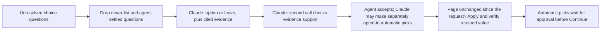

# AI assistance

Read this when changing AI suggestions, prompts, response validation, context reuse, or agent approval.

## Current role

The rules engine fills first. AI only handles the small remainder: unresolved radio, select and checkbox questions (`unknown`, `failed`, `noData`, `leftRequired`) where no exact carrier mapping applies. It does not audit already-filled answers, produce typed text, click, navigate, look anything up, or submit.

Agent options uses Anthropic **Claude Haiku 5.5** through the Messages API (`https://api.anthropic.com/v1/messages`), called from the side panel with the official Anthropic TypeScript SDK. The SDK is bundled into one ES module at `lib/anthropic-sdk.mjs` by `npm run vendor` (esbuild; the pinned `@anthropic-ai/sdk` version and every bundled package's license are in the file), since an extension page cannot resolve package imports and MV3 cannot load remote code. The client is created with `dangerouslyAllowBrowser: true`, which sends the `anthropic-dangerous-direct-browser-access` header the API requires for a request from a browser page; that is acceptable here only because the key is the agent's own, typed into their own extension. Open the brain button, expand **Connection**, and enter the Anthropic API key. Settings are per-device: `aiOn`, `claudeKey`, and `claudeAuto`; the fixed model is `claude-haiku-5-5`. They live in `chrome.storage.local`, which `background.js` restricts to the extension's own pages (`setAccessLevel('TRUSTED_CONTEXTS')`); Chrome honours that for local storage from version 140, the manifest's `minimum_chrome_version`, so content scripts cannot read the key. Obsolete provider settings (`aiKey`, `jevKey`, `jevModel`, `aiProvider`, `aiAuto`, and the OpenAI assistant's `lunaKey` and `lunaAuto`) are removed by `migrateAssistantSettings` and never sent to Anthropic; an agent who used the OpenAI assistant enters an Anthropic key and opts into automatic selection again. Assistant use and automatic selection are off unless the agent enables them. Saved automatic decisions from a retired assistant or model (including GPT-6 Luna's) remain holds for manual review and cannot release Continue by themselves.

Claude policy v1 (`claude-evidence-v1`, `POLICY_VERSION` in `src/ai/claude.js`) sends the task as the `system` prompt and the page state as one user message, with `output_config: { effort: 'low', format: { type: 'json_schema', schema } }` (structured outputs) and `max_tokens: 16000`. It sets no `thinking`, so Haiku 5.5's default adaptive thinking stays on (it is not disabled; low effort keeps it short), and no `temperature`, `top_p` or `top_k` (non-default sampling values are rejected), tools or assistant prefill. The 16,000-token cap is a ceiling for thinking plus the answer, not a budget the model aims for; a response stopped by it (`stop_reason: max_tokens`) fails closed. It reviews up to 12 eligible fields per request, with a combined state and schema bound of 48,000 characters. The first call carries the complete bounded fact/rule source set once without duplicating the intake representation. The verification call carries the whole scoped intake and the evidence cited by the proposed choices. Both calls are required for a non-`leave` result. The same local answer cache is used. Prompt caching is not enabled: the system prompts are shorter than Haiku 5.5's 512-token minimum cacheable prefix, and each page state differs.

Claude suggests current visible options with source IDs and a short explanation. Missing information, conflicts, absent/unknown evidence, invalid options, refusals (`stop_reason: refusal`, an HTTP 200), cut-off output (`max_tokens`), any other stop reason, tool calls and unexpected models fail closed. The response is read by block type: thinking blocks are skipped and exactly one text block must hold the JSON answer. The verification call checks each proposed option against its sources and intake. This is another judgment from the same model, not independent proof. Claude automatic selection is separately opt-in through `claudeAuto`; it can pick only a visible, applicable radio/select/checkbox choice when the verification succeeds, the choice differs from the current value, and the field is outside the manual-only safety list. It never displays a generated confidence percentage. Two judgments from the same model are not calibrated accuracy evidence. Live latency, cost, and accuracy have not been measured with Claude; run `npm run ai:eval -- --live` before relying on it.

Before any paid model request, the planner conservatively sizes the possible verification request: the whole scoped intake, at most four cited sources per field, and the longest visible answer. It splits a group when that bound is exceeded; a single field that is still too large is rejected for manual review. This keeps the evidence boundary explicit while avoiding a request that only fails after it reaches the provider.

The proposal schema shares the exact source-ID constraint through `$defs`/`$ref` instead of repeating it for every field. Claude's structured outputs reject `maxItems`, numeric and string bounds, so the schema states none: the prompt asks for at most four citations, missing-information notes and conflicts, and code (`shortList`) rejects a longer list as an invalid answer. Every object is closed (`additionalProperties: false`, every property required), and no schema uses a union type (`anyOf` or a type array), since a request may hold at most 16. Groups also split before 1,000 total enum values; no visible option or source is removed to fit a group. A schema the API still finds too complex to compile is a 400, and the questions stay with the agent.

The historical request shapes explain the scope of the design. The OpenAI GPT-6 Luna paths (to 2026-10-09) went from one request for up to 40 fields, to four fields per batch with two calls, to 12 fields with two calls (4,096/2,048-token caps, `store: false`). Claude keeps the 12-field, two-call plan.

Claude also reads the intake's claims box once per intake, when assistance is on and the key is set. Code splits the box into lines (at most 20) and replaces client names, numbers and the street (`redactionTerms`) before one structured call answers per line: does it name non-trucking liability (NTL / bobtail), and does it ask for coverage other than the form's ticked coverages. Once for the whole box it also answers `businessTime`: the first line stating how long the business has operated or when it started (`line`, or `none`), and the years or start year that line states (`years`, `since`; -1 when not stated, so the schema needs no nullable union; Claude copies, never calculates). Flagged lines become Check intake items (`ai.ntl`, `ai.coverage-change`) quoting the line; code turns a start year into years and adds `ai.years-in-business` for that line when its years differ from the intake's years in business (or years under own authority), including a blank one, which AmWINS otherwise quotes as a new venture ("in Biz for 3+ years" with no year established); a line the intake's own NTL check already quotes isn't repeated. Nothing is filled or ticked from them: the agent changes Requested coverage. There is no second verification call because nothing is applied. A malformed answer (a line ID not sent, years outside 0-100, a start year after this year or more than 100 years ago) fails the whole review, and a failed review adds a Check intake item to read the box by hand; it is tried again when the assistant settings change (also when they change while a review is still out). An answer for a claims box or form coverages that changed meanwhile is dropped and the box read again; an edit to either after a finished review is read again too (a years-in-business entry made after the review leaves its item for the agent to tick), with Claude's earlier items replaced in place by info notes. NTL has its own flag; "coverage change" means any other change. The usage log records counts only (`ai_suggest`, page `ClaimsBox`, with the same token and cache counters as page reviews).

With assistance on, this leaves the computer: the unresolved questions with their labels, sections, current values and option texts as the page shows them (unredacted, since the answer must be one of them), the carrier-scoped TNI rules, and the scoped intake (`scopedIntake`): the applicant, operations, garaging, coverage, claims, trailer and prior-insurance sections and the active driver, vehicle and trailer. Identifier keys (VIN, license and plate numbers, FEIN, phone, email, account numbers) are removed and USDOT/MC become presence booleans; every remaining string is redacted with the claims-box review's term list (`redactionTerms`, `[client]` for the client's and owners' names, drivers' names and dates of birth, the garaging street, unit, city and ZIP, and contact and ID numbers), in the first call's evidence sources and in the verification call's intake alike. What still goes, in clear: the applicant's year established, years in business and of experience, whether the owner drives, the 60-day USDOT/MC answer and the application date; the garaging state; business class and every operations answer (what they haul, radius, ELD and its brand, SR-22, filings and which, hazmat and placards, moving state, personal use, vehicle ownership, equipment value); every coverage choice and limit; the whole trailer section (ownership, hitch, interchange and its limit, trailer equipment value); vehicle and trailer type, year, make, model and value; the active driver's license state, CDL, CDL year and marital status; prior insurance (type, carrier, limit, expiration) and the computed `priorPolicyExpired`; and the claims box and notes with the terms replaced, with `hasClaims` and the NTL flag. The redaction is the same as the usage log's and has its limits: a value is replaced only where it appears as written in the intake's field, so the same date, phone or name written another way in the claims box or notes (1/2/1980 for 01/02/1980, (555) 123-4567 for 555-123-4567) is still sent; a term shorter than three characters is kept; and a single name word is replaced only as a whole word ("Ann" leaves "Annual", "Car" leaves "Cargo"), but a whole word shared by a name and a fact (a business called "Expediter Services") redacts the fact too. The prior carrier's name is not a term and is sent. Without the Anthropic key, deterministic rules still work and unresolved questions stay with the agent. The Messages API has no per-request storage switch: Anthropic keeps and uses API inputs and outputs as its commercial terms (and any agreement TNI has with it) provide, so TNI's compliance owner should confirm retention for the account whose keys agents use.

## Enforced behavior and its limits

- The never-list filters question text for MVR/CLUE, exclusions, signatures/attestations/authorizations, bank/card/SSN/password details, and typed identifiers. A DOT-lookup identity mismatch is review-only. A question the rules leave to the agent as a client fact or attestation (`source: 'fact'`/`'attestation'`, or a `clientFact` rule the intake doesn't answer, such as marital status or vehicle ownership) carries `manualOnly` on its fill-report item, and `collectItems` keeps it from Claude entirely: no suggestion and no automatic pick. If the same control appears in multiple report groups (for example, an invalid prefilled answer also missing an intake fact), manual-only and review-only restrictions survive deduplication regardless of report priority. It filters questions; what the intake context contains is set by `scopedIntake` (above), whose redaction leaves business and coverage facts in clear.
- Questions the agent changed, or that an applied AI answer already settled on this page, are not sent again.
- The answer must be one of the page's current options or `leave`. Claude answers in structured output and code validates its option and source IDs; missing evidence, invalid output, or an unsupported choice becomes `leave`. The cited source must be one of the supplied intake facts or carrier rules.
- A second Claude call verifies that the cited evidence supports the proposed option. Both calls are required for any non-`leave` result, use the fixed `claude-haiku-5-5` model, and stay within the request bounds above.
- Claude automatic selection is opt-in through `claudeAuto`. It has no probability or confidence threshold: only a successfully verified, source-supported choice from the fixed `claude-haiku-5-5` model can be selected, and the field must be a visible/applicable radio, select or checkbox with a changed value outside the manual-only safety list. The second call is another judgment from the same model, not calibrated accuracy evidence.
- Before anything is applied, the panel compares the page with the snapshot taken when the request started (every control's current value). Any change, including an agent edit made while the request was pending, cancels the apply and asks for a fresh fill. `answer()` then checks the field's kind, section, options and current value, and that the page kept the answer. An agent edit while the answers go in keeps the agent's value on that question, protects its key from later fills, and stops the answers still to come, across all frames, including an edit in a frame that is waiting its turn or already finished (remaining answers are reported as not applied, with the reason); the recorder reports that edit as the agent's when the apply ends. Every dispatch checks the original guard session and current intake context, so a replaced frame document or changed intake stops remaining answers. Guarded edits remain protected in their original intake, tab, and vehicle/driver/page scope after a switch, including transport failures; only keys are retained. Intake replacement keeps those separately scoped records, while explicit Clear erases the current intake's records and prevents its late writes from restoring them without cancelling another intake's guarded edits ([browser filling](browser-filling.md)).
- Automatic picks are marked purple and hold Continue until the agent approves them. A durable hold is recorded before answer dispatch, so intake/cache replacement or a transport failure after dispatch cannot erase it. A guard-read failure before the first answer is sent removes the preparation holds; a failure after any answer is sent retains the conservative holds for review. A trusted manual correction before Reject releases that hold; otherwise Reject keeps it until the agent changes that field or explicitly confirms the current page answer. Identity-bound pending holds survive panel reload and follow the physical quote across intake changes. They retire when the exact quote URL changes or the originating document is proven replaced or gone; a changed value in the same document remains a review hold. Picks made before intake edits or a driver/vehicle change stay listed (labelled); approval re-checks that the page is unchanged since the pick was applied, otherwise the pick stays unresolved for review. Durable pending records contain redacted display text and fingerprints, not intake copies or API keys. Approval and current-answer confirmation check the originating frame, document, question and expected value fingerprint, so a matching answer in another frame cannot release a hold and redacted names do not prevent review. Duplicate questions across frames are left for the agent before applying. Replacing or clearing the intake, changing the quote URL or evicting a cached pick invalidates in-flight approval callbacks. Ordinary agent-edited field keys also survive panel reload, scoped to the intake, tab and page, without saving typed values.
- Cached answers are keyed on the question as the page shows it (key, label, section, options, current value, status), the intake and active driver/vehicle, the model and the policy version. API prompt caching is not enabled (see above). Late responses after a page or context change are discarded.
- Claude returns data and has no navigation or submission tool. Page content and intake text are data, not instructions.
- Successful Claude reviews report `tokensIn`, `tokensOut`, `modelCalls`, `reasoningTokens`, `cachedTokens`, and `cacheWriteTokens`. `tokensIn` adds cache reads and writes back to the API's `input_tokens` (which excludes them); thinking is billed within `output_tokens`, so `reasoningTokens` is 0. `modelCalls` counts logical provider calls and excludes HTTP retries.
- Each call goes through the SDK's `messages.create` with two retries (on connection errors, 408, 409, 429 and 5xx, honouring `retry-after`) inside one 45-second limit. Errors are mapped by status to fixed messages (a refused key, billing, rate limit, overload); error bodies, which can echo the request, are never shown or logged. These counters do not account for all possible spend from failed or timed-out requests.

The AI never-list does not override deterministic carrier rules: Progressive answers its driver-exclusion question No for a driver listed on the intake. See [intake and rules](intake-and-rules.md) when changing that behavior.

## Making changes

Keep the written [TNI rulebook](../src/ai/tni-rules.js) aligned with implemented carrier standards and each rule's `source` ([intake and rules](intake-and-rules.md)): the rulebook states coverage and workflow standards, never a default for a client fact. A fact the intake doesn't give (gender, marital status, year licensed, current-carrier tenure, loss runs, continuous coverage, other coverages) is the agent's, and Claude must not cite a standard for it. For-hire answers follow the business class, not the MC number. A new client fact or agency decision needs evidence; model output and agent acceptance rates do not establish correctness. Claude suggestions and automatic selection remain opt-in and subject to the approval hold. Keep exact mappings, calculations, and execution in code; use the model only for the bounded semantic choice that remains.

Test invalid options, missing or misleading sources, restricted questions, stale responses, manual edits, model identity and approval-before-Continue when those paths change. Preserve a `leave` result when evidence is missing. `npm run mock:claude` drives the packaged extension against controlled Messages API responses (the bundled SDK makes the request; the mock checks its headers and body) and checks key isolation, automatic-selection setting, approval hold, rejection/manual correction, conflicts, stale responses, retired-assistant pending holds, and that facts left to the agent (`manualOnly`) never reach Claude; the agent dismisses those facts on the fixture page so only the Claude approval holds Continue. Mocked responses prove integration behavior, not live accuracy or latency. Use [testing](testing.md) for harness setup.

The evaluation runner (`npm run ai:eval`) supports offline `--score <saved-result.json>` and explicit Claude-only live mode with `--live`. Live mode uses `ANTHROPIC_API_KEY`, separately from extension settings, and is never run as part of unit or browser tests. The evaluation agent decides whether a live run is warranted. Committed cases are sanitized synthetic scenarios with `expertReviewed: false`; their proposed expected answers are not an expert answer key. Reports distinguish suggestions, abstentions, evidence paths, errors, timing and token usage; no output establishes calibrated automatic thresholds or live accuracy. Saved result case IDs must be unique; duplicate IDs are rejected before scoring.

Usage includes `ai_suggest` (model, timing, counts, provider usage, errors; a page review's error text passes the intake redactor first) and `ai_decision` (redacted label, decision, chosen option, evidence basis). The key and client values are never logged. Reports summarize acceptance and failures; this does not train the model or promote rules automatically. Read [learning](learning.md) only if changing that feedback mechanism.

## Proposed work, not current capabilities

Potential extensions include confirmed extraction of free-text requests, a final requested-versus-entered check, AI-drafted rule proposals for human review, promoting repeatedly verified choices to deterministic rules, and centrally managed provider access. These are not committed milestones or permission to expand a task. Validate each against actual quote correctness, not acceptance rate alone.

## Related code and tests

- [claude.js](../src/ai/claude.js): Claude request/response contract, SDK call and error mapping, evidence checks, bounded request planning, and automatic-selection policy.
- [providers.js](../src/ai/providers.js): the Claude-only settings adapter.
- [vendor.mjs](../scripts/vendor.mjs): bundles the pinned Anthropic SDK into `lib/anthropic-sdk.mjs`; rerun `npm run vendor` after changing its version.
- [sidepanel.js](../sidepanel/sidepanel.js): `runAssist`, `pendingAi`, `applyAi`, `renderAi`, caching, approval and manual-edit protection.
- [pagekit.js](../src/content/pagekit.js): `answer`, `decisionSnapshot`, retained-value checks and marks.
- [Claude tests](../test/claude.test.mjs), [panel safety tests](../test/sidepanel-safety.test.mjs), and [claude-mock.mjs](../scripts/claude-mock.mjs): validation and controlled-provider interaction tests.
- [evaluation cases](../test/ai-eval/cases.json) and [evaluation runner](../scripts/ai-eval.mjs): Claude-only evaluation scaffolding.
