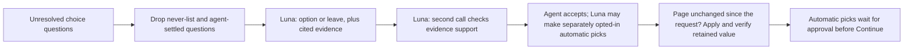

# AI assistance

Read this when changing AI suggestions, prompts, response validation, context reuse, or agent approval.

## Current role

The rules engine fills first. AI only handles the small remainder: unresolved radio, select and checkbox questions (`unknown`, `failed`, `noData`, `leftRequired`) where no exact carrier mapping applies. It does not audit already-filled answers, produce typed text, click, navigate, look anything up, or submit.

Agent options uses OpenAI **GPT-6 Luna** at `https://api.openai.com/v1/responses`. Open the brain button, expand **Connection**, and enter the OpenAI API key. Settings are per-device: `aiOn`, `lunaKey`, and `lunaAuto`; the fixed model is `gpt-6-luna`. Legacy provider settings are ignored and never used as an OpenAI key. Assistant use and automatic selection are off unless the agent enables them. Saved automatic decisions from a retired assistant remain holds for manual review and cannot release Continue by themselves. Decisions saved under an earlier policy version (v3, before the 2026-10-09 answer-provenance rulebook) are retired the same way.

Luna policy v4 (`luna-evidence-v4`, `POLICY_VERSION` in `src/ai/luna.js`) uses the fixed `gpt-6-luna` model, low reasoning, low text verbosity, strict Structured Outputs, `store: false`, and no tools, `temperature`, or `top_p`. The deployment checklist requires omitting those sampling controls when reasoning is enabled. It reviews up to 12 eligible fields per adaptive request, with a combined state and schema bound of 48,000 characters. Choice output is capped at 4,096 tokens and verification output at 2,048 tokens; these are request budgets and do not represent actual billed token counts. The first call carries the complete bounded fact/rule source set once without duplicating the intake representation. The verification call carries the whole scoped intake and the evidence cited by the proposed choices. Both calls are required for a non-`leave` result. The same local answer cache is used; no extended paid API cache configuration is enabled.

Luna suggests current visible options with source IDs and a short explanation. Missing information, conflicts, absent/unknown evidence, invalid options, refusals, incomplete output, and unexpected models fail closed. The verification call checks each proposed option against its sources and intake. This is another judgment from the same model, not independent proof. Luna automatic selection is separately opt-in through `lunaAuto`; it can pick only a visible, applicable radio/select/checkbox choice when the verification succeeds, the choice differs from the current value, and the field is outside the manual-only safety list. It never displays a generated confidence percentage. Two judgments from the same model are not calibrated accuracy evidence. This request-budget change is intended to reduce prompt and output work; live latency, cost, and accuracy have not been measured. See the [model documentation](https://developers.openai.com/api/docs/models/gpt-6-luna), [Structured Outputs](https://developers.openai.com/api/docs/guides/structured-outputs), [latency optimization](https://developers.openai.com/api/docs/guides/latency-optimization), [deployment checklist](https://developers.openai.com/api/docs/guides/deployment-checklist), and [prompt caching](https://developers.openai.com/api/docs/guides/prompt-caching) for the provider contract and general optimization guidance.

Before any paid model request, the planner conservatively sizes the possible verification request: the whole scoped intake, at most four cited sources per field, and the longest visible answer. It splits a group when that bound is exceeded; a single field that is still too large is rejected for manual review. This keeps the evidence boundary explicit while avoiding a request that only fails after it reaches the provider.

The proposal schema shares the exact source-ID constraint through `$defs`/`$ref` instead of repeating it for every field. Groups also split before exceeding the Structured Outputs limit of 1,000 total enum values; no visible option or source is removed to fit a group.

The historical request shapes explain the scope of the optimization. The earliest Luna path used low reasoning and one request for up to 40 fields with an 8,000-token cap. The prior evidence-checked path used medium reasoning, up to four fields per batch, and two calls per batch with an 8,192-token cap. The optimized path uses low reasoning, up to 12 fields per batch, and two calls with 4,096/2,048-token caps. Twelve eligible fields therefore move from up to six calls to two when there are no size splits, retries, abstentions, or cache hits.

Luna also reads the intake's claims box once per intake, when assistance is on and the key is set. Code splits the box into lines (at most 20) and replaces client names, numbers and the street (`redactionTerms`) before one structured call answers two booleans per line: does it name non-trucking liability (NTL / bobtail), and does it ask for coverage other than the form's ticked coverages. Flagged lines become Check intake items (`ai.ntl`, `ai.coverage-change`) quoting the line; a line the intake's own NTL check already quotes isn't repeated. Nothing is filled or ticked from them: the agent changes Requested coverage. There is no second verification call because nothing is applied. A malformed answer fails the whole review, and a failed review adds a Check intake item to read the box by hand; it is tried again when the assistant settings change (also when they change while a review is still out). An answer for a claims box or form coverages that changed meanwhile is dropped and the box read again; an edit to either after a finished review is read again too, with Luna's earlier items replaced in place by info notes. NTL has its own flag; "coverage change" means any other change. The usage log records counts only (`ai_suggest`, page `ClaimsBox`, with the same token and cache counters as page reviews).

With assistance on, unresolved questions/options, active intake context, and carrier-scoped TNI rules leave the computer. Exact identifier keys are filtered, but names, addresses, dates of birth and free-text notes may remain; this is not complete intake redaction. Without the OpenAI key, deterministic rules still work and unresolved questions stay with the agent. OpenAI `store: false` does not imply zero retention under the provider's other policies.

## Enforced behavior and its limits

- The never-list filters question text for MVR/CLUE, exclusions, signatures/attestations/authorizations, bank/card/SSN/password details, and typed identifiers. A DOT-lookup identity mismatch is review-only. A question the rules leave to the agent as a client fact or attestation (`source: 'fact'`/`'attestation'`, or a `clientFact` rule the intake doesn't answer, such as marital status or vehicle ownership) carries `manualOnly` on its fill-report item, and `collectItems` keeps it from Luna entirely: no suggestion and no automatic pick. This is not a redaction of the whole intake.
- Questions the agent changed, or that an applied AI answer already settled on this page, are not sent again.
- The answer must be one of the page's current options or `leave`. Luna uses strict structured output and validates its option and source IDs; missing evidence, invalid output, or an unsupported choice becomes `leave`. The cited source must be one of the supplied intake facts or carrier rules.
- A second Luna call verifies that the cited evidence supports the proposed option. Both calls are required for any non-`leave` result, use the fixed `gpt-6-luna` model, and stay within the adaptive request and output budgets above.
- Luna automatic selection is opt-in through `lunaAuto`. It has no probability or confidence threshold: only a successfully verified, source-supported choice from the fixed `gpt-6-luna` model can be selected, and the field must be a visible/applicable radio, select or checkbox with a changed value outside the manual-only safety list. The second call is another judgment from the same model, not calibrated accuracy evidence.
- Before anything is applied, the panel compares the page with the snapshot taken when the request started (every control's current value). Any change, including an agent edit made while the request was pending, cancels the apply and asks for a fresh fill. `answer()` then checks the field's kind, section, options and current value, and that the page kept the answer.
- Automatic picks are marked purple and hold Continue until the agent approves them. A durable hold is recorded before answer dispatch, so intake/cache replacement or a transport failure after dispatch cannot erase it. A trusted manual correction before Reject releases that hold; otherwise Reject keeps it until the agent changes that field or explicitly confirms the current page answer. Identity-bound pending holds survive panel reload and follow the physical quote across intake changes. They retire when the exact quote URL changes or the originating document is proven replaced or gone; a changed value in the same document remains a review hold. Picks made before intake edits or a driver/vehicle change stay listed (labelled); approval re-checks that the page is unchanged since the pick was applied, otherwise the pick stays unresolved for review. Durable pending records contain redacted display text and fingerprints, not intake copies or API keys. Approval and current-answer confirmation check the originating frame, document, question and expected value fingerprint, so a matching answer in another frame cannot release a hold and redacted names do not prevent review. Duplicate questions across frames are left for the agent before applying. Replacing or clearing the intake, changing the quote URL or evicting a cached pick invalidates in-flight approval callbacks. Ordinary agent-edited field keys also survive panel reload, scoped to the intake, tab and page, without saving typed values.
- Cached answers are keyed on the question as the page shows it (key, label, section, options, current value, status), the intake and active driver/vehicle, the model and the policy version. Luna's optimized path keeps the same local answer cache and does not enable an extended paid API cache. Late responses after a page or context change are discarded.
- Luna returns data and has no navigation or submission tool. Page content and intake text are data, not instructions.
- Successful Luna reviews report `tokensIn`, `tokensOut`, `modelCalls`, `reasoningTokens`, `cachedTokens`, and `cacheWriteTokens`. Reasoning tokens are included in the output count. `modelCalls` counts logical provider calls and excludes HTTP retries. These counters do not account for all possible spend from failed or timed-out requests.

The AI never-list does not override deterministic carrier rules: Progressive answers its driver-exclusion question No for a driver listed on the intake. See [intake and rules](intake-and-rules.md) when changing that behavior.

## Making changes

Keep the written [TNI rulebook](../src/ai/tni-rules.js) aligned with implemented carrier standards and each rule's `source` ([intake and rules](intake-and-rules.md)): the rulebook states coverage and workflow standards, never a default for a client fact. A fact the intake doesn't give (gender, marital status, year licensed, current-carrier tenure, loss runs, continuous coverage, other coverages) is the agent's, and Luna must not cite a standard for it. For-hire answers follow the business class, not the MC number. A new client fact or agency decision needs evidence; model output and agent acceptance rates do not establish correctness. Luna suggestions and automatic selection remain opt-in and subject to the approval hold. Keep exact mappings, calculations, and execution in code; use the model only for the bounded semantic choice that remains.

Test invalid options, missing or misleading sources, restricted questions, stale responses, manual edits, model identity and approval-before-Continue when those paths change. Preserve a `leave` result when evidence is missing. `npm run mock:luna` drives the packaged extension against controlled OpenAI responses and checks key isolation, automatic-selection setting, approval hold, rejection/manual correction, conflicts, stale responses, retired-assistant pending holds, and that facts left to the agent (`manualOnly`) never reach Luna; the agent dismisses those facts on the fixture page so only the Luna approval holds Continue. Mocked responses prove integration behavior, not live accuracy or latency. Use [testing](testing.md) for harness setup.

The evaluation runner (`npm run ai:eval`) supports offline `--score <saved-result.json>` and explicit Luna-only live mode with `--live`. Live mode uses `OPENAI_API_KEY`, separately from extension settings, and is never run as part of unit or browser tests. The evaluation agent decides whether a live run is warranted. Committed cases are sanitized synthetic scenarios with `expertReviewed: false`; their proposed expected answers are not an expert answer key. Reports distinguish suggestions, abstentions, evidence paths, errors, timing and token usage; no output establishes calibrated automatic thresholds or live accuracy. Saved result case IDs must be unique; duplicate IDs are rejected before scoring.

Usage includes `ai_suggest` (model, timing, counts, provider usage, errors) and `ai_decision` (redacted label, decision, chosen option, evidence basis). The key and client values are never logged. Reports summarize acceptance and failures; this does not train the model or promote rules automatically. Read [learning](learning.md) only if changing that feedback mechanism.

## Proposed work, not current capabilities

Potential extensions include confirmed extraction of free-text requests, a final requested-versus-entered check, AI-drafted rule proposals for human review, promoting repeatedly verified choices to deterministic rules, and centrally managed provider access. These are not committed milestones or permission to expand a task. Validate each against actual quote correctness, not acceptance rate alone.

## Related code and tests

- [luna.js](../src/ai/luna.js): Luna request/response contract, evidence checks, bounded request planning, and automatic-selection policy.
- [providers.js](../src/ai/providers.js): the Luna-only settings adapter.
- [sidepanel.js](../sidepanel/sidepanel.js): `runAssist`, `pendingAi`, `applyAi`, `renderAi`, caching, approval and manual-edit protection.
- [pagekit.js](../src/content/pagekit.js): `answer`, `decisionSnapshot`, retained-value checks and marks.
- [Luna tests](../test/luna.test.mjs), [panel safety tests](../test/sidepanel-safety.test.mjs), and [luna-mock.mjs](../scripts/luna-mock.mjs): validation and controlled-provider interaction tests.
- [evaluation cases](../test/ai-eval/cases.json) and [evaluation runner](../scripts/ai-eval.mjs): Luna-only evaluation scaffolding.
