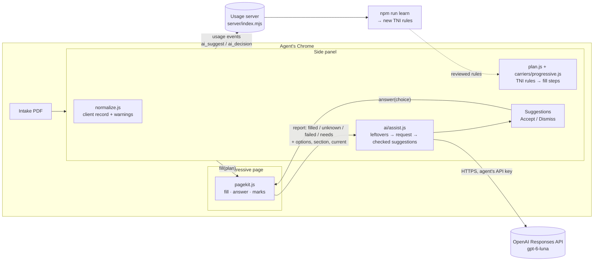
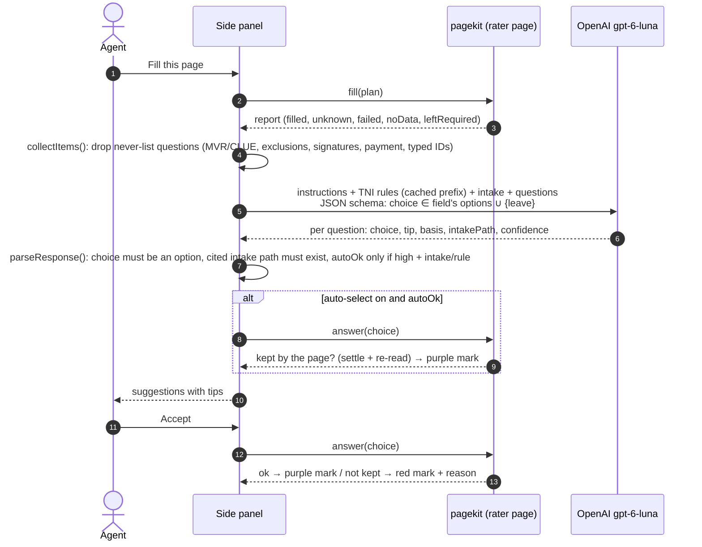
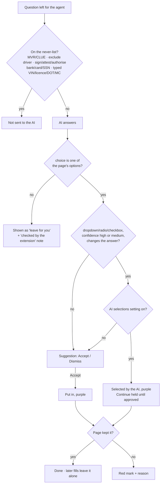
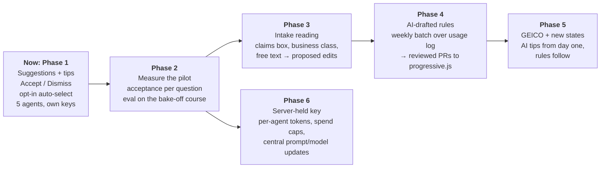
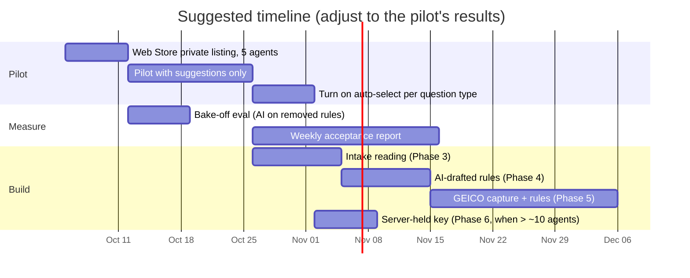
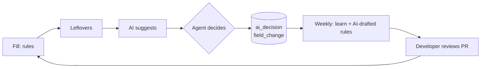

# AI assistant: architecture and roadmap

The rules engine fills what TNI has written rules for. The AI assistant only looks at what's
left: yellow (unfamiliar question), red (couldn't fill) and amber (needs you). It suggests an
answer with a short tip, and the agent accepts or dismisses it. With **Let the AI make selections
on the page** switched on, it selects dropdown/radio/checkbox answers itself (high or medium
confidence; never typed text), marked purple. Its selections are listed at the end of the panel's
report and in a note at the bottom of the rater page, and the page's Continue is not clicked
until the agent approves them (or rejects one and answers it themselves).

Model: OpenAI **GPT-6 Luna** (`gpt-6-luna`) through the Responses API, with each agent's own API
key (set under **AI assistant** in the side panel). Model name and key are per-agent settings.

## Where it sits

## One page, step by step

## What the AI may do

Rules the code enforces, whatever the model says:

- It can only return text. It can't click, navigate or submit. Answers go through the same
  `apply()` and "did the page keep it" check as rule-based answers (`pagekit.answer`).
- Dropdown, radio and checkbox answers must be one of the field's options. Strict structured
  outputs enforce this, and `parseResponse` checks it again.
- A cited intake path must hold a value; otherwise the answer loses its "intake" basis and high
  confidence.
- Typed text is never auto-selected. Answers the page already shows are not re-selected.
- The fixed instructions and TNI rules (`src/ai/tni-rules.js`) come first in every request, so
  the provider can cache them.

## Files

| File | Role |
| --- | --- |
| `src/ai/assist.js` | Leftovers → request, OpenAI call, response checks, auto-select rule |
| `src/ai/tni-rules.js` | TNI's quoting rules as the model reads them (keep in step with `carriers/progressive.js`) |
| `src/content/pagekit.js` | `answer()` puts in a chosen option and verifies it; flagged fields carry options/section/current; purple `ai` mark |
| `sidepanel/sidepanel.js` | `runAssist`, `applyAi`, `renderAi`, AI settings |
| `server/index.mjs` | Accepts `ai_suggest` and `ai_decision` usage events |
| `test/assist.test.mjs` | Schema, never-list, response checks, error messages |

## Usage events (for measuring the pilot)

| Event | Contents |
| --- | --- |
| `ai_suggest` | model, time, questions sent, suggested / leave / auto-eligible counts, held-back count, tokens, error |
| `ai_decision` | question id and text, `accepted` / `dismissed` / `auto` / `failed`, the chosen option (never typed text), confidence, basis, intake path |

Acceptance rate per question = `accepted` ÷ (`accepted` + `dismissed`), and agent changes after
an AI answer show up as ordinary `field_change` events. Those two numbers decide which question
types can be auto-selected for everyone, and which should become plain TNI rules.

## Roadmap

### The feedback loop the roadmap builds

Each question the AI keeps getting right becomes a plain rule, which is free, instant and
tested. The AI then handles only the next set of new questions (new states, new products,
GEICO).
