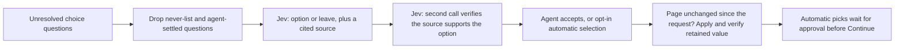

# AI assistance

Read this when changing AI suggestions, prompts, response validation, context reuse, or agent approval.

## Current role

The rules engine fills first. AI only handles the small remainder: unresolved radio, select and checkbox questions (`unknown`, `failed`, `noData`, `leftRequired`) where no exact carrier mapping applies. It does not audit already-filled answers, produce typed text, click, navigate, look anything up, or submit.

The provider is TypeSafe AI **Jev** at `https://api.typesafe.ai/v1/systemone`, default model `jev-1.13.0`. The agent's Jev key and model are per-device settings (`jevKey`, `jevModel`); the legacy OpenAI key is never reused. With assistance on, the unresolved questions and their options, the active intake context, and the carrier-scoped TNI rules leave the computer. Without a key, the rules engine works as before and unresolved questions stay with the agent.

Jev also reads the intake's claims box once per intake (when assistance is on and a key is set): code splits it into lines and asks two yes/no (Noul) questions per line, whether it names non-trucking liability (NTL / bobtail) and whether it asks for coverage different from the form's ticked coverages. Lines at or above `NOTES_FLAG` (0.5, chosen for recall: these are review items, not answers) become Check intake items (`ai.ntl`, `ai.coverage-change`) quoting the line. Nothing is filled or ticked from them; the agent changes Requested coverage. A malformed answer fails the whole review, and the usage log records counts only (`ai_suggest`, page `ClaimsBox`).

## Enforced behavior and its limits

- The never-list filters question text for MVR/CLUE, exclusions, signatures/attestations/authorizations, bank/card/SSN/password details, and typed identifiers. A DOT-lookup identity mismatch is review-only. This is not a redaction of the whole intake.
- Questions the agent changed, or that an applied AI answer already settled on this page, are not sent again.
- The answer must be one of the page's current options or `leave`. Each probability distribution is checked for completeness and consistency; low probability, a missing source, or an unknown source becomes `leave`. The cited source must be one of the supplied intake facts or carrier rules.
- A second call verifies that the cited evidence supports the proposed option. Both calls must be served by the same model, which may be the resolved revision of a configured alias.
- Automatic selection is opt-in and needs the pinned default model to have served the answer, choice probability ≥ 0.98, confidence ≥ 0.97, margin ≥ 0.95, evidence probability ≥ 0.98 and verified support ≥ 0.99 (`AUTO_POLICY`). Numeric, date, limit and identity-style questions stay manual, as does a choice the page already shows. These are conservative starting thresholds, not calibrated accuracy.
- Before anything is applied, the panel compares the page with the snapshot taken when the request started (every control's current value). Any change, including an agent edit made while the request was pending, cancels the apply and asks for a fresh fill. `answer()` then checks the field's kind, section, options and current value, and that the page kept the answer.
- Automatic picks are marked purple and hold Continue until the agent approves or rejects them. Picks made before an intake or driver/vehicle change stay listed (labelled) and can still be approved or rejected; approval re-checks that the page is unchanged since the pick was applied, otherwise the pick is rejected and unlocked for review.
- Cached answers are keyed on the question as the page shows it (key, label, section, options, current value, status), the intake and active driver/vehicle, the model and the policy version. Late responses after a page or context change are discarded.
- Jev returns data; it has no navigation or submission tool. Page content and intake text are data, not instructions.

The AI never-list does not override deterministic carrier rules: Progressive currently defaults its driver-exclusion question to No. See [intake and rules](intake-and-rules.md) when changing that behavior.

## Making changes

Keep the written [TNI rulebook](../src/ai/tni-rules.js) aligned with implemented carrier standards. A new client fact or agency decision needs evidence; model probabilities and agent acceptance rates do not establish correctness. A different model can suggest answers but cannot select them automatically until its policy is validated in code. For TypeSafe/Jev prompts or decision-policy work, follow the `typesafe-ai` skill named in the project guidance.

Test invalid options, missing or misleading sources, restricted questions, stale responses, manual edits, model identity and approval-before-Continue when those paths change. Preserve a `leave` result when evidence is missing. `npm run mock:ai` drives the packaged extension against a mocked Jev endpoint; mocked responses prove integration behavior, not live accuracy or latency. Use [testing](testing.md) for harness setup.

Usage includes `ai_suggest` (model, timing, counts, provider usage, errors) and `ai_decision` (redacted label, decision, chosen option, probabilities, evidence basis). The key and client values are never logged. Reports summarize acceptance and failures; this does not train the model or promote rules automatically. Read [learning](learning.md) only if changing that feedback mechanism.

## Proposed work, not current capabilities

Potential extensions include confirmed extraction of free-text requests, a final requested-versus-entered check, AI-drafted rule proposals for human review, promoting repeatedly verified choices to deterministic rules, and centrally managed provider access. These are not committed milestones or permission to expand a task. Validate each against actual quote correctness, not acceptance rate alone.

## Related code and tests

- [assist.js](../src/ai/assist.js): `collectItems`, `buildRequest`, `parseResponse`, `buildVerification`, `verifyResponse`, `suggest`, `assistContextKey`, `AUTO_POLICY`.
- [sidepanel.js](../sidepanel/sidepanel.js): `runAssist`, `pendingAi`, `applyAi`, `renderAi`, caching, approval and manual-edit protection.
- [pagekit.js](../src/content/pagekit.js): `answer`, `decisionSnapshot`, retained-value checks and marks.
- [assist tests](../test/assist.test.mjs), [panel safety tests](../test/sidepanel-safety.test.mjs), [ai-mock.mjs](../scripts/ai-mock.mjs): validation and controlled-provider interaction tests.
