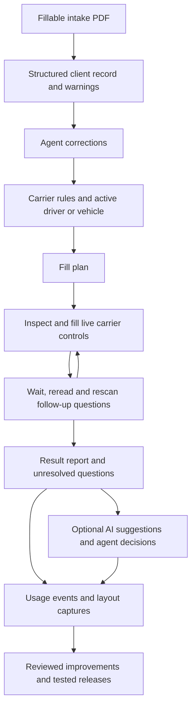

# Architecture and project goal

Read this when changing shared system boundaries or deciding what successful automation means.

The goal is to transfer the client's requested insurance into the correct carrier fields and entity rows, preserve agent decisions, and expose missing or unsupported information. Filling every visible question is insufficient if a requested coverage was never represented.

## Implemented flow

The side panel injects the fill engine into the open carrier tab. It uses the live DOM and supported widget APIs, not downloaded HTML as a runtime template. Progressive finds questions by their data-model names (`fieldref`) or their text on the page, never by question ids, which Progressive renumbers, with reviewed fallbacks; AmWINS uses selectors and labels; GEICO uses the data-model names inside its element names (`Id_<Name>_<n>`, without the number it changes on every redraw), each rule kept to the steps it answers on, which pagekit reads from the progress bar since every step shares one address. Progressive and GEICO turn the generic label rules off. GEICO's support is mapped from saved pages and captures and not yet checked live.

The client record, and the intake PDF for the panel's PDF view, live in Chrome session storage. AI-enabled requests send unresolved choice questions, options, active intake context and relevant TNI rules to OpenAI GPT-6 Luna, with the agent's per-device key when one is saved and otherwise through the collection server's `/v1/luna`, which adds TNI's key and stores nothing. Suggestions are on unless the agent turns them off; Luna's automatic selection is separately opt-in; picks remain held for agent approval. Pending automatic decisions survive a panel reload, including saved choices from a retired assistant that still require manual review. Usage events are separately queued locally and uploaded to the configured collection server. These are different data paths.

What the extension keeps in Chrome's local storage (settings, the agent's corrections, helper records, pending AI decisions, the usage queue) has a version ([storage-version.js](../src/storage-version.js)). When the panel opens, before anything reads that data, it brings data from an older build up to the current version, one migration per version, one copy of the panel at a time. Nothing is reset to defaults: corrections, pending approvals and queued events are kept. A migration writes its changes with its version in one write, then removes what it replaced, so stopping between the two leaves only unused keys, never data lost. One that fails before its write changes nothing more, leaves the data at the last version that went through, and is logged as a panel error by its version and error name only (settings hold the OpenAI key); it is tried again the next time the panel opens. Data from a newer build is left as it is. The first migration removes the retired assistant's keys from settings. To change a stored shape, add a migration and a saved copy of the version before it to `test/storage-version.test.mjs`.

## Boundaries and known gaps

- The reader extracts named fillable PDF fields, not general document understanding or handwriting.
- Rules compute answers; the browser engine finds controls and checks whether values stick. Carrier acceptance is not semantic correctness.
- Each rule declares its answer's `source` (intake, derived, standard, fact, attestation). Facts and attestations the intake lacks are never filled; standards are tagged in the panel and, for a business class outside the carrier's `supportedClasses` (review mode), become check items that hold Continue. GEICO's standards were recorded after its first live run (2026-10-21); it declares Progressive's classes. See [intake and rules](intake-and-rules.md).
- AI assists unresolved questions; it does not reliably audit all answers already filled by rules.
- Feedback produces review material and candidate rules. There is no automatic model training or rule deployment.
- Separate driver/vehicle records exist, but driver exclusion, per-vehicle coverage intent, and driver-to-vehicle relationships are not fully modeled.
- Arbitrary notes such as a non-trucking-liability request do not have a complete extraction, confirmation, and mapping path. Requested-versus-entered coverage reconciliation is not implemented.

## Layers and where a change goes

Each layer knows only the one below it, and a carrier's knowledge lives in that carrier's files. With more carriers, a change to one carrier's page or questions touches that carrier's files, and a TNI decision is made in one place.

| Layer | Holds | Where |
| --- | --- | --- |
| Intake | The PDF's fillable fields read and normalized into the client record | [intake.js](../src/intake.js), [normalize.js](../src/normalize.js), [schema.js](../src/schema.js) |
| TNI rules | TNI's decisions for every carrier: the standard coverage amounts ([standards.js](../src/standards.js)), and the shared helpers that compute answers (the owner and their driver row, owner drives, no prior insurance, GL and trailer interchange requested) | [standards.js](../src/standards.js), [util.js](../src/util.js), the rulebook's [general part](../src/ai/rulebook/general.js) |
| Carrier mapping | Which of the carrier's questions holds which answer, in its wording and options; its steps, helpers and stop pages | `src/carriers/<carrier>.js`, the rulebook's carrier part |
| Plan | The mapping resolved for one client: one step per answer, with its source | [plan.js](../src/plan.js) |
| Fill engine | Finds fields, fills, waits, re-reads and reports, for any page | [pagekit.js](../src/content/pagekit.js) |
| Carrier page adapter | How only this carrier's pages work: its widgets, spinners, page names, step bar, and how its fields are named and keyed (for the fill engine, field-key.js and the usage recorder) | `src/content/carriers/<carrier>.js` ([browser filling](browser-filling.md#execution)) |
| Panel | Intake, review, agent decisions, AI suggestions; it never touches the carrier's page itself | [sidepanel/panel/](../sidepanel/panel/), one file per part (state and storage in `core.js`, the state kept in a Zustand store (`state-store.js`) that the older views read and assign as a plain object and React views subscribe to, a change made in place (a Map's set, a push) telling no view; which fill runs when in `coordinator.js`, filling in `fill.js`, the assistant in `assistant.js`…); the decisions the views draw, with no DOM, in `scope.js` (which page, step, form and unit an answer or edit belongs to), `fill-checks.js` (whether a fill is still current), `live.js` (the live fill view's order and wording) `report-model.js` (a report's items left, answers and sources, and when the quote is finished) and `report-rows.js` (each row of a report's list as a record: what it shows and what happened to it since the fill, which the panel changes and `drawRow` in `fill.js` has drawn again, and which what is left, the filters and the dock count); the views moved to React so far in `.jsx` parts: `live-view.jsx` (the live fill view, from the store's `fillingFor`, which the fill code assigns anew for each change), `report-view.jsx` (a report's list of answers and items, drawn from its rows' records into the report as `renderReport` builds it: `drawRow` counts a change in the store's `rowsDrawn` and only the row whose record changed is drawn again; its buttons call the panel's `rowActs`, and a row's slot draws the AI's card from the row's record, `aiCard`), `steps-view.jsx` (the quote's three steps and the dock, from what `renderSteps` and `renderDock` assign to the store's `steps` and `dock`: the steps' tone, note and current one, and `dockFor`'s word with its one button; their buttons call what `sidepanel.js` wires), `feed-view.jsx` (the page's list of answers around the lists themselves, from what `renderSteps` assigns to the store's `feed`: its title, the page menu, the filters and counts, the key, an earlier page's head, a kept report's age, the empty list's word and Clear the marks; it draws `#live-root`, `#report` and `#past` empty and leaves them to the live view and the panel, which moves a report's nodes in and out), `cards-view.jsx` (the cards at the top of the page view, from the store's `cards`: the rater to open, and the carrier, quote-state, stop, review-mode and fill cards that `showCarrierNote`, `showStateNote`, `showStopPage`, `showReviewMode` and `renderSteps` say, each as `issueSaid` puts it; `issueCard` still draws the panel's other cards with `h()`), `checks-view.jsx` (step 1's checks, from what `renderWarnings` assigns to the store's `checks`: the title, each item's card with its field (`fieldSaid`, the same box client details draws), Luna's choices or a checked item's Undo, and the cleanup notes; and the unit pickers above the page's answers, from `renderPickers`'s `pickers`), `client-view.jsx` (the client's header, from what `render` assigns to the store's `client`: the name, what the quote is about, the PDF button and the file tools' question; with `clientNote`'s line and New quote off while answers go in, `newQuoteOff`) and `details-view.jsx` (client details, from what `renderSections` assigns to the store's `details`: each section's rows (`fieldRow`), folded or open, and the empty fields' button; a box shows a value said again in place, so the agent keeps their focus), `pdf-sheet-view.jsx` (the intake PDF's sheet, from what `openPdf` and `drawPdf` assign to the store's `pdfSheet`: its title, the hint for a marked item, the marks, the error and the controls (`pdfControls`); `drawPdf` draws the page off screen and copies it onto `#pdf-canvas`, which React draws once and leaves alone, and `pdfPan` drags `#pdf-scroll`) and `ai-view.jsx` (Luna's cards, from what `renderAi` and `runAssist` say: a row's card as its record's `aiCard`, drawn with the row so a redraw keeps it and the agent's focus, and the line, Use all and the cards without a row in the report's holder above the list, a small root of its own that `say` draws) and `settings-view.jsx` (Settings, from the store's `switches` (the Filling switches, set by `init` and by the agent; the panel still reads each from its box by id), `ai` and `keyFormOpen` (`renderAiSettings`, `openKeyForm`: the AI key itself is only ever in its box), `usageCard`, `usageNote` and `health` (`renderUsage`, `renderHealth`), `testRun` (`render`), `captureOff` and `captureStatus` (`renderSite`, `captureSaid`) and `devrec` (the developer recording); its controls call `settingsActs`, `aiActs` and what `sidepanel.js` wires; and the footer's Recording usage line, from `recordingLine`); [sidepanel.js](../sidepanel/sidepanel.js) wires them and mounts the React views |

A carrier's files import only the shared layers, never another carrier's. Each plan step and report item carries one resolution (answer, method, explanation, status; [intake and rules](intake-and-rules.md#resolution)), built from its source and flags and held to them by tests; the panel's review list, the AI's eligibility and the usage log read it. Next, each a change of its own: whether the old fields can go, and the client record keeps where each value came from.

## Design direction, not implemented guarantees

Represent confirmed facts with their source and entity identity. Separate shared concepts from carrier wording, then apply explicit state/product/entity conditions and narrow combination exceptions. Conflicts or missing evidence should lead to review. An unseen combination must not become trusted merely because familiar questions matched.

Measure automatic-answer accuracy, the share automated, and whole-quote correctness separately. Use expert-reviewed expected outcomes and held-out scenarios; unchanged answers, AI acceptance, and high field coverage are not accuracy labels. Do not claim a universal 99% success rate from mock results.

## Related code

- [intake.js](../src/intake.js), [normalize.js](../src/normalize.js), [schema.js](../src/schema.js): extraction and record.
- [plan.js](../src/plan.js), [carriers.js](../src/carriers.js): plans and carrier registration.
- [types.js](../types.js), at the root: the carrier config, plan steps, fill report and usage events as JSDoc types, checked by `npm run typecheck` in the files that opt in ([testing](testing.md)).
- [sidepanel/panel/](../sidepanel/panel/) and [sidepanel.js](../sidepanel/sidepanel.js), [pagekit.js](../src/content/pagekit.js): orchestration and browser execution; [src/content/carriers/](../src/content/carriers/): each carrier's page adapter.

For changes to answer semantics, continue to [intake and rules](intake-and-rules.md). For feedback behavior, use [learning](learning.md).
