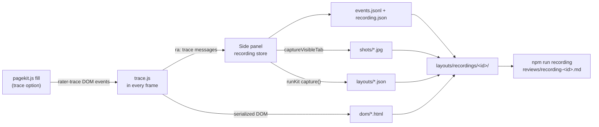

# Developer recording of a quote

Read this when building or changing the developer mode that records a quote on a carrier's page from start to finish: every action with its time, the pages and steps opened, screenshots, the page saved as it changes, and the extension's own fills in the same timeline.

**Status: proposal (2026-10-23), with the maintainer's decisions of the same day ([decided](#decided)): unpacked builds only, raw saved pages, one zip in Downloads, and this developer version before any version for every agent. Step 1 of the [build order](#build-order) is built (2026-10-23): the switch, the trace's actions with their times, the store and the zip, and `npm run recording`. The rest is proposal.** Where a sentence rests on the code as it is, it names the file and line. Where it rests on a guess, it says so; the list at the end collects the guesses.

## Why

The usage log sees an agent's run only to within 1.5 s (`TICK_MS` in [recorder.js](../src/content/recorder.js#L47): the recorder reads the form every 1.5 s and the panel stamps the time when the message arrives, `log()` in [usage-log.js](../sidepanel/usage-log.js#L66)). It sees a click as the button's words (60 characters) and a step, never where on the page, and nothing of scrolling or of the page's redraws between polls. It is paused while a fill runs (`tellRecorder('pause')` in [sidepanel.js](../sidepanel/sidepanel.js#L2048)) and on resume takes a new baseline without announcing the questions the fill revealed (`resume()` in [recorder.js](../src/content/recorder.js#L549)). That is how GEICO's late-drawn team-driving and hazmat-placard questions went unanswered until PR #162. The manual routine for a new carrier (the keşif planı, `docs/kesif-plani.md`, a local file outside the repository) is Alt+Shift+C captures by hand plus Ctrl+S "Web Page, Complete" per page: no timing, no screenshots, raw pages with session tokens in them, and a story that `npm run captures` has to rebuild from file order.

The fill's own waits are tuned from a handful of live runs and read conservatively: a quiet page for 0.8 s before Continue on GEICO, 2 s and its own requests before Recalculate, up to a minute for a load ([browser filling](browser-filling.md), `settle` in [pagekit.js](../src/content/pagekit.js#L367)). Nobody has a millisecond record of what the page did after each answer to say which part of a wait was slack.

A recording gives one timeline a person and a script can read: what the agent did and when, what the page did and when, what the extension did and when. From it the fill's order, its waits and a new carrier's flow are judged on evidence rather than on memory of a live run.

## Goals and non-goals

Goals:

- Record a whole quote as the person does it, or as the extension does it, with the same tool and the same file format, so the two can be compared step by step.
- Millisecond timing from the page's own clock for every action and every redraw.
- Screenshots and the page's DOM at each moment that matters, so Claude can see what the agent saw.
- Files Claude and the review scripts read directly, in ignored `layouts/`, never uploaded by this mode.
- A recorder that only watches. It never clicks, types, scrolls or navigates, and nothing in it can.
- The same layout files Alt+Shift+C saves today, taken at each moment, so `npm run captures` and the new-carrier routine keep working.

Non-goals:

- Not a replacement for the usage log every agent runs. The usage events, the server's allowlist and the review scripts stay as they are; a later version for every agent is sketched below but not designed here.
- Not video, not network bodies, not the agent's other tabs or windows.
- No automatic tuning. A recording is evidence; a wait or a rule changes through [corrections](corrections.md) with a test.
- No new permission that would disable the installed extension until agents accept it ([permissions](#permissions)).

## What a recording is



One recording is one folder:

```
layouts/recordings/geico-fl-2v1d-20261023-1412-ab12/
  recording.json      the manifest: id, carrier, scenario, note, started, ended, the build (version,
                      channel, commit, rules hash), the intake's fingerprint and quote session, the
                      redaction mode, viewport and device pixel ratio, platform, counts, gaps
  events.jsonl        one event per line, in order (below)
  shots/0007.jpg      a screenshot per moment, named by the moment's seq
  dom/0007-f0.html    the page's DOM at that moment, one file per frame (f0 the top frame)
  layouts/0007.json   the page's layout at that moment, in the page-capture format Alt+Shift+C saves
```

A *moment* is a numbered point in the timeline at which a screenshot, a DOM snapshot and a layout may be taken together. Events reference the moment they belong to. The three files of a moment share its number, so a reader opens the screenshot, then the DOM, then the layout of the same instant.

The id is `<carrier>-<scenario>-<yyyymmdd-hhmm>-<4 hex>`, the scenario typed in the panel's existing Scenario box and redacted like a capture's (`capturePage` in [sidepanel.js](../sidepanel/sidepanel.js#L4316)).

## What is recorded

### Timing

Every event carries `t`, wall-clock milliseconds (`performance.timeOrigin + performance.now()` in the frame that saw it; the panel's own events use `Date.now()`, the same system clock), and `pt`, milliseconds since that frame's document started, from `event.timeStamp` for an input event and `performance.now()` for anything else. Both are numbers with a fraction. The report prints deltas; nothing depends on a poll. An event also carries `seq`, one counter per frame, so two events in the same millisecond keep their order, and `frame` (the frame's id as `chrome.scripting` numbers it, 0 for the top frame).

What this changes against today: a change is known to the millisecond rather than to within 1.5 s plus the message hop, and the order of an agent's click, the page's redraw and the recorder's own reading is no longer guessed.

### The agent's actions

Captured as DOM events in the capture phase on `window`, with `composedPath()[0]` as the target (through open shadow roots, as the recorder does, [recorder.js](../src/content/recorder.js#L69)):

| Kind | When | What is kept |
| --- | --- | --- |
| `pointer` | `pointerdown` | `x`, `y` in the viewport, the button, the target's description (below) and its box `rect` |
| `click` | `click` | the same; `text` for a button or link (the recorder's `buttonText`, 60 characters, redacted) |
| `key` | `keydown` | the key's name for Enter, Tab, Escape, Backspace, Delete, arrows, Home, End, PageUp, PageDown; `printable: true` for any other key, never the character; modifiers. Nothing on a `type=password` field |
| `input`, `change` | the native events | the target's description, `trusted`, `len` (the value's length) for a text box, the picked option's text (redacted) for a choice; never typed text |
| `focus`, `blur` | `focusin` / `focusout` | the target's description |
| `scroll` | `scroll`, coalesced to one per 100 ms per scrolled element | window `x`, `y`; the element's selector and offsets when it isn't the window; the document's `scrollHeight` |
| `visible` | `visibilitychange`, `pageshow`, `pagehide` | the document's visibility state |
| `resize` | `resize`, coalesced | the viewport's size and `devicePixelRatio` |

A target's description is the field key as `field-key.js` gives it (`ref:GiveYear`, `cov:COMP#2`, Progressive's `ref:<fieldref>`, redacted as `fieldKeyOf` in [usage.js](../src/usage.js#L297) redacts it), the label as the recorder reads it (`labelFor` in [recorder.js](../src/content/recorder.js#L306): the Duck Creek caption, the GEICO legend, the text before), the control's kind, the question id when there is one, and `rect` (`getBoundingClientRect`, rounded). With `scroll` that gives the target's place in the document, which is how the report checks that answers went down the page.

Each event says who did it: `by: 'agent' | 'extension' | 'page'`. The rule is the recorder's own ([recorder.js](../src/content/recorder.js#L221)): a trusted `input`/`change` is the agent's; one that arrives while a fill runs is the agent's only within 2 s of a trusted gesture on that control, since the kit's `.click()` on a radio or checkbox fires trusted events too. The inputs to the rule are kept on the event (`trusted`, `gestureMs`: milliseconds since the last trusted gesture on that control, `run`: the fill under way), so a reader can re-judge a doubtful case. A select2 pick (GEICO's year, make, model, commodities) fires no native event, so today neither the recorder nor the edit guard sees it as the agent's ([browser filling](browser-filling.md)); the trace still sees the trusted `pointerdown` on the result item and the redraw that follows, and the report pairs them.

### The page

The trace watches the page the way `settle` does (a `MutationObserver` on the body, subtree, child lists and the `checked` / `active-index` attributes, [pagekit.js](../src/content/pagekit.js#L369)) but keeps the result instead of only waiting on it:

| Kind | When | What is kept |
| --- | --- | --- |
| `burst` | a run of mutations ends (no mutation for 100 ms) | `start`, `end`, how many records, `addedControls`, `removedControls`, whether a spinner showed (`busy`, the kit's `pageBusy` selectors, [pagekit.js](../src/content/pagekit.js#L294); on Progressive the ExtJS flag can't be read from the isolated world, so only the mask elements count) |
| `drawn` / `removed` | after a burst, when the controls differ from before | each question's key, label and kind, and `sinceAction`: milliseconds since the last agent or extension action in this frame. This is the direct measure of "the page drew team driving 400 ms after `more about the business`" |
| `changed` | a control's value changed with no input event on it | key, label, before and after as a choice (redacted; `len` only for text): the page's own answer (a decode, a lookup, Recalculate drawing its coverages back) |
| `message` | an error, validation or help message appeared or went away (the recorder's `MESSAGES` selector) | the text, redacted and with typed values taken out as `withoutTyped` does ([pagekit.js](../src/content/pagekit.js#L3682)) |
| `step` | the step read from the page changed (the recorder's `stepKey`: GEICO's progress bar while the title names it, AmWINS' headings) | the step name; `null` when the bar and the title disagree, which the report shows as the mid-redraw window the fill halts on |
| `page` | a new document in a frame (the trace's own start), or the recorder's `pageKey` changed | `page` (as the usage log names pages: `pageName=` on Progressive, the path otherwise, ids normalised), `title` redacted, `from`; never the query string |
| `request` | a same-origin `fetch` or XHR finished (`PerformanceObserver`, `resource` entries, as `watchRequests` reads them, [pagekit.js](../src/content/pagekit.js#L344)) | the path without its query, `start`, `end`, `ms`. A request still running can't be seen this way; see the page-world watcher under [components](#components) |
| `lists` | the unit lists the kit reads changed (`__raterKit.unitListsNow`, when the kit is in this world) | selectors and row counts, as `list_shown` |

Reads of control state use the recorder's own readers (`snapshot`, `labelFor`, `stepKey`, `pageKey`, `buttonText`, `controlForEvent`), which the recorder would export on `globalThis.__raterRecorder.read` (today it exports only `rebaseline`, `poll`, `dispose`, `alive`, [recorder.js](../src/content/recorder.js#L612)). The point is that a recording describes a question exactly as the usage log does, so a recording's `ref:GiveYear` and a `fill_field`'s `ref:GiveYear` are the same question.

### The extension's own work in the same timeline

Two sources, so a person's run and the extension's can be laid side by side on one step:

1. **The kit says what it does.** With a new fill option `trace: true` (set by the panel while a recording runs; declared in [types.js](../types.js) `FillOptions`), `fill()` dispatches a `rater-trace` `CustomEvent` on `document` at each of: fill start (`run`, the plan's step count, the options), each answer as it is applied (`stepId`, `key`, `kind`, `how`, before `apply` and after), each wait (`wait` with `quietMs`, `maxMs`, `requests`, then `waited` with the milliseconds it took and why it ended: quiet, busy at the limit, components undefined, requests still finishing), each button press (`press`: the button's words, `late` or not, as `pressButton` knows it), each mark, and the fill's end (`run`, the report's counts and blockers). The trace, in the isolated world, listens for them and writes them as `fill` events. The `detail` crosses worlds as a JSON string (as `page-press.js` crosses the other way with events and no detail, [page-press.js](../src/content/page-press.js)); objects in `detail` do not reliably cross Chrome's world boundary (assumption to verify in the GEICO mock). Without a listener the dispatch costs nothing, and without `trace` nothing is dispatched: no change for agents.
2. **The panel adds its own markers.** While a recording runs, the panel writes into it: every usage event it logs (kind `usage`, the event as logged, already redacted; so `fill_run`, `fill_field` with its `timing`, `field_change`, `agent_click`, `page_layout` and the rest sit in the same file), the recorder's pause and resume, an automatic fill being scheduled and why (`new_fields`, `removed_fields`, `list_shown`, the 600 ms timer in `scheduleAutoFill`, [sidepanel.js](../sidepanel/sidepanel.js#L2006)), a layout job scheduled and taken, an AI apply's start and end, and a note the developer typed (the Note box, on Alt+Shift+C or a Note button).

From these the report measures each wait's *slack*: the time between the last thing the page did (the last `burst`, `request` or `drawn`) and the moment the wait ended. A wait that ended 1.7 s after the page's last request is 1.7 s of slack, and a wait that ended while a request was still running is the opposite finding.

### Screenshots

The side panel takes them with `chrome.tabs.captureVisibleTab(windowId, { format: 'jpeg', quality: 80 })` when the trace reports a moment (the content script cannot take screenshots). A moment is: a page arrival once the page is quiet, each agent `click` and Enter once the page is quiet after it (quiet 300 ms, or 3 s at most, then shot anyway with `settled: false`), each `drawn` / `removed` / `message` burst, each `step` change, a fill's start, each of its presses, its end, and a note. Moments closer than 600 ms are coalesced into the later one, which keeps the extension under Chrome's limit of two calls per second (`MAX_CAPTURE_VISIBLE_TAB_CALLS_PER_SECOND`, verified in the Chrome `tabs` reference) with margin. Each shot records when it was asked for and when it came back (typically 50–150 ms later: an assumption to measure), the viewport, the scroll position and the document's height, so the reader knows which part of the page it shows. The DOM snapshot of the same moment holds the rest of the page.

Only the active tab of its window can be captured. A recording whose quote tab is behind another tab gets `shot: null, why: 'tab not visible'` on those moments; the events still flow. A JPEG of a 1280×800 form page is about 100–200 KB (assumption; a PNG about twice that), so a 20-minute quote with 150 moments is 15–30 MB. The manifest keeps the count and size, and the panel shows them while recording.

No screenshot and no DOM snapshot is taken on a step that is the agent's (GEICO's `stopSteps`: Final Quote Details, MVR & CLUE, Payment Information, [geico.js](../src/carriers/geico.js#L876)), where the recorder logs no layout today for the same reason, nor while a `type=password` field is on the page or focused (the carrier's login). Events there carry labels only.

### Saved pages and layouts

At each moment the trace serializes the frame's DOM itself: a walk from `documentElement` that writes open shadow roots as `<template shadowrootmode="open">` (declarative shadow DOM, which is what Chrome's own "Save page as" wrote into the GEICO pages in `layouts/geico/NE-no-dot/`, so a later Chrome parses them back), writes each control's current state as attributes (`value`, `checked`, `selected`) since `outerHTML` doesn't, writes `adoptedStyleSheets` and same-origin stylesheet rules as `<style>` so a snapshot renders roughly as seen (cross-origin stylesheets stay as `<link>` with their URL), and drops every `<script>`. `outerHTML` alone would lose GEICO's shadow roots and every typed value.

A snapshot is taken only when the page's signature (the controls' keys and labels, as the kit's `signature()`, [pagekit.js](../src/content/pagekit.js#L3783)) or its messages differ from the last snapshot of that frame, and identical serializations are deduplicated by hash, so typing doesn't produce one per keystroke. Serialization runs on the page's main thread; a 1 MB ExtJS page may take 100–200 ms (assumption), so it runs in `requestIdleCallback` after the quiet period, never during input. A snapshot over 5 MB is dropped and the moment says so.

The panel also saves the moment's layout: the kit's `capture()` as Alt+Shift+C runs it ([sidepanel.js](../sidepanel/sidepanel.js#L4327), [pagekit.js](../src/content/pagekit.js#L3610)), in the same `page-capture` version 2 format with `scenario` set to the recording's id and `note` to the moment's description. `npm run captures` reads the folder as it reads any capture folder, and the new-carrier routine's Alt+Shift+C step is covered by a recording.

**Saved pages are raw** (DR-4): text and values as the page shows them, as the Ctrl+S pages are today, so nothing the evidence needs is lost (GEICO's USDOT record, Progressive's registered names). Credentials are removed all the same: scripts are dropped, hidden inputs lose their values, every URL loses its query string, and attributes whose name or value match the token patterns `geico-fixture.mjs` already knows (`ssotoken`, `tkey`, `retentionKey`, `conversationId`, `auth=`, `convToken`, …, [geico-fixture.mjs](../scripts/geico-fixture.mjs#L651)) are removed.

Screenshots can't be redacted and are raw too. Both stay in ignored `layouts/` on the computer that recorded; this mode never uploads. See [privacy](#privacy-credentials-and-client-data).

## Where the data lives and how it leaves the browser

While recording, the panel appends to the Origin Private File System of the extension's origin (`navigator.storage.getDirectory()`): `events.jsonl` appended per batch, screenshots and snapshots as files as they arrive. A panel reload or a closed panel loses nothing already written (a chunk every 200 events or 5 s): the next panel offers **Save the unfinished recording**. It doesn't take the recording up again; the trace in the page keeps up to 2,000 events while no panel answers (a `gap` event counts any it had to drop) and stops itself after a minute without one. OPFS in an extension page is an assumption to verify in the first PR; `chrome.storage.local`, which the extension already uses with `unlimitedStorage`, is the fallback (screenshots as data URLs under per-moment keys).

**Stop and save** writes the recording as one zip, `recording-<id>.zip`, to Downloads through an anchor, as captures and the usage export do today: no `downloads` permission and no multiple-downloads prompt (DR-3). The zip is built in the panel with fflate's browser build, vendored into `lib/` by `npm run vendor` as PDF.js is ([vendor.mjs](../scripts/vendor.mjs)); fflate is already a development dependency. The developer moves it into `layouts/recordings/`; `npm run recording` reads the zip as it is or the folder unzipped.

The content script keeps nothing after sending. The panel's OPFS copy is deleted after a successful save, or kept and listed under Developer mode until the developer deletes it.

## How Claude and scripts read it

`npm run recording -- layouts/recordings/<id>` (`scripts/recording.mjs`, lib in `scripts/lib/recording.mjs`; neither exists yet) writes `reviews/recording-<id>.md` (ignored, like the other reviews) and `summary.json` beside the recording:

1. **Flow**: the pages and steps in order with arrival times, how long each was on screen, which button left it (the agent's or the extension's), and the moments (screenshot, DOM, layout file names) for each.
2. **Timeline per step**: every action with its time and the delta from the previous one; after each action, what the page drew or removed and how late; the page's requests under it; the extension's waits with their slack.
3. **Order down the page**: each answer's document `y` in the order given, flagged where the order went back up (the check PR #161 made by eye).
4. **Questions drawn late**: each `drawn` event with `sinceAction`, and whether a fill under way answered it, left it, or ended before it (the PR #162 class of problem).
5. **Waits**: every `wait` / `waited` pair with its slack and why it ended; per wait kind, the median and the worst. This section is the input to loosening or tightening `settle` arguments, with a test per change.
6. **Agent versus extension**: when the folder holds two recordings of the same carrier and scenario, or the recording holds both a manual step and a filled step, the two runs side by side per question key: who answered, in what order, how long between answers, which buttons were pressed and how long the page took after each.
7. **Layout story**: `npm run captures` over the recording's `layouts/`, as for manual captures.

Claude reads the Markdown first, then opens the screenshot and DOM of a moment it needs (the Read tool renders a JPEG). The `events.jsonl` is for scripts: `scripts/lib/events.mjs` doesn't read it (these aren't usage events), and nothing in the review scripts changes.

## Components

| Part | Where | What it does |
| --- | --- | --- |
| Trace script | `src/content/trace.js` (new; classic script, isolated world, every frame) | Listens for input events, watches mutations and requests, serializes the DOM, reads controls through `__raterRecorder.read`, sends `{ ra: 'trace', … }` messages to the panel. Injected only while a recording runs, in the same `executeScript` as the recorder (`ensureRecorder`, [sidepanel.js](../sidepanel/sidepanel.js#L1433)); deduplicated across reinjections by a generation counter as the recorder is. Contains no `.click()`, `.value =` or `dispatchEvent`; a test keeps it so |
| Recorder readers | `src/content/recorder.js` (version 12) | Exports `read: { snapshot, labelFor, stepKey, pageKey, buttonText, controlForEvent }`; no behaviour change |
| Kit trace events | `src/content/pagekit.js` (version 86) | `rater-trace` dispatches under the `trace` fill option; `FillOptions.trace` and the `KitTraceEvent` shape in `types.js` |
| Page-world request watcher (optional, PR 2) | `src/content/page-watch.js` (new; MAIN world, every frame, dev mode only) | Wraps `window.fetch` and `XMLHttpRequest.prototype.send` to dispatch `rater-request` events with start and end, so a request still running is seen, which `PerformanceObserver` can't show. It changes the page's globals, so it is never injected outside a recording. If it proves reliable on GEICO it is the evidence for ending the Recalculate wait on the response rather than on 2 s of quiet |
| Recording store | `sidepanel/recording.js` (new ES module) | Start/stop, OPFS writes, the screenshot throttle, moments, the manifest, the zip, the panel's own markers |
| Shapes and rules | `src/recording.js` (new, `// @ts-check`) | Event builders, the attribution rule, redaction of labels and texts (reusing `redactor` from `usage.js`), the manifest; pure functions tested in Node. `TraceEvent` and `RecordingManifest` in `types.js` |
| Panel UI | `sidepanel/sidepanel.html`, `sidepanel.js`, `sidepanel.css` | Settings → Advanced: a **Developer mode** switch (shown only when the build's `channel` is `source` or `unpacked`, which `usage-log.js` knows from its `PROVENANCE` stamp and would export; never in a store build, [decided](#decided)); under it **Record** / **Stop and save**, the elapsed time, counts and size, a Note button; Alt+Shift+C during a recording adds a note and a moment |
| Shortcut | `manifest.json` `commands` | `record-toggle`, suggested Alt+Shift+R. Adding a command is not a permission |
| Report | `scripts/recording.mjs`, `scripts/lib/recording.mjs`, `package.json` script `recording` | Above |
| Mock recording | `scripts/geico-mock.mjs --record <folder>` | The GEICO mock already runs `recorder.js` in a CDP isolated world and plays both the agent and the panel ([testing](testing.md)); with `--record` it runs `trace.js` too and writes a recording of the run. A deterministic sample for the report's tests and for seeing the format, without a live page and without client data (the fixture is scrubbed) |
| Tests | `test/trace.test.mjs`, `test/recording.test.mjs`, new cases in existing files | The trace script in a vm with the fake DOM `test/recorder.test.mjs` uses; the store and the report on a synthetic recording; in `test/pagekit.test.mjs` the `rater-trace` sequence of a fill on the virtual clock; in `test/sidepanel-safety.test.mjs` that the trace never acts and that Developer mode is hidden on a store channel; in `test/consistency.test.mjs` that the token patterns in `trace.js` equal `geico-fixture.mjs`'s |
| Documents | this file; [learning](learning.md), [browser filling](browser-filling.md), [testing](testing.md), [new carriers](new-carrier.md); the README | A line each pointing here, in the PR that lands the behaviour they describe |

The trace reads through `__raterKit` only when the kit is in its world (GEICO, AmWINS). On Progressive the kit runs in the MAIN world ([browser filling](browser-filling.md)), so the trace reads busy state from the mask elements and the panel takes layouts with `runKit`, as `capturePage` does in either world.

## Permissions

The manifest today asks for `sidePanel`, `scripting`, `storage`, `unlimitedStorage` and host permissions for every carrier domain ([manifest.json](../manifest.json#L13)). A permission that adds a warning disables the installed extension until the user accepts it (verified in Chrome's permission-warnings page), so the design adds none:

- `captureVisibleTab`: the method's reference says the extension needs `<all_urls>` or `activeTab`; the same page's host-permissions section says host permissions let an extension call it on matching tabs. **Host permissions alone are refused**: "Either the '<all_urls>' or 'activeTab' permission is required." (step 1's check, 2026-10-23: the packaged unpacked build in Playwright's Chromium, on the AmWINS mock at `localhost`, which the manifest's host permissions cover). Screenshots (step 3) need one of them, which is that step's decision: `activeTab` shows no warning and is granted by a gesture on the extension (the toolbar icon, a shortcut of its own, such as the proposed Alt+Shift+R), for the tab until it navigates, so Progressive's page loads would need it granted again; `<all_urls>` warns, so only in the unpacked copy's manifest (`devManifest` in [package.mjs](../scripts/lib/package.mjs)) or as an optional permission asked for when recording starts.
- No `downloads` (anchor downloads suffice), no `debugger` (it can't be optional and shows a debugging bar on every tab), no `tabCapture`, no `tabs` (the panel already reads the quote tab's URL, which the host permissions allow).
- No new host.
- A second `commands` entry (Alt+Shift+R) is not a permission.

## Privacy, credentials and client data

- A recording holds client data: in its screenshots and its raw saved pages. It belongs in ignored `layouts/recordings/` on the computer that made it, as saved pages and captures do today; the panel says so when it saves, as `capturePage` does. Nothing in this mode uploads anywhere: `recording.js` has no network path, and `npm run e2e:extension`'s rule that no request leaves the machine covers a recording made in that harness.
- Credentials stay out, raw pages and all: scripts are dropped, hidden inputs lose their values, URLs lose their query strings, token-shaped attributes are removed, `type=password` fields are never read and no screenshot is taken while one is on the page or focused. Keystrokes are never recorded as characters. The upload token and the agent's OpenAI key live in the extension's settings, which no content script can read (`setAccessLevel` in [background.js](../background.js)), and the recording store never reads them.
- Events in `events.jsonl` are redacted as usage events are: labels and button texts through the intake's redactor, field keys through `fieldKeyOf`, text values as lengths and `matchesIntake`, choices as option texts. A recording made without an intake loaded has no redaction terms; the panel refuses to start one, as `capturePage` refuses a capture ([sidepanel.js](../sidepanel/sidepanel.js#L4308)).
- Steps that are the agent's (stop steps) and login pages get events only.
- A recording shared with Claude or a reviewer is shared as files on the maintainer's computer, as `layouts/geico/` is today; nothing from it goes into a commit, a PR or an issue. A fixture built from a recording's DOM goes through the same scrub and privacy scan as `geico-fixture.mjs` (`findPii`, token patterns, writes nothing on a finding).

## Failure modes and limits

- The quote tab isn't visible: no screenshots, events continue, the manifest counts the moments without a shot.
- Chrome refuses a capture (rate, a sensitive page): the moment records the error's name; the throttle backs off for a second.
- The panel is closed mid-recording: the trace buffers up to 2,000 events and marks a `gap` with the count if more are lost; screenshots for that span are missing (only the panel takes them); the recording resumes when the panel reopens on the tab.
- The extension is reloaded or updated: the trace in the page is orphaned (`chrome.runtime.id` gone, as the recorder detects, [recorder.js](../src/content/recorder.js#L420)) and stops; the OPFS copy keeps what was written; the manifest marks the recording as cut.
- A heavy page: a mutation storm (ExtJS redrawing a grid) is summarized per burst, never one event per record; serialization is deferred to idle time and capped at 5 MB per snapshot. The observer effect on the page's timing is small but not zero; the recording says it was on (the manifest), and a timing judged from a recording is compared with the usage log's `fill_field.timing` from runs without it.
- Two quote tabs: each tab's trace sends its tab id; the panel records the tab it follows and marks events from another tab with its `view`, as the usage log does.
- Progressive's MAIN-world kit: no `rater-trace` is lost (DOM events cross worlds), but the trace can't read ExtJS component state; labels come from the recorder's readers, which already work without it.
- Clock: one machine, one clock; no skew between frames beyond `timeOrigin` rounding (sub-millisecond).
- Size: tens of megabytes per quote; OPFS quota under the extension's origin is ample on a desktop (assumption; `unlimitedStorage` is known to cover IndexedDB and `chrome.storage.local`, and the first PR checks OPFS).
- What a recording can't show: the carrier's server state, a request still running (unless the page-world watcher is on), and what the agent was thinking. A long pause before a click is a pause; the report doesn't call it a problem.

## From the developer's recording to every agent's

The same event layer could later go into the central usage log, under the same discipline as today's events; the picture layer could not.

| Layer | Developer mode | Every agent (later, not designed here) |
| --- | --- | --- |
| Events with ms timing, positions, scroll, bursts, drawn/removed with delays, requests' timing, attribution | Yes, in `events.jsonl` | Could go central as a new event type (one `trace` event per moment or per short span, bounded, the server's allowlist and `MAX_EVENT_BYTES` of 32 KB per event, [server/index.mjs](../server/index.mjs#L38)); labels, keys and texts redacted exactly as now; paths without queries. Volume is the question: a quote may be 500–1,500 such events, perhaps 0.3 MB, against today's few hundred events (an estimate; dev mode measures it). The queue's cap of 20,000 events ([usage.js](../src/usage.js#L17)) and the review scripts' loaders would need to skip or sample it (as `isPageLayout` keeps `recalculate` layouts out of the layout scripts). A sampling rule (one quote in N, or only quotes with a problem report) and a kill switch in `agent_settings` would be part of that design |
| The kit's `rater-trace` waits and presses | Yes | Yes, as fields on `fill_run` or a bounded `fill_wait` event: per wait kind, the time and why it ended; the richest signal for tuning waits and small |
| Screenshots | Yes, raw | Never: pixels can't be redacted and show names, premiums, SSNs as the page shows them |
| DOM snapshots | Yes, raw, credentials removed | Never central. The redacted `page_layout` already goes central and is the DOM's structured stand-in |
| Layouts (`page-capture`) | Yes | Already central as `page_layout`, per the rules in [learning](learning.md) |
| Where it is read | `npm run recording`, Claude on the files | The signals report's Speed section and the weekly review ([skill](../.claude/skills/weekly-review/SKILL.md)) |

Three things must hold before any of it goes to every agent: TNI's decision (the store listing's privacy practices describe what the usage server receives, [store release](chrome-web-store.md); interaction timing at this grain is new), the server deployed with the new type before the extension sends it (an unknown type is refused and parked, [usage-log.js](../sidepanel/usage-log.js#L200)), and a measured volume from developer recordings.

## Build order

Each step is one PR with its tests and its document changes; each is useful on its own.

1. **Skeleton and the spikes** (built). Developer mode switch; `trace.js` with `page`, `step`, `pointer`, `click`, `key`, `input`, `change`, `focus`, `blur`, `scroll`, `visible`, `resize` events and ms timing; the recorder's readers (`read`: `controlForEvent`, `describe`, `choiceText`, `stepKey`, `pageKey`, `buttonText`), brought forward from step 2 so the timeline names its questions; `sidepanel/recording.js` writing OPFS chunks and saving the zip; the panel's **Note**; `scripts/recording.mjs` printing the flow and the per-step timeline. Checked in the real browser (Playwright, the packaged unpacked build, the AmWINS mock): OPFS works in the panel page; `captureVisibleTab` with host permissions only is refused ([permissions](#permissions)); a recording made there with trusted clicks and typing saves as a zip with no typed text in it. Tests: the trace in a vm, the store on a stand-in file system, the report on a synthetic recording, the panel's injection and message handling.
2. **The page.** `burst`, `drawn`, `removed`, `changed`, `message`, `step`, `request`, `lists`; the recorder's exported readers; raw DOM snapshots with the credential scrub and the consistency test; layouts per moment through `capture()`; `npm run captures` over a recording's `layouts/`. Optional: the page-world request watcher.
3. **Screenshots.** Moments, the throttle, visibility, stop steps and password fields; the report links each moment's files.
4. **The extension in the timeline.** `rater-trace` in `pagekit.js` behind the `trace` option, the panel's markers and usage events copied in, attribution with its inputs; the report's order-down-the-page, late-drawn, waits-and-slack and agent-versus-extension sections; `mock:geico --record` and a small synthetic sample recording under `test/fixtures/recording/` (no screenshots) for the report tests.
5. **Use.** [New carriers](new-carrier.md) names "record a quote" in place of the Ctrl+S routine; the local keşif planı is superseded; the weekly-review skill reads `reviews/recording-*.md` when the maintainer has recorded a scenario for an open item; the first recordings of GEICO's Recalculate and of a manual GEICO quote are taken and read.
6. **Later, on a decision**: the central event layer, as the table above sketches.

## Decision records

### DR-1: A separate trace script beside the recorder, not more recorder

**Status:** proposed. **Deciders:** the maintainer.

**Context.** `recorder.js` runs in every agent's quote page. It polls every 1.5 s, reports bounded summaries, pauses during fills, and has tests and live history behind its judgement calls (what counts as the agent's, when to rebaseline). The developer recording needs event-level capture, a mutation observer, DOM serialization and screenshots, must not pause during fills, and runs only when asked.

**Options.**

| | A: extend `recorder.js` with a dev mode | B: a new `trace.js` using the recorder's readers (chosen) | C: a new script reading the page its own way |
| --- | --- | --- | --- |
| Risk to every agent's recording | High: one file, one timer, shared state, a bug reaches every agent | Low: injected only in dev mode; the recorder changes by one export | Low |
| Same question names as the usage log | Yes | Yes, through the exported readers | No: two readings drift (the capture report once showed one GEICO question appearing and going away under new render numbers for that reason) |
| Code size and tests | Recorder grows past its already dense 620 lines; its vm tests must cover both modes | A new file with its own vm tests; the recorder's tests check the export only | New file, plus a second copy of ~200 lines of readers |
| Fill behaviour | The recorder is paused during fills by design; a dev mode would have to run on through the pause | Independent of the pause; records it as an event | Same |

**Decision.** B. The recorder exports its readers; the trace is its own classic script in the same world and frames, injected only while a recording runs.

**Consequences.** Two scripts read the page with one set of functions; a reading fix lands in one place. The recorder's version goes to 12 for the export. Agents get no new code path. The trace can't use ExtJS component state on Progressive (the recorder never could either).

### DR-2: Screenshots through `captureVisibleTab` from the panel

**Status:** proposed.

**Context.** A content script cannot take a screenshot. The extension APIs that can: `tabs.captureVisibleTab` (viewport of the active tab; rate-limited to 2/s; host permissions or `activeTab`), `chrome.debugger` with `Page.captureScreenshot` and `DOMSnapshot.captureSnapshot` (full page and a layout-annotated DOM; needs the `debugger` permission, which can't be optional, adds a warning, and shows "is debugging this browser" on the tab), `tabCapture` (video; a permission; not structured). Rendering a saved DOM later in headless Chromium needs the carrier's stylesheets and session and would show a reconstruction, not what the agent saw.

| | A: `captureVisibleTab` (chosen) | B: `chrome.debugger` | C: DOM only, no pixels |
| --- | --- | --- | --- |
| Permission change | `activeTab` (no warning) or `<all_urls>`: host permissions alone are refused (step 1's check) | `debugger`: warning, extension disabled until accepted, visible bar | None |
| What it shows | The viewport as the agent saw it; the DOM snapshot holds the rest | Full page, exact layout boxes | Nothing visual; GEICO's styles live in shadow roots and the design system's CSS |
| Rate and cost | 2/s; coalesced moments | Slower, heavier, but no cap | Free |
| When the tab is hidden | No shot | Works | Works |

**Decision.** A, with moments coalesced to at least 600 ms apart and the scroll position recorded with each shot. B is reconsidered only if viewport shots plus DOM prove insufficient for a concrete question, and never for a version agents run.

### DR-3: Files in the browser, saved as one zip; not the collection server, not `downloads`

**Status:** decided by the maintainer, 2026-10-23: a zip, no folder picker.

**Context.** A recording is tens of megabytes of mixed JSON lines, JPEGs and HTML. It must survive a panel reload, end up in ignored `layouts/` on the maintainer's computer, and never reach the production usage server. Three ways to get it to disk: files written by the panel (OPFS as the buffer, then a zip download, or the File System Access API's folder picker), a new endpoint on the local collection server (`server/index.mjs` on `localhost`, which the manifest already allows), or `chrome.downloads`.

| | A: panel files (chosen) | B: local server endpoint | C: `chrome.downloads` |
| --- | --- | --- | --- |
| Needs something running | No | `npm run server` on the recording computer, and `http://localhost/*` only (the production server must refuse the endpoint) | No |
| Permission | None | None | `downloads`: a warning, so agents' copies are disabled until accepted; or an optional permission requested from a gesture |
| Where files land | One zip in Downloads, moved into `layouts/recordings/` | `server-data/recordings/` on the server's disk | Downloads, with Chrome's multiple-downloads prompt or a zip |
| Who can record | Anyone with the unpacked build | A developer with Node | Anyone |
| Browser API risk | OPFS in an extension page is to verify (PR 1); anchor downloads are known to work (captures use them today) | Low | Low |
| Path to the central version | Different: the central path is the usage log, by design (events only) | Shares the server, but the central version must never take DOM or screenshots, so little is reused | None |

**Decision.** A: OPFS while recording, one zip through an anchor on Stop and save. A folder picker was considered and left out by the maintainer's choice. B stays attractive if OPFS disappoints; the recording format doesn't change either way.

### DR-4: Saved pages raw, credentials removed

**Status:** decided by the maintainer, 2026-10-23.

**Context.** Today's saved pages are raw and hold client data and session tokens (the GEICO handoff notes, `docs/HANDOFF.md`, local). Captures are redacted and hold no typed text. Redaction can erase the evidence (a registered name block, a USDOT record); raw pages need care in every later use.

**Decision.** Raw, as the Ctrl+S pages are: text and values kept. Scripts, hidden inputs' values, URL query strings and token-shaped attributes are always removed. Screenshots are raw. Both stay in ignored `layouts/`. The timeline's events are redacted as usage events are ([privacy](#privacy-credentials-and-client-data)), so the part a later version for every agent could share stays clean.

**Consequences.** A recording shows the client as the page did and is handled like today's saved pages: local, never committed, scrubbed before anything becomes a fixture. No recording leaks a credential.

## Decided

The maintainer's answers, 2026-10-23:

1. **Who records:** unpacked (and source) builds only. The store build never shows Developer mode.
2. **Saved pages:** raw, credentials removed (DR-4).
3. **Where recordings go:** one zip in Downloads (DR-3), moved into `layouts/recordings/`.
4. **Every agent's version:** after the maintainer's own developer recordings; nothing new is sent until then, and TNI's privacy wording comes first.

## Open questions for the maintainer

Taken as proposed unless the maintainer says otherwise:

1. **Screenshots**: JPEG at quality 80 (proposed) or PNG? Skip them while an SSN-labelled field holds a value on GEICO's Business & Owner Info, if GEICO doesn't mask it on screen? The design skips stop steps and password fields; this would be a third rule.
2. **Keystrokes**: per-key timing without characters (proposed), or only the first and last key of a typing run?
3. **The page-world request watcher** (wrapping `fetch`/XHR in the page's own world, dev mode only): only if the `PerformanceObserver` view proves too coarse for the Recalculate wait (proposed), or in PR 2?
4. **Shortcut**: Alt+Shift+R to start and stop, and Alt+Shift+C adding a note and moment during a recording (proposed)?
5. **Supersede the keşif planı** with the recording routine once PR 5 lands, or keep both?

## Verified and assumed

Verified in the code and documents cited above: the recorder's 1.5 s poll and resume behaviour; the panel's pause/resume around fills and AI applies; what `capturePage` saves and how; the kit's `settle`, `pageBusy`, `watchRequests`, `signature`, `capture` and the `__raterKit` export; `fill_field.timing`'s fields; the server's allowlist and size limits; the queue's cap and batch sizes; the manifest's permissions and single command; the GEICO fixture's token patterns and privacy scan; the `page-press.js` pattern of DOM events between worlds; which files `npm run package` stamps (`field-key.js`, `pagekit.js`; the recorder isn't, [package.mjs](../scripts/lib/package.mjs#L9), so `trace.js` needn't be either unless it carries a build placeholder). Verified in Chrome's documentation (2026-10-23): `captureVisibleTab`'s two statements on permissions, its limit of 2 calls per second, that an added permission with a warning disables the extension until accepted, that `activeTab` shows no warning, that optional permissions are requested from a user gesture and `debugger` can't be optional.

Checked in step 1, in the real browser (2026-10-23): OPFS is available in the panel page, with `createWritable`, and roomy (about 209 GB of quota on the computer checked); `captureVisibleTab` on a tab the host permissions cover is refused without `activeTab` or `<all_urls>`.

Assumed, to verify in later steps: a `CustomEvent`'s `detail` needs to be a string to cross worlds; JPEG size per shot and capture latency; DOM serialization time on a large ExtJS page; the event volume per quote; that the trace's observer doesn't change the page's timing measurably. Not checked: the size of the saved GEICO pages (0.2 MB each) is taken from the session's notes.
