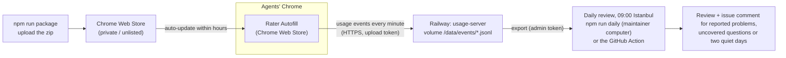

# Hosting: updates to the agents, logs back to TNI

Read this for collection-server configuration, deployment, or log transport operations. For how feedback becomes candidate rules, use [learning](learning.md). For pre-release checks, use [testing](testing.md).



## Extension updates: Chrome Web Store

Chrome only auto-updates extensions installed from the Web Store (on computers not managed by
company policy). See [chrome-web-store.md](chrome-web-store.md): raise the version,
`npm run package`, upload `dist/tni-rater-autofill-<version>.zip`, submit; agents' Chrome picks it up
within hours of approval.

## Usage server: Railway

| | |
| --- | --- |
| Project | `tni-rater-autofill` (workspace "lutfikeskin's Projects") |
| Service | `usage-server`, built from `server/Dockerfile` (`RAILWAY_DOCKERFILE_PATH`) |
| URL | https://usage-server-production.up.railway.app (`/v1/health`) |
| Storage | volume `usage-data` mounted at `/data` (one JSONL file per day received) |
| Variables | `RATER_TOKEN` (upload token, also built into the extension; required: with `HOST=0.0.0.0` the server refuses to start without it), `RATER_ADMIN_TOKEN` (reading the logs, and the event count on `/v1/health`), `HOST=0.0.0.0`, `DATA_DIR=/data`, `PORT=8787` |

The extension sends to this server by default (`sidepanel/usage-log.js`, `DEFAULT_SERVER` /
`DEFAULT_TOKEN`); an agent's own Server setting (a local test server) overrides it, and a blank
one turns uploads off. Harnesses that load the packaged extension must set that Server to a local
server first (`npm run e2e:extension` does, and fails on any request to production), so test runs
stay out of the pilot's usage data. The upload token can only add events, which the server cleans; reading
them back needs the admin token, kept in Railway, in the repository secret `RATER_ADMIN_TOKEN`,
and on the maintainer's Mac in `~/.config/tni-rater/admin-token`.

Redeploy after a server change: `railway up --service usage-server` from the repository root
(`.railwayignore` keeps the upload to what the image needs).

Before deploying, confirm `RATER_TOKEN` is set in the service's Variables. The server fails closed:
bound to anything but loopback (`127.0.0.1`, `localhost`, `::1`) without `RATER_TOKEN`, it exits
with `RATER_TOKEN is not set and HOST=0.0.0.0 is not loopback: refusing to start an open upload
endpoint` instead of taking anyone's uploads (audit 2026-10-08: an unset variable made the
deployment an open write endpoint). On Railway that is a failed deployment in the deploy logs, and
the previous one keeps serving. `npm run server` on this computer still needs no token.
`/v1/health` answers `{ ok, server }` to anyone (what the daily server check and the panel's
"is it there" probe read); `events`, how many are stored, only comes with the admin token.

The container runs as root, the image's default. Running it as the image's `node` user is the
intended hardening, held until the volume's ownership is verified: Railway mounts `/data`
root-owned, and a non-root process that can't write there would answer every upload with 500
("could not store events") rather than fail safe. Before adding `USER node` to
`server/Dockerfile`, check `ls -ld /data` and a test write as `node` in the running container
(or add an entrypoint that chowns `/data` first), then redeploy and confirm `/v1/events` still
stores an event.
Deploy a server change that accepts new event fields before releasing the extension that sends
them: an older server drops unknown fields (and refuses layouts over its size limit) rather than
storing them. The run-identity fields (`run`, `rules`, `settings`, `step` on fill and field-change
events, [learning](learning.md)) are such a change: deploy the server that keeps them before the
extension that sends them, or every fill run until then is stored with those names in `dropped`.
That server also refuses an event whose run id, rules hash, settings object or step is malformed
(per event, in the reply's `rejected`). Historical `page_layout` events may retain `step: null` when no step was recognized, including queued or re-uploaded layouts; this exception does not permit malformed non-null steps or null steps on fill/field-change events. Failed fills also retain `rules` and `settings` on `fill_error`, with the same exact validation as `fill_run`. Older AI clients emitted `probability`, `support`, `evidenceProbability` and `confidence` on `ai_decision`: ingestion preserves scores from 0 to 1, null for unavailable evidence, and the original `high`/`medium`/`low` confidence enum for queued uploads and historical exports. Invalid shapes are dropped; current Luna clients do not emit these scores, and retaining them does not make them calibrated accuracy evidence. The obsolete `ai_suggest.cached` field remains excluded. It keeps an event's `channel` (store, unpacked or source) and `commit` (a short
commit, optionally `+dirty`) only in those shapes. It refuses events from the local test page (`carrier: 'test'`, localhost), which are
no quote; the review scripts also skip the ones stored before. The server names what it dropped on
the stored event (`dropped`: field names only, at most 20, `droppedMore` counts the rest), and
`/v1/health` names its version (`server`, a hash of its `server/index.mjs`). `node scripts/server-check.mjs` compares that with this checkout, without
sending any event: after a deploy it should say `same`.

## Logs on your computer

```bash
npm run pull                         # all events -> server-data/events/
npm run pull -- --since 2026-10-01
npm run review                       # then the usual review
npm run push-logs -- some/export.json   # an agent's exported log, or an old local server's folder
```

## Daily review

Every morning the daily review downloads the log and reviews the events the server received since
the last successful run began downloading. An upload that arrives late is in the next review, and
none is in two. When something is new, it comments on the open issue labelled `daily-review`, or
opens one titled "Daily review" when none is open. New means:

- problem reports, each with the build that logged it, marked when it came from a test run;
- questions without a rule (or AmWINS fields the mock lacks) first seen in a layout of the period,
  one per question whatever its row, number, product or step (`scripts/lib/daily.mjs`);
- a deployed usage server that isn't the repository's (`scripts/server-check.mjs`, checked first
  and only on the default branch): redeploy it;
- two days without any event received;
- a run that couldn't finish, because the server was down or a script broke.

Nothing new, no comment. Two quiet days get one comment, with the day the last event arrived, from
the run whose window holds the moment the quiet reached 48 hours. From 2026-10-11 to 10-18 no events
arrived and every run stayed silent, so a week without quotes looked the same as broken uploads.
A long list is cut to fit a GitHub comment and points to the review. Closing the issue is how a
reviewer says it's been read; the next new item opens another. The review does not implement or deploy
corrections.

### On the maintainer's computer: `npm run daily`

Since 2026-10-19 GitHub doesn't start Actions jobs on this account (billing), so the workflow below
fails before it starts. `npm run daily` (`scripts/daily.mjs`) does the same steps on a Windows (or
any) computer: the server check, `npm run pull`, `scripts/review.mjs --since <start> --summary`,
then `scripts/daily-issue.mjs post`. It needs Node 22, the admin token (`RATER_ADMIN_TOKEN` or
`~/.config/tni-rater/admin-token`), and `gh auth login` as an account that can comment on the
repository's issues. Run it in the main checkout, on the default branch and kept current (`git
pull`): the server check compares the deployed server with that checkout (on another branch it says
`skipped`), and the review uses its rules.

```powershell
npm run daily -- --since 2026-10-19T06:00   # the first run here: where to start (an ISO time or a date)
npm run daily                               # after that: since the last run here
npm run daily -- --dry-run                  # prints the comment instead of posting it
npm run daily -- --dry-run --no-pull --data path\to\server-data   # reads a log as it is
```

Where the last run stopped is `reviews/daily/state.json` (git-ignored): when its download began,
written only after its post step succeeded (a comment, or nothing new to say). A run that fails
leaves it, so the next one reviews the period again; without it, the run asks for `--since` rather
than guess a start. A dry run never changes it. Runs go one at a time (`reviews/daily/run.lock`).
The review, its summary, the comment and a log of every run (`daily.log`) are in `reviews/daily/`,
not next to the weekly `reviews/review-<date>.md` files, so `npm run review` still starts from the
last weekly review. A run that can't finish says so on the issue with the step that stopped and
exits 1; one that can't reach GitHub at all only writes `daily.log`.

**Scheduling it on Windows.** With Task Scheduler, from PowerShell in the checkout (09:00 Istanbul
is 06:00 UTC, the workflow's time):

```powershell
$action   = New-ScheduledTaskAction -Execute (Get-Command node).Source -Argument 'scripts\daily.mjs' -WorkingDirectory (Get-Location).Path
$trigger  = New-ScheduledTaskTrigger -Daily -At 9am
$settings = New-ScheduledTaskSettingsSet -StartWhenAvailable -MultipleInstances IgnoreNew -ExecutionTimeLimit (New-TimeSpan -Minutes 30)
Register-ScheduledTask -TaskName 'TNI daily review' -Action $action -Trigger $trigger -Settings $settings
Start-ScheduledTask -TaskName 'TNI daily review'   # once now, to see it work
```

It runs as you, while you are signed in (where `gh`'s login and the token are); `-StartWhenAvailable`
runs a day missed while the computer was off once it is on, and the window still starts where the
last run stopped. Its Last Run Result is 0 or 1; the output is in `reviews/daily/daily.log`.
`Unregister-ScheduledTask -TaskName 'TNI daily review'` removes it. Alternatively, a scheduled task in
the Claude desktop app, in the main checkout, every morning, with a prompt such as "Run `npm run
daily` and report what it printed; change no files." It runs only while the app is open and the
computer awake. Use one schedule, not both.

### On GitHub: the workflow

`.github/workflows/daily-review.yml` stays in the repository for when Actions works again. It runs
every day at 06:00 UTC, which GitHub often starts hours late (and on demand: Actions → Daily
review → Run workflow, optionally with a start date or time). Its window starts when the last
successful run on the default branch began downloading (`scripts/daily-issue.mjs since`, from that
run's steps; a day when there is none; a run that can't tell fails rather than guess). It keeps the
review as an artifact for 90 days and shows it as the run summary, and when the script that
comments is what broke, the workflow says so with `gh` alone. Its cron is still set, so GitHub
still tries it each day and the run fails at start. Before using it again, stop the local
schedule and start its first run by hand, with the `since` in the local `reviews/daily/state.json`
as its start. Its own last successful run is older, so its window would repeat what the local runs
already said.
