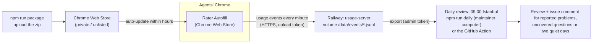

# Hosting: updates to the agents, logs back to TNI

Read this for collection-server configuration, deployment, or log transport operations. For how feedback becomes candidate rules, use [learning](learning.md). For pre-release checks, use [testing](testing.md).



## Extension updates: Chrome Web Store

Chrome only auto-updates extensions installed from the Web Store (on computers not managed by
company policy). See [chrome-web-store.md](chrome-web-store.md): raise the version,
`npm run package`, upload `dist/tni-rater-autofill-<version>.zip`, submit; agents' Chrome picks it up
within hours of approval.

## Usage server: Railway

| | |
| --- | --- |
| Project | `tni-rater-autofill` (workspace "lutfikeskin's Projects") |
| Service | `usage-server`, built from `server/Dockerfile` (`RAILWAY_DOCKERFILE_PATH`) |
| URL | https://usage-server-production.up.railway.app (`/v1/health`) |
| Storage | volume `usage-data` mounted at `/data` (one JSONL file per day received) |
| Variables | `RATER_TOKEN` (upload token, also built into the extension; required: with `HOST=0.0.0.0` the server refuses to start without it), `RATER_ADMIN_TOKEN` (reading the logs, and the event count on `/v1/health`), `OPENAI_API_KEY` (TNI's key for Luna, below; without it `/v1/luna` answers 501), optional `RATER_LUNA_DAILY_LIMIT` (default 5000), optional `RATER_LUNA_DAILY_TOKENS` (default 10,000,000), `RATER_DASHBOARD_TOKEN` (the [live usage page](#live-usage-page)'s password; without it the page is off), optional `RATER_TEST_INTAKES` (intake fingerprints the page counts as test runs), optional `RATER_MIN_FREE_MB` (the [disk guard](#upload-limits-and-the-disk-guard), default 500, `0` off), `HOST=0.0.0.0`, `DATA_DIR=/data`, `PORT=8787`; the image sets `RATER_CLIENT_IP_HEADER=x-real-ip` |

The extension sends to this server by default (`sidepanel/usage-log.js`, `DEFAULT_SERVER` /
`DEFAULT_TOKEN`); an agent's own Server setting (a local test server) overrides it, and a blank
one turns uploads off. Harnesses that load the packaged extension must set that Server to a local
server first (`npm run e2e:extension` does, and fails on any request that leaves the machine), so test runs
stay out of the pilot's usage data. The upload token can only add events, which the server cleans; reading
them back needs the admin token, kept in Railway, in the repository secret `RATER_ADMIN_TOKEN`,
and on the maintainer's Mac in `~/.config/tni-rater/admin-token`.

Agents use Luna without an OpenAI key of their own: with no key saved, the panel sends its Luna
requests to `/v1/luna` with the upload token, and the server adds `OPENAI_API_KEY` and passes them
to OpenAI. It passes on only a request shaped like the panel's (`lunaRequestError`: the fixed
`gpt-6-luna` model, `store: false`, no tools, at most 4,096 output tokens and 160,000 characters,
above the panel's own 120,000, so a server is deployed with a raised bound before the panel), at
most `RATER_LUNA_DAILY_LIMIT` requests a day (UTC, then 429; unset or blank is 5000, `0` refuses every
request, and a value that isn't a whole number counts as 0) and at most `RATER_LUNA_DAILY_TOKENS`
tokens a day (OpenAI's `usage`: input plus output, reasoning included; read the same way, unset or
blank is 10,000,000, over 30 times the pilot's busiest day; then 429 `daily Luna token budget
reached`). A request is counted before it goes to OpenAI, so one OpenAI refuses or doesn't answer
still counts; its tokens are added when the answer comes, so a request begun under the budget may
end over it. An answer without usage counts is counted at the most it could have cost (a token for
each byte of the request as sent, since no token is shorter than a byte, plus 64 for the message
framing, plus its output bound) and marked `estimated`. The day's counts (requests,
input and output tokens, how many were estimated) are kept in `DATA_DIR/luna/<day>.json` on the
volume, counts only, so a restart or redeploy goes on from them; a file that can't be read is
logged and the day counts from 0, and one that can't be written is logged and the count goes on in
memory. The server neither stores nor logs the request or OpenAI's answer. OpenAI's own errors come back as their status only (the log adds OpenAI's error
code, such as `insufficient_quota`); the server's key refused (401, 403, 404) or out of credit or
over its budget (429 `insufficient_quota`) is 424, so the panel says to tell TNI rather than to
check a key or try again. The upload token ships in the extension, so it is not a secret. What
bounds the spending is the daily limit and token budget (counted here) and the money the key can reach:
give the key its own OpenAI project, and on prepaid credit keep auto-recharge off, so an empty
balance stops it (429 `insufficient_quota`, which the panel shows as 424). An OpenAI spend alert on
the project only sends an email; check in OpenAI's settings whether a limit there also stops
requests before relying on it. The pilot's Luna calls (2026-10-01 to 23, opt-in with agents' own
keys) were at most 84 a day, about 3,100 input and 350 output tokens each; a request is at most
160,000 characters and 4,096 output tokens, so the token budget (plus the requests in flight when it
is reached) is the most a day can cost. The check fixes the model and the request's size, not its
instructions or schema, and the limits are for all agents together (the token is shared), so a leaked
token can still ask questions of its own and use up the day's limit for every agent. To stop Luna at once, set the limit to 0 or remove
`OPENAI_API_KEY` (then `/v1/luna` answers 501 and the panel says Luna isn't set up). Rotating the
key is a variable change and a redeploy, with no extension release.

Release order for Luna through the server: set `OPENAI_API_KEY` on Railway, deploy the server that
has `/v1/luna`, check it (`node scripts/server-check.mjs` says `same`), then release the extension.
Suggestions are on by default and an extension with no key of its own counts any usage server as
ready, so a copy released before then asks a server without the route (404) or the key (501) on
every page, and every intake with a claims box gets an Intake check item to read it by hand.

For business analysis, `npm run warehouse` copies the pulled log into a DuckDB file on the
maintainer's computer (`server-data/warehouse.duckdb`, git-ignored). It runs nothing on Railway and
leaves this volume the only full copy of the log. Its tables, the richer intake profile it plans and
optional quoted premiums are in [quoting history database](quoting-history-database.md).

### Upload limits and the disk guard

The upload token ships in the extension, so `/v1/events` bounds what one address can send and stops
taking uploads before the volume fills (`UPLOAD_LIMITS` and `MIN_FREE_MB` in `server/index.mjs`).
Each address has two token buckets in memory: 120 requests, refilled at 60 a minute, and 100 MB,
refilled at 25 MB an hour. The panel posts at most once a minute plus a few prompt uploads, each of
at most 500 events and a million characters, so a full queue (20,000 events) drains in 40 requests
at once; the pilot's busiest minute was 9 requests and 4.8 MB, its busiest day 8.3 MB, all agents
together, and an office's agents may share one address. Over either limit the answer is 429 with
`retry-after`, and the log line names the limit and the address. The address is the socket's, or
the last value of the header `RATER_CLIENT_IP_HEADER` names: the image sets `x-real-ip`, which
Railway's edge sets to the client's address (without it every agent would share the edge's). The
buckets start full again after a restart or redeploy.

While `DATA_DIR` has less than `RATER_MIN_FREE_MB` free (unset or blank 500, `0` switches the guard
off, a value that isn't a number keeps 500), every upload answers 507 and stores nothing, so the
server and the stored log survive; the log says `DISK LOW` once when it starts and `disk ok again`
when it ends. A free-space reading that fails is logged once and never stops uploads. The extension
treats 429 and 507 like any other refusal: the events stay queued on the agent's computer and go on
the next minute's upload (its queue keeps 20,000 events, then drops the oldest and logs
`usage_lost`). On `DISK LOW`, grow the volume in Railway (or free space on it) before the agents'
queues fill.

Redeploy after a server change is merged: `npm run deploy:server` (`scripts/deploy-server.mjs`),
with Railway's CLI signed in and linked to the project. `railway up` uploads the working tree as it
is, on whatever branch it is (other sessions switch branches in the main checkout), so the script
deploys only `origin/main` as merged (audit 2026-11-07, SRV-10). It fetches, refuses unless this
checkout's commit is `origin/main`'s and the files the image is built from (`server/Dockerfile` and
its `COPY` sources) have no uncommitted or untracked changes, then runs
`railway up --service usage-server --ci` (`.railwayignore` keeps the upload to what the image
needs) and waits up to 5 minutes in all, a stalled request included, for Railway's production `/v1/health` (never `RATER_SERVER`) to name this checkout's server. `--dry-run` only
checks. A failed build exits 1, and the previous deployment keeps serving.

After a merge to `main` that changes what the image is built from (`server/`, `src/usage-schema.js`
or `.railwayignore`), [deploy-server.yml](../.github/workflows/deploy-server.yml) runs the same
script on GitHub, one deploy at a time (the maintainer, 2026-11-07). It needs the repository secret
`RAILWAY_TOKEN`, a Railway project token for the production environment; without it the job says
`RAILWAY_TOKEN is not set: nothing deployed` and succeeds, so deploy by hand as above. It checks
out `main` as it is when the job starts, not the pushed commit, so a later merge that changes no
server file and starts no run of its own doesn't stop the deploy. Actions → Deploy usage server →
Run workflow deploys `main` again on demand.

Before deploying, confirm `RATER_TOKEN` is set in the service's Variables. The server fails closed:
bound to anything but loopback (`127.0.0.1`, `localhost`, `::1`) without `RATER_TOKEN`, it exits
with `RATER_TOKEN is not set and HOST=0.0.0.0 is not loopback: refusing to start an open upload
endpoint` instead of taking anyone's uploads (audit 2026-10-08: an unset variable made the
deployment an open write endpoint). On Railway that is a failed deployment in the deploy logs, and
the previous one keeps serving. `npm run server` on this computer still needs no token.
`/v1/health` answers `{ ok, server }` to anyone (what the daily server check and the panel's
"is it there" probe read); `events`, how many are stored, only comes with the admin token.
One request never stops the server for everyone else. A request target that isn't a URL answers
400 before any token check, an event whose type isn't one of the server's own (`constructor` or
`__proto__` included) is refused in the reply's `rejected`, and an exception inside a request
answers 500 (the log names the error and where it was thrown, not its message), or, when the
answer had already begun (an export streaming out), closes the connection, so the client sees a
cut-off answer rather than a 500: an export that ends early has failed. Anything that
fails outside a request still stops the process, with a timestamped log line and a non-zero exit,
so Railway's restart policy applies.

The container runs as root, the image's default. Running it as the image's `node` user is the
intended hardening, held until the volume's ownership is verified: Railway mounts `/data`
root-owned, and a non-root process that can't write there would answer every upload with 500
("could not store events") rather than fail safe. Before adding `USER node` to
`server/Dockerfile`, check `ls -ld /data` and a test write as `node` in the running container
(or add an entrypoint that chowns `/data` first), then redeploy and confirm `/v1/events` still
stores an event.
Deploy a server change that accepts new event fields before releasing the extension that sends
them: an older server drops unknown fields (and refuses layouts over its size limit) rather than
storing them. The run-identity fields (`run`, `rules`, `settings`, `step` on fill and field-change
events, [learning](learning.md)) are such a change: deploy the server that keeps them before the
extension that sends them, or every fill run until then is stored with those names in `dropped`.
That server also refuses an event whose run id, rules hash, settings object or step is malformed
(per event, in the reply's `rejected`). Historical `page_layout` events may retain `step: null` when no step was recognized, including queued or re-uploaded layouts; this exception does not permit malformed non-null steps or null steps on fill/field-change events. Failed fills also retain `rules` and `settings` on `fill_error`, with the same exact validation as `fill_run`. For agents' own defaults ([spec](agent-defaults-spec.md), a proposal no build sends yet), the server already keeps, all from its own module `server/agent-defaults.mjs` (removal steps at its top), a `fill_field` `source` of `agent-default`, `agent_settings.defaults` (`DEFAULTS_SHAPE`: a list of at most 40 objects with only the keys `id`, `value` and optionally `carrier`; `id` is 1–24 ASCII letters, as `medPay`; `carrier` is the extension's lowercase carrier id, 1–20 letters (`geico`, never `GEICO`); `value` is a number from 0 to 100,000,000, the string `ask`, or a string of 1–40 characters from letters, digits, `_`, space and `$ , . / & + -`; one entry out of shape drops the whole list, named in `dropped`) and a fill's `defaultsHash` on `fill_run` and `fill_error` (validated like `rules`: a malformed one refuses the event). Older AI clients emitted `probability`, `support`, `evidenceProbability` and `confidence` on `ai_decision`: ingestion preserves scores from 0 to 1, null for unavailable evidence, and the original `high`/`medium`/`low` confidence enum for queued uploads and historical exports. Invalid shapes are dropped; current Luna clients do not emit these scores, and retaining them does not make them calibrated accuracy evidence. The obsolete `ai_suggest.cached` field remains excluded. It keeps an event's `channel` (store, unpacked or source) and `commit` (a short
commit, optionally `+dirty`) only in those shapes. Every event's common fields are kept only in their shapes (`COMMON_SHAPES`), and an event with one out of its shape is refused (in the reply's `rejected`, naming the field), never stored with it or trimmed: `t` an ISO time in UTC (`…Z`), a real date and time (not `2025-02-30` or `24:00`), from 2025 to 30 days ahead of the server's clock; `agent` initials as typed (1–12 letters, digits, spaces and `. ' -`); `session` a UUID; `intakeId` the intake PDF's SHA-256 (64 lowercase hex); `carrier` a carrier id's shape (lowercase letters, digits and `-`, at most 20, so a new carrier needs no server change); `page` a page name or path (at most 200 of letters, digits, space and `_ . : / ~ % + ( ) , -`); `v` a version number or `dev`. Each may be null but `t`. The request's `agent`, which fills an event without one, is used only in that shape, otherwise not at all. Every event stored from the pilot up to 2026-11-06 (98,872) passes these checks. It refuses events from the local test page (`carrier: 'test'`, localhost), which are
no quote; the review scripts also skip the ones stored before. The server names what it dropped on
the stored event (`dropped`: field names only, at most 20, `droppedMore` counts the rest), and
`/v1/health` names its version (`server`, a hash of every file the image copies, in `server/Dockerfile`'s order: `server/index.mjs`, `server/dashboard.mjs`, `server/agent-defaults.mjs` and `server/privacy.html`; a test holds the list to the Dockerfile's). `node scripts/server-check.mjs` compares that with this checkout, without
sending any event: after a deploy it should say `same`.

The server accepts `intake_profile`, a profile of the client's business (`PROFILE` in
`server/index.mjs`): its groups `business`, `operations`, `vehicles`, `trailers`, `trailerInfo`,
`drivers`, `coverage`, `priorInsurance` and `hasClaims`, each value in its exact shape. A yes/no is
true, false or null; a dollar amount, a year, an age or a count of years is a whole number in a
plausible range; USDOT, MC and FEIN are only `given` (a valid number), `other` (something else
written, such as "Pending") or `blank`; a state is two capital letters, a driver's gender `MALE`,
`FEMALE` or null, a policy's expiry a month (`YYYY-MM`) or `none`; a list holds at most 50 units.
Text is bounded and refused when it looks like it could identify the client (`ID_LIKE`: an `@`; a
date with `/`, `-` or `.` between its parts; seven or more digits, even with spaces, dashes, dots,
slashes or brackets between them, as in a phone, SSN, licence or policy number; five digits in a
row; a word of eight or more letters and digits mixed, as in a VIN). A limit may also be a limit as
written (`LIMIT`: `$1M CSL`, `$1,000,000`, `1000000`, `$1M/$2M`, `25/50/25`, `State Minimum`). A
value out of its shape, or a key the profile has no shape for (a VIN, a date of birth), is left out
and its group named in `dropped`; a group that isn't the right kind of object or list is dropped
whole. Accepting the event collects nothing until an extension sends it, so this server can be
deployed whenever; the extension that sends the profile is released only after the privacy policy
names it.

## Live usage page

`/dashboard` on the usage server (https://usage-server-production.up.railway.app/dashboard) shows
how agents are using the extension, for the maintainer only. It is one server-rendered page
(`server/dashboard.mjs`, no script) that reloads itself every minute and reads the events the
server already stored; it changes nothing the extension sends or the server keeps. Building it
reads and sums 31 days of events on the process that takes uploads, so one page serves every
request for its period for 30 seconds (the log marks those `cached`); a page that can't be built
answers 500 and the server keeps running.

- Totals for the last 24 hours, 7 days and 30 days: quotes started, pages filled, answers filled,
  autofilled answers the agent changed (another value or cleared), reformatted, answered by hand
  (where autofill gave none), problem reports and unfamiliar questions, each with a line saying
  what it means; and a chart of quotes started per day over 30 days (hover a bar for its day).
- Per agent (initials), per carrier and per version and channel, for the period picked at the top
  (24h, 7d or 30d; 7d by default).
- The latest quotes, fills, fill errors and problem reports, newest first; then the problem reports
  with what held Continue, and the questions no rule knew (once per carrier, page and label).

The numbers use the review's definitions (`npm run review`, `scripts/lib/signals.mjs`), copied into
the server because its image has no `scripts/`; `test/dashboard.test.mjs` keeps the two in step. A
period is when the server received the events. A quote is an intake loaded in a session that went
to a carrier's page; a page or answer filled again in the same quote counts once. Test runs are
left out by default (**Include test runs** at the top adds them, marked): intakes the agent marked
as a test, and the fingerprints in `RATER_TEST_INTAKES` (commas, spaces or new lines between them,
each at least 8 hex characters, as in the local `reviews/test-intakes.txt`; anything else is
ignored). Without that variable the maintainer's own unmarked test quotes count as agents' work,
as in a review with no test-run list. The page shows only what the events already hold: initials,
state, business class, unit counts, redacted labels and report texts.

**Its password.** Set `RATER_DASHBOARD_TOKEN` in the `usage-server` service's Variables (a random
value of at least 16 characters, for example from `node -e "console.log(require('crypto').randomBytes(24).toString('hex'))"`),
keep it in your password manager, and redeploy (`npm run deploy:server`). Unset, or
shorter than 16 characters, the page is off and `/dashboard` answers 404 (a short one also prints a
warning at startup); the startup line says `(dashboard on: /dashboard)` when it is on. The browser
asks for a user name and password: any user name, the token as the password (HTTP Basic, over
Railway's HTTPS). A script may send it as `Authorization: Bearer <token>` instead. It is its own
secret, not the upload or admin token: neither opens the page, and the token never opens the export.
The server logs `GET dashboard <period>` with the status, never the token. Rotating it is a
variable change and a redeploy. The page is sent with `no-store`, `noindex` and a policy that
allows no script, frame or form.

Locally: `RATER_DASHBOARD_TOKEN=<16+ characters> npm run server` (PowerShell: set
`$env:RATER_DASHBOARD_TOKEN` first), then http://127.0.0.1:8787/dashboard, on whatever is in
`server-data/events/` (`npm run pull` fills it).

## Logs on your computer

```bash
npm run pull                         # all events -> server-data/events/
npm run pull -- --since 2026-10-01
npm run review                       # then the usual review
npm run push-logs -- some/export.json   # an agent's exported log, or an old local server's folder
```

## Daily review

Every morning the daily review downloads the log and reviews the events the server received since
the last successful run began downloading. An upload that arrives late is in the next review, and
none is in two. When something is new, it comments on the open issue labelled `daily-review`, or
opens one titled "Daily review" when none is open. New means:

- problem reports, each with its time, agent, page and the build that logged it, marked when it
  came from a test run. Never the report's text: the repository is public, so the text is read on
  the usage server's dashboard or in a review run on the maintainer's computer (the server keeps
  at most the panel's 1,000 characters of it);
- questions without a rule (or AmWINS fields the mock lacks) first seen in a layout of the period,
  one per question whatever its row, number, product or step (`scripts/lib/daily.mjs`);
- a deployed usage server that isn't the repository's (`scripts/server-check.mjs`, checked first
  and only on the default branch): redeploy it;
- two days without any event received (test runs don't count);
- a run that couldn't finish, because the server was down or a script broke.

Nothing new, no comment. Two quiet days get one comment, with the day the last event arrived, from
the run whose window holds the moment the quiet reached 48 hours. From 2026-10-11 to 10-18 no events
arrived and every run stayed silent, so a week without quotes looked the same as broken uploads.
Anyone with the extension's upload token can write what the comment quotes (an agent's initials, a
page, a carrier, a build, a question's caption, data-model name and kind), so each is posted in inline code (no
markdown, link or image), its backticks and line breaks taken out, every `@` broken by a zero-width
space (no one is mentioned, and the comment never starts the Claude workflow, which answers an
at-mention of Claude from the maintainer's login, the one `npm run daily -- --post` posts as), and
bounded (a caption at 200 characters, others at 120 or fewer) (`untrusted` in
`scripts/lib/daily.mjs`). A report's time is written only when it is a real date and minute, else `?`. A list too long anyway is cut to fit
a GitHub comment and points to the review. Closing the issue is how a
reviewer says it's been read; the next new item opens another. The review does not implement or deploy
corrections.

### On the maintainer's computer: `npm run daily`

Since 2026-10-19 GitHub doesn't start Actions jobs on this account (billing), so the workflow below
fails before it starts. `npm run daily` (`scripts/daily.mjs`) does the same steps on a Windows (or
any) computer: the server check, `npm run pull`, `scripts/review.mjs --since <start> --summary`,
then `scripts/daily-issue.mjs post`. It needs Node 22, the admin token (`RATER_ADMIN_TOKEN` or
`~/.config/tni-rater/admin-token`), and `gh auth login` as an account that can comment on the
repository's issues.

```powershell
npm run daily                                          # a dry run: prints the comment, posts nothing
npm run daily -- --post                                # posts it, since the last run here
npm run daily -- --post --since <ISO time>             # the first real run here only (below)
npm run daily -- --no-pull --data path\to\server-data  # a dry run on a log as it is
```

It posts only with `--post`, and so does `scripts/daily-issue.mjs post` (the workflow passes it), so
trying it out never comments by accident. A dry run may run anywhere. `--post` refuses, and says
what to do, unless it runs in the main checkout (not a linked worktree, whose state would be its
own), on the default branch, level with `origin` after a fetch: the server check compares the
deployed server with that checkout, and the review uses its rules. The main checkout was on
`claude/release-0.9.10` on 2026-10-20; switch it to `main` and `git pull` before the first real run.

The first real run needs `--since`, once: where the last comment on the issue stopped. That was
2026-10-20T01:12:33Z (comment 6280982877 on #50, the last before this runner). After it,
`reviews/daily/state.json` (git-ignored) says where each run starts: when the last real run's
download began. It's written whole (a temporary file, then a rename) and only after the post step
succeeded (a comment, or nothing new to say). A run that fails leaves it, so the next one reviews
the period again. A dry run never changes it. Without it and without `--since` the run stops
rather than guess a start; when it can't be read, the run says so on the issue (with `--post`).
Don't pass `--since` again once it exists, except to review a period on purpose.

The download starts the day before the window (the server exports whole days, and `npm run pull`
replaces only the days it downloads); a local copy with no earlier day gets everything, as telling
which questions are new needs the history. Runs go one at a time (`reviews/daily/run.lock`). The
review, its summary, the comment and a log of every run (`daily.log`) are in `reviews/daily/`, named
by UTC day and minute, not next to the weekly `reviews/review-<date>.md` files. A run that can't
finish says so on the issue with the step that stopped and exits 1; one that can't reach GitHub at
all only writes `daily.log`.

**Scheduling it on Windows.** After the first real run has written the state, use Task Scheduler,
from PowerShell in the main checkout. `-At` is this computer's local time. The workflow ran at 06:00
UTC, after US agents' day; the first line turns that into local time (02:00 at UTC-4). Any hour
works, as each run starts where the last stopped: pick one when the computer is usually on.

```powershell
$at       = [DateTime]::UtcNow.Date.AddHours(6).ToLocalTime()   # 06:00 UTC, in local time
$action   = New-ScheduledTaskAction -Execute (Get-Command node).Source -Argument 'scripts\daily.mjs --post' -WorkingDirectory (Get-Location).Path
$trigger  = New-ScheduledTaskTrigger -Daily -At $at
$settings = New-ScheduledTaskSettingsSet -StartWhenAvailable -MultipleInstances IgnoreNew -ExecutionTimeLimit (New-TimeSpan -Minutes 30)
Register-ScheduledTask -TaskName 'TNI daily review' -Action $action -Trigger $trigger -Settings $settings
```

The trigger keeps the local hour, so after a daylight-saving change it runs an hour off 06:00 UTC.
It runs as you, while you are signed in (where `gh`'s login and the token are); `-StartWhenAvailable`
runs a day missed while the computer was off once it is on. Its Last Run Result is 0 or 1; the
output is in `reviews/daily/daily.log`. `Unregister-ScheduledTask -TaskName 'TNI daily review'`
removes it. Alternatively, a scheduled task in the Claude desktop app, in the main checkout, every
morning, with a prompt such as "Run `npm run daily -- --post` and report what it printed; change no
files." It runs only while the app is open and the computer awake. Use one schedule, not both.

### On GitHub: the workflow

`.github/workflows/daily-review.yml` stays in the repository for when Actions works again. It runs
every day at 06:00 UTC, which GitHub often starts hours late (and on demand: Actions → Daily
review → Run workflow, optionally with a start date or time). Its window starts when the last
successful run on the default branch began downloading (`scripts/daily-issue.mjs since`, from that
run's steps; a day when there is none; a run that can't tell fails rather than guess). The review
itself stays on the runner, since the repository is public: the run's summary shows its counts
only, and nothing is kept as an artifact. The runner has no local test-run list
(`reviews/test-intakes.txt` is ignored by git), so its review carries the "No test-run list"
warning: the maintainer's own test quotes count as agents' work there, while fixture intakes and
intakes marked as a test are still left out ([learning](learning.md)). When the script that
comments is what broke, the workflow says so with `gh` alone. Its cron is still set, so GitHub
still tries it each day and the run fails at start. Before using it again, stop the local
schedule and start its first run by hand, with the `since` in the local `reviews/daily/state.json`
as its start. Its own last successful run is older, so its window would repeat what the local runs
already said.
