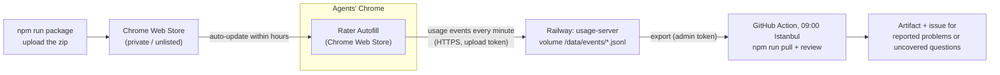

# Hosting: updates to the agents, logs back to TNI

Read this for collection-server configuration, deployment, or log transport operations. For how feedback becomes candidate rules, use [learning](learning.md). For pre-release checks, use [testing](testing.md).



## Extension updates: Chrome Web Store

Chrome only auto-updates extensions installed from the Web Store (on computers not managed by
company policy). See [chrome-web-store.md](chrome-web-store.md): raise the version,
`npm run package`, upload `dist/tni-rater-autofill-<version>.zip`, submit; agents' Chrome picks it up
within hours of approval.

## Usage server: Railway

| | |
| --- | --- |
| Project | `tni-rater-autofill` (workspace "lutfikeskin's Projects") |
| Service | `usage-server`, built from `server/Dockerfile` (`RAILWAY_DOCKERFILE_PATH`) |
| URL | https://usage-server-production.up.railway.app (`/v1/health`) |
| Storage | volume `usage-data` mounted at `/data` (one JSONL file per day received) |
| Variables | `RATER_TOKEN` (upload token, also built into the extension), `RATER_ADMIN_TOKEN` (reading the logs), `HOST=0.0.0.0`, `DATA_DIR=/data`, `PORT=8787` |

The extension sends to this server by default (`sidepanel/usage-log.js`, `DEFAULT_SERVER` /
`DEFAULT_TOKEN`); an agent's own Server setting (a local test server) overrides it, and a blank
one turns uploads off. The upload token can only add events, which the server cleans; reading
them back needs the admin token, kept in Railway, in the repository secret `RATER_ADMIN_TOKEN`,
and on the maintainer's Mac in `~/.config/tni-rater/admin-token`.

Redeploy after a server change: `railway up --service usage-server` from the repository root
(`.railwayignore` keeps the upload to what the image needs).
Deploy a server change that accepts new event fields before releasing the extension that sends
them: an older server drops unknown fields (and refuses layouts over its size limit) rather than
storing them.

## Logs on your computer

```bash
npm run pull                         # all events -> server-data/events/
npm run pull -- --since 2026-10-01
npm run review                       # then the usual review
npm run push-logs -- some/export.json   # an agent's exported log, or an old local server's folder
```

## Daily review

`.github/workflows/daily-review.yml` runs every day at 06:00 UTC (and on demand: Actions → Daily
review → Run workflow, optionally with a start date). It downloads the log, builds the review for
the last day, keeps it as an artifact for 90 days, shows it as the run summary, and opens an issue
labelled `daily-review` when agents reported problems or rule-coverage checks find uncovered questions. The workflow does not implement or deploy corrections.
