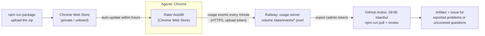

# Hosting: updates to the agents, logs back to TNI

Read this for collection-server configuration, deployment, or log transport operations. For how feedback becomes candidate rules, use [learning](learning.md). For pre-release checks, use [testing](testing.md).



## Extension updates: Chrome Web Store

Chrome only auto-updates extensions installed from the Web Store (on computers not managed by
company policy). See [chrome-web-store.md](chrome-web-store.md): raise the version,
`npm run package`, upload `dist/tni-rater-autofill-<version>.zip`, submit; agents' Chrome picks it up
within hours of approval.

## Usage server: Railway

| | |
| --- | --- |
| Project | `tni-rater-autofill` (workspace "lutfikeskin's Projects") |
| Service | `usage-server`, built from `server/Dockerfile` (`RAILWAY_DOCKERFILE_PATH`) |
| URL | https://usage-server-production.up.railway.app (`/v1/health`) |
| Storage | volume `usage-data` mounted at `/data` (one JSONL file per day received) |
| Variables | `RATER_TOKEN` (upload token, also built into the extension), `RATER_ADMIN_TOKEN` (reading the logs), `HOST=0.0.0.0`, `DATA_DIR=/data`, `PORT=8787` |

The extension sends to this server by default (`sidepanel/usage-log.js`, `DEFAULT_SERVER` /
`DEFAULT_TOKEN`); an agent's own Server setting (a local test server) overrides it, and a blank
one turns uploads off. Harnesses that load the packaged extension must set that Server to a local
server first (`npm run e2e:extension` does, and fails on any request to production), so test runs
stay out of the pilot's usage data. The upload token can only add events, which the server cleans; reading
them back needs the admin token, kept in Railway, in the repository secret `RATER_ADMIN_TOKEN`,
and on the maintainer's Mac in `~/.config/tni-rater/admin-token`.

Redeploy after a server change: `railway up --service usage-server` from the repository root
(`.railwayignore` keeps the upload to what the image needs).
Deploy a server change that accepts new event fields before releasing the extension that sends
them: an older server drops unknown fields (and refuses layouts over its size limit) rather than
storing them. The run-identity fields (`run`, `rules`, `settings`, `step` on fill and field-change
events, [learning](learning.md)) are such a change: deploy the server that keeps them before the
extension that sends them, or every fill run until then is stored with those names in `dropped`.
That server also refuses an event whose run id, rules hash, settings object or step is malformed
(per event, in the reply's `rejected`). Historical `page_layout` events may retain `step: null` when no step was recognized, including queued or re-uploaded layouts; this exception does not permit malformed non-null steps or null steps on fill/field-change events. The server no longer lists the AI fields `probability`,
`support`, `evidenceProbability`, `confidence` and `cached`, which no extension emitted. It keeps an event's `channel` (store, unpacked or source) and `commit` (a short
commit, optionally `+dirty`) only in those shapes. It refuses events from the local test page (`carrier: 'test'`, localhost), which are
no quote; the review scripts also skip the ones stored before. The server names what it dropped on
the stored event (`dropped`: field names only, at most 20, `droppedMore` counts the rest), and
`/v1/health` names its version (`server`, a hash of its `server/index.mjs`). `node scripts/server-check.mjs` compares that with this checkout, without
sending any event: after a deploy it should say `same`.

## Logs on your computer

```bash
npm run pull                         # all events -> server-data/events/
npm run pull -- --since 2026-10-01
npm run review                       # then the usual review
npm run push-logs -- some/export.json   # an agent's exported log, or an old local server's folder
```

## Daily review

`.github/workflows/daily-review.yml` runs every day at 06:00 UTC, which GitHub often starts hours
late (and on demand: Actions → Daily review → Run workflow, optionally with a start date or time).
It downloads the log and builds the review of the events the server received since the last
successful run on the default branch began downloading (`scripts/daily-issue.mjs since`, from that
run's steps; a day when there is none; a run that can't tell fails rather than guess), so an
upload that arrives late is in the next review and none is in two. Runs go one at a time. It keeps the review as an
artifact for 90 days and shows it as the run summary. When something is new, it comments on the
open issue labelled `daily-review`, or opens one titled "Daily review" when none is open: problem
reports, questions without a rule (or AmWINS fields the mock lacks) first seen in a layout of the
period (one per question, whatever its row, number, product or step: `scripts/lib/daily.mjs`), a
deployed usage server that isn't the repository's (`scripts/server-check.mjs`, checked first and
only on the default branch: redeploy it), or a run that couldn't finish (the server down, a broken script; when the broken script is the
one that comments, the workflow says so with `gh` alone). Nothing new: no comment.
A long list is cut to fit a GitHub comment, pointing to the review. Closing the issue is how a
reviewer says it's been read; the next new item opens another. The
workflow does not implement or deploy corrections.
