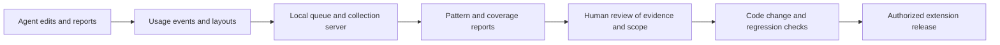

# Learning from usage and exceptions

Read this when changing feedback collection, discovering new fields, or proposing rules from agent behavior.

## Current feedback loop

This is reviewed software improvement, not model training or automatic correction. Comments and AI accept/reject events help review; they do not directly rewrite prompts, rules, or model weights.

The recorder observes page changes; the panel builds redacted events and layouts. Text changes are compared with the intake locally, retaining signals such as `matchesIntake` instead of typed values. An ExtJS combo box also takes typed text (a model search), and the recorder in the page's isolated world can't read its list, so its change keeps `from`/`to` only when each non-empty value is one of the options a fill on that tab read from that control; otherwise it is logged as a text change. A change made before any fill reached that combo, a value its list didn't hold at fill time, and agent/producer lists (whose options are never collected) are therefore logged without values. Choice labels and agent notes are redacted, but derived artifacts still need privacy review before sharing. Practice pages do not record usage.

Each event takes its time and quote session when it is logged, and a `seq` number that orders one computer's events. Field change and fill events carry the control's `key` as well as its question ID, so a question repeated per vehicle row (`<q>@<row>`) or a field without an ID stays distinct; a key holding client data is redacted and keeps a digest under the session's salt, which stays on the computer. A page layout is logged when the page arrives, when questions appear or go away, after an answer changes, when the agent picks another vehicle or driver, and after a fill, whenever its questions, choices or required flags differ from the last layout logged for that page (or that vehicle/driver on its page) in the session. It does not depend on filling or on the automatic-fill settings. Each layout says why it was taken (`reason`), which choice each question had picked (`selected`, only when it is one of the captured choices: never typed text, an editable dropdown's search text or staff lists) and whether text boxes had something in them; a layout that can't be read (or a page that can't be asked whether it's still loading, or stays busy for about five seconds) is counted in the panel and logged once as `layout_error`, by kind of failure rather than its message. A capture belongs to the quote, tab, page and vehicle/driver it was asked for, with its own reasons, and is dropped when any of them changes before it is logged; changes in a child frame are recorded as the quote page's layout. Consecutive layouts with the change events between them show what appeared after which answer; that is an observation, not a proven rule. Captured choice lists keep up to 250 options and set `optionsTruncated` when the page had more.

Events queue in Chrome local storage, written by one panel at a time when several windows have one open, and uploads run periodically, in requests sized to the server's body limit (smaller after a 413). Events leave the queue only when the server's reply accounts for each one: stored, duplicate, or refused by index. Refused events and a single event too large to send are kept aside for export. Retries are deduplicated by ID. The queue is capped (`MAX_EVENTS`), so this is not an unlimited lossless archive. New event fields/types must be accepted by the server allowlist as well as emitted by the extension.

## What the learner actually infers

| Candidate | Default criterion in `learn()` |
| --- | --- |
| Standard answer | At least 5 observations, at least 90% choose one answer |
| State-specific answers | Overall standard fails; multiple states, each with at least 2 observations and 90% agreement |
| Intake mapping for a text field | At least 5 observations, at least 80% match the same intake path |
| Review an existing rule | At least 5 autofilled observations, at least 20% corrected |

These are review thresholds, not correctness probabilities. Page-provided values can enter observations, and repeated agent habits may be wrong. Validate the answer and its applicability before promotion.

Question grouping uses carrier plus question ID, or page/label when there is no ID. It can collapse repeated driver/vehicle answers within a session; events now carry the per-row `key`, but the learner does not use it yet. The learner splits by state but does not discover arbitrary coverage/vehicle/driver interactions.

Layout grouping uses carrier, state, business class, vehicle-type set, and trailer presence. Coverage context is recorded but is not part of that grouping key. A field seen in only some snapshots is marked conditional; this does not establish its trigger. Aggregated options are not proof that every option is available in every scenario.

## Reviewing and improving the mechanism

Use `npm run pull` when current central logs are needed, then `npm run review` for the combined report. `npm run learn`, `npm run layouts`, and `npm run coverage` inspect individual parts. The configured daily workflow pulls logs, produces reports, and can open issues; it does not implement or deploy fixes.

For each candidate, determine whether it needs an intake correction, mapping, scoped exception, browser fix, or confirmed agency decision. Follow [corrections](corrections.md) for that change. Do not promote a majority answer over a legitimate minority exception.

Future learning work should preserve per-entity identity and context, record why an agent changed an answer, distinguish defaults from confirmed facts, and keep separate evaluations for unseen combinations. Those capabilities and automatic semantic-drift detection are not implemented guarantees.

## Related code and tests

- [recorder.js](../src/content/recorder.js), [usage.js](../src/usage.js), [usage-log.js](../sidepanel/usage-log.js), [server/index.mjs](../server/index.mjs): collection and transport.
- [learn.mjs](../scripts/lib/learn.mjs), [layouts.mjs](../scripts/lib/layouts.mjs), [coverage.mjs](../scripts/lib/coverage.mjs), [review.mjs](../scripts/review.mjs): analysis.
- [learn tests](../test/learn.test.mjs), [coverage tests](../test/coverage.test.mjs), [usage tests](../test/usage.test.mjs), [queue tests](../test/usage-log.test.mjs), [consistency tests](../test/consistency.test.mjs), [server tests](../test/server.test.mjs).

Read [hosting](hosting.md) only for transport configuration or server operations, and [testing](testing.md) when changing evaluation or replay coverage.
