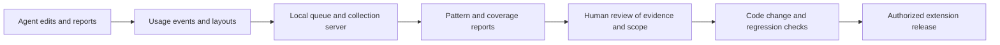

# Learning from usage and exceptions

Read this when changing feedback collection, discovering new fields, or proposing rules from agent behavior.

## Current feedback loop

This is reviewed software improvement, not model training or automatic correction. Comments and AI accept/reject events help review; they do not directly rewrite prompts, rules, or model weights.

The recorder observes page changes; the panel builds redacted events and layouts. A change is labelled with the question text the fill engine read for that field when a fill saw it, else the recorder's own reading: on Progressive the question's Duck Creek caption (its label `c_<id>`, without the note under it), the text pagekit gives the field in layouts, else the field's label or the nearest text before it. A recorder reinjected into the page (the panel does so on every tab update) or told to resume while not paused first reports what changed since its last poll, so an answer given just before is not absorbed into the new baseline: an ExtJS combo pick fires no input/change event to announce it. Text changes are compared with the intake locally, retaining signals such as `matchesIntake` instead of typed values. An ExtJS combo box also takes typed text (a model search), and the recorder in the page's isolated world can't read its list, so its change keeps `from`/`to` only when each non-empty value is one of the options a fill on that tab read from that control; otherwise it is logged as a text change. A change made before any fill reached that combo, a value its list didn't hold at fill time, and agent/producer lists (whose options are never collected) are therefore logged without values. Choice labels and agent notes are redacted, but derived artifacts still need privacy review before sharing. Practice pages do not record usage, and the server refuses events from the local test page (the review scripts skip any stored before, and a quote that only filled the test page whole). A quote, in the reviews, is an intake loaded in a session that worked on a carrier's page: a PDF loaded and never taken to a carrier (a sample retried, a test-page session) is not one, though its intake warnings and edits still count as evidence about intakes.

A quote run for practice or testing is marked with **This intake is a test run, not a client** in Settings → **Advanced (for setup)** (shown while an intake is loaded; it was under the client's name until TNI, 2026-10-19, kept it out of agents' view): the panel logs `intake_marked` (`test`) when the box changes and remembers the PDF's fingerprint on this computer (at most 200), so the same PDF loaded again carries `test: true` on `intake_loaded`; the weekly signals report leaves such quotes out of its numbers. Each event takes its time and quote session when it is logged, a `seq` number that orders one computer's events, and `install`: a random id made once for this copy of the extension on this computer, so two computers sharing initials stay apart and a gap in one install's `seq` shows events lost on the way. `intake_loaded` also carries the computer's `platform` (`os`, and Chrome's major version as `chrome`; `platformOf` in `src/usage.js`). It also names the copy that logged it (`channel`: `store` for the Chrome Web Store zip, `unpacked` for the Load unpacked copy, both stamped by `npm run package`; `source` for the repository's files loaded as they are) and the commit that copy was packaged from (`commit`, `+dirty` when packaged files had uncommitted changes), so a review can tell a development copy from the release that shares its version number; events from before this carry neither. Page views, field changes, fills and layouts also carry a `view`: the tab's order in the quote and, on a page about one vehicle, driver or trailer, its number (`t1`, `t2:v0`, `t2:tr0`; the collection server keeps only these shapes; a step about one vehicle or driver, GEICO's Vehicles and Drivers & Incidents (`vehicleSteps`, `driverSteps`), takes the vehicle or driver picked in the panel, the vehicle's also for a trailer's form there), never tab ids or names, so reviews can keep two quote tabs or two vehicles apart. Field change and fill events carry the control's `key` as well as its question ID, so a question repeated per vehicle row (`<q>@<row>`) or a field without an ID stays distinct; a data-model name key (`ref:<name>`: Progressive's `fieldref`, and since field-key version 5 GEICO's name without the render number its `Id_<Name>_<n>` elements change on every redraw) is the carrier's and is never redacted (a name word redacted inside one, as in `HasContinuousCo[client]ge`, split the question); GEICO's coverage lists on Quote & Coverages, which have no name and a new id on every render, are keyed by caption (`cov:liability coverage`) or, per vehicle, by coverage and row (`cov:COMP#2`); any other key is redacted like a label, a client name word only as a whole word (`owner_Ann`, not `driverAnn1`) and a number wherever it appears, and a redacted key keeps a digest under the session's salt, which stays on the computer (the maintainer chose log quality over redaction, 2026-10-13). Natural-language labels still redact single name words only at word boundaries, preserving labels such as Annual mileage. A page layout is logged when the page arrives, when questions appear or go away, when an error or validation message appears (the recorder reports only that one appeared, `new_messages`; reason `messages`), after an answer changes, when the agent picks another vehicle or driver, and after a fill, whenever its questions, choices or required flags differ from the last layout logged for that page (or that vehicle/driver on its page; on GEICO, per form as its agent edits are kept: a trailer's form apart from its vehicle's, a held form by itself) in the session. It does not depend on filling or on the automatic-fill settings, but it happens by itself only on the carrier's named quote pages (`layoutUrl`, else `autoFillUrl`; a carrier with neither gets layouts from fills only). GEICO's is its quote, `sales.geico.com/quote`, never the agents' gateway or dashboard on the same domain. A step that is the agent's (`stopSteps`: GEICO's Final Quote Details, MVR & CLUE and Payment Information), known by its step or by the page title, logs no layout at all, since its labels and messages may repeat payment or report details; a manual capture (below) still saves one. A capture waits for a fill under way (also after it was queued), is kept per quote tab, is redone when the agent corrects the intake while it waits, gives way to a later change on its page (which takes over its reasons), and is logged only if the page it read names itself as the page asked for. After Luna's picks go in (the recorder is paused meanwhile) the page's layout is asked for. After an intake is loaded or cleared, and when the panel opens with a saved intake, a tab gives layouts only once it shows a new page, has been filled with that intake (a fill that went through), or was opened since (a new quote tab), since it may show another client's quote; when the panel attaches to a ready tab it asks for the page's layout. A page with no questions left is logged when questions went away, so a question's going away and coming back both show; an empty fill or arrival (a page still loading, or one without questions) is not. On a one-address application (`layoutSteps`: AmWINS, GEICO) each layout also names its step, since every step shares the page's address: the visible step heading (GEICO's headings read "Dashboard" on every step, so its step is the progress bar's part under way, and none unless the page title names it too), sent only as one of the carrier's step names (`knownStep` in `src/usage.js`, as for fill and field-change events below); a heading that is none of them sends no `step`. Layouts logged before this sent the raw heading. Each layout carries the page's error, validation and help messages as the capture reads them (`messages`: at most 40, each cut to 200 characters, redacted, with the boxes' typed text and anything shaped like a VIN or long number taken out), so a carrier's refusal ("This field is required", a decline reason) is in the log in its own words; a change of messages logs the page again even when its questions didn't change. Each layout says why it was taken (`reason`), which choice each question had picked (`selected`, only when it is one of the captured choices: never typed text, an editable dropdown's search text or staff lists) and whether text boxes had something in them; a layout that can't be read (or a page that can't be asked whether it's still loading, or stays busy for about eight seconds) is counted in the panel and logged once as `layout_error`, by kind of failure rather than its message. A capture belongs to the quote, tab, page and vehicle/driver it was asked for, with its own reasons, and is dropped when any of them changes before it is logged; changes in a child frame are recorded as the quote page's layout. Consecutive layouts with the change events between them show what appeared after which answer; that is an observation, not a proven rule. Captured choice lists keep up to 250 options and set `optionsTruncated` when the page had more.

Automatic layouts show what a page looked like; manual captures show why it changed. In the panel's **Advanced (for setup)** section the agent names a scenario, writes a note ("set hazmat to Yes") and clicks **Capture page layout** or presses **Alt+Shift+C** (which also works with a dropdown list open). Each capture is a numbered JSON file in Downloads (`capture-<carrier>-<scenario>-<quote>-<nnn>-<page>.json`, where `<quote>` is the start of the quote session's id), never uploaded. It holds the page, step and view, each question with its choices and pick, the messages on screen, and any open dropdown list with its owner. The list's choices are kept only when it is a fixed list of a known question; lookups filled from typed text, and agent/producer lists, keep none. Typed text is left out of controls, messages and lists, and the intake's names and numbers are replaced with `[client]`, so a capture needs a loaded intake. The files go in ignored `layouts/`. `npm run captures` ([captures.mjs](../scripts/captures.mjs)) writes `reviews/captures-<date>.md`: each scenario in capture order, each capture compared with the last one of the same page, step, view and context, listing changed picks, questions that appeared or went away, and changed choice lists and required flags, with the messages and open lists each capture saw. It is evidence from the steps the agent chose, not the carrier's rule.

Fill events say what found each field (`how`: field, text, option, selector, label, name) and why it got its answer: `source` (the rule's provenance: intake, derived, standard, fact, attestation; [intake and rules](intake-and-rules.md)), `standard` (a TNI standard), `manualOnly` (the agent's only, never the AI's) and `review` (a review-mode answer the agent must confirm). When the agent clicks **Mark done** on a "needs you" item, `check_dismissed` names the question (`q`, `key`, `label`, keyed like fill events) and why it needed them (`mark`). and each fill run says whether the page seemed changed (`pageChanged`) and which known fields read differently (`reworded`) or look renamed (`renamed`): the evidence for moving a rule to a data-model name or updating it. A fill's `fill_run`, `fill_field` and `fill_error` events share its `run` (a UUID per fill invocation), so a run's fields are joined by it rather than by adjacent times; the run names the `rules` it filled with (the first 12 hex of SHA-256 over the text of `src/normalize.js`, `src/rules.js`, `src/plan.js`, `src/schema.js`, `src/util.js`, `src/carriers.js`, `src/carriers/progressive.js`, `src/carriers/amwins.js` and `src/carriers/geico.js`, in that order: the plan's, normalization's and carriers' whole import graph, which a test checks; read from the extension's own package when the panel starts; `rulesHash` in `src/usage.js`, absent outside the extension) and the panel's `settings` in force (`autoAdvance`, `autoFollowUps`, `autoPages`, `overwrite`, each a boolean; `overwrite` is the one the fill used, so always false for an automatic fill whatever the checkbox says; `autoAdvance` is read after list verification and AI retirement, when fill options are built, so a switch changed during preparation is recorded as used; pending AI approval still blocks Continue). On a one-address application (AmWINS, GEICO) fill and field-change events carry the `step` the page showed, from pagekit's `stepKey` (AmWINS' visible headings; GEICO's progress bar, while the page title names the same step) for fills and the recorder's reading of the same for changes, but only as one of the carrier's own step names (`layoutSteps`: AmWINS' Insured Info, Drivers, Vehicles, Coverages, Underwriting; GEICO's nine, Business Class & USDOT to Payment Information; `knownStep` in `src/usage.js`): a heading can name the insured, and the tab may still show the previous client's quote, whose names the loaded intake's redaction doesn't know. A heading that is none of them sends no `step`; carriers whose pages have names carry none. A `fill_error` is also logged when a fill's results came back after the intake was replaced or corrected (`stale: intake changed during the fill`; nothing of that fill is logged as the new intake's, and the event carries the `session` and `intakeId` the fill began in) and when a Continue didn't take after its retry (`continue did not take`); its `error` text is redacted like a problem report. The agent's settings are logged whole as `agent_settings` (`agentSettingsEvent` in `src/usage.js`): when an intake is loaded (`reason: intake`), when the panel opens on a saved one (`opened`), and whenever one changes (`changed`, naming it). Its `values` are the filling switches as the panel shows them (`autoFollowUps`, `autoAdvance`, `autoPages`, `overwrite`), the AI assistant (`aiOn`, `aiAuto`: applying verified choices automatically, `aiKey`: whether a key is set, never the key) and where usage goes (`uploads`: `central`, `other` for a test server, `off`), so the setting in force for any event is the last `agent_settings` before it. A button or link the agent clicks themselves on a carrier page (Continue, Recalculate, Print, a lookup) is logged as `agent_click` with its text (redacted, 60 characters), the tab's `view` and, on a one-address application, its known `step`: the review sees a helper the extension didn't click and a Continue the agent pressed. GEICO's buttons (`<gds-button>`, drawn in a shadow root) are found on the click's path and logged by the words slotted into them, such as Next (recorder version 10). The extension's own clicks are untrusted events and never reported. When the visible headings (GEICO: the progress bar) name another step, the recorder tells the panel by itself (`step_shown`, not logged), so the panel shows that step's report even when the step shown changes no answer (recorder version 8); since version 10 it sends the step again when told to resume while not paused (above), for a panel opened again, which doesn't know it. A problem report (`problem_report`, the agent's words redacted, at most 1,000 characters) also says what it is about: the tab's `view`, and the last fill on that tab and page within half an hour (its `run`, `step`, `blockerList` and `since`, the seconds between that fill and the report), so the review joins the report to the fill's events by `run`. A crash nothing in the panel caught (an exception, or a promise nobody awaited) is logged as `client_error`: `where` (`panel`), its message redacted and cut to 300 characters (`error`), and up to four `stack` frames inside the extension's own files, each message once while the panel is open and at most 20 (`clientErrorEvent` in `src/usage.js`; never on practice pages). Errors inside a fill already come back as `fill_error`; crashes in the carrier page's own scripts are not the extension's and are not logged. A failed invocation with no result event carries the same `rules` and bounded `settings` on `fill_error`; errors during preparation use the switches captured at startup, while errors after options were built use the effective Auto-advance switch. An unavailable rule fingerprint stays absent. The server keeps these fields in their exact shapes (`RUN_FIELDS` in `server/index.mjs`) and refuses an event whose value is malformed, so a wrong run id or hash never joins the wrong events; events logged before this carry none of them. `npm run coverage` judges fields the way the fill engine does (data-model name, then text on its page; never a question id), except that it doesn't check a rule's `steps` or `whenShown`: a GEICO name one step's rule claims counts as claimed on every step that shows it. A field without a name that a named rule's text would claim counts as covered only on a page recorded before names; where the page's other fields have names, it is listed as can't tell (it may have lost its name, and the live rule wouldn't take it).

Events queue in Chrome local storage, written by one panel at a time when several windows have one open, and uploads run periodically, in requests sized to the server's body limit (smaller after a 413). Events leave the queue only when the server's reply accounts for each one: stored, duplicate, or refused by index. Refused events and a single event too large to send are kept aside for export; the panel's count includes them, and Clear deletes them with the queue. Retries are deduplicated by ID. The queue is capped (`MAX_EVENTS`), so this is not an unlimited lossless archive: when it is full the oldest events go, and a `usage_lost` event with their `count` takes their place, so a review knows the log is missing some; the extension asks for `unlimitedStorage` so a long outage doesn't hit Chrome's storage quota first, and a save that still fails is shown in the panel ("Usage log can't be saved on this computer") rather than only in the console. New event fields/types must be accepted by the server allowlist as well as emitted by the extension, and the server deployed: a field the running server doesn't keep is named in the event's `dropped`, and the daily review says when the deployed server isn't the repository's ([hosting](hosting.md)).

## What the learner actually infers

| Candidate | Default criterion in `learn()` |
| --- | --- |
| Standard answer | At least 5 intake PDFs, at least 90% of answers choose one |
| State-specific answers | Overall standard fails; multiple states, each with at least 2 answers and 90% agreement |
| Intake mapping for a text field | At least 5 intake PDFs, at least 80% of answers match the same intake path |
| Review an existing rule | Autofilled in quotes of at least 5 intake PDFs, at least 20% of those answers corrected |
| Question agents leave as the page answers it | Not mapped; left to the agent at least once; the page's answer stood when the agent left the page in quotes of at least 5 intake PDFs, 90% the same answer, and no agent chose another; suggested as a `note` rule (kept with the agent, with the evidence), never `ignore` |

Support counts different intake PDFs (by fingerprint): quotes of one PDF, such as a sample retried many times, count once. An answer nobody gave by an event (a page default the agent let stand, or one given in a way the recorder didn't see) is read from the page's last layout before the quote moved on from that page (`selected`): only for questions with an ID (Progressive), only where no fill or change answered it (events always win; a page never left gives nothing), from that quote tab's layout of that visit (a return to the page, or a layout that couldn't be read, leaves the visit unknown: the panel logs no new layout when the questions are the same), not when the extension's fill clicked a button on the page during that visit (Continue, or a helper that navigates, such as the bill plan; its fill is often logged seconds after the move, so one within 30 seconds after the departure counts) or an AI choice answered the question, not for an ID drawn several times without rows, and on a page about one vehicle, driver or trailer only when the layout says which (`view`). Such answers never count toward standard answers or rule reviews; they are their own, weaker, suggestion: the reviewer maps the question from the intake, keeps it with the agent, or (only when it isn't the client's decision) leaves it as the page has it. These are review thresholds, not correctness probabilities. Page-provided values can enter observations, and repeated agent habits may be wrong. Validate the answer and its applicability before promotion.

The learner groups a question with an ID (Progressive's) by its data-model name, or its text on its page, never by the ID, which Progressive reassigned on 2026-10-07: the event's key (`ref:<name>`) when it has one, else the quote's own layout of that page, where a field recorded before names joins the named field with its text in its place ([layouts.mjs](../scripts/lib/layouts.mjs) `fieldIdentities`, the same joins as built layouts, across products), else the event's text. A text that two questions of the page share names neither: without a layout to tell them apart, such an event is grouped by its ID. Questions without an ID (AmWINS, and GEICO, whose `ref:<name>` keys the learner doesn't group by yet) are grouped by page and label, and by step when the event names one (`step`, the one-address application's visible step, as built layouts name its pages: `<page> › <step>`), so two steps' controls reading the same stay apart; events without a step merge as before. A question without an ID whose label is empty or is the page's own chrome (`Browse`, `Delete Coverage`, `1 of 1`, `Select files`) gets no suggestion: its answers are still counted, but it is no question to write a rule for. The review's per-question tables (Speed, AI assistant) group questions the same way (`questionOf`). Within a quote, each vehicle, driver or trailer (`view`) and Rates row (`@<row>` in the key) is its own answer; events from before 0.9.9 carry neither, so their units still merge. A question counts as mapped when a current rule claims it as the coverage report judges it (`fieldStatus`), and suggested rules find their question by name on its page (`field`, `pageOnly`, with `ask` as the wording check) or by text (`page`, `ask`), never by ID. A question without an ID gets a rule by its label, which no step constrains: when observations on two or more steps would match the same label rule, even if only one step has enough support for a suggestion, none of those suggestions gets a ready-to-paste line; the report names the steps and the rule is written by hand. Their wording is the question as a layout draws it when one does (an event's label can be the recorder's guess). A correction counts when the panel says the field was autofilled and the agent's value differs, also when the fill was on another page that shows the question. Layouts record each field's data-model name (`ref`, since 0.9.9; GEICO's without its render number) and its Duck Creek row (`row`, `<page>_<row>`: a vehicle's or trailer's row on Rates) and group a page's fields by name when present. A name some layout of the page shows more than once (Rates gives every vehicle and trailer a row of the same questions) is grouped by name and row, so each row stays its own field and rows line up across quotes by number (one vehicle's row with the same row of a quote with three); the built field keeps its `row` (any field keeps it while every layout that recorded one agrees). Matched by number, one row can be a vehicle in one quote and a trailer in another (a truck and a trailer; two trucks and a trailer). Such a field recorded before rows joins the row first seen in its place (its order among that name's fields); when no single row was first seen there, it stays one field per name, as before. Follow-up inference counts a question's layouts from before and after names and numbers changed as one question's. Two questions reading the same (the business's and the owner's "City") are told apart by the nearest question before them that every layout of the page shows once, and one recorded before names joins the named field in that same place, never a field drawn beside it in one layout (two controls reading the same at once, such as Rates' cargo section and cargo row, are two questions). Pages about one trailer (Progressive's MostCommonTrailers, AddTrailer) are left out of the inference like the vehicle and driver pages. The learner splits by state but does not discover arbitrary coverage/vehicle/driver interactions.

Layout grouping uses carrier, state, business class, vehicle-type set, and trailer presence; a one-address application's steps (AmWINS, with `step` since 0.9.6; GEICO) are pages of their own. An older layout's raw heading that holds one of the step names joins that step (`layoutStep` in [layouts.mjs](../scripts/lib/layouts.mjs), also used by `npm run transitions`); any other raw heading groups by itself as before, so existing layouts may group differently than when they were first built. Coverage context is recorded but is not part of that grouping key. A field seen in only some snapshots is marked conditional. `showWhen` names its trigger only when every layout of the page with a pick for that trigger agrees, with at least two layouts on each side, and the question was never seen while the trigger was unanswered ([conditions.mjs](../scripts/lib/conditions.mjs)); otherwise its condition is `unknown`. The trigger is named by its question id, element id, data-id or name, which the replay matches; a GEICO field recorded without `ref` (a layout or capture from before field-key version 5) by the name its element id or name carries, without the render number (`fieldId`, also used by `npm run captures`). AmWINS layouts without a step, and pages about one vehicle or driver (Progressive's AddVehicle, AddDriver, whose layouts don't say which one), are left out of that inference; GEICO's steps about one vehicle, trailer or driver (`vehicleSteps`, `driverSteps`) are not yet. Layouts are read one at a time, so tabs and event order don't affect it, but it is still an observation from the recordings, not the carrier's rule: answers never seen are listed by `npm run transitions` as a checklist for the next recordings. That report also lists what changed on a page right after an answer, pairing only consecutive layouts of the page with answers on it between them, one sequence per quote and view (the tab and vehicle/driver, `view`, once events carry it) ([transitions.mjs](../scripts/lib/transitions.mjs)). Without a view, two quote tabs on the same page can be mixed; repeated rows are left out of the comparison. Aggregated options are not proof that every option is available in every scenario. Buttons seen on a page are kept as `seenButtons`, evidence for writing actions; the replay page doesn't draw them.

## Reviewing and improving the mechanism

Use `npm run pull` when current central logs are needed, then `npm run review` for the combined report. Its headline takes the weekly numbers from the signals report below, so the two agree: per quote (a page filled many times counts once), test runs left out (problem reports keep them, marked), the builds that logged the period, and each problem report with its build. It counts an agent's change to an autofilled field as a correction when the value differs (another value, or cleared; a reformatted value is counted apart); one that ends on the autofilled value from another value (a select's previous answer, a text box that held something) as the autofilled answer put back, often after the carrier overwrote it (an answer-retention problem) or after the agent's own edit; and one that ends on it from an empty field (a combo opened and closed, a box retyped) as a re-entry, not a correction. Its test runs are those of the signals report, read by the same `readTestList` ([lib](../scripts/lib/signals.mjs)), as are the ledger's, the answer key sheet's and the benchmark's key score (below): intakes marked as a test, the SHA-256 of every PDF under `test/fixtures/` and `dist/synthetic-intakes/pdfs/` (not client data, so left out on any computer, CI included), and the fingerprints in this repository's `reviews/test-intakes.txt` (found from the repository root, whatever the working folder) or the file `--tests <file>` names. A git worktree has no `reviews/`, so a review run there needs `--tests` with the main checkout's list; without a list it warns on stderr and the report says the maintainer's test quotes are counted as agents' work (fixture intakes and intakes marked as a test are still left out). `npm run learn`, `npm run layouts`, `npm run transitions`, `npm run captures` and `npm run coverage` inspect individual parts; the review runs them too. `transitions` and `captures` write `reviews/transitions-<date>.md` and `reviews/captures-<date>.md`, or the file `--out <file>` names. Given an `--out` outside the repository's `reviews/`, the review puts those two reports and the generated layouts (`captures/<carrier>/generated/`, from `build-layouts.mjs --out`) next to its own file, so a review written elsewhere (a test's, in a temporary folder) leaves the repository's `reviews/` and `captures/` alone. A review written anywhere in `reviews/` (`reviews/daily/` too) keeps the defaults, so its layouts stay where `npm run e2e` and `npm run fixtures:progressive` read them. The daily review (`npm run daily` on the maintainer's computer, or the GitHub workflow) pulls logs, reviews what arrived since its last run, and comments on its `daily-review` issue when something is new, two days without events included ([hosting](hosting.md)); it does not implement or deploy fixes.

`npm run signals -- --since <date>` ([weekly-signals.mjs](../scripts/weekly-signals.mjs), [lib](../scripts/lib/signals.mjs)) lists what the review doesn't show, for the period the server received. It opens with the weekly numbers, per quote (quotes, the share done, minutes for a done quote, answers filled, corrections per 100 filled, left to the agent by result, problem reports per 10 quotes, the AI's error rate, restricted actions; and, when TNI's answer key below is configured, `layouts/answer-key/key.json` or `--key`, with its PDFs in `layouts/intakes` or `--intakes`, today's rules on the keyed quotes, test runs left out: right, wrong, missed, invented, for every keyed answer and for those the reviewer decided, and how many entries were accepted as proposed; only the keyed intakes' quotes are replayed, with every quote's page layouts for the questions' names), then which builds logged it (version, `channel`, `commit`, the rule-set fingerprint `rules`: a problem seen only on an older build may already be fixed), how each quote ended on each carrier (done: the carrier's final page, `FINAL` in the lib (GEICO: a step after Quote & Coverages, its `stopSteps`), or the agent's final click, `FINAL_CLICK` (Progressive's Print/Send: a printed quote is done), reached after the quote's own fill on that carrier, a heuristic; declined (a fill run with a `stop:` blocker on a page that isn't final: Progressive's stop page; GEICO's arrival at a stop step logs one too, and counts as done); or the page it stopped at; and whether the carrier's login came up mid-quote), how far quotes got on each carrier, what was left to the agent by result (each question once per quote, page and unit, not per fill run), fill failures by reason, what held Continue (per quote), what the extension clicked (any click that reads as a restricted action is a safety finding), signs a carrier changed a page (`pageChanged`, `reworded`, `renamed`), fill and layout errors, fields the usage server dropped, the AI assistant by build, panel crashes (`client_error`), the settings in force per quote (its last `agent_settings`), buttons agents clicked themselves (`agent_click`), checks they dismissed (`check_dismissed`), where filled answers came from (`source`), platforms, events lost on the way (`usage_lost`, and gaps in each `install`'s `seq`, counted when the event after the gap falls in the period; a `seq` restart after a reinstall or cleared storage can look like a gap), and each problem report with its build and the fill it names (`run`), else the fill around it (same quote, five minutes either side). Test runs are left out of the quote numbers and counted: intakes marked as a test (`test: true` on `intake_loaded`, when the panel sends it), fixture intakes (the PDFs under `test/fixtures/` and `dist/synthetic-intakes/pdfs/`), and the fingerprints listed in this repository's `reviews/test-intakes.txt` (or `--tests <file>`; local and ignored), as the review reads them. Without a list it warns on stderr and the report says the maintainer's test quotes are counted as agents' work. They leave the quote numbers, but problem reports, errors, the extension's clicks, page-change signs and dropped fields keep them, marked as test runs: a defect shows in a test too. It is a reporter: counts and lists, no suggestions. It writes `reviews/signals-<date>.md` (ignored: problem reports are agents' own words). The weekly review ([skill](../.claude/skills/weekly-review/SKILL.md)) reads it with the review and turns both into decisions; fixes follow [apply-review-fixes](../.claude/skills/apply-review-fixes/SKILL.md).

`npm run ledger -- --since <date>` ([ledger.mjs](../scripts/ledger.mjs), [lib](../scripts/lib/ledger.mjs)) closes the loop on the last review's decisions. It reads the open GitHub issue labelled `weekly-review` (the ledger; `--ledger <number>`, or a saved body as a file) through `gh` and changes nothing. Each item line (`- [ ] W42-03 · S2 · Fix · <title> · <decision> · PR #77 · signature: …`) gets its PRs (the ones the line names, and those whose title names its ID; a body can merely mention an item) and their merge commits on `main`, and then the builds that logged the period and contain the fix: a build with a `commit` contains it when the fix's merge commit is an ancestor of that commit (`+dirty` aside); a build with a version only, or with a commit this clone lacks, when its version is at least the first `manifest.json` version after the fix, and a build at the fix's own version can't be told. It counts the item's signature on those builds' events, per quote, and proposes verified, recurred or not exercised; items without a merged fix stay open, and ticked, dropped and deferred ones are listed as such. A signature is counted when written in a small structured form (`expect` or `symptom`, an event type, conditions on its fields such as `page=AddDriver result=failed label~license`, and optionally `when` with the scenario that must have run; the [weekly-review skill](../.claude/skills/weekly-review/SKILL.md) gives the grammar). A condition must name a field the collection server keeps for that event type (`COMMON` and `EVENT_FIELDS` in [server/index.mjs](../server/index.mjs)), else the signature is reported as not read: on a field the events never carry, a symptom would never match and pass as verified. A status that rests only on test runs says so (`verified (test runs only)`). Free text is never judged: it is left to check by hand, with the counts of the event types it names in backticks as information. A PR lookup that fails is noted on its item, which is then left to check by hand rather than called open. The report also sets the period's weekly numbers beside the ledger's, with each period's quote count and no trend when either has fewer than 10 quotes, and lists the period's builds with the fixes each carries. A number whose definition changed between the two gets no trend either: since 2026-10-20 (PR #108) a printed Progressive quote (Print/Send, or its PDF) is done, and "Quotes done" reads "reached the carrier's final page or printed". A ledger whose "Quotes done" row lacks "printed", in an issue opened before that change (a saved body: by its row alone), was counted without printed quotes: its trend reads `definition changed` and the report says the two periods count it differently. The W42 ledger (#86) is one. The weekly numbers leave test runs out as the signals report does (`readTestList`, above; `--tests <file>`), warning on stderr and in the report when there is no list; the items' counts keep test runs, marked. `--since` defaults to the end of the ledger's period; `--last <n>` starts at the newest n quotes instead (a spot review). It writes `reviews/ledger-<date>.md` (ignored). The ledger is the issue's body: the review ticks and updates item lines there, and comments are history; an item line only in a comment is flagged.

`npm run benchmark -- --intakes <folder>` replays recorded quotes through today's rules, without a browser ([benchmark.mjs](../scripts/benchmark.mjs), [lib](../scripts/lib/benchmark.mjs)). It finds each quote's intake PDF in the given folders by the same SHA-256 fingerprint the extension logs (PDFs stay where they are; nothing is copied or uploaded), reads it with today's normalization as of the day it was loaded, and gives every question the quote answered to the rule that claims it today (`claimingRule` in [coverage.mjs](../scripts/lib/coverage.mjs), as the coverage report pairs them, with a checkbox taking only a yes/no rule as the fill engine does). That answer is compared with the quote's final answer from `finalAnswers`: autofill the agent kept, the agent's correction, the agent's own answer, or the page's answer left standing. The report (`reviews/benchmark-<date>.md`) counts agree, differ, unsure, blank and the agent's for each, and lists the questions where today's rules would change an answer agents kept or differ from the agent's own, the corrections they now recover, and the answers they no longer give. `--save <file>` keeps the per-answer results and `--against <file>` compares a run with a saved one, so a rule change can be measured on the same quotes before release (save on `main`, run again on the branch). Choices are compared on the fill engine's exact, yes/no, state and dollar-amount tiers; a pick that depends on the page's options (a band, a prefix, "any but") is unsure. Typed text is compared only through the intake fields it matched (`matchesIntake`) or the rule path that filled it; a derived value no intake field holds is unsure. A question without an id is paired by its text only when the quote's layout gives its element ids and no row section is in doubt, else by the rule that filled it in that quote, else unsure; AmWINS recordings from before element ids (0.8.1) are mostly unsure. Agent corrections to the intake in the panel are not replayed (the report marks answers from such quotes). The agent's final answer is a proxy for the right one, so a difference is a review item: follow [corrections](corrections.md) before changing a rule. Each row also names the `source` of today's answer (intake, derived, standard, fact, attestation).

TNI's answer key replaces that proxy for about ten real quotes a reviewer at TNI has checked ([answer-key.mjs](../scripts/lib/answer-key.mjs)). `npm run key:sheet -- --intakes <folder> [--key <existing key.json>]` ([answer-key-sheet.mjs](../scripts/answer-key-sheet.mjs)) pairs the recorded quotes of the PDFs in the folder with today's rules as the benchmark does, leaves test runs out as the signals report does (`readTestList`, above; `--tests <file>`; without a list it warns on stderr and at the top of the page), and writes a review page to ignored `layouts/answer-key/sheet-<date>.html`. Each row shows the page, the question and its options, today's rule answer and its source, the agent's final answer, and the intake values behind it, read from the PDF on this computer, with a proposal: today's rule answer, or for a pick that depends on the page's options (the first option, any but one) the option the quote ended on. A standard that an agent corrected or answered otherwise gets no preselected answer: the row offers today's rule and the agents' answers, and the reviewer chooses. Rows are grouped so that each decision is made once: (A) standards, one row per question across all quotes, which can be limited to states; (B) intake fields, one row per question naming the record path that answers it (`drivers[].dob`: each unit's own), after which each quote's value is read from its intake; a question a rule works out from the intake (a band, a name split) is confirmed as the answers listed for each quote; (C) the questions today's rules leave to the agent, one row each, then one row per quote only where that client decides: coverage choices, answers the agent corrected, today's rules and the agent disagreeing, and a quote today's rules answer differently from its question's row (an intake that answers a standard). An answer is a value, `fromIntake: <path>` (a blank intake answer then counts as missing: the agent's), `agent` (a client fact the intake doesn't give, or an attestation), or `na` (not applicable); a question can also depend on the client, with each quote's own answer. Each confirmed answer carries the reviewer's initials and the date, and `proposed: true` when it was confirmed as proposed, without being changed or typed. A proposal is not a decision: only confirmed rows go into the key. A and B are confirmed row by row (each row is one decision for every quote); in C, one button confirms the rows without a flag, and a flagged row (the agent and the rules disagree, an intake answering a standard, a coverage choice) needs its own decision. **Save key.json** writes the key (keep it as `layouts/answer-key/key.json`); loading a saved key, or generating the sheet with `--key`, resumes it, and answers for questions or intakes not on the sheet are kept. Until it is saved, the page keeps a copy of the answers in the browser (one copy for every sheet, merged by question and quote, so a sheet made again after adding PDFs takes them back); Chrome gives every local file the same storage, so saving clears that copy. The page says when it starts without a key and how to resume one. Entries are keyed like the learner's questions (data-model name, else the text on its page; AmWINS by page, step and text, an answer recorded before steps joining the one step that reads the same; GEICO by page, step and text too), never by question id: a question known only by its id, and the carriers' login and portal pages (on GEICO, anything but its quote, `/quote`), are left off the sheet. A quote's entries are keyed by intake fingerprint, question and unit, and win over the question's.

`npm run benchmark -- --intakes <folder> --key <key.json>` adds **Against TNI's answer key**: for the keyed intakes only, test runs left out as on the sheet (`readTestList`: marked, fixture and synthetic intake PDFs, and listed in this repository's `reviews/test-intakes.txt` or `--tests`; without a list it warns on stderr and in the report), one answer per quote, question and unit (the intake's latest quote on each carrier), per carrier: right (the key's answer, or left to the agent where the key says `agent`, `na`, or the intake is blank), wrong, missed (left to the agent though the key has an answer), invented (filled where the key says `agent` or `na`; must be 0), unsure (the pairing or the page's options can't tell, as above) and not keyed, with the questions behind each wrong, missed and invented answer, and apart, how the agents' final answers compare (typed text only through the intake fields it matched). Since a proposal is today's rule answer (or the agent's), entries confirmed as proposed agree with the rules by construction: the counts are given for every keyed answer and again for the answers the reviewer decided (changed or typed), with how many of the key's entries were accepted as proposed. `--save` keeps the keyed results (`key`, `decided`, no values) and `--against` lists keyed answers whose result changed. The key, the sheet and the PDFs hold client answers: they stay in ignored `layouts/` and never go into commits, pull requests or issues; tests use a synthetic key. The key is TNI's answer for those quotes, not proof for other clients.

For each candidate, determine whether it needs an intake correction, mapping, scoped exception, browser fix, or confirmed agency decision. Follow [corrections](corrections.md) for that change. Do not promote a majority answer over a legitimate minority exception.

Future learning work should preserve per-entity identity and context, record why an agent changed an answer, distinguish defaults from confirmed facts, and keep separate evaluations for unseen combinations. Those capabilities and automatic semantic-drift detection are not implemented guarantees.

## Related code and tests

- [recorder.js](../src/content/recorder.js), [usage.js](../src/usage.js), [usage-log.js](../sidepanel/usage-log.js), [server/index.mjs](../server/index.mjs): collection and transport.
- [learn.mjs](../scripts/lib/learn.mjs), [layouts.mjs](../scripts/lib/layouts.mjs), [conditions.mjs](../scripts/lib/conditions.mjs), [transitions.mjs](../scripts/lib/transitions.mjs), [captures.mjs](../scripts/captures.mjs), [coverage.mjs](../scripts/lib/coverage.mjs), [review.mjs](../scripts/review.mjs), [signals.mjs](../scripts/lib/signals.mjs), [ledger.mjs](../scripts/lib/ledger.mjs), [benchmark.mjs](../scripts/lib/benchmark.mjs), [answer-key.mjs](../scripts/lib/answer-key.mjs) (with the review page [answer-key-sheet.html](../scripts/lib/answer-key-sheet.html)): analysis.
- [learn tests](../test/learn.test.mjs), [coverage tests](../test/coverage.test.mjs), [capture report tests](../test/captures.test.mjs), [condition tests](../test/conditions.test.mjs), [usage tests](../test/usage.test.mjs), [queue tests](../test/usage-log.test.mjs), [consistency tests](../test/consistency.test.mjs), [server tests](../test/server.test.mjs), [signals tests](../test/weekly-signals.test.mjs), [ledger tests](../test/ledger.test.mjs), [benchmark tests](../test/benchmark.test.mjs), [answer key tests](../test/answer-key.test.mjs).

Read [hosting](hosting.md) only for transport configuration or server operations, and [testing](testing.md) when changing evaluation or replay coverage.
