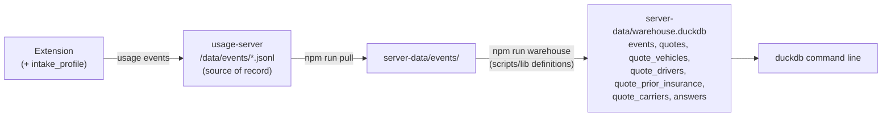

# Quoting history database

**Status: the warehouse is built, nothing deployed.** It is a DuckDB file on the maintainer's computer, built from the pulled usage log by `npm run warehouse` (#152). The intake profile that fills most of its columns is in pull requests waiting for the privacy text to be approved: the privacy policy and store answers (#147), the server that accepts `intake_profile` (#148), and the extension that sends it (#149). Until that release, the profile columns are empty. This was first written on 2026-10-22 as a proposal for Postgres on Railway; the maintainer chose a local DuckDB file the same day ([where it runs](#where-it-runs)).

Read this when querying the warehouse, changing its tables, or deciding what to add to it. For the usage server, read [hosting](hosting.md); for what each event means, [learning](learning.md).

## What it is for

TNI wants to ask its quoting history business questions:

- which states customers come from;
- which business classes it quotes, how many are new ventures, how many already have a USDOT or MC number;
- what the fleets look like: vehicle and trailer types, years, makes, values, drivers;
- which coverages and limits clients ask for, and which are chosen on each carrier;
- who insured them before, and when those policies expire;
- how all of that moves over time;
- later, what the carriers quoted (premiums);
- which quotes became policies, matched with TNI's CRM by [match codes](#match-codes), so TNI can learn what makes an intake likely to sell.

The usage server already receives part of this, as JSON lines on a Railway volume. `npm run warehouse` turns the pulled copy into tables the maintainer queries in SQL with the DuckDB command line. The rest needs one extension change, the intake profile below.

The database is a copy for analysis. The extension never reads it, the JSONL files stay the source of record, and nothing in it is a bound policy.

## What the log holds today

Every row here is a field the usage server keeps today (`EVENT_FIELDS` in [server/index.mjs](../server/index.mjs)).

| Question | Where it is | What to know |
| --- | --- | --- |
| State | `intake_loaded.state` | The intake's garaging state. ZIP and city are never logged. |
| Business class | `intake_loaded.businessClass` | The intake's business class as written. |
| Vehicle types | `intake_loaded.vehicleTypes` | The distinct types only. A quote with three Semi Trucks and one Pickup Truck lists two types, not four vehicles. |
| Fleet size | `intake_loaded.counts` | Drivers, vehicles and trailers. |
| Coverages requested | `intake_loaded.coverages` | The names of the intake's coverage answers that are Yes (`autoLiability`, `cargo`, `gl`, `reeferBreakdown`, ...). No limits. |
| Carrier, pages, how far | `page_view`, `fill_run`, `page_layout` (`carrier`, `page`, `step`) | The weekly numbers already turn these into done, declined or stopped per quote and carrier ([signals.mjs](../scripts/lib/signals.mjs)). |
| Choice made on the carrier page | `fill_field.shown`, `field_change.to`, `page_layout.selected` | The option text the extension filled, the agent picked, or the page left standing. `finalAnswers` in [learn.mjs](../scripts/lib/learn.mjs) combines them into one answer per question and unit. Typed text is never logged. |
| Why that answer | `fill_field.source`, `standard` | Intake, derived, standard (TNI's), fact or attestation. |
| Who, when, which build | `agent`, `install`, `t`, `receivedAt`, `v`, `channel`, `commit` | `t` is the agent's computer clock; `receivedAt` is the server's. |
| Test runs | `intake_loaded.test`, `intake_marked`, fixture PDFs, `reviews/test-intakes.txt` | Read by `readTestList` and `testSessionsOf` in [signals.mjs](../scripts/lib/signals.mjs). |

Missing today: whether the business has a USDOT or MC number, the 60-day answer, years in business, operations (radius, hazmat, filings, ELD, ...), each vehicle's and trailer's type, year, make and value, drivers' ages and CDLs, the requested limits, the prior insurer, claims, premiums, and whether the client bought.

## The intake profile: what to add

`intakeSummary` in [usage.js](../src/usage.js) was written to say what kind of intake an agent loaded, for fixing rules. Business analysis needs more of the intake. The proposal is a new event, `intake_profile`, built on the agent's computer from the client record by one function next to `intakeSummary`.

The line it draws: **the profile describes the business without names, numbers or addresses.** It keeps no name, identification number, address, contact, date of birth, VIN or plate. Where an identifier matters for analysis, it keeps a fact about it instead: whether a USDOT number was given, not the number; a driver's age, not the date of birth. It is pseudonymous, not anonymous: state, fleet, makes and years in business together can still point to one carrier, for example beside public FMCSA records, and free text can name someone the intake doesn't (a shipper). Treat the database as client data.

Yes/no answers keep three values, as the record does (`yesNo` in [normalize.js](../src/normalize.js)): `true`, `false`, and `null` when the intake left the question unanswered. A blank is missing information, never a No.

### Business

| Profile field | From the record | Kept as |
| --- | --- | --- |
| `dot` | `applicant.dot` | `given` (a valid number), `other` (something else written, such as "Pending") or `blank`. The number is never sent. |
| `mc` | `applicant.mc` | `given`, `other` or `blank`. |
| `dotWithin60Days` | `applicant.mcDotWithin60Days` | Yes/no/null: no DOT/MC yet, will have one within 60 days. |
| `fein` | `applicant.fein` | `given`, `other` or `blank`. |
| `yearsInBusiness` | `applicant.yearsInBusiness` | Whole years, or null. |
| `yearsExperience` | `applicant.yearsExperience` | Years under own authority, or null. |
| `ownerDrives` | `applicant.ownerDrives` | Yes/no/null. |
| `businessClass`, `state` | as today | As on `intake_loaded`. |

A blank DOT box is not "no DOT number", and a filled one is not always a number ("Pending", "Applied for"). Read with `dotWithin60Days`, the cases are: a number given; no number (`blank` or `other`) and will have one within 60 days (a new venture); no number and no answer (unknown).

### Operations

| Profile field | From the record | Kept as |
| --- | --- | --- |
| `whatHaul` | `operations.whatHaul` | The intake's text, redacted with the intake's names and numbers like a label, at most 120 characters. |
| `radiusMiles` | `operations.radiusMiles` | Miles, or null. |
| `vehicleOwnership` | `operations.vehicleOwnership` | The intake's choice. |
| `personalUse`, `usesEld`, `needSr22`, `filingsRequired`, `hazmat`, `hazPlacard`, `movingState`, `teamDriving`, `canadaLoads` | `operations.*` | Yes/no/null each. |
| `eldBrand`, `filingsWhich` | `operations.*` | Redacted text, at most 60 characters. |
| `equipVehicle` | `operations.equipVehicle` | Dollars, or null. |

### Vehicles, trailers, drivers

| Profile field | From the record | Kept as |
| --- | --- | --- |
| `vehicles[]` | `vehicles[]` | Per vehicle: `type`, `year`, `make`, `model` (redacted, at most 40 characters each), `value` in dollars. No VIN. |
| `trailers[]` | `trailers[]` | The same per trailer. |
| `trailerInfo` | `trailerInfo.*` | `ownership`, `hitch`, `interchange` (yes/no/null), `interchangeLimit`, `equipTrailer`. |
| `drivers[]` | `drivers[]` | Per driver: `age` in whole years on the day loaded (from the date of birth, which is not sent), `licenseState`, `cdl` (yes/no/null), `cdlYear`, `excluded`, `maritalStatus` (the intake's choice, or null), `gender` (`MALE` or `FEMALE` as set in the panel, or null). No name or license number. |

Gender is not on the intake form (`NOT_ON_INTAKE` in [schema.js](../src/schema.js)). The record's gender stays null until the agent sets it in the panel, sometimes after Luna flags a first name as more often a woman's, and a driver left unset goes to the carriers as Male, TNI's standard. The profile keeps what the panel holds. A null means "sent as Male by TNI's standard", not that the client said so, and a count of men is mostly a count of that assumption. Marital status is the intake's answer, null when the intake left it blank.

### Coverage, prior insurance, claims

| Profile field | From the record | Kept as |
| --- | --- | --- |
| `coverage` | `coverage.*` | Every answer, limits included: `autoLiability`, `autoLiabLimit`, `cargo`, `cargoLimit`, `cargoDeductible`, `gl`, `hasGl`, `glLimit`, `reeferBreakdown`, `ntl`. |
| `priorInsurance[]` | `priorInsurance[]` | Per policy: `type`, `carrier` (the insurer's name, redacted, at most 60 characters), `limit`, and `expires` as a month (`2026-11`), or `none` when the intake says there was no prior insurance. |
| `hasClaims` | `claims.hasClaims` | Yes/no/null. The claims box and notes are never sent. |

### Left out on purpose

Company and owner names, phone, email, street, city, ZIP, USDOT, MC and FEIN numbers, license numbers, dates of birth, VINs, the license plate, the claims box and Additional Notes text. Adding any of these is a decision for the maintainer, not a default. The email, phone, company name and first owner's name do reach the server, but only to become [match codes](#match-codes): the server stores the codes, never the values.

### Match codes

To learn which quotes became policies, TNI matches each quote with its deal in Bitrix, its CRM. The USDOT number can't be the key: many applications have none. Every application has a contact, so the profile carries the intake's email, phone, company name and first owner's name as written (`contact`). The usage server turns each into a keyed code and stores only the codes (`match`; `matchCodes` in [server/index.mjs](../server/index.mjs)):

- **Normalized first** (`normalizeContact`), so the CRM's spelling of the same client gives the same code: the first email address, lowercased; the first US phone number as its 10 digits (`+1 (555) 010-0199` and `555.010.0199` are one); a company name without punctuation, a leading "The" or a trailing LLC, Inc, Co and the like, `&` read as "and"; an owner's name as its words sorted, without initials, Jr or Sr ("Smith, John A." is "john smith"). Nothing usable is a null code.
- **Keyed**: HMAC-SHA256 with `MATCH_KEY` of the kind and the normalized value. A plain hash wouldn't do: every US phone number can be hashed in minutes, so anyone with the stored file could reverse it. With the key held only in Railway and on the maintainer's computer, a code alone can't be turned back ([hosting](hosting.md)).
- **Never stored as written.** The server replaces `contact` with `match` before writing the event; without `MATCH_KEY` it drops the contact and names it in `dropped`.

On the CRM side, the maintainer computes the same codes from each deal's contact with `matchCodes` and the same key, on their own computer, and joins on any of the four: a client who changed their email still matches by phone. The quotes table has them as `match_email`, `match_phone`, `match_company` and `match_owner`. Only quotes from the release that sends the contact have codes; older ones can still be matched through their intake PDF's SHA-256 (`intake_id`) where the PDF in Bitrix is the same file.

The codes are pseudonymous client data, like the profile: whoever has the key can test a guessed email or phone against them. Keep the key out of the repository, logs and chat.

### When it is sent, and how the server checks it

The panel sends `intake_profile` right after `intake_loaded`, 15 seconds after the agent's last correction in the panel, and when it opens on a saved intake, each time only when the profile changed; one still waiting is sent before the intake is replaced or cleared. The session's last profile wins. Today an agent's correction shows up only as `intake_edit` with the field's path, never the new value; with the profile, a corrected state or class reaches the database.

The server keeps the profile only in its exact shapes, as it does for the run fields: booleans or null where yes/no, whole numbers in a plausible range, `given`/`other`/`blank`, months as `YYYY-MM` from real dates only, lists of at most 50 vehicles, 50 trailers and 50 drivers, text within its length. Text that could identify the client (`ID_LIKE`: an `@`; a date with `/`, `-` or `.` between its parts; seven or more digits, even with spaces, dashes, dots, slashes or brackets between them, as in a phone, SSN, licence or policy number; five digits in a row; a word of eight or more letters and digits mixed, as in a VIN) is refused by the server; the extension replaces such parts with `#` before sending, and the intake's own VINs however spaced, so they never get stored. A limit written as a limit (`LIMIT`: `$1M CSL`, `1000000`, `25/50/25`) is kept as written. Consistency tests check that the extension and the server agree on every field and on both tests, also for real intakes with odd values. The whole event must fit the server's 32 KB limit. The server that accepts the event can be deployed whenever, since accepting collects nothing; the extension that sends it is released after the privacy text is approved and the server is deployed.

Quotes from before that release have no profile. A one-time backfill could build profiles for the older quotes whose intake PDFs TNI still has on the maintainer's computer, matched by fingerprint as `npm run benchmark` matches them, through the same profile function. Those rows would be marked as backfilled.

## Design



Four rules shape it.

1. **The JSONL stays the source of record.** Each run builds the whole file again from the pulled log. The pilot's 33,000 events so far take about 3 seconds. A bug in the warehouse costs a rebuild, never data.
2. **One definition of a quote.** What counts as a quote, a test run, a done quote and a final answer already lives in `scripts/lib`: `quoteSessions` and `loadEvents` ([events.mjs](../scripts/lib/events.mjs)), `readTestList`, `testSessionsOf` and `quoteOutcomes` ([signals.mjs](../scripts/lib/signals.mjs)), `finalAnswers` ([learn.mjs](../scripts/lib/learn.mjs)). The warehouse computes its tables with those functions in Node and writes the rows. Rewriting them in SQL would give the database a second quote count that disagrees with the weekly review.
3. **The database collects nothing itself.** Everything in it came through the usage server as an event. New data, like the profile, is an extension and server change with its own review.
4. **It stays on the maintainer's computer.** It is one file in git-ignored `server-data/`, beside the log it is built from. There is no server, port or password. It holds client data: don't copy, attach or commit it.

### Tables

| Table | One row per | Built from |
| --- | --- | --- |
| `events` | event, once per id | `readEvents`: every line as stored, test runs, the local test page and blank pages included |
| `quotes` | quote | `quoteSessions` and `testSessionsOf`, with the session's `intake_loaded` and its last `intake_profile` |
| `v_quotes` (view) | quote that isn't a test run | `quotes`. Start here. |
| `quote_vehicles` | vehicle or trailer on the profile | `intake_profile.vehicles` and `.trailers` |
| `quote_drivers` | driver on the profile | `intake_profile.drivers` |
| `quote_prior_insurance` | prior policy on the profile | `intake_profile.priorInsurance` |
| `quote_carriers` | quote and carrier it was worked on | `quoteOutcomes` |
| `quote_premiums` | premium a carrier page quoted, each time it changed | `quote_premium` events ([Premiums](#premiums)) |
| `v_quote_premium` (view) | quote and carrier: its last premium, test runs left out | `quote_premiums` |
| `answers` | question and unit a quote answered on a carrier | `finalAnswers` |
| `build_info` | the run that built the file | the commit, whether it had uncommitted changes, the sources, the test-run list, counts, the first and last event |

Every column is defined once, in `TABLES` in [warehouse.mjs](../scripts/lib/warehouse.mjs), with a note the file keeps as its comment. In the command line, `DESCRIBE quotes` lists a table's columns, and `SELECT column_name, comment FROM duckdb_columns() WHERE table_name = 'quotes'` gives the notes.

What to know when reading them:

- **`quotes`** has a column for each single value in the profile: business, operations, the trailer section, requested coverage and claims, named in snake case (`dotWithin60Days` is `dot_within_60_days`). The whole profile is also there as JSON (`profile`).
  - `profile_source` is `event` when the quote has a profile, null when only the summary logged on load exists. `profile_dropped` names fields the usage server left out of that profile as out of shape.
  - State, business class, vehicle types and the counts come from the profile when there is one, else from the summary logged on load. So a quote from before the profile still has them. `requested` is the load summary's coverages answered Yes.
  - A yes/no column is null when the intake left it unanswered, never No. A group the server dropped leaves its columns null: missing, not No.
- **`quote_carriers.outcome`** is `done`, `declined` or `stopped`, as the weekly numbers read it (done first). `last_page` is where the quote was last seen on that carrier.
- **`answers.answered_by`** is `autofill`, `agent`, `page` (the page's own answer left standing), or null when no answer was seen: a question left to the agent that the recorder never saw answered.
- **`answers.rule_source`** is where autofill's answer came from: `intake`, `derived`, `standard` (TNI's), `fact` or `attestation`. It stays when the agent then changed the answer (`corrected`), so "TNI standards agents correct" is one query. Builds from before `source` was logged leave it null.
- **`answers.value`** is the option picked. Typed text is never logged, so it is null there, and `matches_intake` names the intake fields a typed value matched. `question` is the learner's key, which survives Progressive renumbering its questions; `label` is the question's text as logged.
- **`events.body`** is the event as JSON: `body->>'state'`.

### Coverage questions (not built)

Each carrier asks for the same coverage in its own words and keys. GEICO keys its coverage lists by caption (`cov:liability coverage`) or by coverage and row (`cov:COMP#2`), Progressive by data-model name on `CoveragesRates`, AmWINS by label on its Coverages step. A map from the carrier's question to one TNI name would turn those into comparable rows.

```sql
-- Written in code (proposed: scripts/lib/warehouse-coverages.mjs), checked by tests, loaded each run.
CREATE TABLE coverage_questions (
  carrier   VARCHAR,
  question  VARCHAR,                        -- answers.question
  coverage  VARCHAR,                        -- auto_liability, cargo_limit, cargo_deductible, gl_limit,
                                            -- um_uim, comp_deductible, collision_deductible, medical_payments,
                                            -- pip, rental, road_service, pay_plan, ...
  PRIMARY KEY (carrier, question)
);

CREATE VIEW coverage_choices AS
SELECT q.session, q.started_at, q.state, q.business_class, a.carrier, c.coverage, a.unit,
       a.value, a.answered_by, a.rule_source, a.corrected
FROM answers a
JOIN coverage_questions c USING (carrier, question)
JOIN v_quotes q USING (session);

-- Questions on a coverage page that the map doesn't name yet: the list to add to it.
CREATE VIEW unmapped_coverage_questions AS
SELECT a.carrier, a.question, min(a.label) AS label, count(DISTINCT a.session) AS quotes
FROM answers a
LEFT JOIN coverage_questions c USING (carrier, question)
WHERE c.coverage IS NULL
  AND (a.page = 'CoveragesRates' OR a.step IN ('Quote & Coverages', 'Coverages'))
GROUP BY 1, 2;
```

The map belongs in code for the same reason the rules do: it is a mapping, it needs review against recorded layouts, and a test catches a broken entry. Matching labels in SQL would quietly merge or split questions when a carrier rewords one. Until it exists, read coverage answers by their page, as the example below does.

## Where it runs

The first version of this document put the tables in Postgres on Railway. The maintainer chose a DuckDB file on their own computer instead (2026-10-22):

- There is nothing to provision, pay for or secure: no database service, no public endpoint through Railway's TCP proxy, no roles or passwords to keep out of logs.
- It runs where the log is pulled and the test-run list lives, with the same commit's definitions as the review scripts.
- The tables and queries are the same. DuckDB reads the SQL in this document as written: `FILTER`, `percentile_cont`, `date_trunc`, JSON's `->>`.

It gives up two things. One person on one computer reads it, and its numbers are as fresh as the last `npm run pull`. If several people need to query the history, or a reporting tool online needs it, move to Postgres then. `warehouseRows` stays as it is; only `writeWarehouse` changes. The move needs:

- a `pg` writer;
- a Postgres service in the Railway project;
- a role that loads and a role that only reads the derived tables;
- the connection string kept out of the repository and logs, as the admin token is.

Having the server write each event to the database on receipt is possible only after that move.

### The command

```bash
npm run pull
npm run warehouse
```

`npm run warehouse` reads `server-data/` and writes `server-data/warehouse.duckdb`. From a git worktree, which has no `reviews/`, pass the main checkout's list:

```bash
node scripts/warehouse.mjs server-data --tests <main checkout>/reviews/test-intakes.txt --out <file>
```

- It reads the server folder, exported logs or both, as the review scripts do ([warehouse.mjs](../scripts/warehouse.mjs)).
- It builds a new file beside the old one (`warehouse.duckdb.building`) and swaps it in only once it is whole. A failed build leaves the old file.
- It refuses to run without a test-run list: `--tests <file>`, or `reviews/test-intakes.txt` in the checkout, which may be empty. The review only warns; a database people query for months should not count the maintainer's test quotes as clients. The fixture PDFs' fingerprints are added, as in the review.
- It prints counts only (events, quotes, test runs, rows per table) and the commit. It prints no client value.
- It replaces the file on every run. Keep your own queries in `.sql` files, not as views inside the file. Close the file in the command line before a rebuild: Windows won't replace a file another program has open.

## Setting it up

1. `npm ci` installs `@duckdb/node-api`, pinned as a development dependency. The extension and the server image don't use it.
2. Install the command line to query the file: `winget install DuckDB.cli` on Windows, `brew install duckdb` on a Mac. Use the same version as `@duckdb/node-api` in `package.json` (1.5.6) or newer: an older command line may not open a file a newer library wrote.
3. Open it with `duckdb -readonly server-data/warehouse.duckdb`. `-readonly` keeps a query from changing the file. `.tables` lists the tables, `.mode line` shows one value per line, `.quit` leaves.
4. Backups: the file can be rebuilt. The copy to back up is the usage server's `usage-data` volume ([hosting](hosting.md)), the only full copy of the log.

## Example SQL

`test/warehouse.test.mjs` runs every block in this section against a warehouse built from synthetic events, so a renamed column fails the tests.

Where customers come from, by month. `intakes` counts distinct PDFs, so a client re-quoted from the same PDF counts once.

```sql
SELECT date_trunc('month', started_at)::date AS month,
       coalesce(state, '(none)') AS state,
       count(*) AS quotes,
       count(DISTINCT intake_id) AS intakes
FROM v_quotes
GROUP BY 1, 2
ORDER BY 1, 3 DESC;
```

Business classes, and how many are new ventures or already have their authority:

```sql
SELECT lower(trim(business_class)) AS business_class,
       count(*) AS quotes,
       count(*) FILTER (WHERE dot = 'given') AS dot_given,
       count(*) FILTER (WHERE mc = 'given') AS mc_given,
       count(*) FILTER (WHERE dot <> 'given' AND dot_within_60_days) AS new_venture,
       count(*) FILTER (WHERE dot <> 'given' AND dot_within_60_days IS NULL) AS dot_unknown,
       percentile_cont(0.5) WITHIN GROUP (ORDER BY years_in_business) AS median_years
FROM v_quotes
WHERE profile_source IS NOT NULL
GROUP BY 1
ORDER BY 2 DESC;
```

The fleet: vehicles by type and make, with their age and value.

```sql
SELECT v.kind, v.type, v.make,
       count(*) AS units,
       count(DISTINCT v.session) AS quotes,
       round(avg(extract(year FROM q.started_at) - v.year)) AS avg_age_years,
       percentile_cont(0.5) WITHIN GROUP (ORDER BY v.value) AS median_value
FROM quote_vehicles v
JOIN v_quotes q USING (session)
GROUP BY 1, 2, 3
HAVING count(*) >= 3
ORDER BY 1, 4 DESC;
```

Drivers: age bands, CDLs, marital status and gender by state. The gender columns keep "set" and "not set" apart, since a driver not set went to the carriers as Male by TNI's standard.

```sql
SELECT q.state,
       CASE WHEN d.age < 25 THEN 'under 25' WHEN d.age < 35 THEN '25-34'
            WHEN d.age < 55 THEN '35-54' WHEN d.age IS NOT NULL THEN '55+' ELSE 'unknown' END AS age_band,
       count(*) AS drivers,
       count(*) FILTER (WHERE d.cdl) AS with_cdl,
       count(*) FILTER (WHERE d.excluded) AS excluded,
       count(*) FILTER (WHERE lower(d.marital_status) LIKE 'married%') AS married,
       count(*) FILTER (WHERE d.marital_status IS NULL) AS marital_blank,
       count(*) FILTER (WHERE d.gender = 'FEMALE') AS set_female,
       count(*) FILTER (WHERE d.gender = 'MALE') AS set_male,
       count(*) FILTER (WHERE d.gender IS NULL) AS gender_not_set
FROM quote_drivers d
JOIN v_quotes q USING (session)
GROUP BY 1, 2
ORDER BY 1, 2;
```

Who insured them before, and when those policies expire: a renewal calendar by insurer.

```sql
SELECT p.expires, lower(trim(p.insurer)) AS prior_insurer, count(DISTINCT p.session) AS quotes
FROM quote_prior_insurance p
JOIN v_quotes q USING (session)
WHERE p.expires <> 'none'
GROUP BY 1, 2
ORDER BY 1, 3 DESC;
```

Coverages and limits requested on the intake, by state:

```sql
SELECT state, auto_liab_limit, gl_limit, cargo_limit, count(*) AS quotes
FROM v_quotes
WHERE profile_source IS NOT NULL
GROUP BY 1, 2, 3, 4
ORDER BY 1, 5 DESC;
```

What was chosen on each carrier's coverage page, split by who chose it. Read the split before the total. A limit that is a TNI standard (GEICO's $100,000 uninsured motorist limit, for one) tops the list because TNI chose it, not because clients asked for it. Until the coverage map exists, a question is its carrier's key, with its label beside it.

```sql
SELECT a.carrier, a.question, min(a.label) AS label, a.value AS chosen,
       count(DISTINCT a.session) AS quotes,
       count(DISTINCT a.session) FILTER (WHERE a.answered_by = 'autofill' AND a.rule_source IN ('intake', 'derived')) AS from_intake,
       count(DISTINCT a.session) FILTER (WHERE a.answered_by = 'autofill' AND a.rule_source = 'standard') AS tni_standard,
       count(DISTINCT a.session) FILTER (WHERE a.answered_by = 'agent') AS agent_picked,
       count(DISTINCT a.session) FILTER (WHERE a.answered_by = 'agent' AND a.corrected) AS agent_corrected,
       count(DISTINCT a.session) FILTER (WHERE a.answered_by = 'page') AS carrier_default_left
FROM answers a
JOIN v_quotes q USING (session)
WHERE a.page = 'CoveragesRates' OR a.step IN ('Quote & Coverages', 'Coverages')
GROUP BY a.carrier, a.question, a.value
ORDER BY 1, 2, 5 DESC;
```

Quotes per carrier per week, and how they ended. Hazmat haulers apart, since carriers decline them more:

```sql
SELECT date_trunc('week', q.started_at)::date AS week,
       qc.carrier,
       q.hazmat AS hazmat,
       count(*) AS quotes,
       count(*) FILTER (WHERE qc.outcome = 'done') AS done,
       count(*) FILTER (WHERE qc.outcome = 'declined') AS declined
FROM v_quotes q
JOIN quote_carriers qc USING (session)
GROUP BY 1, 2, 3
ORDER BY 1, 2, 3;
```

A question the derived tables don't answer yet can go to the raw events. This one counts PDFs loaded per state. It includes test runs and PDFs never taken to a carrier, which is why the derived tables exist.

```sql
SELECT body->>'state' AS state, count(DISTINCT intake_id) AS pdfs_loaded
FROM events
WHERE type = 'intake_loaded'
GROUP BY 1
ORDER BY 2 DESC;
```

Which build of the definitions made the file, and from what:

```sql
SELECT built_at, commit, dirty, events, quotes, test_quotes, test_list, first_event, last_event
FROM build_info;
```

## Premiums

The panel logs the premium a carrier page quotes as a `quote_premium` event ([premium.js](../src/premium.js)). Each time it reads a page's layout (`captureLayout`: after a fill, and as the agent changes the page), on the pages where a carrier quotes its premium (`premiumHere`: GEICO's Quote & Coverages, Progressive's CoveragesRates) it reads the page's text and, when a current premium is shown and differs from the last one logged for that quote, tab and carrier, logs it. Stop steps (GEICO's Final Quote Details, MVR & CLUE, Payment Information) are never read. Nothing about the client is in it.

| Field | Shape |
| --- | --- |
| `carrier`, `page`, `view`, `step` | As on fill events (`step` only on one-address carriers). |
| `total` | The premium for the term, dollars, above 0 and below 100,000,000. |
| `termMonths` | 12 for a year, 6 for six months; null when the page doesn't say. |
| `dueToday`, `payments`, `payment` | GEICO's down payment for the plan picked, the payments after today and each one; null elsewhere. |

The wording read: GEICO's "12 Month Total Premium: $… Due Today $… 10 Additional Payments of $…", Progressive's "Total premium amount $… per year", else any "total/annual/policy/estimated premium $…" (its term unknown). Nothing is read while the page asks for a recalculation or shows "$ --.--" or "****". Whether AmWINS shows a premium before submission is not known. The server keeps these fields in these shapes, drops anything else, and refuses a reading without its total.

The warehouse has every reading in `quote_premiums`, and the last per quote and carrier, test runs left out, in `v_quote_premium`. **It is a quoted premium, never a bound one:** the carrier's figure on screen, before underwriting (on GEICO before the MVR and CLUE reports). Compare it with the printed quote on a few real quotes per carrier before trusting it.

The whole feature can be removed as one piece: `src/premium.js`, its import and one call in `sidepanel.js` (`captureLayout`), `quote_premium` in `server/index.mjs`, and `quote_premiums` with `v_quote_premium` in [warehouse.mjs](../scripts/lib/warehouse.mjs).

## Limits

- **Only quotes run through the extension.** Quotes typed by hand, other carriers and renewals done elsewhere never reach the log, and the log can't say what share of TNI's business they are. Agents can also turn uploads off, and a computer whose queue fills drops its oldest events (`usage_lost`).
- **One computer, one reader.** The file lives on the maintainer's computer and is as fresh as the last `npm run pull`. Anyone else needs the Postgres route above, not a copy of the file.
- **No ZIPs, cities, names, VINs or numbers, by design.** State is the finest geography. The profile says whether a USDOT or MC number was given, never which. That is not anonymity: a carrier with an unusual fleet in a small state can still be recognised, so the database is client data.
- **The intake's word, not the policy's.** The profile is what the client wrote on the intake, as corrected by the agent in the panel. A vehicle type or limit changed later on the carrier's page shows in `answers`, not in the profile.
- **No profile before its release.** Older quotes have only the summary logged on load, unless the backfill finds their PDFs.
- **No bind or outcome data in the log.** "Done" means the quote reached the carrier's final page or was printed. Whether the client bought, and from which carrier, is in TNI's CRM; the [match codes](#match-codes) are how a quote joins to it, from the release that sends them.
- **A quote is a panel session, not a client.** A client quoted twice is two quotes. The same PDF has the same `intake_id`; a re-saved or edited PDF gets a new one.
- **GEICO is not verified live.** Its step names, coverage keys and the premium wording come from saved pages and the first live runs (2026-10-21). Treat GEICO's numbers as provisional until its coverage map is checked against real quotes.
- **History is uneven.** Older builds sent fewer fields: no `step`, `run` or `source`, no `view` before 0.9.9. Questions asked of early events get blanks, such as a null `rule_source` on most early answers, and `dropped` on an event names fields an older server threw away.
- **Final answers are inferred.** `finalAnswers` takes the last fill, agent change, or the page's pick when the agent left the page. A change the recorder didn't see, or one made after the last layout, is missed. The weekly review shares the same caveat.
- **Gender is mostly an assumption.** The intake doesn't ask it. Unless the agent set it, the carriers got Male by TNI's standard, and the profile says not set.
- **Times are the agent's clock.** `t` comes from the agent's computer; `received_at` is the server's. The command line shows times in the computer's time zone.

## Decisions for the maintainer

1. **Purpose and disclosure.** The [privacy policy](../server/privacy.html) says usage information is kept "to maintain the extension" and that client names, numbers and addresses are not included. The Chrome Web Store's data-usage answers ([store release](chrome-web-store.md)) describe the usage log the same way. Business analysis is a new purpose, and the profile sends intake details the server never had: fleet, drivers' ages, marital status and gender, prior insurer, limits. Gender and marital status are personal attributes; the policy should name them. TNI's compliance owner should update the policy and the store answers before the profile ships, or confirm in writing that they already cover it.
2. **The profile's fields.** The tables above are a starting list. Confirm it, and decide the open ones: `whatHaul` as redacted text, the prior insurer's name, drivers' exact age or a band, expiration by month. Every identifier stays out unless TNI decides otherwise.
3. **Where it runs.** Decided on 2026-10-22: a DuckDB file on the maintainer's computer. Postgres later, if several people need it.
4. **Which tool reads it.** The DuckDB command line for now. A reporting tool on the same computer can open the file; one that runs elsewhere needs Postgres.
5. **Agents' initials.** They are in `quotes.agent` and `events.agent`, as in the log. Nobody but the maintainer reads the file today; decide whether others see initials or only totals before anyone else does.
6. **The backfill.** Whether to build profiles for older quotes from the PDFs on the maintainer's computer.
7. **Premiums:** built (2026-10-22): the total, term and payments, every change kept. Still to do: compare readings with printed quotes per carrier.

## Steps, each its own pull request

The profile goes first: the warehouse can load all history whenever it arrives, but a profile field only exists for quotes after the release that sends it.

1. `intake_profile` (#147, #148, #149):
   - #148: the server's shape checks. It can be deployed whenever, since accepting the event collects nothing; confirm with `node scripts/server-check.mjs`.
   - #147: the privacy policy and store answers (decision 1).
   - #149: the profile function in [usage.js](../src/usage.js) and the panel's sending, released only after #147 is approved and #148 deployed. [learning](learning.md) documents the event.
2. **Built (#152):** the warehouse as a DuckDB file. It brings `npm run warehouse`, its pure transform and tests, the per-quote outcome shared with `signals()`, and `rule_source` kept by `finalAnswers`.
3. The coverage map with its tests, checked against recorded layouts of each carrier's coverage page.
4. Optional: the backfill from local PDFs.
5. Optional: Postgres, if several people need to query the history. Having the server write each event on receipt comes after it.
6. `quote_premium` (built). Deploy the server before releasing the extension.

## Related code

- [warehouse.mjs](../scripts/warehouse.mjs) (the command) and [its lib](../scripts/lib/warehouse.mjs): `TABLES`, `warehouseRows`, `writeWarehouse`.
- [server/index.mjs](../server/index.mjs): what the server keeps (`COMMON`, `EVENT_FIELDS`, `RUN_FIELDS`; `PROFILE` in #148).
- [usage.js](../src/usage.js): `intakeSummary`, `fillEvents`, `fieldChangeEvent`, `redactor`; `intakeProfile` and `ID_LIKE` (#149).
- [schema.js](../src/schema.js), [normalize.js](../src/normalize.js): the client record the profile reads.
- [events.mjs](../scripts/lib/events.mjs), [signals.mjs](../scripts/lib/signals.mjs), [learn.mjs](../scripts/lib/learn.mjs): quotes, test runs, outcomes and final answers.
- [pagekit.js](../src/content/pagekit.js): `premiumReady`, `ratesStale`.
