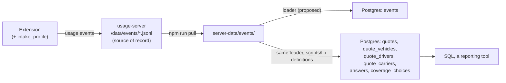

# Quoting history database (proposal)

**Status: proposal, nothing implemented or deployed.** Written 2026-10-22 for the maintainer to review. It changes no extension, server or Railway setting. Each step at the end would be its own pull request, after the decisions listed there are made.

Read this when deciding whether and how TNI keeps its quoting history in Postgres for business analysis. For the usage server as it runs today, read [hosting](hosting.md); for what each event means, [learning](learning.md).

## What it is for

TNI wants to ask its quoting history business questions:

- which states customers come from;
- which business classes it quotes, how many are new ventures, how many already have a USDOT or MC number;
- what the fleets look like: vehicle and trailer types, years, makes, values, drivers;
- which coverages and limits clients ask for, and which are chosen on each carrier;
- who insured them before, and when those policies expire;
- how all of that moves over time;
- later, what the carriers quoted (premiums).

The usage server already receives part of this, as JSON lines on a Railway volume. Reading it today means `npm run pull` and a script. A Postgres copy lets the maintainer, or a reporting tool, answer these questions in SQL. The rest needs one extension change, the intake profile below.

The database is a copy for analysis. The extension never reads it, the JSONL files stay the source of record, and nothing in it is a bound policy.

## What the log holds today

Every row here is a field the usage server keeps today (`EVENT_FIELDS` in [server/index.mjs](../server/index.mjs)).

| Question | Where it is | What to know |
| --- | --- | --- |
| State | `intake_loaded.state` | The intake's garaging state. ZIP and city are never logged. |
| Business class | `intake_loaded.businessClass` | The intake's business class as written. |
| Vehicle types | `intake_loaded.vehicleTypes` | The distinct types only. A quote with three Semi Trucks and one Pickup Truck lists two types, not four vehicles. |
| Fleet size | `intake_loaded.counts` | Drivers, vehicles and trailers. |
| Coverages requested | `intake_loaded.coverages` | The names of the intake's coverage answers that are Yes (`autoLiability`, `cargo`, `gl`, `reeferBreakdown`, ...). No limits. |
| Carrier, pages, how far | `page_view`, `fill_run`, `page_layout` (`carrier`, `page`, `step`) | The weekly numbers already turn these into done, declined or stopped per quote and carrier ([signals.mjs](../scripts/lib/signals.mjs)). |
| Choice made on the carrier page | `fill_field.shown`, `field_change.to`, `page_layout.selected` | The option text the extension filled, the agent picked, or the page left standing. `finalAnswers` in [learn.mjs](../scripts/lib/learn.mjs) combines them into one answer per question and unit. Typed text is never logged. |
| Why that answer | `fill_field.source`, `standard` | Intake, derived, standard (TNI's), fact or attestation. |
| Who, when, which build | `agent`, `install`, `t`, `receivedAt`, `v`, `channel`, `commit` | `t` is the agent's computer clock; `receivedAt` is the server's. |
| Test runs | `intake_loaded.test`, `intake_marked`, fixture PDFs, `reviews/test-intakes.txt` | Read by `readTestList` and `testSessionsOf` in [signals.mjs](../scripts/lib/signals.mjs). |

Missing today: whether the business has a USDOT or MC number, the 60-day answer, years in business, operations (radius, hazmat, filings, ELD, ...), each vehicle's and trailer's type, year, make and value, drivers' ages and CDLs, the requested limits, the prior insurer, claims, premiums, and whether the client bought.

## The intake profile: what to add

`intakeSummary` in [usage.js](../src/usage.js) was written to say what kind of intake an agent loaded, for fixing rules. Business analysis needs more of the intake. The proposal is a new event, `intake_profile`, built on the agent's computer from the client record by one function next to `intakeSummary`.

The line it draws: **the profile describes the business, never identifies it.** It keeps no name, number, address, contact, date of birth, VIN or plate. Where an identifier matters for analysis, it keeps a fact about it instead: whether a USDOT number was given, not the number; a driver's age, not the date of birth.

Yes/no answers keep three values, as the record does (`yesNo` in [normalize.js](../src/normalize.js)): `true`, `false`, and `null` when the intake left the question unanswered. A blank is missing information, never a No.

### Business

| Profile field | From the record | Kept as |
| --- | --- | --- |
| `dot` | `applicant.dot` | `given` or `blank`. The number is never sent. |
| `mc` | `applicant.mc` | `given` or `blank`. |
| `dotWithin60Days` | `applicant.mcDotWithin60Days` | Yes/no/null: no DOT/MC yet, will have one within 60 days. |
| `fein` | `applicant.fein` | `given` or `blank`. |
| `yearsInBusiness` | `applicant.yearsInBusiness` | Whole years, or null. |
| `yearsExperience` | `applicant.yearsExperience` | Years under own authority, or null. |
| `ownerDrives` | `applicant.ownerDrives` | Yes/no/null. |
| `businessClass`, `state` | as today | As on `intake_loaded`. |

A blank DOT box is not "no DOT number". Read with `dotWithin60Days`, the three cases are: number given; blank and will have one within 60 days (a new venture); blank with no answer (unknown).

### Operations

| Profile field | From the record | Kept as |
| --- | --- | --- |
| `whatHaul` | `operations.whatHaul` | The intake's text, redacted with the intake's names and numbers like a label, at most 120 characters. |
| `radiusMiles` | `operations.radiusMiles` | Miles, or null. |
| `vehicleOwnership` | `operations.vehicleOwnership` | The intake's choice. |
| `personalUse`, `usesEld`, `needSr22`, `filingsRequired`, `hazmat`, `hazPlacard`, `movingState`, `teamDriving`, `canadaLoads` | `operations.*` | Yes/no/null each. |
| `eldBrand`, `filingsWhich` | `operations.*` | Redacted text, at most 60 characters. |
| `equipVehicle` | `operations.equipVehicle` | Dollars, or null. |

### Vehicles, trailers, drivers

| Profile field | From the record | Kept as |
| --- | --- | --- |
| `vehicles[]` | `vehicles[]` | Per vehicle: `type`, `year`, `make`, `model` (redacted, at most 40 characters each), `value` in dollars. No VIN. |
| `trailers[]` | `trailers[]` | The same per trailer. |
| `trailerInfo` | `trailerInfo.*` | `ownership`, `hitch`, `interchange` (yes/no/null), `interchangeLimit`, `equipTrailer`. |
| `drivers[]` | `drivers[]` | Per driver: `age` in whole years on the day loaded (from the date of birth, which is not sent), `licenseState`, `cdl` (yes/no/null), `cdlYear`, `excluded`. No name or license number. |

### Coverage, prior insurance, claims

| Profile field | From the record | Kept as |
| --- | --- | --- |
| `coverage` | `coverage.*` | Every answer, limits included: `autoLiability`, `autoLiabLimit`, `cargo`, `cargoLimit`, `cargoDeductible`, `gl`, `hasGl`, `glLimit`, `reeferBreakdown`, `ntl`. |
| `priorInsurance[]` | `priorInsurance[]` | Per policy: `type`, `carrier` (the insurer's name, redacted, at most 60 characters), `limit`, and `expires` as a month (`2026-11`), or `none` when the intake says there was no prior insurance. |
| `hasClaims` | `claims.hasClaims` | Yes/no/null. The claims box and notes are never sent. |

### Left out on purpose

Company and owner names, phone, email, street, city, ZIP, USDOT, MC and FEIN numbers, license numbers, dates of birth, VINs, the license plate, the claims box and Additional Notes text. Driver gender and marital status are left out too: they are personal, and no business question above needs them. Adding any of these is a decision for the maintainer, not a default.

### When it is sent, and how the server checks it

The panel sends `intake_profile` right after `intake_loaded`, and again after the agent corrects the intake in the panel, at most once a minute. The session's last profile wins. Today an agent's correction shows up only as `intake_edit` with the field's path, never the new value; with the profile, a corrected state or class reaches the database.

The server keeps the profile only in its exact shapes, as it does for the run fields: booleans or null where yes/no, whole numbers in a plausible range, `given`/`blank`, months as `YYYY-MM`, lists of at most 50 vehicles, 50 trailers and 50 drivers, text within its length. Any text holding five or more digits in a row, an `@` or a date is dropped, the test the extension already uses to keep typed values out of choice events (`LOOKS_TYPED` in [usage.js](../src/usage.js)), so a VIN, phone or email that slipped into a make or an insurer's name never gets stored. The whole event must fit the server's 32 KB limit. Following [hosting](hosting.md), the server that accepts the event deploys before the extension that sends it.

Quotes from before that release have no profile. A one-time backfill could build profiles for the older quotes whose intake PDFs TNI still has on the maintainer's computer, matched by fingerprint as `npm run benchmark` matches them, through the same profile function. Those rows would be marked as backfilled.

## Design



Three rules shape it.

1. **The JSONL stays the source of record.** Postgres can be dropped and rebuilt from the files at any time. A bug in the loader costs a reload, never data.
2. **One definition of a quote.** What counts as a quote, a test run, a done quote and a final answer already lives in `scripts/lib`: `quoteSessions` and `loadEvents` ([events.mjs](../scripts/lib/events.mjs)), `readTestList` and `testSessionsOf` ([signals.mjs](../scripts/lib/signals.mjs)), `finalAnswers` ([learn.mjs](../scripts/lib/learn.mjs)). The loader computes the derived tables with those functions in Node and writes the rows. Rewriting them in SQL would give the database a second quote count that disagrees with the weekly review.
3. **The database collects nothing itself.** Everything in it came through the usage server as an event. New data, like the profile, is an extension and server change with its own review.

### Raw events

```sql
-- Every event the usage server stored, one row per event id.
CREATE TABLE events (
  id           text PRIMARY KEY,
  t            timestamptz NOT NULL,   -- logged, by the agent's computer clock
  received_at  timestamptz,            -- stored by the usage server (receivedAt)
  type         text NOT NULL,
  session      text,                   -- one intake loaded in the panel
  intake_id    text,                   -- SHA-256 of the intake PDF
  carrier      text,
  page         text,
  agent        text,                   -- the agent's initials
  install      text,
  version      text,                   -- v
  body         jsonb NOT NULL          -- the JSONL line as stored
);
CREATE INDEX events_session ON events (session);
CREATE INDEX events_type_t ON events (type, t);
CREATE INDEX events_intake ON events (intake_id);
```

Loading is idempotent by event id:

```sql
INSERT INTO events (id, t, received_at, type, session, intake_id, carrier, page, agent, install, version, body)
VALUES ($1, $2, ...)
ON CONFLICT (id) DO NOTHING;
```

The server already refuses a second copy of an id, so each id is in the files once. `ON CONFLICT` covers a loader run twice over the same days. `events` keeps lines exactly as stored, the local test page's and `blank` pages' too. The derived tables go through `loadEvents`, which skips those and merges `-Reload` pages, as every review does.

### Derived tables

The loader rebuilds these from the whole history on every run, in one transaction (`TRUNCATE`, then insert). At pilot volume that takes seconds. If it ever doesn't, rebuild only the sessions with new events.

```sql
-- One row per quote: an intake loaded in a session that worked on a carrier's page (quoteSessions).
-- Profile columns come from the session's last intake_profile; null on quotes without one.
CREATE TABLE quotes (
  session            text PRIMARY KEY,
  intake_id          text NOT NULL,
  agent              text,
  install            text,
  started_at         timestamptz NOT NULL,  -- the session's intake_loaded
  last_at            timestamptz NOT NULL,  -- its last event
  version            text,
  channel            text,
  is_test            boolean NOT NULL,      -- testSessionsOf
  profile_source     text,                  -- event, backfill, or null (summary only)
  -- business
  state              text,
  business_class     text,
  dot                text,                  -- given, blank
  mc                 text,
  dot_within_60_days boolean,
  years_in_business  int,
  years_experience   int,
  owner_drives       boolean,
  -- operations
  what_haul          text,
  radius_miles       int,
  vehicle_ownership  text,
  personal_use       boolean,
  uses_eld           boolean,
  eld_brand          text,
  needs_sr22         boolean,
  filings_required   boolean,
  hazmat             boolean,
  haz_placard        boolean,
  team_driving       boolean,
  canada_loads       boolean,
  -- fleet
  vehicle_types      text[] NOT NULL,       -- distinct types (also on quotes without a profile)
  drivers            int,
  vehicles           int,
  trailers           int,
  -- requested coverage
  requested          text[] NOT NULL,       -- intake_loaded.coverages
  auto_liab_limit    text,
  cargo_limit        numeric,
  cargo_deductible   numeric,
  gl_limit           text,
  has_claims         boolean,
  profile            jsonb                  -- the whole profile, for fields without a column
);

-- One row per vehicle or trailer on the intake.
CREATE TABLE quote_vehicles (
  session  text REFERENCES quotes,
  kind     text,                            -- vehicle, trailer
  n        int,                             -- its order on the intake
  type     text,
  year     int,
  make     text,
  model    text,
  value    numeric,
  PRIMARY KEY (session, kind, n)
);

-- One row per driver on the intake.
CREATE TABLE quote_drivers (
  session        text REFERENCES quotes,
  n              int,
  age            int,
  license_state  text,
  cdl            boolean,
  cdl_year       int,
  excluded       boolean,
  PRIMARY KEY (session, n)
);

-- One row per prior policy on the intake.
CREATE TABLE quote_prior_insurance (
  session  text REFERENCES quotes,
  n        int,
  type     text,
  carrier  text,
  "limit"  text,
  expires  text,                            -- YYYY-MM, or none
  PRIMARY KEY (session, n)
);

-- One row per quote and carrier it was worked on.
CREATE TABLE quote_carriers (
  session    text REFERENCES quotes,
  carrier    text,
  first_at   timestamptz,
  last_at    timestamptz,
  last_page  text,                          -- page, or "page › step" on AmWINS and GEICO
  done       boolean,                       -- reached the carrier's final page or printed (FINAL, FINAL_CLICK)
  declined   boolean,                       -- a stop: blocker on a page that isn't final
  logins     int,                           -- the carrier's login came up mid-quote
  PRIMARY KEY (session, carrier)
);

-- One row per question and unit a quote answered on a carrier (finalAnswers).
CREATE TABLE answers (
  session        text REFERENCES quotes,
  carrier        text,
  question       text,                      -- the learner's key: carrier|page|ref:<name>, or its text on its page
  unit           text,                      -- vehicle, driver or trailer and row; '' for the quote
  page           text,
  step           text,
  label          text,                      -- question text, redacted as logged
  control_kind   text,
  value          text,                      -- the option picked; null for typed text, which is never logged
  answered_by    text,                      -- autofill, agent, page (the page's own answer left standing)
  rule_source    text,                      -- intake, derived, standard, fact, attestation
  corrected      boolean,                   -- the agent changed an autofilled answer
  left_to_agent  boolean,
  PRIMARY KEY (session, carrier, question, unit)
);
```

Two small code changes come with the loader. `quote_carriers` needs the per-quote outcome that `signals()` computes inside itself; it would move to an exported function that both use. `answers.rule_source` needs `fill_field.source`, which `finalAnswers` reads past today; it would keep it.

### Coverage questions

Each carrier asks for the same coverage in its own words and keys. GEICO keys its coverage lists by caption (`cov:liability coverage`) or by coverage and row (`cov:COMP#2`), Progressive by data-model name on `CoveragesRates`, AmWINS by label on its Coverages step. A map from the carrier's question to one TNI name turns those into comparable rows.

```sql
-- Written in code (proposed: scripts/lib/warehouse-coverages.mjs), checked by tests, loaded each run.
CREATE TABLE coverage_questions (
  carrier   text,
  question  text,                           -- answers.question
  coverage  text,                           -- auto_liability, cargo_limit, cargo_deductible, gl_limit,
                                            -- um_uim, comp_deductible, collision_deductible, medical_payments,
                                            -- pip, rental, road_service, pay_plan, ...
  PRIMARY KEY (carrier, question)
);

CREATE VIEW coverage_choices AS
SELECT q.session, q.started_at, q.state, q.business_class, a.carrier, c.coverage, a.unit,
       a.value, a.answered_by, a.rule_source, a.corrected
FROM answers a
JOIN coverage_questions c USING (carrier, question)
JOIN quotes q USING (session)
WHERE NOT q.is_test;

-- Questions on a coverage page that the map doesn't name yet: the list to add to it.
CREATE VIEW unmapped_coverage_questions AS
SELECT a.carrier, a.question, min(a.label) AS label, count(DISTINCT a.session) AS quotes
FROM answers a
LEFT JOIN coverage_questions c USING (carrier, question)
WHERE c.coverage IS NULL
  AND (a.page = 'CoveragesRates' OR a.step IN ('Quote & Coverages', 'Coverages'))
GROUP BY 1, 2;
```

The map belongs in code for the same reason the rules do: it is a mapping, it needs review against recorded layouts, and a test catches a broken entry. Matching labels in SQL would quietly merge or split questions when a carrier rewords one.

### Analysis views and the load log

```sql
CREATE VIEW v_quotes AS SELECT * FROM quotes WHERE NOT is_test;

-- One row per loader run: which commit's definitions built the derived tables.
CREATE TABLE load_runs (
  started_at   timestamptz PRIMARY KEY,
  finished_at  timestamptz,
  commit       text,
  events_read  int,
  events_new   int,
  quotes       int,
  test_list    text                        -- the test-run list it read, or null
);
```

## How events get in

| | A. Loader from the JSONL | B. Server writes on receipt | C. Railway cron loader |
| --- | --- | --- | --- |
| Runs | On the maintainer's computer after `npm run pull` (with `npm run daily`) | Inside `usage-server`, after it appends to the day's file | A second Railway service on a schedule, reading `/v1/export` over the private network |
| Delay | Until the next pull, about a day | Seconds | The schedule |
| Server change | None | `pg` becomes the server's first dependency; a database outage must not fail an upload | None |
| Database reachable from the internet | Yes, through Railway's TCP proxy | No | No |
| Test-run list | The main checkout's `reviews/test-intakes.txt` | Not available on the server | Needs a copy in Railway |

I recommend **A** first. It changes nothing on the ingest path agents depend on, and it reuses the files and the test-run list the daily review already has. It also runs where the review runs, so the derived tables follow the same commit's definitions. A day's delay doesn't matter for monthly business questions.

**B** is worth it only if someone needs live numbers. If chosen: the JSONL append stays first and decides the reply; the Postgres insert follows, and if it fails the server logs one line without the event or the connection string, and loader A fills the gap on its next run. The derived tables would still come from loader A, since the server has no test-run list.

**C** is the choice if TNI wants no public database endpoint and the reporting tool also runs inside Railway. The test-run fingerprints would then live in a Railway variable or a small table.

### The loader (proposed)

- `scripts/warehouse.mjs`, run as `npm run warehouse` once it exists, after `npm run pull`.
- Reads `server-data/events/`, inserts new events in batches, rebuilds the derived tables, writes a `load_runs` row.
- Refuses to run without a test-run list (`--tests <file>`, or the main checkout's `reviews/test-intakes.txt`). The review only warns; a database that people query for months should not count the maintainer's test quotes as clients.
- The step from events to rows is a pure function, tested by `npm test` on synthetic events with no database. Writing to Postgres is tested by hand against a local Postgres.
- `pg` is added as a dev dependency, for the script only. The extension and the server image don't change.
- It never prints the connection string or password. A connection error says which variable or file it read.

## Provisioning on Railway

The maintainer does this in the dashboard; nothing here does it. Railway's menus as of 2026-10; check them in the dashboard.

1. In project `tni-rater-autofill`, add a PostgreSQL database (**New → Database → PostgreSQL**). It becomes its own service with its own volume. Railway sets its variables: `DATABASE_URL` for the private network (`postgres.railway.internal`), `DATABASE_PUBLIC_URL` through a TCP proxy, and `PGPASSWORD` with the rest. Leave `usage-server` unchanged unless option B is chosen; then give it `DATABASE_URL=${{Postgres.DATABASE_URL}}` as a reference variable, so the password is never copied by hand.
2. Create two roles with their own generated passwords. The superuser's password stays in Railway only.
   - `tni_loader`: inserts into `events`, rebuilds the derived tables.
   - `tni_analyst`: `SELECT` on the derived tables and views. Not on `events`, which also holds problem reports in agents' own words and AI decisions that business analysis doesn't need.
3. Keep credentials where the admin token already lives. The loader's URL goes in an environment variable (`TNI_WAREHOUSE_URL`) or in `~/.config/tni-rater/warehouse-url` on the maintainer's computer. Nothing goes in the repository, a committed `.env`, a pull request, an issue or a log.
4. For option A the database is reachable through the TCP proxy. Connect with `sslmode=require`, and confirm the template serves TLS before relying on it. With options B or C and a reporting tool inside Railway, remove the TCP proxy (the service's **Settings → Networking**) so the database has no public address.
5. Backups. The database can be rebuilt from the JSONL, so the volume to back up is `usage-data`, not Postgres. Check Railway's volume backups for it either way.
6. Cost is usage-based. `/v1/days` (admin token) gives the size of each day's file; the whole history today is small enough for the smallest instance, but check it before choosing.

Once it exists, [hosting](hosting.md) gets a row for the database service and its variables, in the same pull request as the loader.

## Example SQL

Where customers come from, by month. `intakes` counts distinct PDFs, so a client re-quoted from the same PDF counts once.

```sql
SELECT date_trunc('month', started_at)::date AS month,
       coalesce(state, '(none)') AS state,
       count(*) AS quotes,
       count(DISTINCT intake_id) AS intakes
FROM v_quotes
GROUP BY 1, 2
ORDER BY 1, 3 DESC;
```

Business classes, and how many are new ventures or already have their authority:

```sql
SELECT lower(trim(business_class)) AS business_class,
       count(*) AS quotes,
       count(*) FILTER (WHERE dot = 'given') AS dot_given,
       count(*) FILTER (WHERE mc = 'given') AS mc_given,
       count(*) FILTER (WHERE dot = 'blank' AND dot_within_60_days) AS new_venture,
       count(*) FILTER (WHERE dot = 'blank' AND dot_within_60_days IS NULL) AS dot_unknown,
       percentile_cont(0.5) WITHIN GROUP (ORDER BY years_in_business) AS median_years
FROM v_quotes
WHERE profile_source IS NOT NULL
GROUP BY 1
ORDER BY 2 DESC;
```

The fleet: vehicles by type and make, with their age and value.

```sql
SELECT v.kind, v.type, v.make,
       count(*) AS units,
       count(DISTINCT v.session) AS quotes,
       round(avg(extract(year FROM q.started_at) - v.year)) AS avg_age_years,
       percentile_cont(0.5) WITHIN GROUP (ORDER BY v.value) AS median_value
FROM quote_vehicles v
JOIN v_quotes q USING (session)
GROUP BY 1, 2, 3
HAVING count(*) >= 3
ORDER BY 1, 4 DESC;
```

Drivers: age bands and CDLs by state.

```sql
SELECT q.state,
       CASE WHEN d.age < 25 THEN 'under 25' WHEN d.age < 35 THEN '25-34'
            WHEN d.age < 55 THEN '35-54' WHEN d.age IS NOT NULL THEN '55+' ELSE 'unknown' END AS age_band,
       count(*) AS drivers,
       count(*) FILTER (WHERE d.cdl) AS with_cdl,
       count(*) FILTER (WHERE d.excluded) AS excluded
FROM quote_drivers d
JOIN v_quotes q USING (session)
GROUP BY 1, 2
ORDER BY 1, 2;
```

Who insured them before, and when those policies expire: a renewal calendar by insurer.

```sql
SELECT p.expires, lower(trim(p.carrier)) AS prior_insurer, count(DISTINCT p.session) AS quotes
FROM quote_prior_insurance p
JOIN v_quotes q USING (session)
WHERE p.expires <> 'none'
GROUP BY 1, 2
ORDER BY 1, 3 DESC;
```

Coverages and limits requested on the intake, by state:

```sql
SELECT state, auto_liab_limit, gl_limit, cargo_limit, count(*) AS quotes
FROM v_quotes
WHERE profile_source IS NOT NULL
GROUP BY 1, 2, 3, 4
ORDER BY 1, 5 DESC;
```

Limits chosen on each carrier, split by who chose them. Read the split before the total. A limit that is a TNI standard (GEICO's $100,000 uninsured motorist limit, for one) tops the list because TNI chose it, not because clients asked for it.

```sql
SELECT carrier, coverage, value AS chosen,
       count(DISTINCT session) AS quotes,
       count(*) FILTER (WHERE answered_by = 'autofill' AND rule_source IN ('intake', 'derived')) AS from_intake,
       count(*) FILTER (WHERE answered_by = 'autofill' AND rule_source = 'standard') AS tni_standard,
       count(*) FILTER (WHERE answered_by = 'agent') AS agent_picked,
       count(*) FILTER (WHERE answered_by = 'page') AS carrier_default_left
FROM coverage_choices
GROUP BY 1, 2, 3
ORDER BY 1, 2, 4 DESC;
```

Quotes per carrier per week, and how they ended. Hazmat haulers apart, since carriers decline them more:

```sql
SELECT date_trunc('week', q.started_at)::date AS week,
       qc.carrier,
       coalesce(q.hazmat, false) AS hazmat,
       count(*) AS quotes,
       count(*) FILTER (WHERE qc.done) AS done,
       count(*) FILTER (WHERE qc.declined) AS declined
FROM v_quotes q
JOIN quote_carriers qc USING (session)
GROUP BY 1, 2, 3
ORDER BY 1, 2, 3;
```

A question the derived tables don't answer yet can go to the raw events, as the loader role. This one counts PDFs loaded per state. It includes test runs and PDFs never taken to a carrier, which is why the derived tables exist.

```sql
SELECT body->>'state' AS state, count(DISTINCT intake_id) AS pdfs_loaded
FROM events
WHERE type = 'intake_loaded'
GROUP BY 1
ORDER BY 2 DESC;
```

## Premiums: a separate, optional step

No event carries a premium today. The fill engine only checks that one is on screen: `premiumReady()` in [pagekit.js](../src/content/pagekit.js) reads the page text for Progressive's "Total premium amount $… per year" and GEICO's "Quote $… Due Today $… Total", and refuses while the page is busy or asks for a recalculation (`ratesStale()`). The result decides whether an action that needs a current premium may run. The amount is never logged.

A `quote_premium` event could carry it:

| Field | Shape |
| --- | --- |
| `carrier`, `page`, `step`, `view`, `run` | As on fill events. |
| `amount` | A number in dollars, greater than 0 and below 10,000,000, at most two decimals. |
| `term` | `annual`, `6 months`, or null when the page doesn't say. |
| `wording` | Which pattern matched: `total premium` (Progressive) or `quote total` (GEICO). |
| `dueToday` | GEICO's Due Today amount, same shape as `amount`, when shown. |

The panel would send it when pagekit reads a current premium on a carrier's rating page, and again each time the amount changes after a Recalculate. The last one before the quote leaves the page is the quote's final quoted premium. GEICO's stop steps (Final Quote Details, MVR & CLUE, Payment Information) stay unlogged as today. The server would keep these fields in exactly these shapes and drop anything else. The loader would add a `quote_premiums` table (session, carrier, amount, term, at, final).

**It is a quoted premium, never a bound one.** It is the carrier's figure on screen at that moment, before underwriting. On GEICO it comes before the MVR and CLUE reports, since TNI stops the quote at Quote & Coverages. A Recalculate or a report can change it, and it is not what the client paid. The tables and reports would call it `quoted_premium`.

With the profile, premiums become comparable across fleets, for example the median quoted premium per power unit by state, class and carrier.

The maintainer decides these before anyone writes the event:

1. **Purpose and disclosure.** See the first decision at the end; premiums are a new kind of data on top of it.
2. **Which figure.** The total for the term only, or also per vehicle, per coverage, the down payment and the installments.
3. **Term.** Keep the term as quoted, or convert six-month premiums to annual for comparison.
4. **Which reading counts.** The last one before the agent leaves the rating page, or the one on screen when the agent prints.
5. **Carriers.** `premiumReady` knows Progressive's and GEICO's wording. Whether AmWINS shows a premium before submission is not known.
6. **A check before trusting it.** The amount comes from a pattern on page text. Compare it with the printed quote for some real quotes on each carrier first, so a Due Today amount is never read as the total.
7. **Retention and readers.** How long premiums are kept, and whether `tni_analyst` sees them per quote or only in totals.

## Limits

- **Only quotes run through the extension.** Quotes typed by hand, other carriers and renewals done elsewhere never reach the log, and the log can't say what share of TNI's business they are. Agents can also turn uploads off, and a computer whose queue fills drops its oldest events (`usage_lost`).
- **No ZIPs, cities, names, VINs or numbers, by design.** State is the finest geography. The profile says whether a USDOT or MC number was given, never which.
- **The intake's word, not the policy's.** The profile is what the client wrote on the intake, as corrected by the agent in the panel. A vehicle type or limit changed later on the carrier's page shows in `answers`, not in the profile.
- **No profile before its release.** Older quotes have only today's summary, unless the backfill finds their PDFs.
- **No bind or outcome data.** "Done" means the quote reached the carrier's final page or was printed. Whether the client bought, and from which carrier, is in TNI's agency system, and the log has no identifier that could join to it.
- **A quote is a panel session, not a client.** A client quoted twice is two quotes. The same PDF has the same `intake_id`; a re-saved or edited PDF gets a new one.
- **GEICO is not verified live.** Its step names, coverage keys and the premium wording come from saved pages and the first live runs (2026-10-21). Treat GEICO's numbers as provisional until its coverage map is checked against real quotes.
- **History is uneven.** Older builds sent fewer fields: no `step`, `run` or `source`, no `view` before 0.9.9. Questions asked of early events get blanks, and `dropped` on an event names fields an older server threw away.
- **Final answers are inferred.** `finalAnswers` takes the last fill, agent change, or the page's pick when the agent left the page. A change the recorder didn't see, or one made after the last layout, is missed. The weekly review shares the same caveat.
- **Times are the agent's clock.** `t` comes from the agent's computer; `received_at` is the server's.

## Decisions for the maintainer

1. **Purpose and disclosure.** The [privacy policy](../server/privacy.html) says usage information is kept "to maintain the extension" and that client names, numbers and addresses are not included. The Chrome Web Store's data-usage answers ([store release](chrome-web-store.md)) describe the usage log the same way. Business analysis is a new purpose, and the profile sends intake details the server never had: fleet, drivers' ages, prior insurer, limits. TNI's compliance owner should update the policy and the store answers before the profile ships, or confirm in writing that they already cover it.
2. **The profile's fields.** The tables above are a starting list. Confirm it, and decide the open ones: `whatHaul` as redacted text, the prior insurer's name, drivers' exact age or a band, expiration by month. Gender, marital status and every identifier stay out unless TNI decides otherwise.
3. **Where the loader runs:** A, B or C. The proposal recommends A.
4. **Which tool reads the database:** `psql` on the maintainer's computer, or a reporting tool. A reporting tool inside the Railway project lets the database stay off the internet (option C).
5. **Agents' initials.** Whether `tni_analyst` sees them, or only totals across agents.
6. **The backfill.** Whether to build profiles for older quotes from the PDFs on the maintainer's computer.
7. **Premiums,** with the decisions in their section, if and when they are wanted.

## Steps, each its own pull request

The profile goes first: the database can load all history whenever it arrives, but a profile field only exists for quotes after the release that sends it.

1. The privacy policy and store answers (decision 1), then `intake_profile`: the server's shape checks and tests, deployed with `node scripts/server-check.mjs`; then the profile function in [usage.js](../src/usage.js) and the panel's sending, with tests, in a release. [learning](learning.md) documents the event.
2. Schema file, the loader with its pure transform and tests, the per-quote outcome shared with `signals()`, `rule_source` kept by `finalAnswers`. [hosting](hosting.md) gets the database service and the loader command; [testing](testing.md) the new tests.
3. The coverage map with its tests, checked against recorded layouts of each carrier's coverage page.
4. Optional: the backfill from local PDFs.
5. Optional: the server writes on receipt (option B).
6. Optional: `quote_premium`, after the premium decisions. Server first, then the extension.

## Related code

- [server/index.mjs](../server/index.mjs): what the server keeps (`COMMON`, `EVENT_FIELDS`, `RUN_FIELDS`).
- [usage.js](../src/usage.js): `intakeSummary`, `fillEvents`, `fieldChangeEvent`, `redactor`, `LOOKS_TYPED`.
- [schema.js](../src/schema.js), [normalize.js](../src/normalize.js): the client record the profile reads.
- [events.mjs](../scripts/lib/events.mjs), [signals.mjs](../scripts/lib/signals.mjs), [learn.mjs](../scripts/lib/learn.mjs): quotes, test runs, outcomes and final answers.
- [pagekit.js](../src/content/pagekit.js): `premiumReady`, `ratesStale`.
